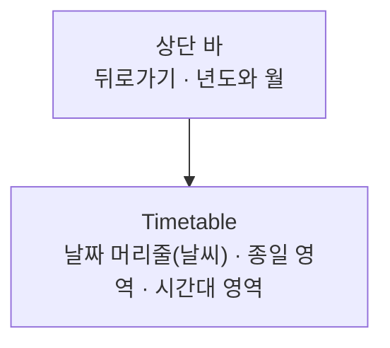

# CalendarTimetable 디자인

기준 스펙: [CalendarTimetable 화면 스펙](../spec/client/calendar-timetable.md), [캘린더 연락처 생일 표시 스펙](../spec/client/calendar-contact-birthday.md)

## 화면 구조

화면 위쪽에는 상단 바를 두고, 그 아래 나머지 영역 전체를 [Timetable 컴포넌트 디자인](timetable.md)으로 채운다.

Timetable은 시스템 내비게이션 바 위에서 끝나므로, 마지막 시간대까지 시스템 바에 가리지 않고 스크롤된다.

## 상단 바

상단 바 왼쪽에는 뒤로가기 버튼을 두고, 그 오른쪽에 표시 중인 날짜의 년도와 월을 제목으로 표시한다. 제목 형식은 [CalendarHome 디자인](calendar-home.md)의 `문구`에 있는 년도와 월 표시와 같다. 주간 형식에서는 그 주 일요일의 년도와 월을 표시한다.

뒤로가기 버튼이나 시스템 뒤로가기를 사용하면 캘린더 홈 화면으로 돌아간다.

## 날씨

날짜별 날씨는 [Timetable 컴포넌트 디자인](timetable.md)의 `날짜 정보`로 각 날짜의 일 아래에 표시한다. 날씨 하나는 [CalendarHome 디자인](calendar-home.md)의 `날씨 아이템`에 있는 `아이콘 영역`, `온도 영역`, `선택 조작`을 그대로 따르며, 그 문서의 날짜 칸은 시간표의 날짜 열이다. 따라서 주간 형식에서는 좁은 날짜 열 안에서 아이콘을 가로로 스크롤하고, 하루 형식에서는 넓은 날짜 열에 더 많은 아이콘을 한 번에 보여 준다.

날씨 위에서 길게 누르면 날씨 선택 대신 [Timetable 컴포넌트 디자인](timetable.md)의 `기간 선택 조작`에 따라 그 날짜 칸에서 날짜 선택을 시작한다.

날씨가 없는 날짜는 날씨 자리를 비워 두고, 날씨가 준비되면 별도 전환 효과 없이 나타난다.

## 종일 메모

종일 아이템으로 놓인 메모는 [CalendarText 컴포넌트 디자인](calendar-text.md)으로 표시하고, 배경에는 메모의 표시 색상을 쓴다.

## 시각 메모 블록

시각 아이템으로 놓인 메모는 차지하는 자리를 채우는 블록으로 표시한다. 여러 날에 걸친 메모는 [Timetable 컴포넌트 디자인](timetable.md)의 `시각 아이템`에 따라 날짜 열마다 나뉜 블록으로 표시하며, 나뉜 블록은 모두 같은 모양으로 메모 제목을 표시한다. 이는 [CalendarHome 디자인](calendar-home.md)에서 여러 주에 걸친 메모의 조각을 모두 같은 형태로 표시하는 것과 같다.

블록은 [공통 스타일](styles.md)의 `캘린더 아이템 모양`을 쓰고, 배경에는 메모의 표시 색상을 쓴다. 블록 안에는 `4dp` 안쪽 여백을 두고 메모 제목을 Material 3의 작은 레이블 글자 스타일로 위쪽부터 표시한다. 제목이 블록에 모두 들어가지 않으면 들어가는 줄까지만 표시하고 마지막 줄 끝을 말줄임표로 줄인다. 글자색은 [CalendarText 컴포넌트 디자인](calendar-text.md)의 색상 규칙처럼 배경색과의 대비에 맞춘다.

## 생일

종일 아이템으로 놓인 생일은 [CalendarHome 디자인](calendar-home.md)의 `생일 아이템`과 같은 글, 배경색, 문구와 접근성 이름으로 표시한다. 같은 날짜에 생일이 여러 개면 기준 스펙의 조회 결과 정렬 순서대로 위에서 아래로 놓는다.

생일은 하나의 클릭 영역으로 제공한다. 누르면 `캘린더 아이템 모양` 안에 물결 효과를 표시하고 스펙의 생일 선택을 실행한다. 화면 낭독 도구에는 그 문서의 생일 아이템 접근성 이름을 가진 버튼으로 알린다.

## 공휴일 이름

종일 아이템으로 놓인 공휴일 이름은 [CalendarText 컴포넌트 디자인](calendar-text.md)으로 표시한다. 배경색은 [CalendarHome 디자인](calendar-home.md)의 `공휴일과 메모 아이템`과 같이 공휴일 여부가 참이면 일요일·공휴일 색상, 거짓이면 공휴일이 아닌 이름의 회색 계열을 쓴다.

공휴일 이름은 하나의 클릭 영역으로 제공한다. 누르면 `캘린더 아이템 모양` 안에 물결 효과를 표시하고 스펙의 공휴일 이름 선택을 실행한다. 화면 낭독 도구에는 공휴일 이름을 이름으로 가진 버튼으로 알린다.

## 메모 선택 조작

시각 메모 블록과 종일 메모는 각각 하나의 클릭 영역으로 제공한다. 여러 날에 걸친 메모의 나뉜 블록도 각각 하나의 클릭 영역이며, 어느 블록을 눌러도 같은 메모를 선택한다. 누르면 `캘린더 아이템 모양` 안에 물결 효과를 표시하고 스펙의 메모 선택을 실행한다.

화면 낭독 도구에는 메모를 메모 제목을 이름으로 가진 버튼으로 알린다. 나뉜 블록도 각각 같은 이름의 버튼으로 알린다.

## 기간 선택

시간표는 [Timetable 컴포넌트 디자인](timetable.md)의 `기간 선택 조작`을 사용한다. 시각 메모 블록, 종일 메모, 생일, 공휴일 이름, 날씨 위에서 길게 누르면 그 자리의 칸에서 선택을 시작한다.

## 키보드 조작

방향키로 옮기는 날짜와 이동 범위를 벗어난 입력의 처리는 기준 스펙의 `방향키로 날짜 이동`을 따른다. 방향키로 옮길 때도 좌우로 넘길 때와 같은 페이지 전환으로 표현한다.

## 불러오는 중과 빈 상태

메모를 불러오는 동안과 메모가 없을 때, 조회에 실패했을 때는 모두 [Timetable 컴포넌트 디자인](timetable.md)의 `빈 시간표`를 그대로 보여 준다. 메모가 준비되면 해당 자리에 나타난다. 날씨를 동기화하는 동안에도 진행 표시를 두지 않는다.

## 문구

상단 바의 접근성 이름은 다음과 같다.

| 문구 | 한국어 | 그 외 기본 |
| --- | --- | --- |
| 뒤로가기 접근성 이름 | `뒤로가기` | `Navigate up` |

## 검색 결과 열기 실패 안내

공휴일 이름이나 날씨를 선택했는데 브라우저를 열지 못하면 화면을 그대로 둔 채 화면 아래쪽에 짧게 보이는 스낵바로 알린다. 스낵바에는 동작 버튼을 두지 않고, 새 안내를 표시할 때 이미 보이는 스낵바가 있으면 즉시 새 안내로 바꾼다. 스낵바는 시스템 탐색 영역을 침범하지 않게 배치한다.

| 문구 | 한국어 | 그 외 기본 |
| --- | --- | --- |
| 검색 결과 열기 실패 안내 | `검색 결과를 열지 못했습니다.` | `Couldn't open the search results.` |
