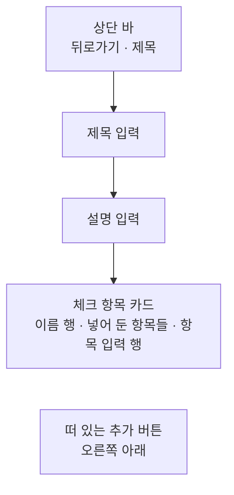

# ChecklistAdd 화면 디자인

기준 스펙: [ChecklistAdd 화면 스펙](../spec/client/checklist-add.md), [Checklist 목록·상세 배치 스펙](../spec/client/checklist-list-detail.md)

화면 구조, 표시 영역과 소프트 키보드, 초점과 단축키, 진행과 피드백은 [항목 추가 화면 공통 디자인](./entity-add.md)을 따른다.

## 화면 구조

ChecklistAdd 화면은 [ChecklistHome 화면](./checklist-home.md)에서 이어지는 세부 화면으로, 창 너비에 따라 단독으로 표시하거나 [Checklist 목록·상세 배치 디자인](./checklist-list-detail.md)에 따라 체크리스트 목록과 함께 상세 영역에 표시한다. 공통 내비게이션 영역은 [TopLevelNavigation 디자인](./top-level-navigation.md)의 `세부 화면에서의 노출`에 따라 숨긴다.

뒤로가기 버튼의 노출 조건은 [목록·상세 배치 공통 디자인](./list-detail-pane.md)의 `버튼 노출`을 따르므로, 단독으로 표시할 때만 뒤로가기 버튼을 둔다.

화면 상단에는 상단 바를 두고, 시작 쪽에 뒤로가기 동작을, 그 바로 뒤에 제목을 시작 쪽에 맞춰 표시한다. 상단 바 끝 쪽에는 동작을 두지 않는다. 체크리스트 추가는 [항목 추가 화면 공통 디자인](./entity-add.md)의 `화면 구조`에 따라 오른쪽 아래의 떠 있는 추가 버튼으로 표시한다.

상단 바 아래 본문에는 위에서부터 제목 입력, 설명 입력, 체크 항목 카드를 차례로 세로로 놓고, 각 요소 사이에 [공통 여백과 간격](./dimens.md)의 `구성요소 간격`을 둔다. 본문 위아래에는 `화면 세로 여백`, 좌우에는 `화면 가로 여백`을 둔다. 세 요소 모두 본문 가로 폭을 모두 사용한다. 이 화면에는 태그 입력을 두지 않는다.

개수에 따라 높이가 변하는 체크 항목 카드를 가장 아래에 두어, 항목을 넣거나 빼도 제목과 설명 입력의 자리가 흔들리지 않게 한다. 이는 [항목 추가 화면 공통 디자인](./entity-add.md)의 `태그 입력의 자리`가 정한 높이가 변하는 입력의 배치 기준과 같다.

본문은 통째로 세로 스크롤한다.

## 제목과 설명 입력

제목 입력의 이름과 표현은 [제목 입력 디자인](./title-input.md)을, 설명 입력의 구성과 표현은 [설명 입력 컴포넌트 디자인](./description-input.md)을 따른다.

## 체크 항목 카드

체크 항목은 하나의 카드에 담아 제목과 설명 입력과 구분한다. 카드의 모양과 색은 카드 컴포넌트의 기본값을 쓴다.

카드 최상단에는 영역 이름 `체크 항목`을 시작 쪽에 둔 이름 행을 두고, 영역 이름 앞에는 [카드 안쪽 여백](./dimens.md)을 둔다. [항목 추가 화면 공통 디자인](./entity-add.md)의 `여러 항목을 담는 입력`과 달리 이름 행 끝 쪽에는 추가 버튼을 두지 않는다. 이 카드는 빈 항목을 먼저 만들고 채우는 방식이 아니라 아래 항목 입력 행에 적은 내용을 넣는 방식이므로, 넣는 버튼은 내용을 적는 자리 바로 옆에 둔다.

이름 행 아래에는 넣어 둔 체크 항목을 넣은 순서대로 위에서부터 쌓고, 그 아래 카드 맨 끝에 항목 입력 행을 둔다. 넣어 둔 항목이 없으면 이름 행 바로 아래에 항목 입력 행이 오고, 빈 상태 안내는 두지 않는다.

### 넣어 둔 항목 행

넣어 둔 항목 하나는 한 행에 항목 내용과 그 항목을 빼는 버튼을 순서대로 둔다. 내용은 고칠 수 없는 글로 표시하며 체크 상자를 두지 않는다. 이 화면의 항목은 체크할 수 없고, 누를 수 없는 체크 상자를 두면 눌리지 않는 이유를 사용자가 찾게 되기 때문이다.

내용은 본문 기본 글자 크기로 빼기 버튼을 뺀 남은 폭에 표시하고, 폭을 넘으면 줄을 바꿔 모두 보여 준다. 줄 수를 제한하거나 끝을 줄이지 않는다. 내용의 시작 쪽은 이름 행의 영역 이름과 같은 세로선에 맞춘다.

빼기 버튼에는 Material Symbols `remove` 아이콘만 표시하고 라벨은 두지 않는다. 모양과 크기는 플랫폼 기본 아이콘 버튼을 따르며, 이는 [ContactAdd 화면 디자인](./contact-add.md)의 전화번호 삭제 버튼과 같은 표현이다. 버튼의 이름을 알려 주는 설명 표시는 [아이콘 버튼 설명 디자인](./icon-button-tooltip.md)을 따른다. 행이 여러 줄이 되면 버튼은 행의 세로 가운데에 둔다.

빼기 버튼을 누르면 그 행만 사라진다. 행이 늘거나 줄어 카드 높이가 바뀔 때의 애니메이션은 [항목 추가 화면 공통 디자인](./entity-add.md)의 `여러 항목을 담는 입력`과 같다.

### 항목 입력 행

항목 입력 행에는 단일 줄 항목 입력과 넣기 버튼을 순서대로 둔다. 항목 입력은 넣기 버튼을 뺀 남은 폭을 모두 사용한다.

항목 입력은 테두리가 있는 글자 입력으로 두고, 입력 안쪽 위에 라벨 `새 항목`을 표시한다. 입력 끝 쪽에는 지우기 버튼을 두지 않는다. 입력이 폭을 넘어도 여러 줄로 늘지 않고 가로로 옮겨 가며 확인한다. 소프트 키보드는 일반 텍스트 키보드를 요청하고, 입력을 마치는 키는 `완료`로 표시한다.

넣기 버튼에는 Material Symbols `add` 아이콘만 표시하고 라벨은 두지 않는다. 모양과 크기는 플랫폼 기본 아이콘 버튼을 따르고, 설명 표시는 [아이콘 버튼 설명 디자인](./icon-button-tooltip.md)을 따른다. 항목 입력이 비어 있거나 공백만 있는 동안에는 버튼을 숨기지 않고 Material 기본 비활성 아이콘 버튼 표현으로 둔다. 숨기면 입력의 폭이 내용에 따라 늘었다 줄기 때문이다.

넣기 버튼을 누르거나 소프트 키보드의 `완료`, 물리 키보드의 `Enter`를 누르면 항목을 넣는다. 항목을 넣으면 새 행이 항목 입력 행 바로 위에 나타나고, 항목 입력이 비며 입력 초점과 소프트 키보드는 그대로 남는다. 항목 입력 행이 표시 영역 아래로 밀려나면 다시 보이도록 본문을 스크롤한다. 비어 있거나 공백만 있을 때 `완료`나 `Enter`를 누르면 아무 일도 일어나지 않고 초점도 그대로 둔다.

## 추가 버튼

추가 버튼은 [항목 추가 화면 공통 디자인](./entity-add.md)의 `화면 구조`대로 오른쪽 아래에 떠 있는 버튼으로 두고, 추가를 뜻하는 Material Symbols `add` 아이콘을 쓴다. 이는 [QrAdd 화면 디자인](./qr-add.md)의 추가 버튼과 같은 표현이다. 항목 입력 행의 넣기 버튼도 같은 아이콘을 쓰지만, 넣기 버튼은 카드 안 항목 입력 옆의 작은 아이콘 버튼이고 추가 버튼은 화면에 떠 있는 버튼이어서 자리와 크기로 구분된다. 버튼은 입력 상태와 관계없이 같은 자리에 같은 모양으로 표시하고 비활성으로 표시하지 않는다.

물리 키보드 환경에서 `Cmd` 또는 `Meta`와 `Enter`를 함께 누르면 추가를 실행한다. 항목 입력에 초점이 있을 때 `Enter`만 누르면 항목 넣기를, `Cmd` 또는 `Meta`와 함께 누르면 체크리스트 추가를 실행한다.

## 진행과 피드백

추가 처리 중의 진행 표시, 저장 실패와 미입력 안내의 표현은 [항목 추가 화면 공통 디자인](./entity-add.md)의 `진행과 피드백`을 따른다. 처리 중에도 항목 입력, 넣기 버튼과 빼기 버튼을 잠그거나 흐리게 바꾸지 않는다.

제목 미입력이면 제목 입력이 보이도록 본문을 스크롤해 초점을 옮기고 제목 미입력 안내를 스낵바로 표시한다.

추가에 성공하면 화면에 머문 채 입력과 넣어 둔 항목을 비우고, 제목 입력이 보이도록 본문을 맨 위로 스크롤해 초점을 옮긴 뒤 추가 성공 안내를 스낵바로 표시한다.

## 시스템 영역과 적응형 배치

상단 바는 상태 표시줄 영역을 피해 배치한다. 본문, 추가 버튼과 스낵바의 배치와 소프트 키보드 처리는 [항목 추가 화면 공통 디자인](./entity-add.md)의 `표시 영역과 소프트 키보드`를 따른다. 본문의 마지막 요소인 항목 입력 행이 추가 버튼에 가리지 않도록 본문 아래쪽에 [공통 여백과 간격 디자인](./dimens.md)의 `플로팅 액션 버튼 아래 여백`을 둔다.

창 너비, 창 높이, 자세와 입력 장치가 달라져도 요소의 순서는 바뀌지 않는다. 창이 넓으면 입력과 카드가 넓어진다.

## 문구와 접근성

[항목 추가 화면 공통 디자인](./entity-add.md)의 `문구와 접근성`에 더해 한국어 환경과 그 외 기본 환경에서는 다음 문구를 사용한다.

| 항목 | 한국어 | 그 외 기본 |
| --- | --- | --- |
| 상단 바 제목 | `체크리스트 추가` | `Add checklist` |
| 추가 버튼 접근성 이름 | `체크리스트 추가` | `Add checklist` |
| 체크 항목 카드 영역 이름 | `체크 항목` | `Items` |
| 항목 입력 라벨 | `새 항목` | `New item` |
| 넣기 버튼 접근성 이름 | `항목 넣기` | `Add item` |
| 빼기 버튼 접근성 이름 | `항목 빼기` | `Remove item` |
| 제목 미입력 안내 | `제목을 입력해 주세요.` | `Please enter a title.` |
| 추가 성공 안내 | `체크리스트가 추가되었습니다.` | `Checklist added.` |

빼기 버튼의 접근성 이름에는 [항목 추가 화면 공통 디자인](./entity-add.md)의 `문구와 접근성`에 따라 위에서부터 센 항목의 순서를 함께 담는다. 예: `항목 빼기 1`, `Remove item 1`. 넣어 둔 항목 행의 내용은 화면에 보이는 글 그대로 읽는다.
