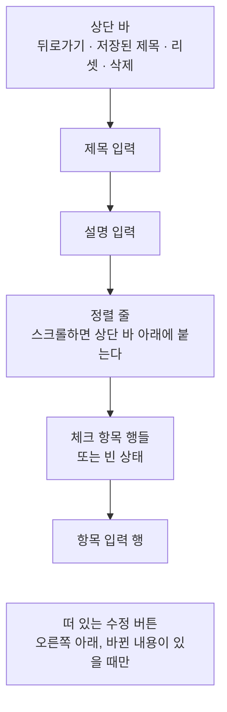
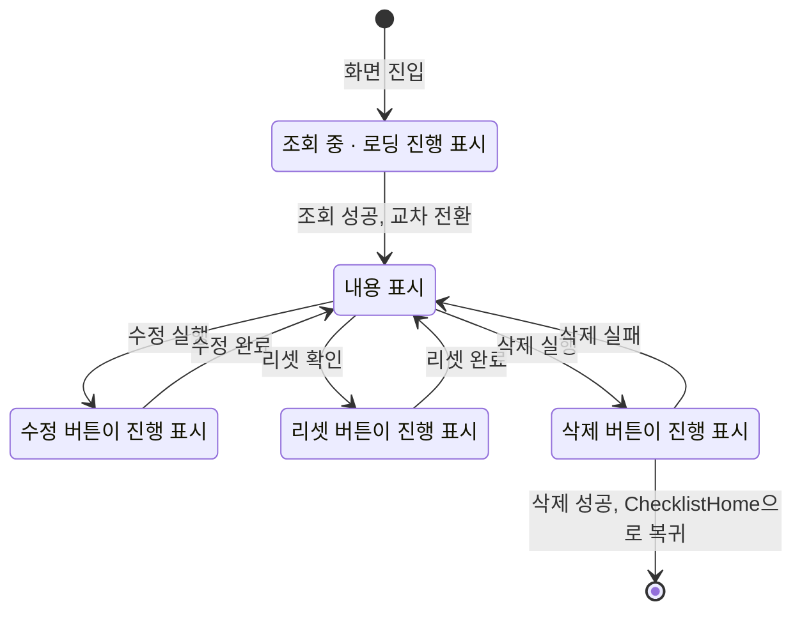

# ChecklistDetail 화면 디자인

기준 스펙: [ChecklistDetail 화면 스펙](../spec/client/checklist-detail.md)

ChecklistDetail은 [ChecklistAdd 화면 디자인](./checklist-add.md)과 같은 자리에 제목과 설명 입력, 항목 입력 행을 두어 사용자가 체크리스트를 만들 때와 관리할 때 같은 방식으로 조작한다. 저장된 체크 항목을 체크하는 목록, 정렬 줄, 상단 바 액션과 떠 있는 수정 버튼, 상태 전환과 피드백이 다르다.

## 화면 구조

ChecklistDetail 화면은 [ChecklistHome 화면](./checklist-home.md)에서 이어지는 세부 화면으로 창 너비와 관계없이 단독 표시하고, 공통 내비게이션 영역은 [TopLevelNavigation 디자인](./top-level-navigation.md)의 `세부 화면에서의 노출`에 따라 숨긴다.

화면 상단에는 상단 바를 두고, 시작 쪽에 뒤로가기 동작을, 그 바로 뒤에 저장된 체크리스트 제목을 시작 쪽에 맞춰 표시한다. 제목의 한 줄 유지, 가로 이동과 iOS 표현은 [QrDetail 화면 디자인](./qr-detail.md)의 `화면 구조`가 정한 상단 바 제목과 같다. 조회가 완료되면 상단 바 끝 쪽에 리셋 버튼과 삭제 버튼을 이 순서로 둔다. 되돌릴 수 없는 삭제를 모서리에 고정해 두는 것은 [PlaceDetail 화면 디자인](./place-detail.md)의 상단 바 액션 배치와 같은 기준이다.

상단 바 아래 본문은 하나의 세로 스크롤 영역으로, 위에서부터 제목 입력, 설명 입력, 체크 항목 영역을 차례로 놓는다. 체크 항목 영역은 위에서부터 정렬 줄, 체크 항목 행들 또는 빈 상태, 항목 입력 행으로 이루어진다.

제목 입력과 설명 입력 사이, 설명 입력과 정렬 줄 사이에는 [공통 여백과 간격](./dimens.md)의 `구성요소 간격`을 둔다. 본문 위아래에는 `화면 세로 여백`, 제목 입력, 설명 입력, 정렬 줄과 항목 입력 행의 좌우에는 `화면 가로 여백`을 둔다. 체크 항목 행은 `체크 항목 행`이 정한 대로 누르는 배경이 본문 좌우 끝까지 닿는다.

제목과 설명, 체크 항목을 한 스크롤에 두어 좁은 창에서도 소프트 키보드 위에 입력이 보일 자리를 남긴다. 항목이 많아 체크 항목 영역이 길어지면 제목과 설명은 위로 스크롤되어 사라지고, 정렬 줄만 상단 바 바로 아래에 붙어 남는다. 이는 [목록 정렬 디자인](./list-sort.md)의 `정렬 줄`이 정한 대로 목록을 스크롤해도 정렬 줄이 사라지지 않게 하기 위한 것이다. 정렬 줄이 붙어 있는 동안에는 화면 배경색으로 칠해 아래로 지나가는 항목이 비치지 않게 한다.

이 화면에는 태그 입력과 탭을 두지 않는다.

## 제목과 설명 입력

제목 입력의 이름과 표현은 [제목 입력 디자인](./title-input.md)을, 설명 입력의 구성과 표현은 [설명 입력 컴포넌트 디자인](./description-input.md)을 따른다. 조회가 완료되면 저장된 제목과 설명을 채우고, 글자 입력의 커서는 값의 끝에 둔다.

## 정렬 줄

정렬 줄의 구성, 정렬 선택 Bottom Sheet, 항목이 없는 동안 정렬 컨트롤을 감추는 표현과 전환은 [목록 정렬 디자인](./list-sort.md)을 따른다. 이 화면의 정렬 줄은 끝 쪽 컨트롤을 두지 않으므로, 노출할 체크 항목이 없는 동안에는 줄 자체가 자리를 차지하지 않고 빈 상태가 설명 입력 아래로 올라온다.

정렬을 바꾸면 체크 항목 행이 새 순서로 다시 놓이고, [목록 정렬 디자인](./list-sort.md)의 기준에 따라 정렬 줄이 표시 영역 맨 위에 붙고 그 바로 아래에 새 순서의 첫 항목이 보이도록 본문을 곧바로 스크롤한다. 제목·설명 입력의 내용은 그대로 둔다. 지금 선택된 정렬을 다시 고르면 스크롤하지 않는다.

## 체크 항목 행

체크 항목 하나는 한 행에 체크 상자, 항목 내용, 빼기 버튼을 시작 쪽부터 이 순서로 둔다. 행의 최소 높이는 Material 목록 항목의 한 줄 기본 높이를 따르고, 행 사이에는 구분선이나 간격을 두지 않는다. 체크 상자의 시작 쪽과 빼기 버튼의 끝 쪽은 위아래 입력과 같은 `화면 가로 여백` 세로선에 맞춘다.

체크 상자는 Material 기본 체크 상자로 체크 여부를 나타낸다. 항목 내용은 본문 기본 글자 크기로 체크 상자와 빼기 버튼 사이의 남은 폭에 표시하고, 폭을 넘으면 줄을 바꿔 모두 보여 준다. 줄 수를 제한하거나 끝을 줄이지 않는다. 행이 여러 줄이 되면 체크 상자와 빼기 버튼은 행의 세로 가운데에 둔다.

체크된 항목은 체크 상자를 채운 표현에 더해 내용에 가운데 줄을 긋고 글자를 본문 보조 색으로 바꾼다. 확인을 마친 일이 체크하지 않은 일보다 덜 눈에 띄게 해 남은 일을 먼저 읽게 하기 위한 것이다. 체크 상자의 색은 Material 기본값을 그대로 둔다.

빼기 버튼을 뺀 행 전체가 하나의 누를 수 있는 대상이며, 체크 상자를 누르거나 내용을 눌러도 같은 결과로 체크가 바뀐다. 누르는 동안의 배경은 행의 좌우를 본문 좌우 끝까지 채운다. 체크를 바꿀 때 진행 표시를 두지 않고, 체크 상자와 내용의 표현을 곧바로 바꾼다. 저장하지 못해 저장된 상태로 돌아가면 전환 효과 없이 되돌린다.

빼기 버튼에는 Material Symbols `remove` 아이콘만 표시하고 라벨은 두지 않는다. 모양과 크기는 플랫폼 기본 아이콘 버튼을 따르며, [ChecklistAdd 화면 디자인](./checklist-add.md)의 빼기 버튼과 같은 표현이다. 버튼의 이름을 알려 주는 설명 표시는 [아이콘 버튼 설명 디자인](./icon-button-tooltip.md)을 따른다. 누르면 확인 없이 그 행이 기본 항목 사라짐 애니메이션으로 사라지고 아래 행이 올라온다. 실행 취소 스낵바는 두지 않는다.

체크 상태가 바뀌거나 리셋, 다른 기기의 변경으로 행이 다른 자리로 옮겨질 때는 기본 항목 이동 애니메이션으로 옮기고, 새로 넣은 항목은 기본 항목 나타남 애니메이션으로 나타낸다. 행이 옮겨져도 본문 스크롤 위치는 따라 움직이지 않는다.

## 빈 상태

노출할 체크 항목이 하나도 없으면 체크 항목 행 자리에 빈 상태를 둔다. 빈 상태는 [목록 빈 상태 디자인](./list-empty-state.md)의 `빈 상태 구성`과 같은 배경 도형, 아이콘, 제목 문구, 보조 문구로 구성하고, Material Symbols `checklist` 아이콘과 아래 `문구와 접근성`의 문구를 쓴다.

이 화면의 빈 상태는 목록이 화면 본문을 차지하지 않고 입력들 사이에 놓이므로, 그 문서의 `배치`와 달리 남은 영역 전체를 채우지 않는다. 빈 상태는 가로 가운데에 두고 위아래에 `화면 세로 여백`을 둔 뒤, 그 아래에 항목 입력 행을 이어 둔다. 체크 항목 행과 빈 상태 사이는 그 문서의 `전환`과 같은 교차 페이드로 바꾼다. 체크 항목을 불러오는 동안에는 빈 상태와 체크 항목 행을 모두 두지 않는다.

## 항목 입력 행

항목 입력 행은 체크 항목 영역의 맨 끝, 마지막 행이나 빈 상태 바로 아래에 둔다. 단일 줄 항목 입력과 넣기 버튼의 구성, 라벨, 소프트 키보드, 넣기 버튼의 비활성 표현, `완료`·`Enter`로 넣는 조작과 넣은 뒤 초점을 남기는 표현은 [ChecklistAdd 화면 디자인](./checklist-add.md)의 `항목 입력 행`과 같다. 이 화면의 항목 입력 행은 카드에 담지 않는다.

항목 넣기를 처리하는 동안에는 넣기 버튼의 아이콘을 진행 표시로 바꾸고, 항목 입력은 잠그지 않는다. 넣기에 성공하면 항목 입력을 비우고, 새 행이 정렬 기준에 맞는 자리에 나타난다. 추가순에서는 새 행이 항목 입력 행 바로 위에 나타난다. 항목 입력 행이 표시 영역 아래로 밀려나면 다시 보이도록 본문을 스크롤한다. 넣기에 실패하면 진행 표시를 넣기 아이콘으로 되돌리기만 하고 항목 입력의 내용과 초점을 그대로 둔다.

## 리셋 버튼

상단 바 끝 쪽, 삭제 버튼 바로 앞의 버튼에는 처음 상태로 되돌린다는 뜻의 Material Symbols `restart_alt` 아이콘만 표시하고 라벨은 두지 않는다. 모양과 크기는 플랫폼 기본 아이콘 버튼을 따르고, 버튼의 이름을 알려 주는 설명 표시는 [아이콘 버튼 설명 디자인](./icon-button-tooltip.md)을 따른다.

노출하는 체크 항목 중 체크된 항목이 없으면 버튼을 숨기지 않고 Material 기본 비활성 아이콘 버튼 표현으로 둔다. iOS에서는 [상단 바](./top-bar.md)의 iOS 비활성 표현을 쓴다. 숨기면 옆의 삭제 버튼 자리가 체크 상태에 따라 옮겨지기 때문이다. 비활성인 동안에는 눌러도 아무 일도 일어나지 않는다.

버튼을 누르면 `리셋 확인 다이얼로그`를 띄운다. 리셋을 처리하는 동안에는 리셋 아이콘을 [진행 표시 크기](./dimens.md)의 진행 표시로 바꾼다. 처리 중에도 체크 항목 행, 입력, 정렬 줄과 삭제 버튼은 잠그거나 흐리게 바꾸지 않는다.

## 리셋 확인 다이얼로그

화면 가운데에 확인 다이얼로그를 띄운다. 다이얼로그는 위에서 아래로 제목, 안내 문구, 동작 줄을 두고, 너비와 높이, 제목 위에 아이콘을 두지 않는 것, 동작 줄의 배치, 닫는 조작과 뒤의 가림막은 [MoreHome 화면 디자인](./more-home.md)의 `로그아웃 확인 다이얼로그`와 같다. 리셋을 끝 쪽에, 취소를 그 앞에 두고, 두 동작은 모두 배경 없는 텍스트 버튼으로 두며 리셋을 강조 색이나 오류 색으로 구분하지 않는다. 리셋은 항목을 지우지 않고 체크만 해제하는 동작이기 때문이다.

리셋을 누르면 다이얼로그를 닫고 리셋을 실행한다. 취소를 누르거나, 바깥을 누르거나, 뒤로가기나 `Esc`로 닫으면 아무것도 바꾸지 않고 다이얼로그만 닫는다.

다이얼로그가 떠 있는 동안 화면이 회전하거나 창 크기가 바뀌어도 다이얼로그를 그대로 띄워 둔다.

## 삭제 버튼

상단 바 끝 쪽 모서리의 삭제 버튼은 [QrDetail 화면 디자인](./qr-detail.md)의 `삭제 버튼`과 같은 아이콘, 진행 표시와 확인 없는 실행을 따른다.

## 수정 버튼

수정 버튼의 자리, 체크 아이콘, 나타나고 사라지는 표현, 처리 중 진행 표시와 `Cmd` 또는 `Meta`와 `Enter`로 실행하는 단축키는 [QrDetail 화면 디자인](./qr-detail.md)의 `수정 버튼`을 따른다. 이 화면에서는 입력한 제목 또는 설명이 저장 내용과 다를 때만 표시하며, 체크, 항목 넣기와 빼기, 리셋은 버튼의 표시에 영향을 주지 않는다. 항목 입력에 초점이 있을 때 `Enter`만 누르면 항목 넣기를 실행하고, `Cmd` 또는 `Meta`와 함께 누르면 수정 반영을 실행한다.

## 상태 전환과 동작 표시

수정, 리셋, 삭제와 항목 넣기의 진행 표시는 각자의 버튼에만 두며 서로를 비활성으로 만들지 않는다.

조회 중에는 본문 가운데에 로딩 진행 표시만 두고 입력, 정렬 줄, 체크 항목 영역과 수정 버튼을 표시하지 않는다. 상단 바에는 뒤로가기만 두고 제목과 리셋·삭제 버튼을 표시하지 않는다. 조회 중 상태와 내용 표시 상태는 서로 겹쳐 바뀌는 교차 전환을 사용한다. 진입할 때는 입력 초점을 두지 않으므로 소프트 키보드도 열지 않는다.

삭제에 성공하면 ChecklistHome 화면으로 돌아간다. ChecklistHome에는 삭제 안내 스낵바를 표시하지 않는다.

## 진행과 피드백

수정 성공 안내는 짧게 보이는 스낵바로 화면 아래쪽에 표시하며, 스낵바에는 동작 버튼을 두지 않는다. 새 안내를 표시할 때 이미 보이는 스낵바가 있으면 즉시 새 안내로 바꾼다. 이는 [QrDetail 화면 디자인](./qr-detail.md)의 `진행과 피드백`과 같은 기준이다.

체크 변경, 항목 넣기와 빼기, 리셋의 성공과 실패에는 스낵바를 두지 않는다. 목록의 변화가 곧 결과이기 때문이다.

제목을 비운 채 수정해 저장된 제목이 유지되는 경우에는 별도의 안내를 표시하지 않고 수정 성공 피드백만 표시한다. 수정에 성공해도 입력, 정렬과 본문의 스크롤 위치는 그대로 둔다.

## 시스템 영역과 적응형 배치

상단 바는 상태 표시줄 영역을 피해 배치한다. 본문, 수정 버튼과 스낵바는 내비게이션 바와 디스플레이 컷아웃 영역을 피해 배치하고, 소프트 키보드가 나타나면 키보드 위 영역에 맞춰 배치한다. 항목 입력이나 제목·설명 입력에 초점이 있으면 그 입력이 키보드에 가리지 않도록 본문을 스크롤한다.

본문의 마지막 요소인 항목 입력 행이 수정 버튼에 가리지 않도록 본문 아래쪽에 [공통 여백과 간격 디자인](./dimens.md)의 `플로팅 액션 버튼 아래 여백`을 둔다. 수정 버튼이 보이지 않는 동안에도 이 여백을 줄이지 않아 버튼이 나타날 때 본문이 움직이지 않게 한다.

창 너비, 창 높이, 자세와 입력 장치가 달라져도 요소의 순서는 바뀌지 않는다. 창이 넓으면 입력, 정렬 줄과 체크 항목 행이 넓어진다.

## 문구와 접근성

한국어 환경과 그 외 기본 환경에서 다음 문구를 사용한다. 항목 입력 라벨, 넣기 버튼과 빼기 버튼의 문구는 [ChecklistAdd 화면 디자인](./checklist-add.md)의 `문구와 접근성`과 같다.

| 항목 | 한국어 | 그 외 기본 |
| --- | --- | --- |
| 상단 바 제목 | 저장된 체크리스트 제목 | 저장된 체크리스트 제목 |
| 뒤로가기 접근성 이름 | `뒤로가기` | `Navigate up` |
| 리셋 버튼 접근성 이름 | `체크 모두 해제` | `Uncheck all` |
| 삭제 버튼 접근성 이름 | `체크리스트 삭제` | `Delete checklist` |
| 수정 버튼 접근성 이름 | `체크리스트 수정` | `Update checklist` |
| 리셋 확인 제목 | `모든 체크를 해제할까요?` | `Uncheck all items?` |
| 리셋 확인 안내 | `체크 항목은 그대로 남고 체크만 모두 해제됩니다.` | `All items stay in the checklist. Only their checks are cleared.` |
| 리셋 확인 동작 | `리셋` | `Reset` |
| 리셋 취소 동작 | `취소` | `Cancel` |
| 빈 상태 제목 문구 | `아직 체크 항목이 없습니다` | `No items yet` |
| 빈 상태 보조 문구 | `아래 입력으로 새 항목을 넣을 수 있습니다` | `Use the field below to add an item.` |
| 수정 성공 안내 | `체크리스트가 수정되었습니다.` | `Checklist updated.` |
| 로딩 진행 표시 접근성 이름 | `체크리스트 불러오는 중` | `Loading checklist` |

정렬 줄과 정렬 이름의 문구는 [목록 정렬 디자인](./list-sort.md)의 `문구와 접근성 이름`을 따른다.

체크 항목 행은 화면 낭독 도구가 체크 상자 하나로 읽게 하고, 행의 접근성 이름은 항목 내용, 상태는 체크됨 또는 체크 안 됨으로 알린다. 행 안의 체크 상자는 따로 읽지 않는다. 빼기 버튼의 접근성 이름에는 그 항목의 내용을 함께 담는다. 예: `항목 빼기, 우유 사기`, `Remove item, Buy milk`. 이 화면의 행은 정렬에 따라 자리가 바뀌므로 순서 대신 내용으로 어느 항목인지 구분한다.

제목 입력의 이름과 표현은 [제목 입력 디자인](./title-input.md)을, 설명 입력은 [설명 입력 컴포넌트 디자인](./description-input.md)을 따른다.
