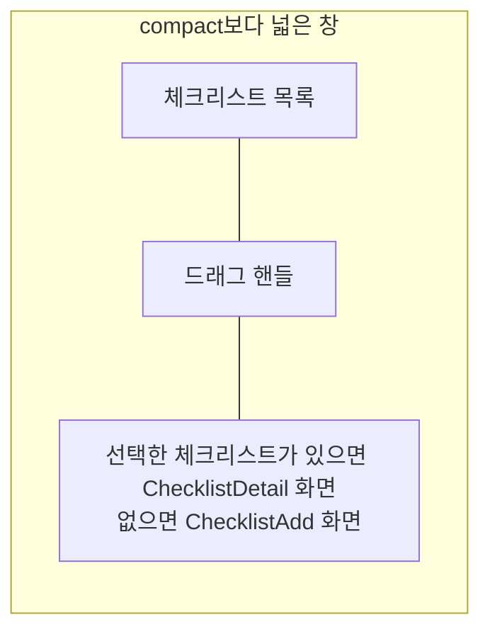

# Checklist 목록·상세 배치 디자인

기준 스펙: [Checklist 목록·상세 배치 스펙](../spec/client/checklist-list-detail.md)

배치, 크기 조절, 버튼 노출, 진행과 피드백, 조절 상태 표시의 공통 표현과 상세 영역의 전환은 [목록·상세 배치 공통 디자인](./list-detail-pane.md)을 따르며, 이 배치는 그 문서의 `추가 화면이 선택 전 자리를 채우는 배치`에 해당한다.

## 두 영역에 두는 화면

목록 영역에는 [ChecklistHome 화면](./checklist-home.md)의 체크리스트 목록을 두고, 상세 영역에는 선택한 체크리스트의 [ChecklistDetail 화면](./checklist-detail.md)을 표시한다. 선택한 체크리스트가 없으면 [ChecklistAdd 화면](./checklist-add.md)을 표시한다.

상세 영역에 놓인 화면의 체크 항목 행도 입력과 함께 상세 영역 폭에 맞춰 좁아진다.

## 버튼 노출

상세 영역에 놓인 ChecklistAdd와 ChecklistDetail의 상단 바에는 뒤로가기 버튼을 표시하지 않는다. 상단 바 제목, ChecklistDetail 상단 바의 리셋 버튼과 삭제 버튼, 체크리스트 추가와 수정을 실행하는 떠 있는 버튼, 본문의 항목 넣기와 빼기 버튼, 정렬 줄은 그대로 표시한다.

## 목록과 상세의 표시

ChecklistDetail의 정렬 줄은 상세 영역 안에만 두며, 정렬 선택 Bottom Sheet는 [목록 정렬 디자인](./list-sort.md)에 따라 창 전체를 기준으로 표시하고 상세 영역과 자리를 나누지 않는다. 리셋 확인 다이얼로그도 상세 영역이 아니라 창 가운데에 띄우고, 목록 영역과 상세 영역을 함께 가림막 아래에 둔다.

체크리스트를 추가하거나 수정한 뒤에는 바뀐 진행 정도도 목록에 반영되는 것을 같은 화면에서 확인한다.
