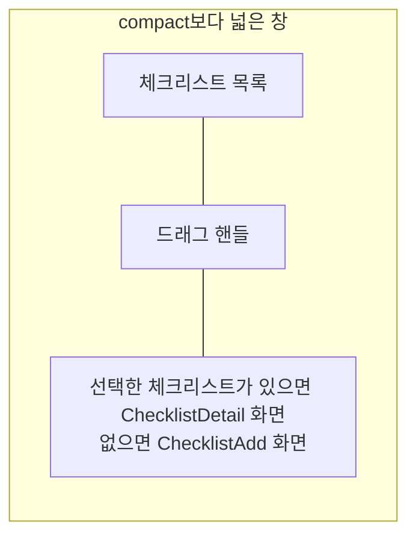

# Checklist 목록·상세 배치 디자인

기준 스펙: [Checklist 목록·상세 배치 스펙](../spec/client/checklist-list-detail.md)

배치, 크기 조절, 버튼 노출, 진행과 피드백, 조절 상태 표시의 공통 표현은 [목록·상세 배치 공통 디자인](./list-detail-pane.md)을 따른다.

## 두 영역에 두는 화면

목록 영역에는 [ChecklistHome 화면](./checklist-home.md)의 체크리스트 목록을 두고, 상세 영역에는 선택한 체크리스트의 [ChecklistDetail 화면](./checklist-detail.md)을 표시한다. 선택한 체크리스트가 없으면 [ChecklistAdd 화면](./checklist-add.md)을 표시한다. 두 영역은 각각 자기 상단 바를 갖는다.

상세 영역에 아이콘과 안내만 두는 [목록·상세 배치 공통 디자인](./list-detail-pane.md)의 `선택 전 상세`는 이 배치에서 쓰지 않는다. 선택 전 자리를 체크리스트 추가가 채우므로 사용자가 목록을 떠나지 않고 곧바로 입력할 수 있고, 비어 있는 안내 자리를 보지 않기 때문이다.

체크리스트 목록의 격자는 상세 영역과 자리를 나눠 좁아져도 [ChecklistHome 화면 디자인](./checklist-home.md)의 2열 고정 격자를 유지하며, 상세 영역에 놓인 화면의 입력과 체크 항목 행도 상세 영역 폭에 맞춰 함께 좁아진다.

## 상세 영역의 전환

목록에서 체크리스트 카드를 누르면 상세 영역이 그 체크리스트의 ChecklistDetail 화면으로 바뀐다. 상세 영역에서 시스템 뒤로가기를 사용하거나 그 체크리스트를 삭제하면 상세 영역이 ChecklistAdd 화면으로 되돌아간다.

목록에서 체크리스트 추가 버튼을 누르면 상세 영역이 ChecklistAdd 화면으로 바뀐다. 버튼의 노출 조건은 [목록·상세 배치 공통 디자인](./list-detail-pane.md)의 `버튼 노출`을 따르므로, 상세 영역에 이미 ChecklistAdd가 놓여 있는 동안에는 버튼을 표시하지 않는다. ChecklistDetail이 놓인 동안 체크리스트 추가 버튼으로 연 ChecklistAdd에서 시스템 뒤로가기를 사용하면 상세 영역은 그 전에 보던 체크리스트의 ChecklistDetail로 돌아간다.

상세 영역의 화면이 바뀔 때는 교차 전환을 쓰고, 목록 영역과 드래그 핸들의 자리와 너비 비율은 그대로 둔다. ChecklistAdd로 되돌아갈 때 입력하던 내용이 남는지는 기준 스펙의 `유지와 초기화 기준`을 따른다.

## 버튼 노출

목록 화면의 체크리스트 추가 버튼과 추가 단축키를 언제 제공하는지는 [목록·상세 배치 공통 디자인](./list-detail-pane.md)의 `버튼 노출`을 따른다. 상세 영역에 ChecklistAdd가 놓여 있는 동안에는 버튼을 표시하지 않고, ChecklistDetail이 놓여 있는 동안에는 그대로 표시한다. 버튼을 표시하지 않는 동안 격자 내용 아래쪽 여백은 [공통 여백과 간격 디자인](./dimens.md)의 `플로팅 액션 버튼 아래 여백` 사용 기준에 따라 버튼이 없을 때의 여백으로 둔다.

목록 영역 상단 바의 뒤로가기 버튼은 함께 표시하는 동안에도 그대로 두고, 누르면 상세 영역만 되돌리지 않고 두 영역을 함께 닫아 `더보기` 화면을 표시한다. 두 영역은 하나의 화면처럼 함께 사라진다.

상세 영역에 놓인 ChecklistAdd와 ChecklistDetail의 상단 바에는 뒤로가기 버튼을 표시하지 않는다. 상단 바 제목, ChecklistDetail 상단 바의 리셋 버튼과 삭제 버튼, 체크리스트 추가와 수정을 실행하는 떠 있는 버튼, 본문의 항목 넣기와 빼기 버튼, 정렬 줄은 그대로 표시한다.

## 목록과 상세의 표시

목록의 당김 새로고침과 진행 표시는 [새로고침 디자인](./sync-refresh.md)의 `적응형 배치`에 따라 목록 영역 안에만 두고 상세 영역에는 두지 않는다.

ChecklistDetail의 정렬 줄은 상세 영역 안에만 두며, 정렬 선택 Bottom Sheet는 [목록 정렬 디자인](./list-sort.md)에 따라 창 전체를 기준으로 표시하고 상세 영역과 자리를 나누지 않는다. 리셋 확인 다이얼로그도 상세 영역이 아니라 창 가운데에 띄우고, 목록 영역과 상세 영역을 함께 가림막 아래에 둔다.

ChecklistAdd와 ChecklistDetail의 피드백 스낵바와 목록의 삭제 안내 스낵바는 [목록·상세 배치 공통 디자인](./list-detail-pane.md)의 `진행과 피드백`에 따라 각자의 영역 안 아래쪽에 표시한다. 체크리스트를 추가하거나 수정한 뒤의 성공 피드백이 목록 영역을 가리지 않으므로, 사용자는 방금 추가하거나 수정한 체크리스트와 바뀐 진행 정도가 목록에 반영되는 것을 같은 화면에서 확인한다.

체크리스트를 추가하거나 수정하거나 삭제해 목록이 갱신될 때 목록 영역과 드래그 핸들의 자리와 너비 비율은 그대로 둔다.
