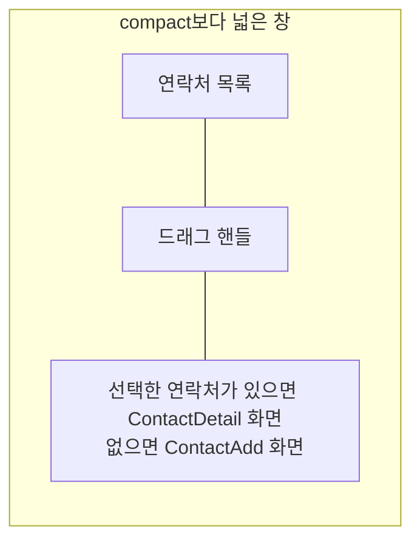

# Contact 목록·상세 배치 디자인

기준 스펙: [Contact 목록·상세 배치 스펙](../spec/client/contact-list-detail.md)

배치, 크기 조절, 버튼 노출, 진행과 피드백, 조절 상태 표시의 공통 표현과 상세 영역의 전환은 [목록·상세 배치 공통 디자인](./list-detail-pane.md)을 따르며, 이 배치는 그 문서의 `추가 화면이 선택 전 자리를 채우는 배치`에 해당한다.

## 두 영역에 두는 화면

목록 영역에는 [ContactHome 화면](./contact-home.md)의 연락처 목록을 두고, 상세 영역에는 선택한 연락처의 [ContactDetail 화면](./contact-detail.md)을 표시한다. 선택한 연락처가 없으면 [ContactAdd 화면](./contact-add.md)을 표시한다.

## 목록 영역의 컨트롤

목록의 정렬 줄은 [목록 정렬 디자인](./list-sort.md)에 따라 목록 영역 안에만 두고 상세 영역에는 두지 않는다. 상세 영역에 어느 화면이 놓여 있어도 정렬 줄의 자리와 표현은 바뀌지 않는다.

필터 Bottom Sheet를 여는 동안에는 목록 영역과 상세 영역을 함께 어둡게 처리한 배경 아래에 그대로 둔다. 표현은 [ContactHome 화면 디자인](./contact-home.md)의 `필터 진입`을 따른다.
