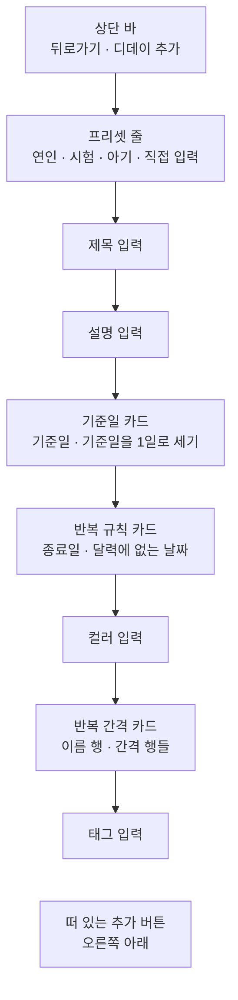
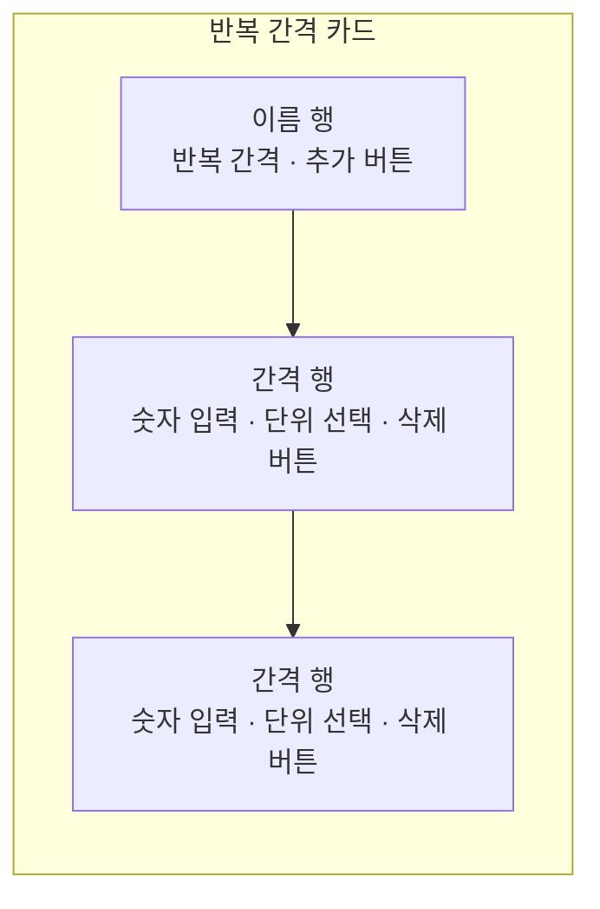

# DDayAdd 화면 디자인

기준 스펙: [DDayAdd 화면 스펙](../spec/client/dday-add.md), [DDay 목록·상세 배치 스펙](../spec/client/dday-list-detail.md)

화면 구조, 태그 입력의 자리, 표시 영역과 소프트 키보드, 초점과 단축키, 진행과 피드백, 여러 항목을 담는 입력의 공통 표현은 [항목 추가 화면 공통 디자인](./entity-add.md)을 따른다. 이 문서의 `기준일 카드`, `반복 규칙 카드`, `반복 간격 카드`는 [DDayDetail 화면 디자인](./dday-detail.md)도 같은 표현으로 쓴다.

## 화면 구조

DDayAdd 화면은 [DDayHome 화면](./dday-home.md)에서 이어지는 세부 화면으로, 창 너비에 따라 단독으로 표시하거나 [DDay 목록·상세 배치 디자인](./dday-list-detail.md)에 따라 디데이 목록과 함께 상세 영역에 표시한다. [TagDetail 디데이 탭](./tag-detail-dday.md)에서 진입한 DDayAdd 화면은 창 너비와 관계없이 단독으로 표시한다. 공통 내비게이션 영역은 [TopLevelNavigation 디자인](./top-level-navigation.md)의 `세부 화면에서의 노출`에 따라 숨긴다.

뒤로가기 버튼의 노출 조건은 [목록·상세 배치 공통 디자인](./list-detail-pane.md)의 `버튼 노출`을 따르므로, 단독으로 표시할 때만 뒤로가기 버튼을 둔다.

화면 상단에는 상단 바를 두고, 시작 쪽에 뒤로가기 동작을, 그 바로 뒤에 제목을 시작 쪽에 맞춰 표시한다. 상단 바 끝 쪽에는 동작을 두지 않는다. 디데이 추가는 오른쪽 아래의 떠 있는 추가 버튼으로 표시한다.

상단 바 아래 본문에는 위에서부터 프리셋 줄, 제목 입력, 설명 입력, 기준일 카드, 반복 규칙 카드, 컬러 입력, 반복 간격 카드, 태그 입력을 차례로 세로로 놓고, 각 요소 사이에 [공통 여백과 간격](./dimens.md)의 `구성요소 간격`을 둔다. 본문 위아래에는 `화면 세로 여백`, 좌우에는 `화면 가로 여백`을 둔다. 모든 요소가 본문 가로 폭을 모두 사용한다.

프리셋 줄은 프리셋이 채우는 네 값보다 먼저 보이도록 본문 맨 위에 둔다. 사용자가 쓰임을 먼저 고르고 그 아래 값을 확인하며 고쳐 나가게 하기 위한 것이다. 개수에 따라 높이가 변하는 반복 간격 카드는 높이가 정해진 입력보다 아래에 두고, 태그 입력은 본문 가장 마지막에 둔다. 두 기준은 [항목 추가 화면 공통 디자인](./entity-add.md)의 `태그 입력의 자리`를 따른다.

본문은 통째로 세로 스크롤한다.

## 프리셋 줄

프리셋 줄에는 `연인`, `시험`, `아기`, `직접 입력` 칩 네 개를 이 순서로 시작 쪽부터 한 줄에 나란히 두고, 칩 사이에 [공통 항목 간격](./dimens.md)을 둔다. 줄 위에 별도의 라벨은 두지 않는다.

칩은 선택 상태를 갖지 않는 Material 동작 칩(assist chip)으로 두고, 아이콘 없이 라벨만 표시한다. 기준 스펙이 어떤 프리셋을 골랐는지 계속 표시하지 않으므로, 누른 뒤에도 칩을 채우거나 체크 표시를 두지 않고 누르는 동안의 기본 누름 표현만 보인다.

칩을 누르면 확인을 묻지 않고 기준일을 1일로 세기, 반복 간격, 종료일, 달력에 없는 날짜 처리의 표시를 그 프리셋의 값으로 곧바로 바꾼다. 각 입력이 바뀌는 표현은 그 입력이 값을 바꿀 때의 표현을 그대로 쓴다. 스위치는 기본 전환으로 움직이고, 종료일 버튼의 날짜는 `종료일 행`의 값 변경 전환을, 반복 간격 카드의 행은 [항목 추가 화면 공통 디자인](./entity-add.md)의 `여러 항목을 담는 입력`이 정한 높이 전환을 따른다. 프리셋을 적용했다는 스낵바나 별도 안내는 두지 않는다. 바뀐 값이 화면에 그대로 드러나기 때문이다.

칩을 눌러도 입력 초점은 옮기지 않는다. 다만 초점이 있던 반복 간격 행이 프리셋 적용으로 사라지면 초점은 어느 입력에도 남지 않고 소프트 키보드를 닫는다.

칩 네 개가 본문 폭에 들어가지 않으면 줄을 바꾸지 않고 프리셋 줄만 가로로 스크롤한다. 글자 크기를 크게 키운 환경에서도 프리셋 줄의 높이가 한 줄로 유지되어 아래 입력의 자리가 흔들리지 않게 하기 위한 것이다.

## 제목과 설명 입력

제목 입력의 이름과 표현은 [제목 입력 디자인](./title-input.md)을, 설명 입력의 구성과 표현은 [설명 입력 컴포넌트 디자인](./description-input.md)을 따른다.

## 컬러 입력

컬러 입력의 구성과 조작, 컬러 선택 다이얼로그는 [DiaryColorInput 컴포넌트 디자인](./diary-color-input.md)을 따른다.

## 카드 행 공통

기준일 카드와 반복 규칙 카드는 각각 하나의 카드에 두 행을 위아래로 담는다. 카드의 모양과 색은 카드 컴포넌트의 기본값을 쓰고, 행 사이에는 구분선이나 간격을 두지 않는다.

각 행은 시작 쪽에 행 이름을, 끝 쪽에 값을 보여 주거나 바꾸는 컨트롤을 둔다. 행 이름은 카드 시작 쪽에서 [카드 안쪽 여백](./dimens.md)만큼 띄우고, 끝 쪽 컨트롤은 카드 끝 쪽에서 같은 여백만큼 안쪽에 둔다. 행의 최소 높이는 Material 목록 항목의 한 줄 기본 높이를 따른다. 이는 [ContactAdd 화면 디자인](./contact-add.md)의 `생일 입력` 첫 행과 같은 구성이다.

끝 쪽 컨트롤은 내용만큼만 폭을 차지하고, 행 이름은 남은 폭을 쓴다. 폭이 좁아 행 이름이 한 줄에 들어가지 않으면 행 이름을 줄바꿈해 여러 줄로 표시하고, 끝 쪽 컨트롤은 한 줄을 유지한 채 행의 세로 가운데에 둔다.

## 기준일 카드

기준일 카드에는 위에서부터 기준일 행과 기준일을 1일로 세기 행을 둔다. 기준일과, 그 날을 어떻게 셀지를 한 카드에 묶어 함께 읽히게 한다.

### 기준일 행

기준일 행의 끝 쪽에는 지금 기준일을 표시하는 날짜 버튼을 둔다. 기준일은 항상 있으므로 날짜 버튼에는 언제나 날짜를 표시하고, 지우기 버튼은 두지 않는다. 버튼의 표현은 [ContactAdd 화면 디자인](./contact-add.md)의 생일 버튼과 같다.

날짜 버튼을 누르면 지금 기준일이 선택된 날짜 선택 다이얼로그를 표시한다. 다이얼로그의 조작과 확인·취소 결과의 표현은 [DiaryDateTimeInput 컴포넌트 디자인](./diary-date-time-input.md)의 `날짜 선택`을, 날짜와 다이얼로그 문구의 표시 형식은 같은 문서의 `표시 형식`과 `문구`를 따른다. 기준일은 오늘보다 앞이나 뒤의 날짜를 모두 고를 수 있으므로 다이얼로그에서 고를 수 없는 날짜를 두지 않는다.

기준일이 바뀔 때의 값 전환은 [DiaryDateTimeInput 컴포넌트 디자인](./diary-date-time-input.md)의 `값 변경 전환`을 따른다. 기준일을 지금 종료일보다 뒤로 골라 종료일이 함께 맞춰지면 종료일 버튼의 날짜도 같은 전환으로 함께 바뀐다.

### 기준일을 1일로 세기 행

기준일을 1일로 세기 행의 끝 쪽에는 켬·끔 스위치를 둔다. 스위치는 Material 기본 스위치 표현으로 켜짐과 꺼짐을 나타낸다.

행 전체가 하나의 누를 수 있는 대상이며, 행 이름을 눌러도 스위치를 눌렀을 때와 같이 켬·끔이 바뀐다. 누르는 동안의 배경은 카드의 좌우 끝까지 채운다. 이는 [DiaryDateTimeInput 컴포넌트 디자인](./diary-date-time-input.md)의 `사용 여부 전환`이 스위치 행을 다루는 기준과 같다.

## 반복 규칙 카드

반복 규칙 카드에는 위에서부터 종료일 행과 달력에 없는 날짜 행을 둔다. 두 값은 모두 기념일이 어디까지, 어느 날짜에 놓이는지를 정하므로 한 카드에 묶는다. 카드 위쪽에 따로 영역 이름 행은 두지 않는다.

### 종료일 행

종료일 행의 끝 쪽에는 종료일을 표시하는 날짜 버튼과 종료일을 지우는 버튼을 순서대로 둔다. 구성과 표현은 [ContactAdd 화면 디자인](./contact-add.md)의 생일 버튼과 생일 지우기 버튼과 같다.

종료일이 없으면 날짜 버튼에 고르지 않았음을 알리는 문구를 표시하고 지우기 버튼은 표시하지 않는다. 종료일을 고르면 버튼에 고른 날짜를 표시하고 지우기 버튼을 함께 표시한다. 지우기 버튼이 나타나고 사라지는 표현은 [나타나고 사라지는 버튼 디자인](./button-visibility.md)을 따른다. 지우기 버튼을 누르면 종료일이 없는 표시로 바뀌고, 지우기 버튼이 사라지므로 키보드 초점은 종료일 날짜 버튼으로 옮긴다.

날짜 버튼을 누르면 날짜 선택 다이얼로그를 표시한다. 종료일이 없으면 기준일이, 있으면 지금 종료일이 선택된 상태로 연다. 다이얼로그의 조작, 확인·취소 결과와 표시 형식은 `기준일 행`과 같다.

다이얼로그의 달력에서 기준일보다 앞의 날짜는 Material 기본의 고를 수 없는 날짜 표현으로 흐리게 두고, 눌러도 선택되지 않는다. 직접 입력 방식에서 기준일보다 앞의 날짜를 입력하면 입력 칸에 Material 기본의 범위를 벗어난 입력 표현과 실행 환경이 제공하는 기본 안내를 표시하고, 고른 날짜가 없는 것으로 다루어 확인을 눌러도 다이얼로그를 닫지 않는다.

종료일이 바뀔 때의 값 전환은 `기준일 행`과 같다. 종료일이 없는 문구와 날짜 사이를 오갈 때는 값 전환을 두지 않고 바로 바꾼다. 앞뒤를 비교할 날짜가 없기 때문이다.

### 달력에 없는 날짜 행

달력에 없는 날짜 행의 끝 쪽에는 지금 고른 처리 방식을 표시하는 버튼을 둔다. 버튼은 배경 없는 텍스트 버튼으로, 고른 값의 이름 뒤에 메뉴가 열림을 뜻하는 Material Symbols `arrow_drop_down` 아이콘을 둔다.

버튼을 누르면 버튼에 맞춰 드롭다운 메뉴를 펼치고, `말일로 당김`, `표시하지 않음`, `다음 달 1일로 미룸`을 이 순서로 한 항목씩 둔다. 지금 고른 항목에는 시작 쪽에 체크 아이콘을 두고, 고르지 않은 항목은 같은 자리를 비워 세 이름의 시작을 맞춘다. 메뉴는 표시 영역 안에 들어가도록 플랫폼 기본 위치 조정에 따라 버튼 아래나 위에 펼친다.

항목을 누르면 메뉴를 닫고 버튼의 이름을 고른 값으로 바로 바꾼다. 지금 고른 항목을 다시 누르면 값은 바뀌지 않고 메뉴만 닫힌다. 메뉴 바깥을 누르거나, 뒤로가기나 `Esc`로 닫으면 값을 바꾸지 않는다.

이 행은 개월이나 년 단위의 간격이 없어도 같은 모양으로 표시하고 비활성으로 두지 않는다.

## 반복 간격 카드

반복 간격은 [항목 추가 화면 공통 디자인](./entity-add.md)의 `여러 항목을 담는 입력`에 따라 하나의 카드에 담는다. 이름 행의 시작 쪽에 영역 이름 `반복 간격`을, 끝 쪽에 간격을 추가하는 버튼을 둔다. 추가 버튼에는 Material Symbols `add` 아이콘만 표시하고 라벨은 두지 않는다. 간격이 하나도 없으면 이름 행만 표시하고 빈 상태 안내는 두지 않는다.

### 간격 행

간격 하나는 한 행에 숫자 입력, 단위 선택, 그 간격을 삭제하는 버튼을 시작 쪽부터 이 순서로 둔다. 간격 행의 좌우에는 [카드 안쪽 여백](./dimens.md)을 두고, 행 사이와 마지막 행 아래에는 [공통 항목 간격](./dimens.md)을 둔다. 삭제 버튼은 행의 세로 가운데에 둔다.

숫자 입력은 테두리가 있는 단일 줄 글자 입력으로 두고, 입력 안쪽 위에 라벨 `숫자`를 표시하며, 단위 선택과 삭제 버튼을 뺀 남은 폭을 모두 쓴다. 입력한 값이 있으면 끝 쪽에 지우기 버튼을 표시하며, 나타나고 사라지는 표현은 [나타나고 사라지는 버튼 디자인](./button-visibility.md)을 따른다. 소프트 키보드는 소수점 없는 숫자 키보드를 요청하고, 입력을 마치는 키는 `완료`로 표시한다. 숫자 앞에 넣은 `0`도 입력한 그대로 표시한다.

소프트 키보드 종류는 입력기에 대한 요청일 뿐이므로, 물리 키보드나 붙여넣기로 들어온 값도 기준 스펙의 `반복 간격 입력`이 정한 문자와 자리 수만 반영한다. 반영하지 않는 입력에는 오류 색이나 안내를 표시하지 않고, 값이 바뀌지 않는 것으로만 드러낸다. 이는 [ContactAdd 화면 디자인](./contact-add.md)의 `키와 신발 사이즈 입력`과 같은 기준이다.

단위 선택은 숫자 입력과 같은 높이와 테두리를 가진 읽기 전용 드롭다운 입력으로 두고, 입력 안쪽 위에 라벨 `단위`를, 안에 고른 단위 이름과 끝 쪽의 `arrow_drop_down` 아이콘을 표시한다. 폭은 가장 긴 단위 이름과 아이콘이 들어가는 폭으로 고정해, 단위를 바꿔도 숫자 입력의 폭이 흔들리지 않게 한다. 글자를 입력할 수 없으므로 소프트 키보드를 열지 않는다.

단위 선택을 누르면 그 아래에 입력 폭에 맞춘 드롭다운 메뉴를 펼치고 `일`, `개월`, `년`을 이 순서로 둔다. 지금 고른 단위의 표시, 고르고 닫는 조작은 `달력에 없는 날짜 행`의 메뉴와 같다. 단위를 바꿔도 숫자 입력의 값은 그대로 둔다.

삭제 버튼에는 Material Symbols `remove` 아이콘만 표시하고 라벨은 두지 않는다. 모양과 크기는 플랫폼 기본 아이콘 버튼을 따르며, 이는 [ContactAdd 화면 디자인](./contact-add.md)의 전화번호 삭제 버튼과 같은 표현이다.

추가 버튼, 삭제 버튼과 지우기 버튼의 이름을 알려 주는 설명 표시는 [아이콘 버튼 설명 디자인](./icon-button-tooltip.md)을 따른다.

### 간격의 추가와 삭제

추가 버튼을 누르면 단위가 `일`이고 숫자가 빈 행이 카드 마지막 자리에 나타난다. 삭제 버튼을 누르면 그 행만 사라진다. 카드 높이가 바뀔 때의 전환은 [항목 추가 화면 공통 디자인](./entity-add.md)의 `여러 항목을 담는 입력`을 따른다. 어느 경우에도 입력 초점과 소프트 키보드는 그대로 둔다. 새 행이 표시 영역 아래에 나타나면 새 행이 보이도록 본문을 스크롤해, 추가 버튼을 누른 결과가 화면에 드러나게 한다.

초점이 있던 행을 삭제하면 그 입력이 사라지므로 초점은 어느 입력에도 남지 않고 소프트 키보드를 닫는다.

## 추가 버튼

추가 버튼은 [항목 추가 화면 공통 디자인](./entity-add.md)의 `화면 구조`대로 오른쪽 아래에 떠 있는 버튼으로 두고, 추가를 뜻하는 Material Symbols `add` 아이콘을 쓴다. 반복 간격 카드의 추가 버튼도 같은 아이콘을 쓰지만, 카드 이름 행 끝의 작은 아이콘 버튼과 화면에 떠 있는 버튼이라는 자리와 크기로 구분된다. 버튼은 입력 상태와 관계없이 같은 자리에 같은 모양으로 표시하고 비활성으로 표시하지 않는다.

## 진행과 피드백

추가 처리 중의 진행 표시, 저장 실패와 미입력 안내의 표현은 [항목 추가 화면 공통 디자인](./entity-add.md)의 `진행과 피드백`을 따른다. 처리 중에도 프리셋 칩, 카드 안의 버튼과 스위치, 반복 간격의 추가·삭제 버튼을 잠그거나 흐리게 바꾸지 않는다.

제목 미입력이면 제목 입력이 보이도록 본문을 스크롤해 초점을 옮기고 제목 미입력 안내를 스낵바로 표시한다.

반복 간격 미입력이면 입력 초점은 옮기지 않고 반복 간격 미입력 안내를 스낵바로 표시한다. 반복 간격 카드가 표시 영역 밖에 있으면 카드의 이름 행이 보이도록 본문을 스크롤한다. 숫자가 빈 행이나 `0`인 행에 오류 색이나 표시를 따로 두지 않는다.

추가에 성공하면 화면에 머문 채 제목과 설명을 비우고, 컬러 카드를 새 컬러로, 기준일 버튼을 오늘로, 기준일을 1일로 세기 스위치를 켬으로, 종료일 버튼을 고르지 않은 표시로, 달력에 없는 날짜 버튼을 `말일로 당김`으로 되돌리며, 반복 간격 카드는 이름 행만 남긴다. 태그 입력의 칩은 그대로 둔다. 그 뒤 제목 입력이 보이도록 본문을 맨 위로 스크롤해 초점을 옮기고 추가 성공 안내를 스낵바로 표시한다.

## 단축키

물리 키보드 환경에서 `Cmd` 또는 `Meta`와 `Enter`를 함께 누르면 추가를 실행한다. 숫자 입력에 초점이 있을 때 `Enter`만 누르면 소프트 키보드의 `완료`와 같이 입력을 마치기만 한다.

키보드 초점은 화면에 놓인 순서대로 옮겨 가며, 프리셋 칩, 날짜 버튼, 스위치 행, 드롭다운 버튼과 단위 선택은 `Enter` 또는 `Space`로 실행한다. 펼친 드롭다운 메뉴에서는 방향 키로 항목 사이를 옮기고 `Enter`로 고른다.

## 시스템 영역과 적응형 배치

상단 바는 상태 표시줄 영역을 피해 배치한다. 본문, 추가 버튼과 스낵바의 배치와 소프트 키보드 처리는 [항목 추가 화면 공통 디자인](./entity-add.md)의 `표시 영역과 소프트 키보드`를 따르고, 칩 영역의 높이 기준은 [항목 태그 입력 컴포넌트 디자인](./entity-tag-input.md)을 따른다. 본문의 마지막 요소인 태그 입력이 추가 버튼에 가리지 않도록 본문 아래쪽에 [공통 여백과 간격 디자인](./dimens.md)의 `플로팅 액션 버튼 아래 여백`을 둔다.

날짜 선택 다이얼로그는 창 가운데에 띄우고, 드롭다운 메뉴는 표시 영역 안에서 버튼이나 단위 선택에 맞춰 펼친다. 둘 다 시스템 영역과 디스플레이 컷아웃에 가려지지 않게 한다. 다이얼로그나 메뉴가 열려 있는 동안 화면이 회전하거나 창 크기가 바뀌어도 그대로 열어 둔다.

창 너비, 창 높이, 자세와 입력 장치가 달라져도 요소의 순서는 바뀌지 않는다. 창이 넓으면 입력과 카드가 넓어지고, 카드 행의 이름과 끝 쪽 컨트롤 사이가 벌어진다.

## 문구와 접근성

[항목 추가 화면 공통 디자인](./entity-add.md)의 `문구와 접근성`에 더해 한국어 환경과 그 외 기본 환경에서는 다음 문구를 사용한다. 이 표의 카드와 입력 문구는 [DDayDetail 화면 디자인](./dday-detail.md)도 그대로 쓴다.

| 항목 | 한국어 | 그 외 기본 |
| --- | --- | --- |
| 상단 바 제목 | `디데이 추가` | `Add D-Day` |
| 추가 버튼 접근성 이름 | `디데이 추가` | `Add D-Day` |
| 프리셋 줄 접근성 이름 | `프리셋` | `Presets` |
| `연인` 프리셋 칩 라벨 | `연인` | `Couple` |
| `시험` 프리셋 칩 라벨 | `시험` | `Exam` |
| `아기` 프리셋 칩 라벨 | `아기` | `Baby` |
| `직접 입력` 프리셋 칩 라벨 | `직접 입력` | `Custom` |
| 기준일 행 이름 | `기준일` | `Start date` |
| 기준일을 1일로 세기 행 이름 | `기준일을 1일로 세기` | `Count start date as day 1` |
| 종료일 행 이름 | `종료일` | `End date` |
| 종료일 미선택 표시 | `선택 안 함` | `Not set` |
| 종료일 지우기 버튼 접근성 이름 | `종료일 지우기` | `Clear end date` |
| 달력에 없는 날짜 행 이름 | `달력에 없는 날짜` | `Missing dates` |
| `말일로 당김` 항목 | `말일로 당김` | `Use last day of month` |
| `표시하지 않음` 항목 | `표시하지 않음` | `Skip` |
| `다음 달 1일로 미룸` 항목 | `다음 달 1일로 미룸` | `Use 1st of next month` |
| 반복 간격 영역 이름 | `반복 간격` | `Repeat intervals` |
| 반복 간격 추가 버튼 접근성 이름 | `반복 간격 추가` | `Add interval` |
| 숫자 입력 라벨 | `숫자` | `Number` |
| 숫자 입력 접근성 이름 | `{순서}번째 간격 숫자` | `Interval {순서} number` |
| 단위 선택 라벨 | `단위` | `Unit` |
| 단위 선택 접근성 이름 | `{순서}번째 간격 단위` | `Interval {순서} unit` |
| `일` 단위 | `일` | `Days` |
| `개월` 단위 | `개월` | `Months` |
| `년` 단위 | `년` | `Years` |
| 간격 삭제 버튼 접근성 이름 | `{순서}번째 간격 삭제` | `Remove interval {순서}` |
| 제목 미입력 안내 | `제목을 입력해 주세요.` | `Please enter a title.` |
| 반복 간격 미입력 안내 | `반복 간격에 1 이상의 숫자를 입력해 주세요.` | `Please enter a number of 1 or more for each interval.` |
| 추가 성공 안내 | `디데이가 추가되었습니다.` | `D-Day added.` |

숫자 입력의 지우기 버튼 접근성 이름은 [항목 추가 화면 공통 디자인](./entity-add.md)의 `문구와 접근성`에 따라 그 입력 컴포넌트의 공용 문구를 쓴다. 간격 행의 `{순서}`는 같은 문서의 기준에 따라 위에서부터 `1`부터 세고, 행을 추가하거나 삭제하면 다시 센다.

프리셋 칩은 버튼 역할로 라벨을 그대로 읽히게 하고, 칩들을 감싼 프리셋 줄 전체에 접근성 이름을 두어 무엇을 고르는 칩인지 알린다. 칩이 선택 상태를 갖지 않으므로 선택됨이나 선택 안 됨은 알리지 않는다.

날짜 버튼, 달력에 없는 날짜 버튼은 표시한 값을 그대로 읽히게 두고 별도의 접근성 이름을 두지 않는다. 앞에 있는 행 이름이 무엇을 고르는 버튼인지 이미 알려 준다. 이는 [ContactAdd 화면 디자인](./contact-add.md)의 생일 버튼과 같은 기준이다. 달력에 없는 날짜 버튼과 단위 선택은 메뉴를 여는 컨트롤임을, 메뉴가 펼쳐지면 펼쳐진 상태임을 함께 알린다.

기준일을 1일로 세기 행은 화면 낭독 도구가 스위치 하나로 읽게 하고, 행의 접근성 이름은 행 이름, 상태는 켜짐 또는 꺼짐으로 알린다. 행 안의 스위치는 따로 읽지 않는다.

태그 입력의 칩 라벨과 태그 선택 목록의 문구는 [항목 태그 입력 컴포넌트 디자인](./entity-tag-input.md)을, 날짜 선택 다이얼로그의 문구는 [DiaryDateTimeInput 컴포넌트 디자인](./diary-date-time-input.md)의 `문구`를 따른다.
