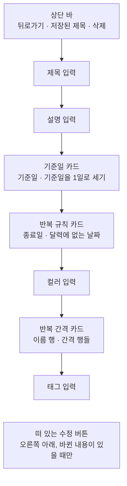
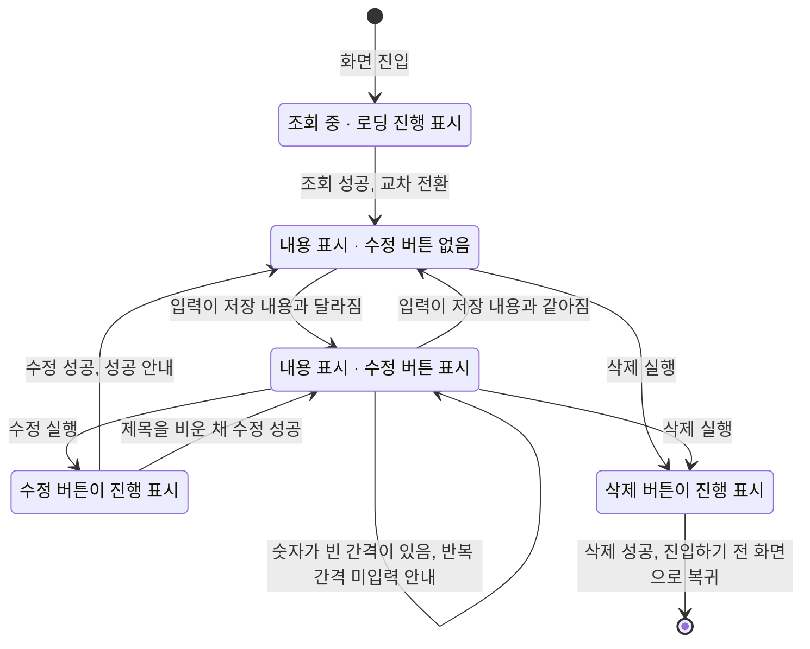

# DDayDetail 화면 디자인

기준 스펙: [DDayDetail 화면 스펙](../spec/client/dday-detail.md), [DDay 목록·상세 배치 스펙](../spec/client/dday-list-detail.md)

DDayDetail은 [DDayAdd 화면 디자인](./dday-add.md)에서 프리셋 줄만 뺀 본문을 같은 순서와 표현으로 쓰고, 상단 바 액션과 떠 있는 버튼, 상태 전환과 피드백만 다르다. 두 화면이 같은 자리에 같은 입력을 두어 사용자가 디데이를 추가할 때와 고칠 때 같은 방식으로 조작한다. 상단 바 제목, 삭제 버튼의 자리, 수정 실행 단축키, 피드백 스낵바와 진입할 때의 초점은 [항목 상세 화면 공통 디자인](./entity-detail.md)을 따른다.

## 화면 구조

DDayDetail 화면은 [DDayHome 화면](./dday-home.md)에서 이어지는 세부 화면으로, 창 너비에 따라 단독으로 표시하거나 [DDay 목록·상세 배치 디자인](./dday-list-detail.md)에 따라 디데이 목록과 함께 상세 영역에 표시한다. 캘린더 홈 화면, 시간표, [TagDetail 디데이 탭](./tag-detail-dday.md)과 [SearchHome 화면](./search-home.md)에서 진입한 DDayDetail 화면은 창 너비와 관계없이 단독으로 표시한다. 공통 내비게이션 영역은 [TopLevelNavigation 디자인](./top-level-navigation.md)의 `세부 화면에서의 노출`에 따라 숨긴다.

뒤로가기 버튼의 노출 조건은 [목록·상세 배치 공통 디자인](./list-detail-pane.md)의 `버튼 노출`을 따르므로, 단독으로 표시할 때만 뒤로가기 버튼을 둔다.

화면 상단에는 상단 바를 두고, 시작 쪽에 뒤로가기 동작을, 그 바로 뒤에 저장된 디데이 제목을 시작 쪽에 맞춰 표시한다. 조회가 완료되면 상단 바 끝 쪽에 삭제 버튼 하나만 둔다. 상단 바에는 수정 동작을 실행하는 컨트롤을 두지 않고, 수정은 오른쪽 아래의 떠 있는 수정 버튼으로 제공한다.

상단 바 아래 본문에는 위에서부터 제목 입력, 설명 입력, 기준일 카드, 반복 규칙 카드, 컬러 입력, 반복 간격 카드, 태그 입력을 차례로 세로로 놓는다. 요소 사이 간격, 본문 여백, 스크롤과 각 입력의 구성·조작은 [DDayAdd 화면 디자인](./dday-add.md)의 `화면 구조`, `제목과 설명 입력`, `컬러 입력`, `카드 행 공통`, `기준일 카드`, `반복 규칙 카드`, `반복 간격 카드`를 그대로 따른다. 기준 스펙이 프리셋을 DDayAdd에만 두므로 프리셋 줄은 두지 않고, 본문은 제목 입력부터 시작한다. 이 화면에는 탭을 두지 않는다.

카드 문구와 기념일은 이 화면에 표시하지 않는다.

## 태그 입력

태그 입력은 본문 가장 마지막에 둔다. 구성과 조작, 칩 영역의 높이 기준은 [항목 태그 입력 컴포넌트 디자인](./entity-tag-input.md)을 따른다.

칩 영역에는 저장된 연결을 그대로 표시하고, 사용자가 항목을 누르면 저장된 연결이 곧바로 바뀌어 칩 영역에 이어서 나타난다. 반영에는 진행 표시를 두지 않으므로 수정 버튼과 삭제 버튼의 진행 표시와 섞이지 않는다. 태그를 연결하거나 해제해도 수정 버튼의 표시 여부와 입력 중이던 내용은 바뀌지 않는다.

태그 칩을 누르면 그 태그의 TagDetail 화면으로 이동하고, 뒤로가면 이 디데이의 상세로 돌아온다. 이동한 화면은 태그 디테일 탭이 선택된 상태로 시작한다.

## 삭제 버튼

상단 바 끝 쪽 모서리의 삭제 버튼은 [QrDetail 화면 디자인](./qr-detail.md)의 `삭제 버튼`과 같은 아이콘, 진행 표시와 확인 없는 실행을 따른다.

## 수정 버튼

수정 버튼의 자리, 체크 아이콘, 나타나고 사라지는 표현, 처리 중 진행 표시와 `Cmd` 또는 `Meta`와 `Enter`로 실행하는 단축키는 [QrDetail 화면 디자인](./qr-detail.md)의 `수정 버튼`을 따른다. 이 화면에서는 입력이 저장된 내용과 다를 때만 표시하며, 그 판정은 기준 스펙의 `수정 동작의 제공 기준`을 따른다. 숫자가 비어 있거나 `0`인 간격 행이 있으면 저장된 내용과 다른 것이므로 버튼을 표시하고, 반복 간격 미입력 안내는 수정을 실행한 시점에만 제공한다.

수정을 처리하는 동안에도 입력, 카드 안의 버튼과 스위치, 반복 간격의 추가·삭제 버튼을 잠그거나 흐리게 바꾸지 않으며, 수정과 삭제는 서로를 비활성으로 만들지 않는다.

## 상태 전환과 동작 표시

조회 중에는 본문 가운데에 로딩 진행 표시만 두고 입력, 카드, 태그 입력과 수정 버튼을 표시하지 않는다. 상단 바에는 단독으로 표시할 때의 뒤로가기만 두고 제목과 삭제 버튼을 표시하지 않는다. 조회 중 상태와 내용 표시 상태는 서로 겹쳐 바뀌는 교차 전환을 사용한다.

조회가 완료되면 저장된 제목, 설명, 컬러, 기준일, 기준일을 1일로 세기, 종료일, 달력에 없는 날짜 처리와 반복 간격, 저장된 태그 연결을 채운다. 반복 간격 카드에는 기준 스펙의 `입력 내용 채우기`가 정한 순서대로 간격 행을 처음부터 놓고, 채울 때는 행이 나타나는 전환을 두지 않는다. 종료일이 없으면 종료일 버튼을 고르지 않은 표시로 둔다. 글자 입력의 커서는 값의 끝에 둔다. 진입할 때의 초점은 [항목 상세 화면 공통 디자인](./entity-detail.md)의 `진입할 때의 초점`을 따른다.

삭제에 성공하면 단독으로 표시하고 있었으면 진입하기 전 화면으로 돌아가고, 목록과 함께 표시하고 있었으면 상세 영역이 [DDay 목록·상세 배치 디자인](./dday-list-detail.md)의 선택 전 표시인 DDayAdd 화면으로 되돌아간다. 돌아간 화면에는 삭제 안내 스낵바를 표시하지 않는다. 삭제에 실패하면 삭제 버튼의 진행 표시를 삭제 아이콘으로 되돌리기만 하고, 입력과 수정 버튼의 표시는 삭제를 실행하기 전 그대로 둔다.

## 진행과 피드백

수정 성공과 반복 간격 미입력 안내는 짧게 보이는 스낵바로 화면 아래쪽에 표시하며, 스낵바에는 동작 버튼을 두지 않는다. 이미 보이는 스낵바를 바꾸는 기준은 [항목 상세 화면 공통 디자인](./entity-detail.md)의 `피드백 스낵바`를 따른다.

반복 간격 미입력이면 입력 초점은 옮기지 않고, 반복 간격 카드가 표시 영역 밖에 있으면 카드의 이름 행이 보이도록 본문을 스크롤한 뒤 안내를 표시한다. 숫자가 빈 행이나 `0`인 행에 오류 색이나 표시를 따로 두지 않는다. 이는 [DDayAdd 화면 디자인](./dday-add.md)의 `진행과 피드백`과 같은 표현이다.

제목을 비운 채 수정해 저장된 제목이 유지되는 경우에는 별도의 안내를 표시하지 않고 수정 성공 피드백만 표시한다.

수정에 성공해도 입력, 간격 행의 순서와 본문의 스크롤 위치는 그대로 둔다.

## 시스템 영역과 적응형 배치

상단 바는 상태 표시줄 영역을 피해 배치한다. 본문, 수정 버튼과 스낵바는 내비게이션 바와 디스플레이 컷아웃 영역을 피해 배치하고, 소프트 키보드가 나타나면 키보드 위 영역에 맞춰 배치한다. 초점이 있는 입력이 키보드에 가리지 않도록 본문을 스크롤한다. 날짜 선택 다이얼로그와 드롭다운 메뉴의 자리는 [DDayAdd 화면 디자인](./dday-add.md)의 `시스템 영역과 적응형 배치`를 따른다.

본문의 마지막 요소인 태그 입력이 수정 버튼에 가리지 않도록 본문 아래쪽에 [공통 여백과 간격 디자인](./dimens.md)의 `플로팅 액션 버튼 아래 여백`을 둔다. 수정 버튼이 보이지 않는 동안에도 이 여백을 줄이지 않아 버튼이 나타날 때 본문이 움직이지 않게 한다.

창 너비, 창 높이, 자세와 입력 장치가 달라져도 요소의 순서는 바뀌지 않는다. 창이 넓으면 입력과 카드가 넓어진다. 키보드 초점의 이동과 실행은 [DDayAdd 화면 디자인](./dday-add.md)의 `단축키`와 같다.

## 문구와 접근성

[DDayAdd 화면 디자인](./dday-add.md)의 `문구와 접근성`에 있는 카드 행, 반복 간격, 반복 간격 미입력 안내 문구와 접근성 기준을 그대로 쓰고, 다음 문구를 더한다.

| 항목 | 한국어 | 그 외 기본 |
| --- | --- | --- |
| 상단 바 제목 | 저장된 디데이 제목 | 저장된 디데이 제목 |
| 뒤로가기 접근성 이름 | `뒤로가기` | `Navigate up` |
| 삭제 버튼 접근성 이름 | `디데이 삭제` | `Delete D-Day` |
| 수정 버튼 접근성 이름 | `디데이 수정` | `Update D-Day` |
| 수정 성공 안내 | `디데이가 수정되었습니다.` | `D-Day updated.` |
| 로딩 진행 표시 접근성 이름 | `디데이 불러오는 중` | `Loading D-Day` |

제목 입력의 이름과 표현은 [제목 입력 디자인](./title-input.md)을, 설명 입력은 [설명 입력 컴포넌트 디자인](./description-input.md)을 따른다.

태그 입력의 칩 라벨과 태그 선택 목록의 문구는 [항목 태그 입력 컴포넌트 디자인](./entity-tag-input.md)을 따른다.
