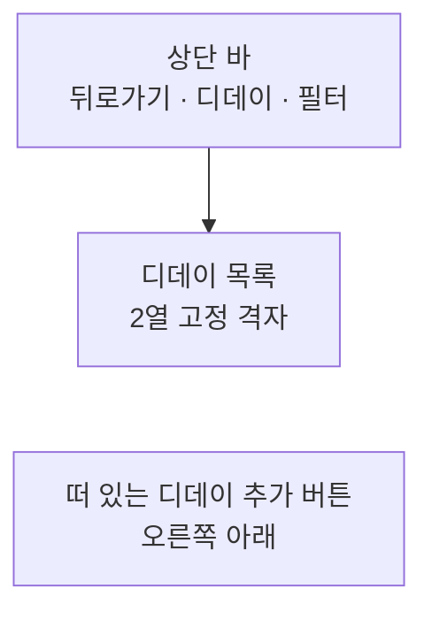
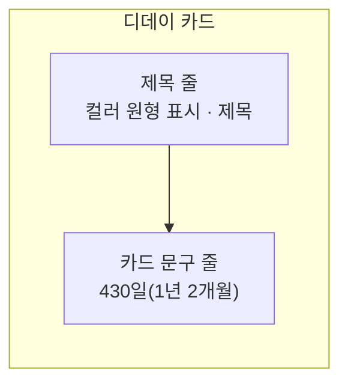

# DDayHome 화면 디자인

기준 스펙: [DDayHome 화면 스펙](../spec/client/dday-home.md), [디데이 앱 스펙](../spec/client/dday.md), [DDay 목록·상세 배치 스펙](../spec/client/dday-list-detail.md), [태그 필터 스펙](../spec/client/tag-filter.md), [목록 필터 반영 스펙](../spec/client/list-filter.md), [새로고침 스펙](../spec/client/sync-refresh.md), [페이지 조회 목록의 자리 표시 스펙](../spec/client/paged-list-placeholder.md), [목록 빈 상태 스펙](../spec/client/list-empty-state.md)

화면 구조, 추가 버튼, 카드 조작, 삭제 스와이프, 자리 표시·빈 상태·새로고침, 격자와 시스템 영역, 추가 단축키의 공통 표현은 [항목 목록 화면 공통 디자인](./entity-home.md)을 따른다. 이 문서는 DDayHome에서만 다른 표현과, 다른 화면이 함께 쓰는 `디데이 카드`를 다룬다.

## 화면 구조

목록이 상세 영역과 자리를 나눠 쓰는 배치와 그 자리에서의 버튼 노출은 [DDay 목록·상세 배치 디자인](./dday-list-detail.md)을 따른다.

상단 바 시작 쪽에 뒤로가기 동작을, 그 바로 뒤에 화면 이름을 제목으로 표시한다. 제목은 시작 쪽에 맞춘다. 상단 바의 끝 쪽에는 필터 아이콘 버튼 하나만 둔다. 디데이 검색은 이 화면의 범위 밖이므로 [MemoHome 목록 디자인](./memo-home.md)이 필터 버튼 앞에 두는 검색 버튼에 해당하는 자리를 비워 둔다. 기준 스펙이 정렬 선택을 제공하지 않으므로 정렬 줄은 두지 않는다.

본문 전체는 디데이 목록 영역 하나로 채운다.

## 디데이 추가 버튼

버튼에는 추가를 뜻하는 Material Symbols `add` 아이콘만 표시하고 라벨은 두지 않는다. 버튼의 모양과 크기는 플랫폼 기본 플로팅 액션 버튼을 따르고, 플랫폼별 표현은 [떠 있는 동작 버튼 디자인](./floating-action-button.md)을 따른다. 버튼의 이름을 알려 주는 설명 표시는 [아이콘 버튼 설명 디자인](./icon-button-tooltip.md)을 따른다.

버튼은 목록이 비어 있거나 필터를 적용해 두었어도 같은 자리에 같은 모양으로 표시하고, 비활성으로 표시하지 않는다. 버튼을 누르면 진행 표시 없이 바로 [DDayAdd 화면](./dday-add.md)으로 이동한다.

## 필터 진입

필터 아이콘 버튼은 상단 바의 가장 끝에 둔다. 버튼의 아이콘과 적용 상태 표현, Bottom Sheet의 표시, 닫는 조작, 필터 반영 전환, 적응형 배치는 [필터 Bottom Sheet 디자인](./filter-bottom-sheet.md)을 따르고, Bottom Sheet의 구성과 태그 칩의 표현·선택 조작, 태그 추가 칩, 선택 전체 해제 버튼은 [태그 필터 디자인](./tag-filter.md)을 따른다. DDayHome의 Bottom Sheet에는 태그 필터만 담는다.

필터 아이콘 버튼은 선택한 태그가 하나도 없으면 기본 상단 바 아이콘 색을, 하나 이상이면 주요 색을 사용한다. 선택한 태그를 세는 기준은 [목록 필터 반영 스펙](../spec/client/list-filter.md)의 `필터 적용 상태`를 따른다.

필터 아이콘 버튼을 누르면 목록과 넓은 창의 상세 영역을 어둡게 처리한 배경 아래에 그대로 유지한 채 태그 필터 Bottom Sheet를 표시한다. 태그 추가 칩을 누르면 Bottom Sheet를 닫고 TagAdd 화면으로 이동한다.

## 디데이 카드

각 디데이는 카드로 표시한다. 카드에는 위에서부터 제목 줄과 카드 문구 줄 두 줄만 둔다. 설명, 기준일, 기준일을 1일로 세기, 반복 간격, 종료일, 달력에 없는 날짜 처리와 태그는 카드에 표시하지 않는다.

제목 줄의 시작 쪽에는 디데이에 저장된 컬러로 채운 원형 표시를 [컬러 원형 표시 크기](./dimens.md)로 두고, 그 뒤에 [컬러 원형 표시 간격](./dimens.md)을 띄워 제목을 둔다. 원형 표시는 제목 줄의 세로 가운데에 맞춘다. 제목은 카드의 기본 글자 크기로 한 줄에 표시한다. 원형 표시와 제목의 구성은 [MemoHome 목록 디자인](./memo-home.md)의 `메모 카드`와 같다.

카드 문구 줄은 카드 안쪽 시작 쪽, 원형 표시와 같은 세로선에서 시작해 카드 안쪽 폭을 모두 쓴다. 카드 문구는 디데이를 한눈에 알아보게 하는 값이므로 Material 3 타이포그래피의 `title medium` 크기를 굵게 표시해 제목보다 눈에 띄게 하고, 색은 본문 기본 색을 쓴다. 문구는 [디데이 앱 스펙](../spec/client/dday.md)의 `카드 문구`가 정한 글 전체를 한 줄에 같은 글씨로 표시하며, 괄호 안의 채운 년과 개월도 크기나 색을 달리하지 않는다. 문구의 언어별 표기는 `카드 문구 표기`를 따른다.

제목과 카드 문구가 카드에서 쓸 수 있는 폭을 넘었을 때의 한 줄 유지와 가로 이동은 [항목 목록 화면 공통 디자인](./entity-home.md)의 `카드`를 따른다.

카드의 안쪽 여백은 [공통 스타일](./styles.md)의 `카드 내용`을 따르고, 제목 줄과 카드 문구 줄 사이에는 [카드 줄 간격](./dimens.md)을 둔다. 카드의 모양과 색은 카드 컴포넌트의 기본값을 쓰고, 디데이의 컬러는 원형 표시에만 쓴다.

카드 문구가 바뀌면 전환 효과 없이 바로 새 문구로 바꾼다. 화면에 돌아와 오늘이 다시 정해졌을 때와 상세에서 수정한 결과가 반영될 때가 그렇다. 제목이 바뀌어 카드가 다른 자리로 옮겨질 때는 [항목 목록 화면 공통 디자인](./entity-home.md)의 기본 항목 이동 애니메이션을 따른다.

이 카드는 [TagDetail 디데이 탭 디자인](./tag-detail-dday.md)의 디데이 목록과 [SearchHome 화면 디자인](./search-home.md)의 디데이 결과에도 같은 형태로 쓴다.

### 카드 문구 표기

한국어 환경에서는 [디데이 앱 스펙](../spec/client/dday.md)의 `카드 문구`에 적힌 형식을 그대로 쓴다. 그 외 기본 환경에서는 같은 값을 다음 형식으로 쓴다.

| 상태 | 한국어 | 그 외 기본 |
| --- | --- | --- |
| 아직 오지 않음, 채운 년과 개월 있음 | `D-400(1년 1개월)` | `D-400 (1 year 1 month)` |
| 아직 오지 않음, 1개월 미만 | `D-20` | `D-20` |
| 당일 | `D-Day` | `D-Day` |
| 지남, 채운 년과 개월 있음 | `430일(1년 2개월)` | `430 days (1 year 2 months)` |
| 지남, 년만 채움 | `366일(1년)` | `366 days (1 year)` |
| 지남, 1개월 미만 | `25일` | `25 days` |

그 외 기본 환경에서는 수가 1이면 `day`, `month`, `year`를, 그 밖의 수이면 `days`, `months`, `years`를 쓰고, 괄호 앞에 한 칸을 띄운다. 숫자에는 자리 구분 기호를 넣지 않는다.

### 카드 조작

카드를 누르면 진행 표시 없이 바로 그 디데이의 [DDayDetail 화면](./dday-detail.md)으로 이동하고, 목록과 상세를 함께 표시하는 동안에는 이동하지 않고 상세 영역이 그 디데이의 상세로 바뀐다. 상세 영역에 어느 디데이가 놓여 있는지는 상세 영역의 상단 바 제목이 알리므로, 격자에서 선택 표시를 따로 두지 않는다.

## 격자

카드는 2열 고정 격자로 배치한다. 모든 카드가 한 줄 제목과 한 줄 카드 문구로 이루어져 높이가 같으므로 지그재그 격자를 쓰지 않는다. 목록 영역이 넓어지면 카드가 함께 넓어진다.

## 삭제 스와이프

목록과 상세를 함께 표시하는 배치에서 삭제 안내 스낵바의 자리는 [목록·상세 배치 공통 디자인](./list-detail-pane.md)의 `진행과 피드백`을 따른다.

실행 취소로 돌아온 카드는 스와이프 전 모양과 카드 문구 그대로 제목 순서에 맞는 자리에 다시 나타난다.

## 자리 표시

이 목록의 자리 표시 카드는 원형 표시, 제목과 카드 문구를 비워 두고, 준비된 카드와 같은 두 줄 높이를 차지한다.

## 빈 상태

빈 상태의 아이콘과 문구는 필터를 적용해 두었는지에 따라 달라진다. 필터 적용 여부의 기준은 `필터 진입`에서 필터 아이콘 버튼을 주요 색으로 표시하는 기준과 같다.

| 상태 | 아이콘 | 제목 문구 |
| --- | --- | --- |
| 필터 아이콘이 기본 색인 상태 | 디데이 아이콘 | `아직 디데이가 없습니다` |
| 필터 아이콘이 주요 색인 상태 | 필터 아이콘 | `조건에 맞는 디데이가 없습니다` |

디데이 아이콘은 [MoreHome 화면 디자인](./more-home.md)의 `디데이` 바로가기 항목이 쓰는 아이콘과 같다. 두 빈 상태 사이의 전환과 보조 문구를 포함한 정확한 문구는 [목록 빈 상태 디자인](./list-empty-state.md)을 따른다.

목록을 불러오지 못했을 때는 별도 오류 안내나 다시 시도 버튼을 표시하지 않고 같은 빈 상태를 표시한다.

빈 상태에서도 상단 바의 필터 아이콘 버튼과 떠 있는 디데이 추가 버튼은 같은 자리에 같은 모양으로 표시한다.

## 새로고침

본문 전체가 디데이 목록 영역이므로 본문 전체를 당김 새로고침 컨테이너로 감싸고, 진행 표시는 본문 위쪽 가로 가운데에 둔다.

## 시스템 영역과 적응형 배치

상단 바는 상태 표시줄 영역을 피해 배치하고, 본문과 플로팅 액션 버튼, 스낵바는 내비게이션 바와 디스플레이 컷아웃 영역을 피해 배치한다. 이 화면에는 입력이 없으므로 소프트 키보드를 고려한 배치는 두지 않는다. 필터 Bottom Sheet의 시스템 영역 처리는 [필터 Bottom Sheet 디자인](./filter-bottom-sheet.md)의 `적응형 배치`를 따른다.

창 너비, 창 높이, 자세와 입력 장치가 달라져도 상단 바의 구성과 2열 격자는 바뀌지 않는다. 포인터 환경에서는 카드와 버튼에 Material 기본 포인터 올림 표현을 두고, 키보드 환경에서는 상단 바, 카드, 추가 버튼 순서로 초점이 옮겨 가며 카드는 `Enter` 또는 `Space`로 연다.

## 문구와 접근성

한국어 환경과 그 외 기본 환경에서 다음 문구를 사용한다. 뒤로가기 접근성 이름과 실행 취소 동작은 [항목 목록 화면 공통 디자인](./entity-home.md)의 `문구와 접근성`을, 필터 버튼 접근성 이름, 필터 적용 상태 접근성 설명, Bottom Sheet 제목과 태그 필터 안의 문구는 [태그 필터 디자인](./tag-filter.md)의 `문구와 접근성`을 따른다.

| 항목 | 한국어 | 그 외 기본 |
| --- | --- | --- |
| 상단 바 제목 | `디데이` | `D-Day` |
| 디데이 추가 버튼 접근성 이름 | `디데이 추가` | `Add D-Day` |
| 빈 상태 제목 문구 | `아직 디데이가 없습니다` | `No D-Days yet` |
| 빈 상태 보조 문구 | `추가 버튼으로 새 디데이를 만들 수 있습니다` | `Use the add button to create a D-Day.` |
| 삭제 안내 | `디데이가 삭제되었습니다.` | `D-Day deleted.` |
| 삭제 스와이프 아이콘 접근성 이름 | `디데이 삭제` | `Delete D-Day` |

디데이 카드에는 카드가 누를 수 있는 요소임을 알리는 별도의 접근성 이름을 두지 않고, 카드에 표시한 제목과 카드 문구를 이 순서로 이어 하나의 접근성 이름으로 읽는다. 원형 표시는 컬러를 그림으로만 보여 주는 장식이므로 따로 읽지 않는다.
