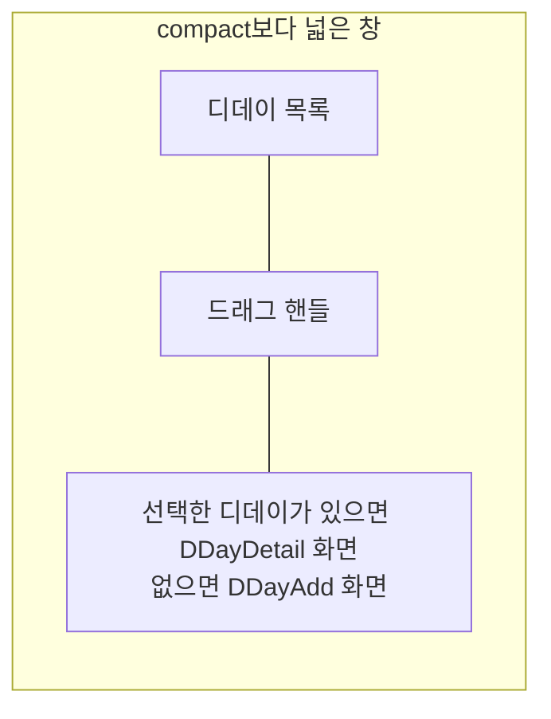

# DDay 목록·상세 배치 디자인

기준 스펙: [DDay 목록·상세 배치 스펙](../spec/client/dday-list-detail.md)

배치, 크기 조절, 버튼 노출, 진행과 피드백, 조절 상태 표시의 공통 표현과 상세 영역의 전환은 [목록·상세 배치 공통 디자인](./list-detail-pane.md)을 따르며, 이 배치는 그 문서의 `추가 화면이 선택 전 자리를 채우는 배치`에 해당한다.

## 두 영역에 두는 화면

목록 영역에는 [DDayHome 화면](./dday-home.md)의 디데이 목록을 두고, 상세 영역에는 선택한 디데이의 [DDayDetail 화면](./dday-detail.md)을 표시한다. 선택한 디데이가 없으면 [DDayAdd 화면](./dday-add.md)을 표시한다.

상세 영역에 놓인 화면의 카드와 입력도 상세 영역 폭에 맞춰 좁아지고, 카드 행의 이름이 줄바꿈되는 기준은 [DDayAdd 화면 디자인](./dday-add.md)의 `카드 행 공통`을 따른다. DDayAdd의 프리셋 줄이 상세 영역 폭에 들어가지 않으면 같은 문서의 `프리셋 줄`에 따라 가로로 스크롤한다.

## 버튼 노출

상세 영역에 놓인 DDayAdd와 DDayDetail의 상단 바에는 뒤로가기 버튼을 표시하지 않는다. 상단 바 제목, DDayDetail 상단 바의 삭제 버튼, 디데이 추가와 수정을 실행하는 떠 있는 버튼, 본문의 프리셋 칩과 카드 안의 버튼은 그대로 표시한다.

## 목록 영역의 컨트롤

목록 영역 상단 바의 필터 아이콘 버튼은 상세 영역에 어느 화면이 놓여 있어도 같은 자리에 같은 모양으로 둔다. 필터 Bottom Sheet를 여는 동안에는 목록 영역과 상세 영역을 함께 어둡게 처리한 배경 아래에 그대로 두며, 표현은 [DDayHome 화면 디자인](./dday-home.md)의 `필터 진입`을 따른다. 필터를 바꿔도 상세 영역의 화면과 입력 중이던 내용은 바뀌지 않는다.

## 목록과 상세의 표시

상세 영역에서 여는 날짜 선택 다이얼로그는 상세 영역이 아니라 창 가운데에 띄우고, 목록 영역과 상세 영역을 함께 가림막 아래에 둔다. 드롭다운 메뉴는 상세 영역 안의 버튼이나 단위 선택에 맞춰 펼치되, 표시 영역 안에 들어가도록 자리를 정한다.

상세 영역에서 디데이를 추가하거나 수정한 뒤에는 바뀐 제목, 컬러와 카드 문구, 제목 순서에 따라 옮겨진 자리가 목록에 반영되는 것을 같은 화면에서 확인한다. 카드 문구가 바뀌고 카드가 자리를 옮기는 표현은 [DDayHome 화면 디자인](./dday-home.md)의 `디데이 카드`를 따른다.

상세 영역의 디데이가 고른 필터에 맞지 않아 목록에서 사라져도 상세 영역에는 그 디데이의 상세를 그대로 둔다.
