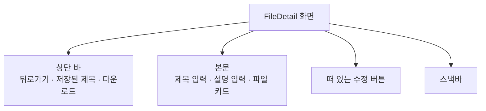
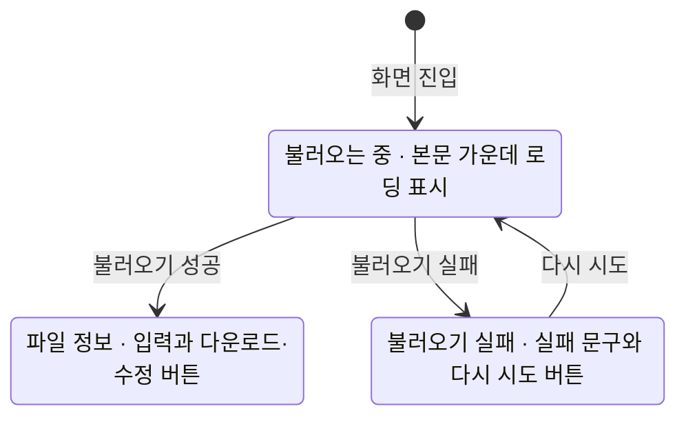

# FileDetail 화면 디자인

기준 스펙: [FileDetail 화면 스펙](../spec/client/file-detail.md), [파일 내려받기 스펙](../spec/client/file-download.md)

## 화면 구조

FileDetail 화면은 FileHome 위에 단독으로 표시하고, 창 너비와 관계없이 목록과 함께 나누어 표시하지 않는다. 공통 내비게이션 영역은 [TopLevelNavigation 디자인](./top-level-navigation.md)의 `세부 화면에서의 노출`에 따라 숨긴다.

화면 상단에는 상단 바를 두고 시작 쪽에 뒤로가기 버튼을 항상 둔다. 제목 자리에는 저장된 제목을 두고, 끝 쪽에는 다운로드 버튼 하나를 둔다. 상단 바에는 수정 동작을 두지 않고, 수정은 본문 오른쪽 아래에 떠 있는 수정 버튼으로 제공한다.

본문에는 제목 입력, 설명 입력, 파일 카드를 위에서부터 이 순서로 둔다. [FileAdd 화면 디자인](./file-add.md)과 같은 순서라 파일을 올릴 때와 고칠 때 같은 자리에서 같은 값을 찾는다. 입력 사이에는 [구성요소 간격](./dimens.md)을 두고, 본문 바깥에는 [화면 가로 여백과 화면 세로 여백](./dimens.md)을 둔다. 본문의 내용이 화면 높이를 넘으면 본문 안에서 세로로 스크롤한다.

제목 입력의 구성은 [제목 입력 디자인](./title-input.md)을, 설명 입력의 구성은 [설명 입력 컴포넌트 디자인](./description-input.md)을 따른다.

상단 바 제목은 한 줄을 유지하고 폭을 넘으면 끝을 말줄임한다. 접근성에는 생략하지 않은 전체 제목을 제공한다.

## 파일 카드

파일 카드는 본문 가로 폭을 모두 쓰는 외곽선 카드다. 카드 안에는 파일 이름 입력을 위에, 파일 크기와 올린 날짜·시각을 담은 보조 줄을 그 아래에 둔다. 카드 가장자리와 내용 사이에는 [카드 안쪽 여백](./dimens.md)을, 입력과 보조 줄 사이에는 [카드 줄 간격](./dimens.md)을 둔다.

파일 이름 입력은 `파일 이름` 라벨이 붙은 단일 줄 텍스트 입력이며 카드의 가로 폭을 모두 쓰고 입력의 밑줄과 배경은 표시하지 않는다. 시작 쪽에는 [FileHome 화면 디자인](./file-home.md)의 목록 줄과 같은 파일 아이콘을 본문 보조 색으로 둔다. 이름이 입력 폭을 넘어도 여러 줄로 늘어나지 않고 입력 안에서 가로로 옮겨 가며 확인한다. 지우기 버튼은 두지 않는다. 파일 이름은 대부분 확장자를 포함하므로, 모두 지우고 다시 쓰기보다 일부를 고치는 경우가 많기 때문이다.

보조 줄은 `크기 · 올린 날짜 올린 시각` 형태로 본문 보조 색과 목록 항목의 기본 보조 글자 크기로 표시한다. 크기와 날짜·시각의 표기는 [FileHome 화면 디자인](./file-home.md)의 `파일 목록`과 같다. 보조 줄은 누를 수 있는 자리가 아니며, 한 줄에 들어가지 않으면 줄바꿈하고 말줄임하지 않는다.

파일 이름 입력의 소프트 키보드는 자동 수정과 자동 대문자 변환을 쓰지 않는다. 키보드의 동작 키는 완료로 표시하고, 누르면 키보드를 닫는다. 동작 키로 수정을 실행하지 않는다.

## 본문 상태

불러오는 중에는 본문 가운데에 로딩 표시만 두고 어떤 입력도 표시하지 않는다. 상단 바에는 뒤로가기 버튼만 두고 제목과 다운로드 버튼을 표시하지 않으며, 수정 버튼도 표시하지 않는다.

불러오기에 실패하면 본문 가운데에 실패 문구를, 그 아래 [항목 간격](./dimens.md)을 두고 외곽선 형태의 다시 시도 버튼을 둔다. 실패 문구, 버튼과 로딩 표시의 모양, 가운데 표시의 여백과 정렬은 [FileHome 화면 디자인](./file-home.md)의 `본문 상태`가 정한 처음 불러오기 실패 표시와 같다. 상단 바는 불러오는 중과 같다.

본문 상태가 바뀔 때는 교차 페이드로 전환하고, 지속 시간과 완급은 전환 기본값을 따른다.

불러오기에 성공하면 세 입력에 저장된 값을 채운다. 저장된 설명이 비어 있으면 설명 입력을 비운 채 둔다. 입력이 비어 있는 상태에 오류 색이나 필수 표시를 상시로 두지 않는다.

## 수정 버튼

수정 버튼은 본문의 끝 쪽 아래 모서리에 떠 있는 버튼으로 두고 체크 아이콘을 쓴다. 이는 [MusicDetail 화면 디자인](./music-detail.md)의 수정 버튼과 같은 표현이다.

수정 버튼은 제목, 설명, 파일 이름 중 하나라도 저장된 값과 다를 때만 표시하며, 나타나고 사라지는 표현은 [나타나고 사라지는 버튼 디자인](./button-visibility.md)을 따른다. 제목이나 파일 이름이 비어 있어도 저장된 값과 다르면 버튼을 표시하고, 미입력 안내는 수정을 실행한 시점에만 제공한다.

수정을 처리하는 동안에는 체크 아이콘 자리를 [진행 표시 크기](./dimens.md)의 원형 진행 표시로 바꾼다. 처리 중에도 입력과 다운로드 버튼을 잠그거나 흐리게 바꾸지 않는다. 처리 중에 입력을 저장된 값과 같게 되돌리면 버튼은 진행 표시와 함께 사라진다.

물리 키보드 환경에서는 수정 버튼이 표시된 동안 `Cmd` 또는 `Meta`와 `Enter`를 함께 눌러 수정을 실행할 수 있다. 이는 [MusicDetail 화면 디자인](./music-detail.md)의 수정 단축키와 같다.

본문의 마지막 요소인 파일 카드가 수정 버튼에 가리지 않도록, 버튼이 보이는 동안 본문 아래쪽에 [플로팅 액션 버튼 아래 여백](./dimens.md)을 둔다.

## 다운로드 버튼

다운로드 버튼은 아래쪽 화살표가 받침 위에 놓인 다운로드 아이콘만 표시하는 아이콘 버튼이다. 설명 표시는 [아이콘 버튼 설명 디자인](./icon-button-tooltip.md)을 따른다.

내려받는 동안에는 아이콘 자리를 [진행 표시 크기](./dimens.md)의 원형 진행 표시로 바꾼다. 진행 표시에는 진행률을 나타내지 않는다. 버튼을 흐리게 표시하지 않고 접근성 이름도 그대로 유지하며, 눌러도 아무 일이 일어나지 않는다. 내려받는 동안에도 입력과 수정 버튼은 그대로 쓸 수 있다.

내려받기에 성공하거나 실패하면 진행 표시를 아이콘으로 되돌리고 결과를 스낵바로 표시한다. 웹에서 성공하면 브라우저의 다운로드 표시가 결과를 알리므로 스낵바를 표시하지 않는다.

플랫폼마다 내려받은 파일이 놓이는 자리는 [파일 내려받기 스펙](../spec/client/file-download.md)의 `feature > 제공 범위`를 따르며, 내려받은 뒤 파일을 여는 버튼이나 저장 위치로 이동하는 동작은 두지 않는다.

## 진행과 피드백

수정 성공, 수정 실패, 미입력과 이름 길이 안내, 다운로드 결과는 모두 스낵바로 표시하고 동작 버튼은 두지 않는다. 표시 시간은 Material 기본의 짧은 표시 시간이다. 새 안내를 표시할 때 이미 보이는 스낵바가 있으면 표시 시간이 지나기를 기다리지 않고 즉시 새 안내로 바꾼다. 스낵바는 수정 버튼을 가리지 않도록 버튼 위에 표시한다.

제목 미입력 안내, 파일 이름 미입력 안내와 이름 길이 안내는 수정 처리와 같은 진행 표시를 거치지 않고 곧바로 표시하며, 입력 초점을 해당 입력으로 옮긴다.

수정에 성공해도 입력 내용을 비우거나 되돌리지 않으며, 입력이 저장된 값과 같아지면 수정 버튼은 사라진다. 상단 바 제목은 새로 저장된 제목으로 바뀐다.

화면이 회전하거나 시스템이 화면을 재생성하면 보이던 스낵바는 닫히고 다시 나타나지 않는다. 재생성된 뒤 끝난 수정과 다운로드의 결과는 재생성된 화면에서 스낵바로 표시한다.

## 표시 영역과 소프트 키보드

본문, 수정 버튼과 스낵바는 상태 표시 영역, 시스템 탐색 영역과 카메라 컷아웃 등 기기가 가리는 영역을 침범하지 않게 배치한다.

소프트 키보드가 나타나면 본문과 수정 버튼을 키보드 위 영역에 맞춰 배치하고, 초점이 있는 입력이 키보드에 가리지 않도록 본문을 세로로 스크롤한다. 진입할 때는 어느 입력에도 초점을 두지 않으므로 소프트 키보드도 열지 않는다.

## 적응형 배치

본문의 배치는 창 너비, 창 높이와 기기 자세에 따라 달라지지 않는다.

## 문구와 접근성

한국어 환경과 그 외 기본 환경에서 다음 문구를 사용한다.

| 항목 | 한국어 | 그 외 기본 |
| --- | --- | --- |
| 상단 바 제목 | 저장된 제목 | 저장된 제목 |
| 뒤로가기 버튼 접근성 이름 | `뒤로가기` | `Navigate up` |
| 다운로드 버튼 접근성 이름 | `다운로드` | `Download` |
| 수정 버튼 접근성 이름 | `파일 수정` | `Update file` |
| 파일 이름 입력 라벨 | `파일 이름` | `File name` |
| 불러오기 실패 문구 | `파일을 불러오지 못했습니다` | `Couldn't load the file` |
| 다시 시도 버튼 | `다시 시도` | `Retry` |
| 로딩 접근성 이름 | `파일 불러오는 중` | `Loading file` |
| 제목 미입력 안내 | `제목을 입력해 주세요.` | `Please enter a title.` |
| 파일 이름 미입력 안내 | `파일 이름을 입력해 주세요.` | `Please enter a file name.` |
| 파일 이름 길이 안내 | `파일 이름은 255자까지 입력할 수 있습니다.` | `File names can be up to 255 characters.` |
| 수정 성공 안내 | `파일이 수정되었습니다.` | `File updated.` |
| 수정 실패 안내 | `파일을 수정하지 못했습니다.` | `Couldn't update the file.` |
| 다운로드 성공 안내 | `파일을 내려받았습니다: <저장한 파일 이름>` | `Downloaded: <saved file name>` |
| 다운로드 위치 실패 안내 | `다운로드 위치에 저장하지 못했습니다. 설정에서 다운로드 위치를 확인해 주세요.` | `Couldn't save to the download location. Check it in Settings.` |
| 다운로드 실패 안내 | `파일을 내려받지 못했습니다.` | `Couldn't download the file.` |

제목 미입력 안내는 [FileAdd 화면 디자인](./file-add.md)의 같은 안내와 같은 문구다. 제목 입력의 이름과 설명 입력의 이름은 각 입력 디자인을 따른다.

상단 바 제목은 저장된 제목을 그대로 읽히게 두고 별도의 접근성 이름을 두지 않는다. 파일 이름 입력의 접근성 이름은 `파일 이름` 라벨이고, 보조 줄은 입력과 따로 읽힌다. 수정과 다운로드를 처리하는 동안에는 각 버튼이 처리 중임을 낭독 도구에 알리고 버튼의 이름은 바꾸지 않는다.
