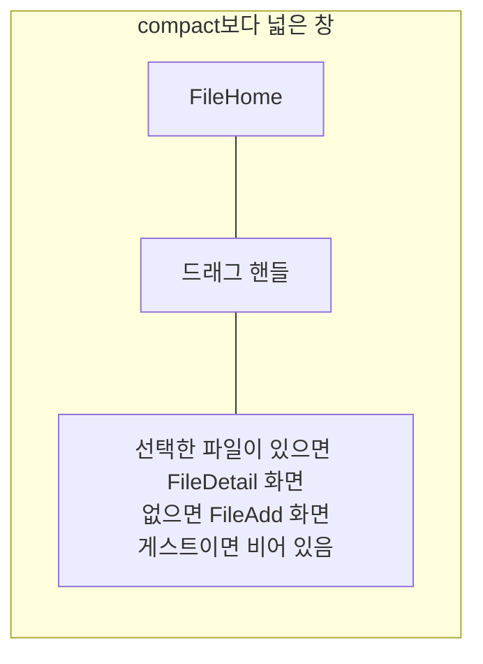

# File 목록·상세 배치 디자인

기준 스펙: [File 목록·상세 배치 스펙](../spec/client/file-list-detail.md)

배치, 크기 조절, 버튼 노출, 진행과 피드백, 조절 상태 표시의 공통 표현은 [목록·상세 배치 공통 디자인](./list-detail-pane.md)을 따른다.

## 두 영역에 두는 화면

목록 영역에는 [FileHome 화면](./file-home.md)을 두고, 상세 영역에는 선택한 파일의 [FileDetail 화면](./file-detail.md)을 표시한다. 선택한 파일이 없으면 [FileAdd 화면](./file-add.md)을 표시한다. 두 영역은 각각 자기 상단 바를 갖는다.

상세 영역에 아이콘과 안내만 두는 [목록·상세 배치 공통 디자인](./list-detail-pane.md)의 `선택 전 상세`는 이 배치에서 쓰지 않는다. 선택 전 자리를 FileAdd가 채우므로 사용자가 목록을 떠나지 않고 곧바로 입력할 수 있고, 비어 있는 안내 자리를 보지 않기 때문이다.

게스트 상태에서는 상세 영역에 아무것도 두지 않고 배경만 표시한다. 로그인 안내는 목록 영역의 [FileHome 화면 디자인](./file-home.md)의 `로그인 안내`가 이미 보여 주므로 상세 영역에서 반복하지 않는다. 상세 영역의 너비와 드래그 핸들은 그대로 두어, 로그인 뒤 FileAdd가 나타나도 두 영역의 자리와 너비 비율이 바뀌지 않는다.

파일 목록은 상세 영역과 자리를 나눠 좁아져도 [FileHome 화면 디자인](./file-home.md)의 한 열 목록을 유지하며, 상세 영역에 놓인 입력도 상세 영역 폭에 맞춰 함께 좁아진다.

## 상세 영역의 전환

목록에서 파일 줄을 누르면 상세 영역이 그 파일의 FileDetail 화면으로 바뀐다. 상세 영역에서 시스템 뒤로가기를 사용하면 상세 영역이 FileAdd 화면으로 되돌아간다.

목록에서 파일 추가 버튼을 누르면 상세 영역이 FileAdd 화면으로 바뀐다. 버튼의 노출 조건은 [목록·상세 배치 공통 디자인](./list-detail-pane.md)의 `버튼 노출`을 따르므로, 상세 영역에 이미 FileAdd가 놓여 있는 동안에는 버튼을 표시하지 않는다. FileDetail이 놓인 동안 파일 추가 버튼으로 연 FileAdd에서 시스템 뒤로가기를 사용하면 상세 영역은 그 전에 보던 파일의 FileDetail로 돌아간다.

상세 영역의 화면이 바뀔 때는 교차 전환을 쓰고, 목록 영역과 드래그 핸들의 자리와 너비 비율은 그대로 둔다. FileAdd로 되돌아갈 때 적어 두던 내용이 남는지는 기준 스펙의 `유지와 초기화 기준`을 따른다.

## 버튼 노출

목록 화면의 파일 추가 버튼과 추가 단축키를 언제 제공하는지는 [목록·상세 배치 공통 디자인](./list-detail-pane.md)의 `버튼 노출`을 따른다. 상세 영역에 FileAdd가 놓여 있는 동안에는 버튼을 표시하지 않고 추가 단축키도 처리하지 않는다. FileDetail이 놓여 있는 동안에는 버튼을 그대로 표시하며, 올리는 중에 버튼이 진행 표시로 바뀌는 표현은 [FileHome 화면 디자인](./file-home.md)을 따른다.

목록 영역 상단 바의 뒤로가기 버튼은 함께 표시하는 동안에도 그대로 두고, 누르면 상세 영역만 되돌리지 않고 두 영역을 함께 닫아 `더보기` 화면을 표시한다. 두 영역은 하나의 화면처럼 함께 사라진다.

상세 영역에 놓인 FileAdd와 FileDetail의 상단 바에는 뒤로가기 버튼을 표시하지 않는다. 상단 바 제목, FileDetail 상단 바의 다운로드 버튼, 본문의 `파일 고르기` 버튼, 파일 올리기와 파일 수정을 실행하는 떠 있는 버튼은 그대로 표시한다. FileDetail을 불러오는 중이거나 불러오기에 실패한 동안에는 상단 바에 뒤로가기 버튼도 두지 않으므로 상단 바가 비어 보인다.

## 목록과 상세의 표시

목록의 당김 새로고침과 진행 표시는 [새로고침 디자인](./sync-refresh.md)의 `적응형 배치`처럼 목록 영역 안에만 두고 상세 영역에는 두지 않는다.

FileHome의 스낵바는 목록 영역 안 아래쪽에, FileAdd와 FileDetail의 스낵바는 [목록·상세 배치 공통 디자인](./list-detail-pane.md)의 `진행과 피드백`에 따라 상세 영역 안 아래쪽에 표시한다. 상세 영역에 FileAdd가 놓인 동안 끝난 올리기의 결과는 FileAdd의 스낵바로만 표시하고, 목록 영역에는 표시하지 않는다. 상세 영역에 FileDetail이 놓인 동안 끝난 올리기의 실패는 FileHome의 스낵바로 목록 영역에 표시한다.

파일을 올리거나 고쳐 목록이 갱신될 때 목록 영역과 드래그 핸들의 자리와 너비 비율은 그대로 둔다.
