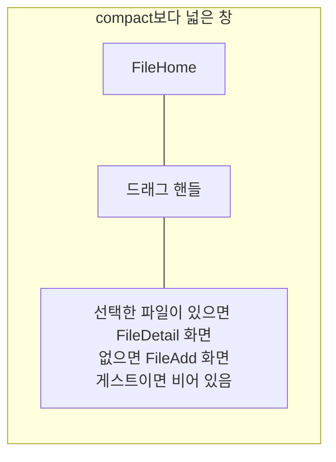

# File 목록·상세 배치 디자인

기준 스펙: [File 목록·상세 배치 스펙](../spec/client/file-list-detail.md)

배치, 크기 조절, 버튼 노출, 진행과 피드백, 조절 상태 표시의 공통 표현과 상세 영역의 전환은 [목록·상세 배치 공통 디자인](./list-detail-pane.md)을 따르며, 이 배치는 그 문서의 `추가 화면이 선택 전 자리를 채우는 배치`에 해당한다.

## 두 영역에 두는 화면

목록 영역에는 [FileHome 화면](./file-home.md)을 두고, 상세 영역에는 선택한 파일의 [FileDetail 화면](./file-detail.md)을 표시한다. 선택한 파일이 없으면 [FileAdd 화면](./file-add.md)을 표시한다.

게스트 상태에서는 상세 영역에 아무것도 두지 않고 배경만 표시한다. 로그인 안내는 목록 영역의 [FileHome 화면 디자인](./file-home.md)의 `로그인 안내`가 이미 보여 주므로 상세 영역에서 반복하지 않는다. 상세 영역의 너비와 드래그 핸들은 그대로 두어, 로그인 뒤 FileAdd가 나타나도 두 영역의 자리와 너비 비율이 바뀌지 않는다.

좁아진 파일 목록도 [FileHome 화면 디자인](./file-home.md)의 한 열 목록을 유지한다.

## 버튼 노출

FileDetail이 놓여 있는 동안 표시하는 파일 추가 버튼이 올리는 중에 진행 표시로 바뀌는 표현은 [FileHome 화면 디자인](./file-home.md)을 따른다.

상세 영역에 놓인 FileAdd와 FileDetail의 상단 바에는 뒤로가기 버튼을 표시하지 않는다. 상단 바 제목, FileDetail 상단 바의 다운로드 버튼, 본문의 `파일 고르기` 버튼, 파일 올리기와 파일 수정을 실행하는 떠 있는 버튼은 그대로 표시한다. FileDetail을 불러오는 중이거나 불러오기에 실패한 동안에는 상단 바에 뒤로가기 버튼도 두지 않으므로 상단 바가 비어 보인다.

## 목록과 상세의 표시

올리기 결과를 어느 영역의 스낵바로 표시하는지는 [File 목록·상세 배치 스펙](../spec/client/file-list-detail.md)의 `올리기 결과를 알리는 화면`을 따른다.
