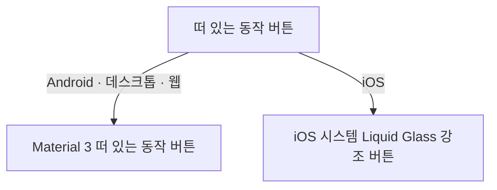

# 떠 있는 동작 버튼 디자인

이 문서는 화면 본문 위에 떠 있는 공통 동작 버튼이 플랫폼마다 어떤 표현으로 그려지는지를 소유한다. 각 화면에 어떤 버튼을 어느 자리에 어떤 조건으로 두는지와 버튼의 접근성 이름 문구는 그 화면 디자인이 소유한다.

이 문서는 이미 있는 버튼의 표현만 다루고 사용자 행위나 제품 정책을 새로 정의하지 않으므로 기준 스펙을 두지 않는다.

## 적용 대상

| 버튼 | 아이콘 |
| --- | --- |
| 떠 있는 추가 버튼 | 추가 |
| 떠 있는 확인 버튼 | 체크 |
| 떠 있는 올리기 버튼 | 올리기 |

세 버튼은 아이콘 하나만 표시하고 글자 라벨을 두지 않는다. 화면 디자인이 진행 표시를 정한 버튼은 동작이 진행되는 동안 아이콘 자리를 진행 표시로 바꾸고, 진행 중에도 버튼 이름은 유지한다.

눌러서 동작 목록을 펼치는 떠 있는 메뉴 버튼도 이 문서를 따른다. 지금은 [SettingHoliday 화면](./setting-holiday.md)의 일괄 선택 동작 버튼이 그렇다. 메뉴 버튼에 두는 항목과 순서, 아이콘과 문구, 접기 전후의 아이콘은 그 화면 디자인이 소유한다.

아이콘은 모든 플랫폼에서 같은 Material Symbols Rounded 아이콘을 쓴다.

## 플랫폼별 표현

### Android, 데스크톱, 웹

Material 3 떠 있는 동작 버튼을 그대로 쓴다. 크기, 모양, 색, 그림자는 Material 3 기본값을 따르고 이 문서에서 수치를 정하지 않는다.

진행 표시는 물결 모양 원형 진행 표시를 쓰고, 아이콘과 진행 표시 사이는 교차 전환으로 바꾼다.

[아이콘 버튼 설명](./icon-button-tooltip.md)의 설명 표시를 둔다.

### iOS

iOS 26의 시스템 Liquid Glass 강조 버튼으로 그린다. 유리 면을 앱 색 구성의 주 색으로 물들여, 상단 바의 색 없는 유리 버튼보다 화면의 주요 동작으로 두드러지게 한다.

| 요소 | 표현 |
| --- | --- |
| 모양 | 지름 `56dp`의 원형 유리 면 |
| 유리 면 색 | 앱 색 구성의 주 색으로 물들인다 |
| 아이콘 | `24dp`, 앱 색 구성에서 주 색 위에 놓이는 내용 색 |
| 진행 표시 | iOS 시스템 진행 표시를 아이콘과 같은 색으로 표시한다 |
| 그림자 | 따로 두지 않고 시스템 유리 면의 표현을 따른다 |
| 누름 | 시스템 유리 면의 누름 반응을 따른다 |

버튼이 차지하는 자리는 Android·데스크톱·웹의 떠 있는 동작 버튼과 같아서, 버튼의 위치와 [플로팅 액션 버튼 아래 여백](./dimens.md)은 플랫폼과 관계없이 같다.

진행 표시로 바뀌는 동안에는 버튼 자리를 그대로 두고 그 안에서 교차 전환한다.

iOS의 떠 있는 동작 버튼은 iOS 시스템 버튼으로 그려 길게 눌러 보는 설명이 없으므로 [아이콘 버튼 설명](./icon-button-tooltip.md)의 설명 표시를 두지 않는다. 포인터를 쓰는 iPad에서는 포인터를 올리면 시스템 설명으로 버튼의 접근성 이름을 보여 준다.

화면이 바뀌는 동안 버튼은 [상단 바](./top-bar.md)와 같이 화면 본문과 함께 교차 전환하고, 이전 화면의 전환이 끝나기를 기다리지 않는다.

[나타나고 사라지는 버튼](./button-visibility.md)이 대상으로 꼽은 떠 있는 버튼은 iOS에서도 그 문서의 떠 있는 버튼 모션으로 유리 면 전체가 커지고 작아진다.

## 떠 있는 메뉴 버튼

### Android, 데스크톱, 웹

Material 3 떠 있는 동작 버튼 메뉴를 그대로 쓴다. 버튼을 누르면 버튼 위쪽에 항목을 쌓아 펼치고, 다시 누르면 접는다. 펼침과 접힘의 모션, 아이콘 전환은 화면 디자인을 따른다.

### iOS

버튼은 `iOS`의 떠 있는 동작 버튼과 같은 강조 유리 버튼으로 그리고, 화면 디자인이 정한 접힌 상태의 아이콘을 둔다.

버튼을 누르면 버튼에서 iOS 시스템 메뉴를 펼친다. 메뉴는 시스템 Liquid Glass 표현을 따르고, 항목은 화면 디자인이 정한 순서대로 문구와 아이콘을 함께 둔다. 시스템 메뉴가 펼친 상태를 보여 주므로 버튼 아이콘을 닫기 아이콘으로 바꾸지 않는다.

항목을 고르면 그 동작을 실행하고 메뉴를 닫는다. 메뉴 바깥을 누르면 아무것도 실행하지 않고 메뉴만 닫는다.

메뉴 버튼의 접근성 이름은 화면 디자인이 정한 접힌 버튼의 이름을 쓴다.

## 시스템 영역

버튼은 내비게이션 바, 홈 표시기, 디스플레이 컷아웃, 소프트 키보드와 겹치지 않는 자리에 둔다. 그 자리는 플랫폼과 관계없이 같고 각 화면 디자인과 공통 배치 문서가 정한다.

## 접근성

모든 플랫폼에서 버튼의 접근성 이름은 화면 디자인이 정한 문구를 쓰고, 낭독 도구에 버튼으로 알린다. 진행 표시로 아이콘이 바뀐 동안에도 버튼 이름을 유지한다.

## 참고

- [Liquid Glass – Apple Developer](https://developer.apple.com/documentation/technologyoverviews/liquid-glass)
- [Floating action buttons – Material Design 3](https://m3.material.io/components/floating-action-button/overview)
