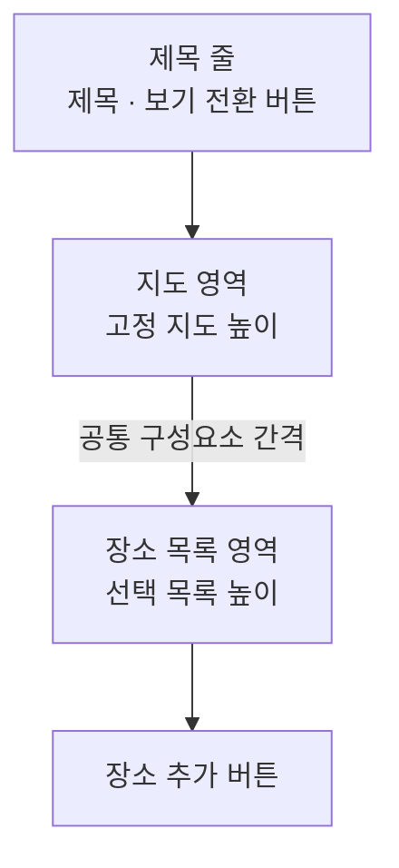

# 메모 장소 카드 컴포넌트 디자인

기준 스펙: [메모 장소 카드 컴포넌트 스펙](../spec/client/memo-place-card.md), [메모 장소 스펙](../spec/common/memo-place.md)

## 구성과 배치

장소 카드에는 지도 영역을 맨 위에 두고, 그 아래에 연결된 장소의 칩과 장소 추가 칩을 표시하는 칩 영역을 둔다. 지도가 장소 카드임을 드러내므로 별도의 라벨은 두지 않는다.

지도 영역은 카드 가로 폭을 모두 사용한다. 지도 영역과 칩 영역이 카드 높이를 나누는 방식은 카드가 높이를 지정받는지에 따라 갈리고, 칩 영역의 높이는 [공통 칩 영역 높이](./dimens.md)를 따른다.

카드 높이가 정해지지 않은 배치에서는 지도 영역 높이를 [공통 고정 지도 높이](./dimens.md)로 고정하고, 칩 영역은 칩 영역 높이를 최소로 삼아 연결된 장소가 늘면 그만큼 커진다. 칩 영역이 커지면 카드 전체 높이가 커지므로 카드 뒤에 이어지는 요소는 밀린다.

카드가 높이를 지정받는 배치에서는 칩 영역을 칩 영역 높이로 고정하고, 지도 영역이 카드 높이에서 그 높이를 뺀 나머지를 채운다. 칩 전체 높이가 칩 영역을 넘으면 칩 영역 안에서 세로로 스크롤한다. 카드 높이가 칩 영역 높이보다 크지 않으면 칩 영역 높이를 먼저 지킨다. 카드를 쓰는 화면에서 카드에 높이를 주는 배치는 [메모 본문 배치 디자인](./memo-form.md)을 따른다.

## 지도 영역

지도 영역의 지도와 지도 제공자 전환 컨트롤의 구성, 지도 조작과 지도 컨트롤은 [DiaryMap 컴포넌트 디자인](./diary-map.md)을 따른다.

카드의 지도는 지점 선택을 사용하지 않으므로 지점 표시를 두지 않는다.

지도를 표시하지 않는 동안에는 지도 영역을 비워 두고, 지도 영역과 칩 영역의 자리와 크기는 바꾸지 않는다. 별도의 로딩 표시나 오류 안내도 배치하지 않는다.

장소를 눌러 지도를 옮길 때는 이동 애니메이션 없이 그 장소의 좌표를 바로 지도 가운데에 둔다.

## 지도 핀

지도 영역에는 칩 영역과 같은 장소를 핀으로 표시한다. 핀의 색은 장소의 컬러이고 라벨은 장소의 제목이다.

핀의 마커와 라벨 표현, 겹침 처리와 애니메이션은 [DiaryMap 컴포넌트 디자인](./diary-map.md)의 핀 표시를 따른다.

연결된 장소가 바뀌어 칩이 갱신되면 핀도 같은 장소들로 함께 갱신되며, 갱신 시 핀 이동 애니메이션은 지정하지 않는다. 칩이 자리를 옮기는 애니메이션은 지도 위 핀에 적용하지 않는다.

지도 영역은 핀 선택을 사용하는 상태로 배치한다. 사용자가 핀을 누르면 그 장소의 [PlaceDetail 화면](./place-detail.md)으로 이동하며, 누를 수 있는 자리와 누르는 동안의 표현은 [DiaryMap 컴포넌트 디자인](./diary-map.md)의 핀 선택을 따른다. 핀을 눌러 이동할 때 지도 영역과 칩 영역에는 이동을 알리는 표시를 두지 않는다.

칩을 누르면 그 장소가 지도 가운데에 있지 않을 때는 지도를 그 장소로 옮기고, 이미 가운데에 있을 때는 핀을 누른 것과 같이 장소 상세로 이동한다. 핀은 언제나 장소 상세로 이동한다. 첫 누름과 핀의 조작을 구분해 알리기 위해 각각의 접근성 이름을 다르게 둔다.

## 장소 칩

장소 칩에는 장소에 저장된 컬러로 채운 작은 원형 표시와 장소 제목을 표시한다. 장소 제목이 칩에서 쓸 수 있는 폭을 넘었을 때의 표시와 칩 하나의 최대 폭은 [칩 이름 표시 디자인](./chip.md)을 따르며, 장소 추가 칩에도 같은 규칙이 적용된다.

칩의 줄바꿈, 간격과 정렬, 칩이 자리를 옮길 때의 애니메이션은 [메모 웹 입력 컴포넌트 디자인](./memo-web-input.md)의 `구성과 배치`와 같다. 칩 영역이 고정 높이로 스크롤하는 배치에서도 줄은 칩 영역의 위쪽부터 쌓는다.

장소 칩을 누르면 그 장소가 지도 가운데에 있지 않을 때는 지도가 그 장소의 좌표로 이동하고, 이미 가운데에 있을 때는 그 장소의 [PlaceDetail 화면](./place-detail.md)으로 이동한다. 지도가 표시되지 않는 동안에는 눌러도 반응하지 않는다. 상세로 이동할 때 칩 영역에는 이동을 알리는 표시를 두지 않는다. 칩에는 버튼 역할과 지도에서 위치를 보여 준다는 동작 접근성 이름을 제공한다. 동작 접근성 이름은 첫 누름의 결과인 지도에서 위치 보기를 알리고, 그 장소가 지도 가운데에 있는지에 따라 바꾸지 않는다. 가운데 여부는 사용자가 지도를 볼 때에만 드러나는 상태라, 이름이 지도 상태에 따라 바뀌면 같은 항목이 읽을 때마다 다르게 안내되기 때문이다.

## 장소 추가 칩

칩 영역의 장소 칩 흐름 마지막에는 장소 추가 칩을 표시한다. 목록이 바뀌어 칩이 자리를 옮겨도 장소 추가 칩은 항상 마지막에 둔다.

장소 추가 칩에는 추가를 나타내는 플러스 아이콘과 `장소 선택` 라벨을 표시한다. 연결된 장소가 없으면 칩 영역에는 장소 추가 칩만 표시한다.

장소 추가 칩을 누르면 기준 스펙의 `추가 항목의 동작 판정`에 따라 장소 선택 목록을 열거나 PlaceAdd 화면으로 이동한다. 어느 동작으로 이어지든 칩의 표현은 같으며, 동작에 따라 라벨이나 아이콘을 바꾸지 않는다. 칩에는 버튼 역할과 장소 선택으로 이어짐을 알리는 동작 접근성 이름을 제공한다.

PlaceAdd 화면으로 이동할 때 별도의 안내나 전환 표시를 두지 않고 바로 이동한다.

## 장소 선택 목록

장소 선택 목록은 [태그 선택 입력 공통 디자인](./tag-select-input.md)의 `태그 선택 목록`과 같은 대화상자 형태로 연다.

목록은 대화상자로 표시하고, 제목과 목록 내용의 여백은 [태그 선택 입력 공통 디자인](./tag-select-input.md)의 `태그 선택 목록`과 같다.

목록의 각 항목은 [선택 목록 항목 디자인](./picker-row.md)을 따르고, 장소 컬러로 채운 컬러 원형 표시와 장소 제목을 표시한다. 보조 줄은 두지 않는다. 항목이 목록에 들어오거나 빠질 때는 위치 변화에 애니메이션을 적용한다.

목록이 차지하는 자리의 높이와 스크롤은 [태그 선택 입력 공통 디자인](./tag-select-input.md)의 `태그 선택 목록`과 같다.

사용자가 항목을 누르면 그 장소의 선택 여부를 바꾼다.

아직 준비되지 않은 자리에는 [페이지 조회 목록의 자리 표시 디자인](./paged-list-placeholder.md)에 따라 자리 표시 행을 표시한다. 이 목록의 자리 표시 행은 컬러 표시와 제목을 비워 두고, 체크 표시는 선택하지 않은 상태로 표시한다.

불러오기에 실패했을 때 이미 나타난 항목을 유지하고 재시도 동작을 두지 않는 기준은 기준 스펙의 `장소 선택 목록`을 따르며, 별도의 오류 표시도 두지 않는다. 목록을 닫았다가 다시 열면 스크롤 위치를 이어받지 않고 목록의 맨 위에서 시작한다.

선택과 해제에는 진행 표시를 두지 않는다. 항목을 누르면 체크 표시가 곧바로 바뀌고, 반영된 결과는 칩 영역과 지도 위 핀에 이어서 나타난다.

검색어가 비어 있는데 나타낼 장소가 없으면 목록 자리를 비워 두고 별도의 안내 문구를 두지 않는다. 목록을 처음 준비하는 동안에도 같다. 검색어를 입력해 나타낼 장소가 없어졌을 때의 표시는 `장소 선택 목록의 검색 결과 없음`을 따른다.

사용자는 목록 바깥을 누르거나 뒤로가기로 목록을 닫을 수 있다. 확인 버튼은 두지 않는다. 항목을 누르는 것이 곧 반영이므로 별도의 확인 단계를 두지 않는다.

## 장소 선택 목록의 검색 입력

목록 보기에서는 목록 제목 바로 아래, 목록 위에 검색 입력을 상시 표시한다. 자리, 구성, 자리 표시 문구의 역할, 목록과의 간격, 초점과 소프트 키보드 동작은 [태그 선택 입력 공통 디자인](./tag-select-input.md)의 `태그 선택 목록의 검색 입력`과 같고, 자리 표시 문구만 장소의 문구를 쓴다.

## 장소 선택 목록의 검색 결과 없음

검색어를 입력해 나타낼 장소가 없어지면 목록 자리에 안내 문구를 표시한다. 안내의 구성, 배치, 전환과 안내를 표시하는 동안의 다른 요소 처리는 [태그 선택 입력 공통 디자인](./tag-select-input.md)의 `태그 선택 목록의 검색 결과 없음`과 같고, 문구만 장소의 문구를 쓴다. 표시하는 조건은 기준 스펙의 `장소 검색`을 따른다.

안내를 표시하는 동안에도 지도 영역과 칩 영역의 표시는 바뀌지 않는다.

## 장소 선택 목록의 보기 전환

목록 제목 줄의 끝 쪽에 보기 전환 버튼을 아이콘 버튼으로 둔다. 제목은 시작 쪽에 그대로 두고, 버튼은 제목 줄의 세로 가운데에 맞춘다.

버튼에는 지금 누르면 바뀔 보기를 나타내는 아이콘을 표시한다. 목록 보기에서는 접힌 지도 아이콘을, 지도 보기에서는 가로 줄이 쌓인 목록 아이콘을 표시하며, 두 아이콘은 [장소 보기 모드 디자인](./place-view-mode.md)의 전환 컨트롤과 같은 아이콘이다. 아이콘만 표시하므로 [아이콘 버튼 설명 디자인](./icon-button-tooltip.md)의 설명 표시를 함께 둔다.

카드의 지도가 표시되지 않는 동안에는 보기 전환 버튼을 자리까지 함께 감춘다. 비활성 상태로 남기지 않는 것은 사용자가 누를 수 없는 이유를 대화상자에서 알 수 없기 때문이다. 이 기준은 [장소 검색 다이얼로그 디자인](./place-search-dialog.md)의 `여는 컨트롤`과 같다.

보기를 바꿀 때 제목 아래의 내용은 이전 보기가 사라지면서 새 보기가 나타나는 교차 페이드로 전환하고, 버튼의 아이콘도 같은 교차 페이드로 바뀐다. 지속 시간과 완급은 전환 기본값을 따른다. 제목 줄과 장소 추가 버튼은 전환하는 동안 자리를 옮기지 않는다.

지도 보기로 바꾸면 검색 입력이 사라지므로 검색 입력의 초점이 풀리고 소프트 키보드가 닫힌다. 목록 보기로 돌아와도 검색 입력에 초점을 다시 두지 않으며, 사용자가 입력을 누르면 초점과 소프트 키보드가 함께 열린다. 목록 보기의 스크롤 위치는 지도 보기에 다녀오면 목록의 맨 위에서 다시 시작한다.

## 장소 선택 목록의 지도 보기

지도 보기에서는 제목 아래에 위에서 아래로 지도 영역, 장소 목록 영역을 두고, 그 아래에 목록 보기와 같은 장소 추가 버튼을 둔다. 지도 보기에는 검색 입력을 두지 않는다.

지도 영역은 대화상자 내용의 가로 폭을 모두 쓰고 높이는 [공통 고정 지도 높이](./dimens.md)로 둔다. 지도 영역과 장소 목록 영역 사이에는 [공통 구성요소 간격](./dimens.md)을 둔다. 장소 목록 영역은 목록 보기의 목록과 같이 [공통 선택 목록 높이](./dimens.md)를 차지하며, 표시 영역이 좁아 그 높이를 다 쓸 수 없으면 줄어든 높이를 장소 목록 영역이 흡수한다. 지도 영역의 높이는 줄이지 않는다.

지도와 지도 제공자 전환 컨트롤의 구성, 지도 조작과 지도 컨트롤은 [DiaryMap 컴포넌트 디자인](./diary-map.md)을 따르고, 전환 컨트롤의 배치는 환경별 기본 구성을 그대로 쓴다. 지도 보기는 지점 선택을 사용하지 않으므로 지점 표시를 두지 않는다. 지도 위에서 끄는 조작은 지도를 옮기기만 하고 대화상자를 닫거나 옮기지 않는다.

지도 영역에는 장소 목록 영역과 같은 장소를 핀으로 표시한다. 핀의 색은 장소의 컬러이고 라벨은 장소의 제목이며, 마커와 라벨 표현, 겹침 처리, 누를 수 있는 자리와 누르는 동안의 표현은 [DiaryMap 컴포넌트 디자인](./diary-map.md)의 `핀 표시`와 `핀 선택`을 따른다. 핀에는 선택 여부를 표시하지 않는다. 선택 여부는 장소 목록 영역의 체크 표시가 알린다.

사용자가 핀을 누르면 그 장소의 선택 여부를 바꾼다. 지도와 핀에는 바뀐 것을 알리는 별도의 표시를 두지 않고, 장소 목록 영역에서 같은 장소의 체크 표시가 곧바로 바뀐다.

장소 목록 영역의 각 항목은 목록 보기와 같이 [선택 목록 항목 디자인](./picker-row.md)을 따르고, 장소 컬러로 채운 컬러 원형 표시와 장소 제목을 표시한다. 보조 줄은 두지 않는다. 항목을 누르면 그 장소의 선택 여부를 바꾸며, 지도를 옮기지 않는다. 지도 보기의 항목에는 지도에서 위치를 보여 준다는 동작 접근성 이름을 두지 않는다. 누른 결과가 목록 보기와 같은 선택과 해제이기 때문이다.

지도를 옮겨 항목이 들어오거나 빠질 때는 자리 이동에 애니메이션을 적용하지 않고 바로 교체한다. 지도를 옮기는 동안 목록이 여러 번 바뀌므로 목록이 계속 움직이지 않게 하기 위한 것이며, [장소 검색 다이얼로그 디자인](./place-search-dialog.md)의 결과 목록과 같다. 지도 보기의 목록은 페이지로 나누지 않으므로 자리 표시 행을 두지 않는다.

지도는 표시되었지만 보이는 영역을 아직 확인하지 못한 동안에는 장소 목록 영역을 항목, 안내와 진행 표시 없이 비워 둔다.

## 장소 선택 목록의 지도 보기 장소 없음

보이는 영역 안에 나타낼 장소가 없으면 장소 목록 영역 자리에 안내 문구를 표시한다. 안내의 구성, 배치와 전환은 [태그 선택 입력 공통 디자인](./tag-select-input.md)의 `태그 선택 목록의 검색 결과 없음`과 같고, 문구만 아래 `문구와 접근성`의 지도 보기 문구를 쓴다. 표시하는 조건은 기준 스펙의 `지도 보기에 나타나는 장소`를 따른다.

안내를 표시하는 동안에도 지도 영역과 장소 추가 버튼은 같은 자리에 그대로 표시하고, 사용자가 지도를 옮겨 영역 안에 장소가 들어오면 안내와 목록이 교차 페이드로 오간다.

## 장소 선택 목록의 장소 추가 버튼

목록 아래에 장소 추가 버튼을 둔다. 배치, 크기, 스크롤과의 관계, 목록이 비어 있을 때의 표시는 [태그 선택 입력 공통 디자인](./tag-select-input.md)의 `태그 선택 목록의 태그 추가 버튼`과 같고, 라벨과 접근성 이름만 장소의 문구를 쓴다.

버튼을 누르면 목록을 닫고 PlaceAdd 화면으로 이동한다. 이동할 때 별도의 안내나 전환 표시를 두지 않으며, 지도 영역의 표시도 바꾸지 않는다.

## 문구와 접근성

한국어 환경과 그 외 기본 환경에서 다음 문구를 사용한다.

| 항목 | 한국어 | 그 외 기본 |
| --- | --- | --- |
| 지도 영역 접근성 이름 | `메모 장소 지도` | `Memo place map` |
| 장소 칩 동작 접근성 이름 | `지도에서 위치 보기` | `Show location on map` |
| 장소 추가 칩 라벨 | `장소 선택` | `Select place` |
| 장소 선택 동작 접근성 이름 | `장소 선택` | `Select place` |
| 장소 선택 목록 제목 | `장소 선택` | `Select Place` |
| 장소 선택 목록 장소 추가 버튼 라벨 | `장소 추가` | `Add place` |
| 장소 추가 동작 접근성 이름 | `장소 추가` | `Add place` |
| 장소 선택 목록 검색 입력 자리 표시 문구 | `장소 검색` | `Search places` |
| 장소 선택 목록 검색 결과 없음 제목 문구 | `검색 결과가 없습니다` | `No search results` |
| 장소 선택 목록 검색 결과 없음 보조 문구 | `다른 검색어로 찾아보세요` | `Try a different search query.` |
| 목록 보기에서 보기 전환 버튼 접근성 이름 | `지도로 보기` | `Show map` |
| 지도 보기에서 보기 전환 버튼 접근성 이름 | `목록으로 보기` | `Show list` |
| 지도 보기 지도 영역 접근성 이름 | `장소 선택 지도` | `Place selection map` |
| 지도 보기 장소 없음 제목 문구 | `이 지역에 장소가 없습니다` | `No places in this area` |
| 지도 보기 장소 없음 보조 문구 | `지도를 옮겨 다른 곳을 찾아보세요` | `Move the map to look elsewhere.` |

보기 전환 버튼의 접근성 이름은 지금 어떤 보기인지가 아니라 누르면 바뀔 보기를 알리며, [장소 보기 모드 디자인](./place-view-mode.md)의 전환 컨트롤과 같은 문구를 쓴다. 보기가 바뀌어도 별도의 낭독 안내는 두지 않는다.

지도 위 핀의 접근성 이름과 지도 제공자 전환 컨트롤의 문구와 접근성 이름은 [DiaryMap 컴포넌트 디자인](./diary-map.md)을 따른다.
