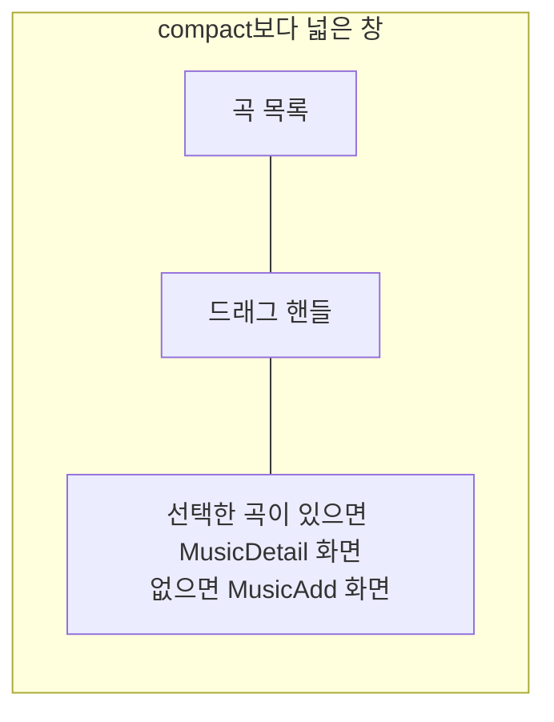

# Playlist 목록·상세 배치 디자인

기준 스펙: [Playlist 목록·상세 배치 스펙](../spec/client/playlist-list-detail.md)

배치, 크기 조절, 버튼 노출, 진행과 피드백, 조절 상태 표시의 공통 표현과 상세 영역의 전환은 [목록·상세 배치 공통 디자인](./list-detail-pane.md)을 따르며, 이 배치는 그 문서의 `추가 화면이 선택 전 자리를 채우는 배치`에 해당한다.

## 두 영역에 두는 화면

목록 영역에는 [PlaylistHome 화면](./playlist-home.md)의 곡 목록을 두고, 상세 영역에는 선택한 곡의 [MusicDetail 화면](./music-detail.md)을 표시한다. 선택한 곡이 없으면 [MusicAdd 화면](./music-add.md)을 표시한다.

## 버튼 노출

상세 영역에 놓인 MusicAdd와 MusicDetail의 상단 바에는 뒤로가기 버튼을 표시하지 않는다. 상단 바 제목과 본문의 불러오기 버튼, 곡 추가와 곡 수정을 실행하는 떠 있는 버튼, MusicDetail 상단 바의 외부로 열기 버튼과 삭제 버튼은 그대로 표시한다.

## 목록과 상세의 표시

목록의 정렬 줄은 [목록 정렬 디자인](./list-sort.md)에 따라 목록 영역 안에만 두고 상세 영역에는 두지 않는다. 정렬 선택 Bottom Sheet도 그 문서를 따라 창 전체를 기준으로 표시하며, 상세 영역과 자리를 나누지 않는다.

