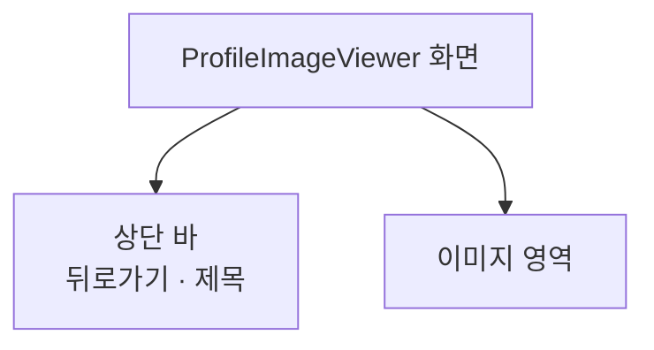

# ProfileImageViewer 화면 디자인

기준 스펙: [ProfileImageViewer 화면 스펙](../spec/client/profile-image-viewer.md)

## 화면 구조

ProfileImageViewer 화면은 MoreHome에서 이어지는 세부 화면이며, [TopLevelNavigation 디자인](./top-level-navigation.md)의 공통 내비게이션은 표시하지 않는다.

화면 상단에는 제목과 뒤로가기 버튼이 있는 상단 바를 둔다. 상단 바에는 다른 동작 버튼을 두지 않는다.

상단 바 아래의 본문 전체를 이미지 영역으로 쓴다. 이미지 영역에는 여백을 두지 않고 배경은 화면 배경색을 그대로 쓴다. 이미지는 원형으로 자르지 않고 원래 모양 그대로 보여 준다.

## 상태 표현

| 상태 | 이미지 영역 |
| --- | --- |
| 불러오는 중 | 가운데에 원형 진행 표시 |
| 표시 | 이미지 전체가 영역 안에 들어오도록 맞춘 이미지 |
| 불러오지 못함 | 가운데에 깨진 사진 아이콘과 불러오기 실패 문구를 세로로 쌓음 |

상태가 바뀔 때 전환 모션은 두지 않는다.

## 조작

이미지를 표시하는 동안 다음 수단으로 확대·축소하고 움직인다.

| 수단 | 조작 |
| --- | --- |
| 터치 | 두 손가락 핀치로 확대·축소하고, 확대한 상태에서 한 손가락 드래그로 움직인다. 두 번 탭하면 처음 배율일 때 탭한 자리를 중심으로 2.5배로 확대하고, 확대한 상태일 때 처음 배율로 돌아간다 |
| 포인터 | 스크롤 휠 또는 트랙패드 스크롤로 포인터 위치를 중심으로 확대·축소하고, 확대한 상태에서 드래그로 움직인다. 두 번 클릭은 두 번 탭과 같다 |

스크롤로 확대·축소할 때는 휠 한 칸마다 약 `10%`씩 배율을 바꾼다.

조작이 스펙의 확대 범위를 벗어나게 하면 그 범위에 맞는 가장 가까운 상태로 곧바로 붙이고, 튕겨 돌아가는 모션은 두지 않는다. 두 번 탭으로 배율이 바뀔 때만 짧은 확대·축소 모션을 둔다.

물리 키보드나 화면 낭독 도구만으로 확대하고 움직이는 조작은 이번 범위에서 제공하지 않는다.

## 표시 영역

이미지 영역은 상태 표시 영역, 시스템 탐색 영역과 카메라 컷아웃 등 기기가 가리는 영역을 침범하지 않게 배치한다. 이 화면에는 글자 입력이 없어 소프트 키보드가 나타나지 않는다.

## 문구와 접근성

한국어 환경과 그 외 기본 환경에서는 다음 문구를 사용한다.

| 문구 | 한국어 | 그 외 기본 |
| --- | --- | --- |
| 상단 바 제목 | `프로필 이미지` | `Profile photo` |
| 뒤로가기 버튼 접근성 이름 | `뒤로가기` | `Navigate up` |
| 이미지 접근성 이름 | `프로필 이미지` | `Profile image` |
| 불러오기 실패 문구 | `이미지를 불러올 수 없습니다.` | `Couldn't load the image.` |

뒤로가기 버튼은 아이콘만 표시하므로 [아이콘 버튼 설명](./icon-button-tooltip.md)에 따라 접근성 이름과 같은 설명을 둔다.

이미지는 낭독 도구에 `프로필 이미지` 하나의 요소로 읽힌다. 진행 표시와 실패 아이콘에는 접근성 이름을 두지 않고, 실패 상태에서는 실패 문구가 읽힌다.
