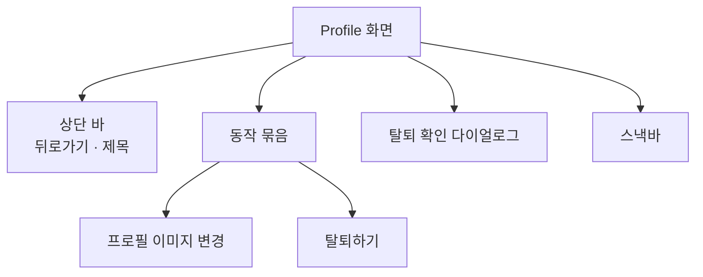
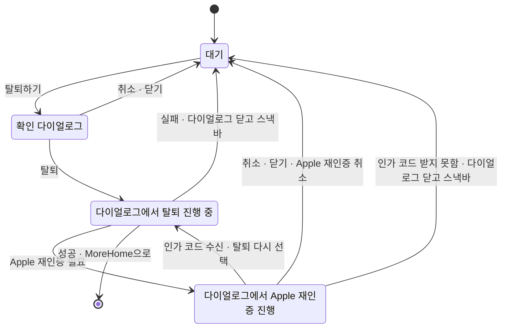

# Profile 화면 디자인

기준 스펙: [Profile 화면 스펙](../spec/client/profile.md), [계정 탈퇴 스펙](../spec/client/account-deletion.md)

## 화면 구조

Profile 화면은 MoreHome에서 이어지는 세부 화면이며, [TopLevelNavigation 디자인](./top-level-navigation.md)의 공통 내비게이션은 표시하지 않는다.

화면 상단에는 제목과 뒤로가기 버튼이 있는 상단 바를 둔다. 상단 바에는 다른 동작 버튼을 두지 않는다.

본문에는 두 동작을 세로 목록으로 배치하고, 배경과 모양, 항목 사이 간격, 누름 상태의 표현은 [묶음 목록 항목 디자인](./segmented-list-item.md)을 따른다. 본문 둘레에는 [화면 가로 여백](./dimens.md)과 [화면 세로 여백](./dimens.md)을 둔다. 순서는 위에서부터 `프로필 이미지 변경`, `탈퇴하기`다.

## 동작 항목

각 항목은 시작 쪽 아이콘과 이름 문구 한 줄로 구성한다. 보조 문구는 두지 않는다.

| 항목 | 아이콘 | 글자와 아이콘 색 |
| --- | --- | --- |
| `프로필 이미지 변경` | 사진 아이콘 | 기본 글자색 |
| `탈퇴하기` | 사람 빼기 아이콘 | 테마의 오류 색 |

`탈퇴하기`는 되돌릴 수 없는 동작이므로 오류 색으로 다른 항목과 구분한다. 배경은 다른 항목과 같은 묶음 색을 쓴다.

항목을 누르면 `프로필 이미지 변경`은 ProfileImageEdit 화면으로 이동하고, `탈퇴하기`는 탈퇴 확인 다이얼로그를 연다.

## 탈퇴 확인 다이얼로그

`탈퇴하기`를 누르면 화면 가운데에 확인 다이얼로그를 띄운다. 다이얼로그는 위에서 아래로 경고 아이콘, 제목, 안내 문구, 동작 줄을 둔다.

다이얼로그의 너비는 대화상자 컴포넌트의 기본값을 따르고, 높이는 내용에 맞춘다. 창 크기와 플랫폼에 따라 구성이 달라지지 않는다.

제목 위에는 경고 아이콘을 테마의 오류 색으로 둔다. 로그아웃 확인과 달리 탈퇴는 서버와 이 기기의 데이터를 되돌릴 수 없게 지우므로 위험을 그림으로도 알린다.

동작 줄은 대화상자 컴포넌트의 기본 배치를 그대로 쓴다. `탈퇴`를 끝 쪽에, `취소`를 그 앞에 둔다. 두 동작은 배경 없는 텍스트 버튼으로 두고, `탈퇴`의 글자만 테마의 오류 색으로 칠한다.

사용자는 다이얼로그 바깥을 누르거나 뒤로가기로 다이얼로그를 닫을 수 있고, 물리 키보드 환경에서는 `Esc`로도 닫을 수 있다. 닫는 동안 탈퇴는 실행되지 않는다. 탈퇴 진행 중에는 바깥 누름, 뒤로가기, `Esc`에 반응하지 않는다.

다이얼로그가 떠 있는 동안 뒤의 화면은 흐려진 가림막으로 덮고, 뒤의 컨트롤은 누를 수 없다.

## 상태 표현

탈퇴 진행 중은 확인 다이얼로그 안에서 표현한다. 다이얼로그는 진행 중에도 같은 경고 아이콘, 제목, 안내 문구를 그대로 둔다. 안내 문구는 무엇이 지워지는지 계속 알려야 하므로 진행 표시로 바꾸지 않는다.

진행 표시는 `탈퇴` 버튼 안에 두어 `취소` 버튼과 높이와 세로 가운데가 맞게 하고, 버튼의 폭이 바뀌지 않아 `취소` 버튼의 자리가 움직이지 않게 한다.

| 상태 | `탈퇴` 동작 자리 | `취소` 동작 |
| --- | --- | --- |
| 확인 대기 | `탈퇴` 텍스트 버튼 | 누를 수 있음 |
| 탈퇴 진행 중 | `탈퇴` 버튼을 Material 비활성 표현으로 두고, 버튼 크기는 그대로 둔 채 문구를 감추고 그 자리 가운데에 원형 진행 표시를 둔다. 지름은 [진행 표시 크기](./dimens.md) | Material 비활성 표현으로 둠 |

탈퇴 진행 중 표현은 Apple 재인증이 필요한지 판단하는 동안과 서버 처리를 기다리는 동안에 쓴다. Apple 재인증 흐름이 진행되는 동안에는 기준 스펙에 따라 진행 표현을 두지 않고 확인 대기와 같이 표시한다.

Profile 화면의 두 동작 항목은 다이얼로그 뒤에 가려지므로 진행 중을 따로 표현하지 않는다.

탈퇴에 성공하면 화면이 닫히고 MoreHome 화면으로 돌아가며 별도의 안내는 표시하지 않는다.

탈퇴 실패 안내는 다이얼로그를 닫은 뒤 화면의 스낵바로 표시한다. 새 안내를 표시할 때 이미 보이는 스낵바가 있으면 표시 시간이 지나기를 기다리지 않고 즉시 새 안내로 바꾼다.

## 표시 영역

본문과 스낵바는 상태 표시 영역, 시스템 탐색 영역과 카메라 컷아웃 등 기기가 가리는 영역을 침범하지 않게 배치한다. 스낵바는 화면 아래쪽에 둔다.

창이 넓어도 묶음 목록은 화면 폭을 그대로 채운다. 이 화면에는 글자 입력이 없어 소프트 키보드가 나타나지 않는다.

## 문구와 접근성

한국어 환경과 그 외 기본 환경에서는 다음 문구를 사용한다.

| 문구 | 한국어 | 그 외 기본 |
| --- | --- | --- |
| 상단 바 제목 | `프로필` | `Profile` |
| 뒤로가기 버튼 접근성 이름 | `뒤로가기` | `Navigate up` |
| 프로필 이미지 변경 항목 | `프로필 이미지 변경` | `Change profile photo` |
| 탈퇴하기 항목 | `탈퇴하기` | `Delete account` |
| 탈퇴 확인 제목 | `탈퇴할까요?` | `Delete account?` |
| 탈퇴 확인 안내 | `계정과 서버에 저장된 모든 데이터가 삭제되며 되돌릴 수 없습니다. 이 기기에 저장된 이 계정의 데이터와 아직 서버에 반영되지 않은 변경도 함께 삭제됩니다.` | `Your account and all data stored on the server will be deleted. This can't be undone. Data for this account on this device, including changes not yet sent to the server, will also be deleted.` |
| 탈퇴 확인 동작 | `탈퇴` | `Delete` |
| 탈퇴 취소 동작 | `취소` | `Cancel` |
| 탈퇴 진행 표시 접근성 이름 | `탈퇴 진행 중` | `Deleting account` |
| 탈퇴 실패 안내 | `탈퇴하지 못했습니다. 다시 시도해 주세요.` | `Couldn't delete your account. Please try again.` |

뒤로가기 버튼은 아이콘만 표시하므로 [아이콘 버튼 설명](./icon-button-tooltip.md)에 따라 접근성 이름과 같은 설명을 둔다.

두 동작 항목의 아이콘은 문구가 전달하는 뜻을 거듭 보여주는 장식이므로 별도 접근성 이름을 두지 않는다. 항목의 이름은 표시한 문구가 된다. 다이얼로그의 경고 아이콘도 제목과 안내 문구가 뜻을 전달하므로 접근성 이름을 두지 않는다.

탈퇴 진행 중에 누를 수 없게 된 항목은 낭독 도구에 사용할 수 없는 항목으로 알린다.
