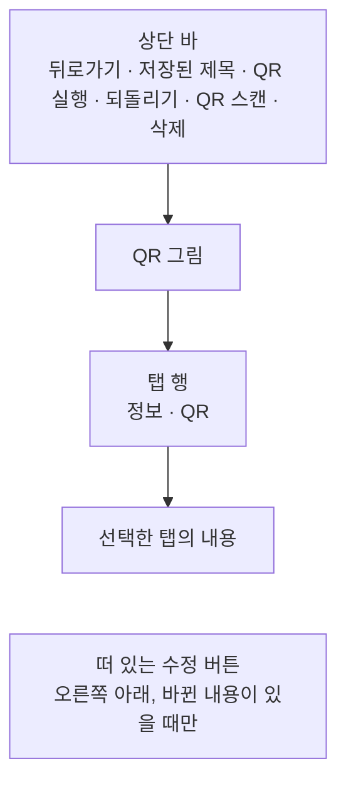
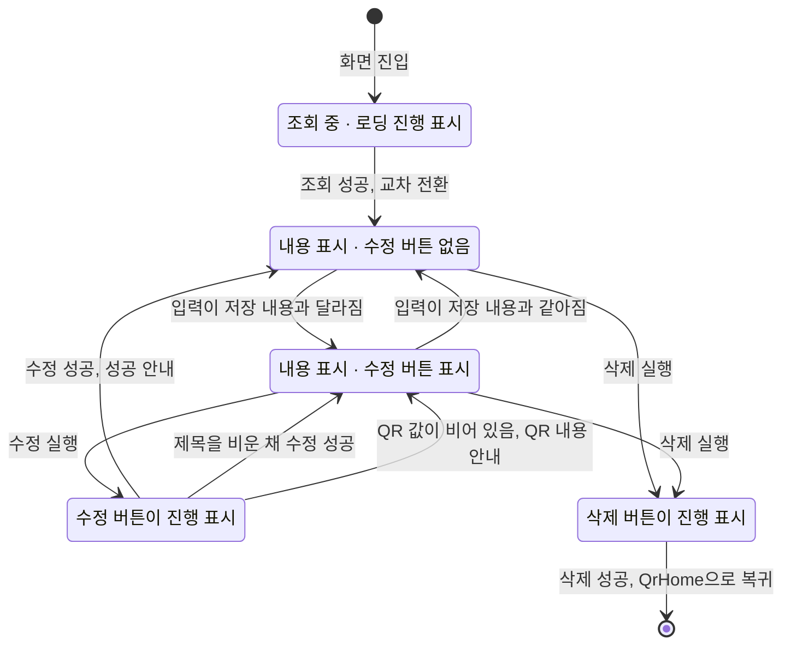

# QrDetail 화면 디자인

기준 스펙: [QrDetail 화면 스펙](../spec/client/qr-detail.md), [QR 목록·상세 배치 스펙](../spec/client/qr-list-detail.md)

QrDetail은 [QrAdd 화면 디자인](./qr-add.md)과 같은 본문을 쓰고, 상단 바 액션과 떠 있는 버튼, 상태 전환과 피드백만 다르다. 두 화면이 같은 자리에 같은 입력을 두어 사용자가 QR을 추가할 때와 고칠 때 같은 방식으로 조작한다.

## 화면 구조

QrDetail 화면은 [QrHome 화면](./qr-home.md)에서 이어지는 세부 화면으로, 창 너비에 따라 단독으로 표시하거나 [QR 목록·상세 배치 디자인](./qr-list-detail.md)에 따라 QR 목록과 함께 상세 영역에 표시한다. 공통 내비게이션 영역은 [TopLevelNavigation 디자인](./top-level-navigation.md)의 `세부 화면에서의 노출`에 따라 숨긴다.

뒤로가기 버튼의 노출 조건은 [목록·상세 배치 공통 디자인](./list-detail-pane.md)의 `버튼 노출`을 따르므로, 단독으로 표시할 때만 뒤로가기 버튼을 둔다.

화면 상단에는 상단 바를 두고, 시작 쪽에 뒤로가기 동작을, 그 바로 뒤에 저장된 QR 제목을 시작 쪽에 맞춰 표시한다. 제목은 한 줄을 유지하고, 사용 가능한 폭을 넘으면 기본 이동 속도와 간격으로 가로 이동을 시작해 화면에 표시되는 동안 횟수 제한 없이 반복한다. 접근성에는 생략하지 않은 전체 제목을 제공한다. 조회가 완료되면 상단 바 끝 쪽에 QR 실행 버튼, 되돌리기 버튼, QR 스캔 버튼, 삭제 버튼을 이 순서로 둔다. QR 실행 버튼은 실행할 수 있는 내용이 있을 때만 두며, 버튼이 없을 때는 나머지 버튼이 끝 쪽으로 모인다. 되돌리기 버튼과 QR 스캔 버튼의 순서와 표현은 [QrAdd 화면 디자인](./qr-add.md)의 `되돌리기 버튼`, `QR 스캔 버튼`과 같고, 되돌릴 수 없는 삭제를 모서리에 고정해 두는 것은 [PlaceDetail 화면 디자인](./place-detail.md)의 상단 바 액션 배치와 같은 기준이다. 이 버튼들은 선택한 탭과 관계없이 같은 자리에 둔다.

상단 바 아래 본문의 QR 그림, 탭 행, 정보 탭과 QR 탭의 구성, 간격, 스크롤과 위치 지도의 표현은 [QrAdd 화면 디자인](./qr-add.md)의 `화면 구조`, `QR 그림`, `탭 행`, `정보 탭`, `QR 탭`을 그대로 따른다. 그 문서에서 추가 성공으로 입력이 다시 채워지는 경우는 이 화면에 없다.

## QR 실행 버튼

QR 실행 버튼은 실행할 동작을 뜻하는 아이콘만 표시하고 라벨은 두지 않는다. 모양과 크기는 플랫폼 기본 아이콘 버튼을 따르고, 버튼의 이름을 알려 주는 설명 표시는 [아이콘 버튼 설명 디자인](./icon-button-tooltip.md)을 따른다. 아이콘과 이름은 동작마다 다음과 같다.

| 동작 | Material Symbols 아이콘 |
| --- | --- |
| 웹 주소 열기 | `open_in_new` |
| 전화 걸기 | `call` |
| 메일 쓰기 | `mail` |
| 문자 보내기 | `sms` |
| 지도에서 보기 | `map` |
| 연락처에 추가 | `person_add` |
| 캘린더에 추가 | `calendar_add_on` |
| Wi-Fi 연결 | `wifi` |

입력 중인 QR 값이 바뀌어 실행할 동작이 바뀌면 아이콘과 이름도 바로 바뀌며, 버튼이 나타나고 사라지는 것은 다른 상단 바 버튼처럼 전환 효과 없이 바뀐다. 버튼은 실행 중에도 진행 표시로 바꾸지 않고, 수정이나 삭제를 처리하는 동안에도 잠그지 않는다.

iOS에서 연락처나 일정 화면은 이 화면 위에 아래에서 올라오는 시스템 화면으로 뜨고, 사용자가 저장하거나 취소하면 내려가 이 화면이 그대로 보인다. Wi-Fi 연결은 Android와 iOS 모두 시스템의 확인 창이 이 화면 위에 뜨며, 확인 창이 닫히면 이 화면이 그대로 보인다.

## 삭제 버튼

상단 바 끝 쪽 모서리의 버튼에는 삭제를 뜻하는 Material Symbols `delete` 아이콘만 표시하고 라벨은 두지 않는다. 모양과 크기는 플랫폼 기본 아이콘 버튼을 따르고, 버튼의 이름을 알려 주는 설명 표시는 [아이콘 버튼 설명 디자인](./icon-button-tooltip.md)을 따른다.

삭제를 처리하는 동안에는 삭제 아이콘을 진행 표시로 바꾼다. 삭제 전에 확인 대화상자를 두지 않으며, 이는 [TagDetail 화면 디자인](./tag-detail.md)의 삭제와 같은 기준이다.

## 수정 버튼

수정 버튼은 [QrAdd 화면 디자인](./qr-add.md)의 추가 버튼과 같은 오른쪽 아래 자리에 떠 있는 버튼으로 두고 체크 아이콘을 쓴다. 이는 [PlaceDetail 화면 디자인](./place-detail.md)과 [WebDetail 화면 디자인](./web-detail.md)의 수정 버튼과 같은 표현이다.

수정 버튼은 입력한 제목, 설명 또는 QR 값이 저장 내용과 다를 때만 표시하며, 어느 탭을 보고 있든 같은 자리에 둔다. 나타나고 사라지는 표현은 [나타나고 사라지는 버튼 디자인](./button-visibility.md)을 따른다. QR 값이 비어 있어도 저장 내용과 다르므로 버튼을 표시하고, QR 내용이 필요하다는 안내는 수정을 실행한 시점에만 제공한다.

수정을 처리하는 동안에는 수정 버튼의 체크 아이콘을 진행 표시로 바꾼다. 처리 중에도 입력, 탭 행, 되돌리기 버튼과 QR 스캔 버튼을 잠그거나 흐리게 바꾸지 않으며, 수정과 삭제는 서로를 비활성으로 만들지 않는다.

물리 키보드 환경에서는 수정 버튼이 표시된 동안 `Cmd` 또는 `Meta`와 `Enter`를 함께 눌러 수정 반영을 실행할 수 있다. 이는 [QrAdd 화면 디자인](./qr-add.md)이 따르는 추가 실행 단축키와 같은 기준이다.

## 상태 전환과 동작 표시

조회 중에는 본문 가운데에 로딩 진행 표시만 두고 QR 그림, 탭 행, 탭 내용, 수정 버튼을 표시하지 않는다. 상단 바에는 단독으로 표시할 때의 뒤로가기만 두고 제목과 QR 실행·되돌리기·QR 스캔·삭제 버튼을 표시하지 않는다. 조회 중 상태와 내용 표시 상태는 서로 겹쳐 바뀌는 교차 전환을 사용한다.

조회가 완료되면 정보 탭을 선택한 상태로 저장된 제목과 설명을 채우고, QR 그림에 저장된 QR 값을 그리며, QR 탭의 포맷 선택과 포맷 입력을 저장된 QR 값에서 채운다. 글자 입력의 커서는 값의 끝에 둔다. 진입할 때는 입력 초점을 두지 않으므로 소프트 키보드도 열지 않는다.

삭제에 성공하면 단독으로 표시하고 있었으면 QrHome 화면으로 돌아가고, 목록과 함께 표시하고 있었으면 상세 영역이 [QR 목록·상세 배치 디자인](./qr-list-detail.md)의 선택 전 표시로 되돌아간다. QrHome에는 삭제 안내 스낵바를 표시하지 않는다.

## 진행과 피드백

수정 성공, QR 내용 미입력, 카메라 권한 안내와 QR 실행 실패 안내는 모두 짧게 보이는 스낵바로 화면 아래쪽에 표시하며, 스낵바에는 동작 버튼을 두지 않는다. 새 안내를 표시할 때 이미 보이는 스낵바가 있으면 즉시 새 안내로 바꾼다. 이는 [QrAdd 화면 디자인](./qr-add.md)의 `진행과 피드백`과 같은 기준이다.

QR 내용 미입력도 수정을 실행한 결과로 판단하므로 수정 처리와 같은 진행 표시를 거친 뒤 QR 탭으로 바꾸고, 초점을 옮길 입력이 보이도록 본문을 스크롤한 뒤 안내를 표시한다.

제목을 비운 채 수정해 저장된 제목이 유지되는 경우에는 별도의 안내를 표시하지 않고 수정 성공 피드백만 표시한다.

수정에 성공해도 입력, 선택한 탭, 본문의 스크롤 위치와 위치 지도의 표시는 그대로 둔다.

## 시스템 영역과 적응형 배치

상단 바는 상태 표시줄 영역을 피해 배치한다. 본문, 수정 버튼과 스낵바의 배치, 소프트 키보드 처리와 창 크기에 따른 표현은 [QrAdd 화면 디자인](./qr-add.md)의 `시스템 영역과 적응형 배치`를 따르며, 그 문서의 추가 버튼은 이 화면의 수정 버튼으로 읽는다. 수정 버튼이 보이지 않는 동안에도 본문 아래쪽 여백은 줄이지 않아 버튼이 나타날 때 본문이 움직이지 않게 한다.

## 문구와 접근성

[QrAdd 화면 디자인](./qr-add.md)의 `문구와 접근성`에 있는 탭, 포맷, 포맷별 입력, QR 내용 미입력 안내, 카메라 권한 안내, 되돌리기·QR 스캔 버튼, 위치 지도 문구를 그대로 쓰고, 다음 문구를 더한다.

| 항목 | 한국어 | 그 외 기본 |
| --- | --- | --- |
| 상단 바 제목 | 저장된 QR 제목 | 저장된 QR 제목 |
| 뒤로가기 접근성 이름 | `뒤로가기` | `Navigate up` |
| 삭제 버튼 접근성 이름 | `QR 삭제` | `Delete QR code` |
| 수정 버튼 접근성 이름 | `QR 수정` | `Update QR code` |
| 웹 주소 열기 버튼 접근성 이름 | `브라우저에서 열기` | `Open in browser` |
| 전화 걸기 버튼 접근성 이름 | `전화 걸기` | `Call` |
| 메일 쓰기 버튼 접근성 이름 | `메일 쓰기` | `Write email` |
| 문자 보내기 버튼 접근성 이름 | `문자 보내기` | `Send message` |
| 지도에서 보기 버튼 접근성 이름 | `지도에서 보기` | `Show on map` |
| 연락처에 추가 버튼 접근성 이름 | `연락처에 추가` | `Add to contacts` |
| 캘린더에 추가 버튼 접근성 이름 | `캘린더에 추가` | `Add to calendar` |
| Wi-Fi 연결 버튼 접근성 이름 | `Wi-Fi 연결` | `Connect to Wi-Fi` |
| QR 실행 실패 안내 | `QR을 실행하지 못했습니다.` | `Couldn't open the QR code.` |
| 수정 성공 안내 | `QR이 수정되었습니다.` | `QR code updated.` |
| 로딩 진행 표시 접근성 이름 | `QR 불러오는 중` | `Loading QR code` |

제목 입력의 이름과 표현은 [제목 입력 디자인](./title-input.md)을, 설명 입력은 [설명 입력 컴포넌트 디자인](./description-input.md)을 따른다. QR 그림은 화면 낭독 도구가 읽지 않는다.
