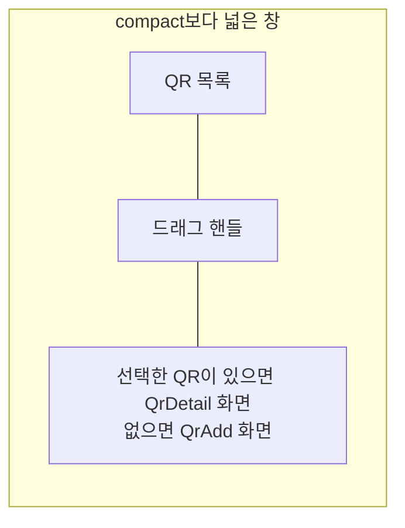

# QR 목록·상세 배치 디자인

기준 스펙: [QR 목록·상세 배치 스펙](../spec/client/qr-list-detail.md)

배치, 크기 조절, 버튼 노출, 진행과 피드백, 조절 상태 표시의 공통 표현과 상세 영역의 전환은 [목록·상세 배치 공통 디자인](./list-detail-pane.md)을 따르며, 이 배치는 그 문서의 `추가 화면이 선택 전 자리를 채우는 배치`에 해당한다.

## 두 영역에 두는 화면

목록 영역에는 [QrHome 화면](./qr-home.md)의 QR 목록을 두고, 상세 영역에는 선택한 QR의 [QrDetail 화면](./qr-detail.md)을 표시한다. 선택한 QR이 없으면 [QrAdd 화면](./qr-add.md)을 표시한다.

목록 카드의 QR 그림도 카드 폭에 맞춰 함께 좁아지고, 상세 영역에 놓인 화면의 QR 그림과 탭 행도 상세 영역 폭에 맞춰 함께 좁아진다.

## QR 스캔 화면

상세 영역에 놓인 QrAdd나 QrDetail의 QR 스캔 버튼을 누르면 목록 영역과 상세 영역을 함께 닫고 [QrScan 화면](./qr-scan.md)을 창 전체에 단독으로 표시한다. QrScan 화면에서 돌아오면 두 영역을 함께 다시 표시하며, 목록 영역과 드래그 핸들의 자리와 너비 비율, 상세 영역에 놓인 화면은 스캔하러 가기 전 그대로 둔다.

## 버튼 노출

상세 영역에 놓인 QrAdd와 QrDetail의 상단 바에는 뒤로가기 버튼을 표시하지 않는다. 상단 바 제목, QrAdd와 QrDetail 상단 바의 되돌리기 버튼과 QR 스캔 버튼, QrDetail 상단 바의 QR 실행 버튼과 삭제 버튼, QR 추가와 수정을 실행하는 떠 있는 버튼은 그대로 표시한다. QrScan 화면은 단독으로 표시하므로 [QrScan 화면 디자인](./qr-scan.md)의 뒤로가기 버튼을 그대로 둔다.

## 목록과 상세의 표시

카메라 권한 안내 스낵바는 QrAdd와 QrDetail의 피드백 스낵바와 같은 기준으로 상세 영역 안 아래쪽에 표시하고, 시스템이나 브라우저가 표시하는 권한 요청은 두 영역 위에 그대로 둔다.
