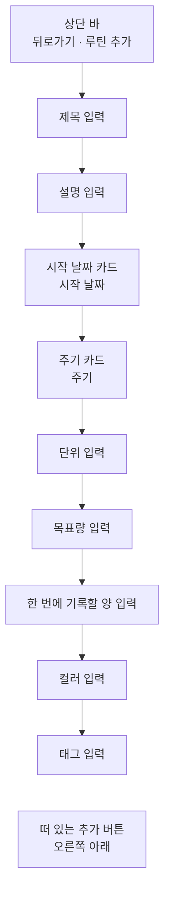

# RoutineAdd 화면 디자인

기준 스펙: [RoutineAdd 화면 스펙](../spec/client/routine-add.md), [Routine 목록·상세 배치 스펙](../spec/client/routine-list-detail.md)

화면 구조, 태그 입력의 자리, 표시 영역과 소프트 키보드, 초점과 단축키, 진행과 피드백의 공통 표현은 [항목 추가 화면 공통 디자인](./entity-add.md)을 따른다. 이 문서의 `시작 날짜 카드`, `주기 카드`, `단위 입력`, `숫자 입력 공통`, `목표량 입력`, `한 번에 기록할 양 입력`은 [RoutineDetail 화면 디자인](./routine-detail.md)도 같은 표현으로 쓴다.

## 화면 구조

RoutineAdd 화면은 [RoutineHome 화면](./routine-home.md)에서 이어지는 세부 화면으로, 창 너비에 따라 단독으로 표시하거나 [Routine 목록·상세 배치 디자인](./routine-list-detail.md)에 따라 RoutineHome과 함께 상세 영역에 표시한다. [TagDetail 루틴 탭](./tag-detail-routine.md)에서 진입한 RoutineAdd 화면은 창 너비와 관계없이 단독으로 표시한다. 공통 내비게이션 영역은 [TopLevelNavigation 스펙](../spec/client/top-level-navigation.md)의 `내비게이션 노출 기준`에 따라 단독으로 표시할 때는 숨기고, RoutineHome과 함께 표시할 때는 그대로 둔다.

뒤로가기 버튼의 노출 조건은 [목록·상세 배치 공통 디자인](./list-detail-pane.md)의 `버튼 노출`을 따르므로, 단독으로 표시할 때만 뒤로가기 버튼을 둔다.

화면 상단에는 상단 바를 두고, 시작 쪽에 뒤로가기 동작을, 그 바로 뒤에 제목을 시작 쪽에 맞춰 표시한다. 상단 바 끝 쪽에는 동작을 두지 않는다. 루틴 추가는 오른쪽 아래의 떠 있는 추가 버튼으로 표시한다.

상단 바 아래 본문에는 위에서부터 제목 입력, 설명 입력, 시작 날짜 카드, 주기 카드, 단위 입력, 목표량 입력, 한 번에 기록할 양 입력, 컬러 입력, 태그 입력을 차례로 세로로 놓고, 각 요소 사이에 [공통 여백과 간격](./dimens.md)의 `구성요소 간격`을 둔다. 본문 위아래에는 `화면 세로 여백`, 좌우에는 `화면 가로 여백`을 둔다. 모든 요소가 본문 가로 폭을 모두 사용한다.

주기 카드와 단위 입력을 두 숫자 입력 바로 위에 두는 것은 주기가 목표량을 채우는 기간을, 단위가 두 숫자를 읽는 말을 정하기 때문이다. 사용자는 주기를 고르고 단위를 적은 뒤 그 아래에서 숫자를 채운다. 단위 입력은 글자 입력이므로 카드에 담지 않고 두 숫자 입력과 같은 모양으로 그 바로 위에 이어 둔다. 태그 입력은 [항목 추가 화면 공통 디자인](./entity-add.md)의 `태그 입력의 자리`에 따라 본문 가장 마지막에 둔다. 이 화면에는 개수에 따라 높이가 변하는 다른 입력이 없다.

본문은 통째로 세로 스크롤한다.

## 제목과 설명 입력

제목 입력의 이름과 표현은 [제목 입력 디자인](./title-input.md)을, 설명 입력의 구성과 표현은 [설명 입력 컴포넌트 디자인](./description-input.md)을 따른다.

## 컬러 입력

컬러 입력의 구성과 조작, 컬러 선택 다이얼로그는 [DiaryColorInput 컴포넌트 디자인](./diary-color-input.md)을 따른다.

## 시작 날짜 카드

시작 날짜 카드는 하나의 카드에 시작 날짜 행 하나만 담는다. 행이 하나여도 아래의 주기 카드와 같은 카드 행으로 두어, 날짜와 선택지를 고르는 설정이 같은 모양으로 이어지게 한다. 카드의 모양과 색, 행 이름과 끝 쪽 컨트롤의 자리, 행의 최소 높이, 폭이 좁을 때 행 이름을 줄바꿈하는 기준은 [DDayAdd 화면 디자인](./dday-add.md)의 `카드 행 공통`을 따른다.

시작 날짜 행의 끝 쪽에는 지금 시작 날짜를 표시하는 날짜 버튼을 둔다. 시작 날짜는 항상 있으므로 날짜 버튼에는 언제나 날짜를 표시하고 지우기 버튼은 두지 않는다. 날짜 버튼의 표현, 날짜 선택 다이얼로그의 조작과 표시 형식, 값이 바뀔 때의 전환은 [DDayAdd 화면 디자인](./dday-add.md)의 `기준일 행`과 같다. 다이얼로그는 지금 시작 날짜가 선택된 상태로 열고, 고를 수 없는 날짜를 두지 않는다.

루틴을 마치는 날짜를 고르는 행은 두지 않는다. 루틴을 마치는 것은 저장한 루틴의 완료로 나타내며, 그 표현은 [RoutineHome 화면 디자인](./routine-home.md)의 `완료와 삭제 제스처`와 [RoutineDetail 화면 디자인](./routine-detail.md)의 `완료와 다시 시작`을 따른다.

## 주기 카드

주기 카드는 하나의 카드에 주기 행 하나만 담는다. 행 이름과 끝 쪽 컨트롤의 자리는 `시작 날짜 카드`와 같이 [DDayAdd 화면 디자인](./dday-add.md)의 `카드 행 공통`을 따른다.

주기 행의 끝 쪽에는 지금 고른 주기를 표시하는 버튼을 둔다. 버튼은 배경 없는 텍스트 버튼으로, 고른 주기의 이름 뒤에 메뉴가 열림을 뜻하는 Material Symbols `arrow_drop_down` 아이콘을 둔다. 주기는 언제나 하나가 골라져 있으므로 버튼에는 언제나 주기 이름을 표시한다.

버튼을 누르면 버튼에 맞춰 드롭다운 메뉴를 펼치고, `매일`, `평일만`, `주말만`, `매주`, `매월`을 이 순서로 한 항목씩 둔다. 순서는 [루틴 스펙](../spec/common/routine.md)의 `주기`가 주기를 적은 순서와 같다. 버튼과 메뉴의 표현, 지금 고른 항목의 체크 아이콘, 고르고 닫는 조작과 메뉴가 펼쳐지는 자리는 [DDayAdd 화면 디자인](./dday-add.md)의 `달력에 없는 날짜 행`과 같다.

항목에는 주기 이름만 표시하고, 그 주기가 어느 요일에 해당하는지를 풀어 쓴 보조 문구나 아이콘은 두지 않는다.

항목을 고르면 메뉴를 닫고 버튼의 이름을 고른 주기로 전환 효과 없이 바로 바꾼다. 다른 입력의 값과 입력 초점은 그대로 둔다. 어느 주기를 골라도 시작 날짜 카드와 그 아래 입력의 구성은 바뀌지 않는다.

## 단위 입력

단위 입력은 테두리가 있는 단일 줄 글자 입력으로 두고, 입력 안쪽 위에 라벨 `단위`를 표시한다. 라벨의 표현은 [제목 입력 디자인](./title-input.md)의 라벨과 같이 Material 텍스트 입력의 기본 표현을 따른다. 카드 행의 끝 쪽 컨트롤이 아니라 `숫자 입력 공통`의 두 숫자 입력과 같은 높이와 테두리를 가진 입력으로 두어, 직접 적는 세 입력이 같은 모양으로 이어지게 한다.

미리 정해 둔 단위를 고르는 칩이나 메뉴는 두지 않는다. 대신 입력이 비어 있는 동안 어떤 말을 적는 자리인지 알리는 예시를 자리 표시 문구로 둔다. 자리 표시 문구는 Material 텍스트 입력의 기본 표현에 따라 입력이 비어 있고 초점을 받아 라벨이 위쪽으로 옮겨진 동안 입력 칸 안에 보조 색으로 보인다. 초점이 없고 비어 있는 동안에는 라벨만 입력 칸 안에 보인다. 예시는 입력한 값이 아니므로 그대로 두고 추가해도 단위는 비어 있다.

단위는 비워 둘 수 있으므로 필수 표시나 오류 색을 두지 않고, 보조 문구도 두지 않는다. 입력한 값이 있으면 끝 쪽에 지우기 버튼을 표시하며, 나타나고 사라지는 표현은 [나타나고 사라지는 버튼 디자인](./button-visibility.md)을 따른다.

소프트 키보드는 기본 글자 키보드를 요청하고, 입력을 마치는 키는 `완료`로 표시한다. 적은 글자의 대소문자를 그대로 두도록 첫 글자 자동 대문자와 자동 고침은 요청하지 않는다. 입력할 수 있는 글자와 글자 수는 기준 스펙의 `단위 입력 기준`을 따르며, 10자를 넘는 글자와 줄바꿈에는 오류 색이나 안내, 글자 수 표시를 두지 않고 값이 바뀌지 않는 것으로만 드러낸다. 이는 `숫자 입력 공통`이 반영하지 않는 문자에 정한 것과 같은 기준이다.

단위를 적거나 고치면 `숫자 입력 공통`에 따라 목표량 입력과 한 번에 기록할 양 입력의 끝 쪽 단위 글자가 전환 효과 없이 바로 바뀐다. 입력한 숫자는 그대로 둔다.

## 숫자 입력 공통

목표량 입력과 한 번에 기록할 양 입력은 테두리가 있는 단일 줄 글자 입력으로 두고, 입력 안쪽 위에 라벨을 표시한다. 입력의 끝 쪽에는 단위 입력에 적은 글자를 입력 컴포넌트의 접미 글자로 표시해, 숫자가 비어 있는 동안에도 어떤 단위로 읽히는지 보이게 한다. 접미 글자는 입력한 숫자가 아니므로 커서가 들어가지 않고 지워지지 않는다.

접미 글자에는 단위 입력에 적은 글자에서 앞뒤 공백을 뺀 글자를 그대로 쓴다. 어느 언어 환경에서나 같은 글자를 쓰고 다른 말로 바꾸지 않는다. 단위 입력이 비어 있거나 공백만 있으면 접미 글자를 표시하지 않고 그 자리도 차지하지 않는다. 접미 글자는 줄이지 않고 한 줄로 표시하며, 숫자가 쓰는 폭이 그만큼 줄어든다.

입력한 값이 있으면 접미 글자 뒤 끝 쪽에 지우기 버튼을 표시하며, 나타나고 사라지는 표현은 [나타나고 사라지는 버튼 디자인](./button-visibility.md)을 따른다. 소프트 키보드는 소수점 없는 숫자 키보드를 요청하고, 입력을 마치는 키는 `완료`로 표시한다. 숫자 앞에 넣은 `0`도 입력한 그대로 표시한다.

소프트 키보드 종류는 입력기에 대한 요청일 뿐이므로 값의 형식을 보장하지 않으며, 물리 키보드나 붙여 넣기로 들어온 값에서 무엇을 반영하는지는 기준 스펙의 `숫자 입력`을 따른다. 반영하지 않는 문자와 자리 수를 넘는 숫자에는 오류 색이나 안내를 표시하지 않고, 값이 바뀌지 않는 것으로만 드러낸다. 이는 [DDayAdd 화면 디자인](./dday-add.md)의 `간격 행`이 숫자 입력에 정한 것과 같은 기준이다.

## 목표량 입력

목표량 입력은 `숫자 입력 공통`의 입력에 라벨 `목표량`을 둔다. 입력 아래에는 입력 컴포넌트의 보조 문구 자리에 목표량을 비워 둘 수 있음을 알리는 문구를 항상 표시한다. 비워 둔 목표량이 빠뜨린 입력이 아니라 고를 수 있는 상태임을 알리기 위한 것이다. 보조 문구는 값이 있어도, `0`이어도 같은 문구와 같은 색으로 두고 오류 색으로 바꾸지 않는다.

## 한 번에 기록할 양 입력

한 번에 기록할 양 입력은 `숫자 입력 공통`의 입력에 라벨 `한 번에 기록할 양`을 둔다. 보조 문구는 두지 않는다. 비우거나 `0`으로 두어도 입력에 오류 색이나 필수 표시를 두지 않고, 안내는 추가를 실행한 시점에만 제공한다.

## 추가 버튼

추가 버튼은 [항목 추가 화면 공통 디자인](./entity-add.md)의 `화면 구조`대로 오른쪽 아래에 떠 있는 버튼으로 두고, 추가를 뜻하는 Material Symbols `add` 아이콘을 쓴다. 플랫폼별 표현은 [떠 있는 동작 버튼 디자인](./floating-action-button.md)을, 설명 표시는 [아이콘 버튼 설명 디자인](./icon-button-tooltip.md)을 따른다. 버튼은 입력 상태와 관계없이 같은 자리에 같은 모양으로 표시하고 비활성으로 표시하지 않는다.

## 진행과 피드백

추가 처리 중의 진행 표시, 저장 실패와 미입력 안내의 표현은 [항목 추가 화면 공통 디자인](./entity-add.md)의 `진행과 피드백`을 따른다. 처리 중에도 입력, 날짜 버튼, 주기 버튼과 지우기 버튼을 잠그거나 흐리게 바꾸지 않는다.

미입력 안내는 기준 스펙의 `추가 성립 조건`이 정한 순서대로 먼저 성립하지 않은 것 하나만 스낵바로 표시한다.

| 미입력 | 초점과 스크롤 | 안내 |
| --- | --- | --- |
| 제목 | 제목 입력이 보이도록 본문을 스크롤해 초점을 옮긴다 | 제목 미입력 안내 |
| 목표량이 `0` | 목표량 입력이 보이도록 본문을 스크롤해 초점을 옮긴다 | 목표량 미입력 안내 |
| 한 번에 기록할 양이 비었거나 `0` | 한 번에 기록할 양 입력이 보이도록 본문을 스크롤해 초점을 옮긴다 | 한 번에 기록할 양 미입력 안내 |

초점을 옮긴 숫자 입력에는 오류 색이나 표시를 따로 두지 않고, 커서를 값의 끝에 둔다.

추가에 성공하면 화면에 머문 채 제목과 설명을 비우고, 컬러 카드를 새 컬러로, 시작 날짜 버튼을 오늘로, 주기 버튼을 `매일`로 되돌리며, 단위 입력과 목표량 입력을 비우고 한 번에 기록할 양 입력을 `1`로 되돌린다. 단위 입력을 비우므로 두 숫자 입력의 접미 글자도 사라진다. 태그 입력의 칩은 그대로 둔다. 되돌릴 때는 값 전환 효과를 두지 않는다. 그 뒤 제목 입력이 보이도록 본문을 맨 위로 스크롤해 초점을 옮기고 추가 성공 안내를 스낵바로 표시한다.

## 단축키

물리 키보드 환경에서 `Cmd` 또는 `Meta`와 `Enter`를 함께 누르면 추가를 실행한다. 단위 입력이나 숫자 입력에 초점이 있을 때 `Enter`만 누르면 소프트 키보드의 `완료`와 같이 입력을 마치기만 한다.

키보드 초점은 화면에 놓인 순서대로 옮겨 가며, 날짜 버튼과 주기 버튼은 `Enter` 또는 `Space`로 실행한다. 펼친 드롭다운 메뉴에서는 방향 키로 항목 사이를 옮기고 `Enter`로 고른다.

## 시스템 영역과 적응형 배치

상단 바는 상태 표시줄 영역을 피해 배치한다. 본문, 추가 버튼과 스낵바의 배치와 소프트 키보드 처리는 [항목 추가 화면 공통 디자인](./entity-add.md)의 `표시 영역과 소프트 키보드`를 따르고, 칩 영역의 높이 기준은 [항목 태그 입력 컴포넌트 디자인](./entity-tag-input.md)을 따른다. 본문의 마지막 요소인 태그 입력이 추가 버튼에 가리지 않도록 본문 아래쪽에 [공통 여백과 간격 디자인](./dimens.md)의 `플로팅 액션 버튼 아래 여백`을 둔다.

날짜 선택 다이얼로그는 창 가운데에 띄우고, 드롭다운 메뉴는 표시 영역 안에서 주기 버튼에 맞춰 펼친다. 둘 다 시스템 영역과 디스플레이 컷아웃에 가려지지 않게 한다. 다이얼로그나 메뉴가 열려 있는 동안 화면이 회전하거나 창 크기가 바뀌어도 그대로 열어 둔다.

창 너비, 창 높이, 자세와 입력 장치가 달라져도 요소의 순서는 바뀌지 않는다. 창이 넓으면 입력과 카드가 넓어지고, 카드 행의 이름과 끝 쪽 컨트롤 사이가 벌어진다.

## 문구와 접근성

[항목 추가 화면 공통 디자인](./entity-add.md)의 `문구와 접근성`에 더해 한국어 환경과 그 외 기본 환경에서는 다음 문구를 사용한다. 이 표의 카드와 입력, 미입력 안내 문구는 [RoutineDetail 화면 디자인](./routine-detail.md)도 그대로 쓴다.

| 항목 | 한국어 | 그 외 기본 |
| --- | --- | --- |
| 상단 바 제목 | `루틴 추가` | `Add Routine` |
| 추가 버튼 접근성 이름 | `루틴 추가` | `Add routine` |
| 시작 날짜 행 이름 | `시작 날짜` | `Start date` |
| 주기 행 이름 | `주기` | `Repeat` |
| `매일` 항목 | `매일` | `Daily` |
| `평일만` 항목 | `평일만` | `Weekdays` |
| `주말만` 항목 | `주말만` | `Weekends` |
| `매주` 항목 | `매주` | `Weekly` |
| `매월` 항목 | `매월` | `Monthly` |
| 단위 입력 라벨 | `단위` | `Unit` |
| 단위 입력 자리 표시 문구 | `예: 회, ml, 분` | `e.g. times, ml, min` |
| 목표량 입력 라벨 | `목표량` | `Goal` |
| 목표량 입력 보조 문구 | `비워 두면 목표 없이 합계만 보여 줍니다` | `Leave empty to track the total without a goal.` |
| 한 번에 기록할 양 입력 라벨 | `한 번에 기록할 양` | `Amount per record` |
| 제목 미입력 안내 | `제목을 입력해 주세요.` | `Please enter a title.` |
| 목표량 미입력 안내 | `목표량에 1 이상의 숫자를 입력하거나 비워 주세요.` | `Please enter a goal of 1 or more, or leave it empty.` |
| 한 번에 기록할 양 미입력 안내 | `한 번에 기록할 양에 1 이상의 숫자를 입력해 주세요.` | `Please enter an amount of 1 or more per record.` |
| 추가 성공 안내 | `루틴이 추가되었습니다.` | `Routine added.` |

단위 입력과 숫자 입력의 지우기 버튼 접근성 이름은 [항목 추가 화면 공통 디자인](./entity-add.md)의 `문구와 접근성`에 따라 그 입력 컴포넌트의 공용 문구를 쓴다.

날짜 버튼과 주기 버튼은 표시한 값을 그대로 읽히게 두고 별도의 접근성 이름을 두지 않는다. 앞에 있는 행 이름이 무엇을 고르는 버튼인지 이미 알려 준다. 주기 버튼은 메뉴를 여는 컨트롤임을, 메뉴가 펼쳐지면 펼쳐진 상태임을 함께 알린다. 이는 [DDayAdd 화면 디자인](./dday-add.md)의 날짜 버튼, 달력에 없는 날짜 버튼과 같은 기준이다.

메뉴의 항목은 주기 이름을 그대로 읽히게 하고, 지금 고른 항목은 선택된 상태를 함께 알린다. 체크 아이콘은 선택된 상태를 그림으로 되풀이하므로 따로 읽지 않는다.

단위 입력은 라벨이 접근성 이름이 되고, 입력한 글자를 값으로 읽힌다. 비어 있는 동안에는 자리 표시 문구를 입력의 안내로 함께 읽힌다.

두 숫자 입력은 라벨과 입력한 숫자, 접미 글자인 단위를 함께 읽히게 한다. 접미 글자가 없으면 라벨과 숫자만 읽는다. 목표량 입력의 보조 문구는 입력의 설명으로 함께 읽힌다.

제목 입력의 이름과 표현은 [제목 입력 디자인](./title-input.md)을, 설명 입력은 [설명 입력 컴포넌트 디자인](./description-input.md)을 따른다. 태그 입력의 칩 라벨과 태그 선택 목록의 문구는 [항목 태그 입력 컴포넌트 디자인](./entity-tag-input.md)을, 날짜 선택 다이얼로그의 문구는 [DiaryDateTimeInput 컴포넌트 디자인](./diary-date-time-input.md)의 `문구`를 따른다.
