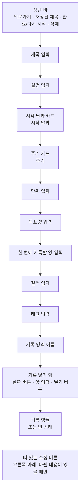
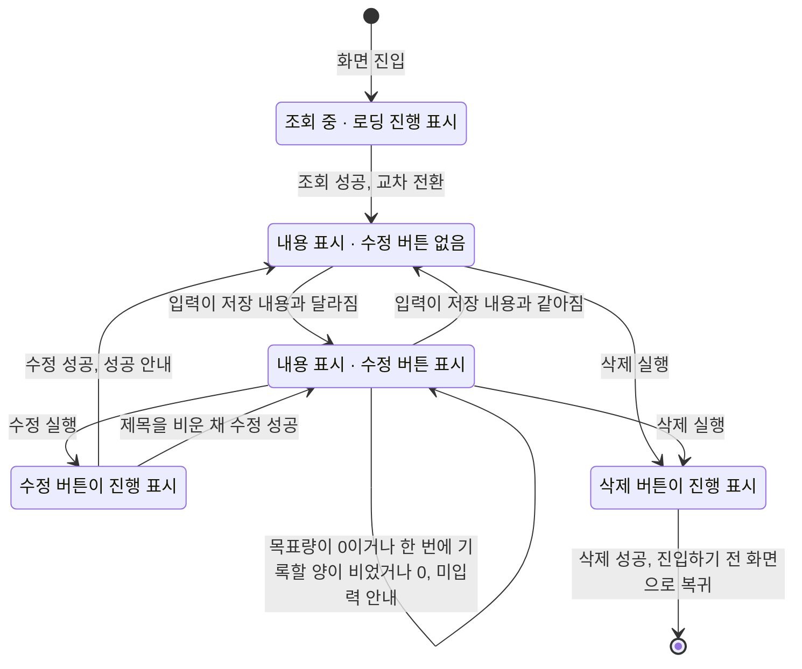

# RoutineDetail 화면 디자인

기준 스펙: [RoutineDetail 화면 스펙](../spec/client/routine-detail.md), [Routine 목록·상세 배치 스펙](../spec/client/routine-list-detail.md), [RoutineFinishedList 목록·상세 배치 스펙](../spec/client/routine-finished-list-detail.md), [TagRoutineFinishedList 목록·상세 배치 스펙](../spec/client/tag-routine-finished-list-detail.md), [페이지 조회 목록의 자리 표시 스펙](../spec/client/paged-list-placeholder.md)

RoutineDetail은 [RoutineAdd 화면 디자인](./routine-add.md)의 입력을 같은 순서와 표현으로 쓰고, 그 아래에 기록을 넣고 확인하는 기록 영역을 더한다. 두 화면이 같은 자리에 같은 입력을 두어 사용자가 루틴을 추가할 때와 고칠 때 같은 방식으로 조작한다. 상단 바 액션과 떠 있는 버튼, 기록 영역, 상태 전환과 피드백이 다르다. 상단 바 제목, 삭제 버튼의 자리, 수정 실행 단축키, 피드백 스낵바와 진입할 때의 초점은 [항목 상세 화면 공통 디자인](./entity-detail.md)을 따른다.

## 화면 구조

RoutineDetail 화면은 [RoutineHome 화면](./routine-home.md)에서 이어지는 세부 화면으로, 창 너비에 따라 단독으로 표시하거나 [Routine 목록·상세 배치 디자인](./routine-list-detail.md)에 따라 RoutineHome과 함께 상세 영역에 표시한다. RoutineHome의 목록 보기에서 카드를 눌러 진입했을 때와 달력 보기에서 루틴 기록 아이템을 눌러 진입했을 때의 화면은 같다. [TagDetail 루틴 탭](./tag-detail-routine.md), [SearchHome 화면](./search-home.md)과 Spotlight 검색 결과에서 진입한 RoutineDetail 화면은 창 너비와 관계없이 단독으로 표시한다. [RoutineFinishedList 화면](./routine-finished-list.md)에서 진입하면 창 너비에 따라 단독으로 표시하거나 [RoutineFinishedList 목록·상세 배치 디자인](./routine-finished-list-detail.md)에 따라 완료된 루틴 목록과 함께 상세 영역에 표시하고, [TagRoutineFinishedList 화면](./tag-routine-finished-list.md)에서 진입할 때도 같은 기준으로 [TagRoutineFinishedList 목록·상세 배치 디자인](./tag-routine-finished-list-detail.md)을 따른다. 어느 경로로 진입해도, 완료된 루틴이어도 화면의 구성과 입력은 같다. 공통 내비게이션 영역은 [TopLevelNavigation 스펙](../spec/client/top-level-navigation.md)의 `내비게이션 노출 기준`에 따라 단독으로 표시할 때와 완료된 루틴 목록과 함께 표시할 때는 숨기고, RoutineHome과 함께 표시할 때는 그대로 둔다.

뒤로가기 버튼의 노출 조건은 [목록·상세 배치 공통 디자인](./list-detail-pane.md)의 `버튼 노출`을 따르므로, 단독으로 표시할 때만 뒤로가기 버튼을 둔다.

화면 상단에는 상단 바를 두고, 시작 쪽에 뒤로가기 동작을, 그 바로 뒤에 저장된 루틴 제목을 시작 쪽에 맞춰 표시한다. 조회가 완료되면 상단 바 끝 쪽에 완료 상태를 전환하는 버튼과 삭제 버튼을 이 순서로 둔다. 삭제 버튼을 끝 쪽 모서리에 두는 것은 [항목 상세 화면 공통 디자인](./entity-detail.md)의 `삭제 버튼의 자리`를 따른다. 상단 바에는 수정 동작을 실행하는 컨트롤을 두지 않고, 수정은 오른쪽 아래의 떠 있는 수정 버튼으로 제공한다.

상단 바 아래 본문은 하나의 세로 스크롤 영역으로, 위에서부터 제목 입력, 설명 입력, 시작 날짜 카드, 주기 카드, 단위 입력, 목표량 입력, 한 번에 기록할 양 입력, 컬러 입력, 태그 입력, 기록 영역을 차례로 놓는다. 기록 영역은 위에서부터 영역 이름, 기록 넣기 행, 기록 행들 또는 빈 상태로 이루어진다. 이 화면에는 탭을 두지 않는다.

제목 입력부터 태그 입력까지 요소 사이의 간격과 각 입력의 구성·조작은 [RoutineAdd 화면 디자인](./routine-add.md)의 `화면 구조`, `제목과 설명 입력`, `컬러 입력`, `시작 날짜 카드`, `주기 카드`, `단위 입력`, `숫자 입력 공통`, `목표량 입력`, `한 번에 기록할 양 입력`을 그대로 따른다. 태그 입력과 기록 영역 이름 사이에도 [공통 여백과 간격](./dimens.md)의 `구성요소 간격`을 둔다. 본문 위아래에는 `화면 세로 여백`, 입력과 카드, 기록 영역 이름, 기록 넣기 행, 기록 행의 좌우에는 `화면 가로 여백`을 둔다.

루틴의 정보와 기록을 한 스크롤에 둔다. 좁은 창에서도 소프트 키보드 위에 초점이 있는 입력이 보일 자리를 남기고, 정보를 고치는 일과 기록을 넣는 일을 화면을 오가지 않고 이어서 할 수 있게 하기 위한 것이다. 기록 영역은 저장된 기록 수만큼 끝없이 길어지므로 본문 가장 아래에 두어, 기록이 늘어도 위쪽 입력과 태그 입력의 자리가 흔들리지 않게 한다. 이는 [ChecklistDetail 화면 디자인](./checklist-detail.md)이 길어지는 체크 항목 영역을 태그 입력 아래에 두는 것과 같은 기준이다.

기록 넣기 행은 기록 행들 위에 둔다. 기록 내역은 목록 끝에 다가갈 때마다 이어서 더 나타나 끝이 정해져 있지 않으므로, 넣기 행을 내역 아래에 두면 기록이 많을수록 닿을 수 없기 때문이다. 내역은 날짜가 늦은 기록부터 놓이므로 방금 넣은 기록도 대개 넣기 행 가까이에 나타난다.

카드 문구, 이번 주기의 합계와 달성률은 이 화면에 표시하지 않는다. 완료된 루틴임을 알리는 문구나 배지도 본문에 두지 않으며, 완료 여부는 `완료와 다시 시작`의 버튼 상태로만 드러낸다.

## 태그 입력

태그 입력의 구성과 조작, 칩 영역의 높이 기준은 [항목 태그 입력 컴포넌트 디자인](./entity-tag-input.md)을 따른다.

칩 영역에는 저장된 연결을 그대로 표시하고, 사용자가 항목을 누르면 저장된 연결이 곧바로 바뀌어 칩 영역에 이어서 나타난다. 반영에는 진행 표시를 두지 않으므로 수정 버튼, 완료 상태 전환 버튼, 삭제 버튼과 넣기 버튼의 진행 표시와 섞이지 않는다. 태그를 연결하거나 해제해도 수정 버튼의 표시 여부, 입력 중이던 내용과 기록 영역은 바뀌지 않는다. 칩이 늘거나 줄어 태그 입력의 높이가 바뀌면 아래의 기록 영역이 그만큼 밀린다.

태그 칩을 누르면 그 태그의 TagDetail 화면으로 이동하고, 뒤로가면 이 루틴의 상세로 돌아온다. 이동한 화면은 태그 디테일 탭이 선택된 상태로 시작한다.

## 기록 영역 이름

기록 영역의 맨 위에는 영역 이름 `기록`을 시작 쪽에 맞춰 한 줄로 둔다. 글자는 Material 3 타이포그래피의 `title small` 크기와 본문 기본 색으로 표시한다. 위쪽의 루틴 정보 입력과 아래쪽의 기록을 구분하고, 이 아래의 날짜와 양이 루틴의 정보가 아니라 기록 하나의 값임을 알린다. 영역 이름은 누를 수 없고, 본문과 함께 스크롤되어 상단 바 아래에 붙어 남지 않는다.

영역 이름과 기록 넣기 행 사이에는 [공통 여백과 간격](./dimens.md)의 `항목 간격`을 둔다.

## 기록 넣기 행

기록 넣기 행에는 날짜 버튼, 양 입력, 넣기 버튼을 시작 쪽부터 이 순서로 한 행에 두고, 요소 사이에 [공통 여백과 간격](./dimens.md)의 `항목 간격`을 둔다. 날짜 버튼과 넣기 버튼은 내용만큼만 폭을 차지하고, 양 입력은 남은 폭을 모두 쓴다. 세 요소는 행의 세로 가운데에 맞춘다. 이 행은 카드에 담지 않는다.

### 날짜 버튼

날짜 버튼에는 지금 고른 기록할 날짜를 표시한다. 기록할 날짜는 항상 있으므로 버튼에는 언제나 날짜를 표시하고 지우기 버튼은 두지 않는다. 버튼의 표현과 날짜의 표시 형식, 값이 바뀔 때의 전환은 [RoutineAdd 화면 디자인](./routine-add.md)의 `시작 날짜 카드`가 쓰는 날짜 버튼과 같다.

날짜 버튼을 누르면 지금 고른 날짜가 선택된 날짜 선택 다이얼로그를 표시한다. 다이얼로그의 조작과 확인·취소 결과의 표현은 [DiaryDateTimeInput 컴포넌트 디자인](./diary-date-time-input.md)의 `날짜 선택`을 따른다.

다이얼로그의 달력에서 기준 스펙의 `기록할 날짜의 범위`를 벗어난 날짜, 곧 저장된 시작 날짜보다 앞의 날짜는 Material 기본의 고를 수 없는 날짜 표현으로 흐리게 두고, 눌러도 선택되지 않는다. 직접 입력 방식에서 범위를 벗어난 날짜를 입력했을 때의 표현은 [DDayAdd 화면 디자인](./dday-add.md)의 `종료일 행`과 같다. 범위에는 저장된 시작 날짜만 쓰므로, 시작 날짜 카드에서 날짜를 고치고 아직 수정을 반영하지 않았으면 다이얼로그의 범위는 바뀌지 않는다.

저장된 시작 날짜가 바뀌어 고른 날짜가 시작 날짜로 맞춰지면 버튼의 날짜는 값 변경 전환으로 바뀌고, 따로 안내를 표시하지 않는다.

### 양 입력

양 입력은 [RoutineAdd 화면 디자인](./routine-add.md)의 `숫자 입력 공통`이 정한 입력에 라벨 `기록할 양`을 둔다. 끝 쪽의 접미 글자는 저장된 루틴의 단위이며, 저장된 단위가 비어 있으면 접미 글자를 표시하지 않는다. 단위 입력에서 단위를 고치고 아직 수정을 반영하지 않았으면 접미 글자는 바뀌지 않고, 수정을 반영하면 기록 행의 양 문구와 함께 바뀐다. 기록은 저장된 단위로 읽히기 때문이다.

이 입력에는 지우기 버튼과 보조 문구를 두지 않는다. 행의 폭을 날짜 버튼, 넣기 버튼과 나눠 쓰므로 숫자가 들어갈 자리를 남기기 위한 것이다.

### 넣기 버튼

넣기 버튼에는 Material Symbols `add` 아이콘만 표시하고 라벨은 두지 않는다. 모양과 크기는 플랫폼 기본 아이콘 버튼을 따르고, 설명 표시는 [아이콘 버튼 설명 디자인](./icon-button-tooltip.md)을 따른다. [ChecklistDetail 화면 디자인](./checklist-detail.md)의 항목 넣기 버튼과 같은 표현이다.

양이 비어 있거나 0인 동안에는 버튼을 숨기지 않고 Material 기본 비활성 아이콘 버튼 표현으로 둔다. 숨기면 양 입력의 폭이 값에 따라 늘었다 줄기 때문이다. 비활성인 동안에는 눌러도 아무 일도 일어나지 않고, 양 입력에 오류 색이나 안내를 두지 않는다.

넣기 버튼을 누르거나, 양 입력에 초점을 둔 채 소프트 키보드의 `완료`나 물리 키보드의 `Enter`를 누르면 기록을 넣는다. 양이 비어 있거나 0일 때 `완료`나 `Enter`를 누르면 아무 일도 일어나지 않고 초점도 그대로 둔다.

기록 넣기를 처리하는 동안에는 넣기 버튼의 아이콘을 [진행 표시 크기](./dimens.md)의 진행 표시로 바꾸고, 날짜 버튼과 양 입력은 잠그거나 흐리게 바꾸지 않는다. 넣기에 성공하면 진행 표시를 넣기 아이콘으로 되돌리고, 날짜 버튼은 그대로 둔 채 양 입력을 저장된 한 번에 기록할 양으로 되돌린다. 입력 초점과 소프트 키보드는 넣기 전 그대로 두고, 본문의 스크롤 위치도 옮기지 않는다. 넣기에 실패하면 진행 표시를 넣기 아이콘으로 되돌리기만 하고 날짜와 양, 초점을 그대로 둔다.

## 기록 행

기록 하나는 한 행에 날짜, 양 문구, 빼기 버튼을 시작 쪽부터 이 순서로 둔다. 행의 최소 높이는 Material 목록 항목의 한 줄 기본 높이를 따르고, 행 사이에는 구분선이나 간격을 두지 않는다. 날짜의 시작 쪽과 빼기 버튼의 끝 쪽은 위쪽 입력과 같은 `화면 가로 여백` 세로선에 맞춘다.

날짜는 본문 기본 글자 크기와 본문 기본 색으로 표시하고 남은 폭을 쓴다. 표시 형식은 [DiaryDateTimeInput 컴포넌트 디자인](./diary-date-time-input.md)의 `표시 형식`을 따른다. 양 문구는 빼기 버튼 바로 앞에 같은 글자 크기로 굵게 표시하고 내용만큼만 폭을 차지한다. 양 문구의 표기는 [RoutineHome 화면 디자인](./routine-home.md)의 `카드 문구 표기`를 따르므로, 저장된 단위가 비어 있으면 숫자만 표시한다. 날짜와 양 문구는 각각 한 줄로 표시하고 줄이지 않는다.

같은 날짜의 기록이 여러 개여도 하나로 묶거나 날짜를 생략하지 않고 행마다 날짜를 표시한다. 오늘보다 뒤의 날짜이거나 시작 날짜보다 앞에 놓인 기록도, 완료된 루틴의 기록도 모양이나 색을 달리하지 않는다.

행은 누를 수 있는 대상이 아니므로 눌림 표현과 포인터 올림 표현을 두지 않는다. 누를 수 있는 것은 빼기 버튼뿐이다.

빼기 버튼에는 Material Symbols `remove` 아이콘만 표시하고 라벨은 두지 않는다. 모양과 크기는 플랫폼 기본 아이콘 버튼을 따르며, [ChecklistDetail 화면 디자인](./checklist-detail.md)의 빼기 버튼과 같은 표현이다. 버튼의 이름을 알려 주는 설명 표시는 [아이콘 버튼 설명 디자인](./icon-button-tooltip.md)을 따른다. 누르면 확인 없이 그 행이 기본 항목 사라짐 애니메이션으로 사라지고 아래 행이 올라온다. 진행 표시와 실행 취소 스낵바는 두지 않는다. 빼기를 저장하지 못해 기록이 남으면 전환 효과 없이 행을 그대로 둔다.

새로 넣은 기록과 RoutineHome의 빠른 기록, 다른 기기에서 넣은 기록은 기본 항목 나타남 애니메이션으로 순서에 맞는 자리에 나타나고, 실행 취소되거나 다른 기기에서 뺀 기록은 기본 항목 사라짐 애니메이션으로 사라진다. 행이 나타나거나 사라져도 본문 스크롤 위치는 따라 움직이지 않는다. 저장된 단위가 바뀌거나 비워지면 모든 행의 양 문구가 전환 효과 없이 바로 새 단위나 숫자만으로 바뀐다.

아직 준비되지 않은 자리에는 [페이지 조회 목록의 자리 표시 디자인](./paged-list-placeholder.md)에 따라 자리 표시 행을 표시한다. 이 목록의 자리 표시 행은 날짜와 양 문구를 비워 두고 빼기 버튼을 두지 않으며, 준비된 행과 같은 높이를 차지한다.

## 빈 상태

기록 내역 불러오기가 끝났고 노출할 기록이 하나도 없으면 기록 행 자리에 빈 상태를 둔다. 빈 상태는 [목록 빈 상태 디자인](./list-empty-state.md)의 `빈 상태 구성`과 같은 배경 도형, 아이콘, 제목 문구, 보조 문구로 구성하고, [RoutineHome 화면 디자인](./routine-home.md)의 빈 상태가 쓰는 루틴 아이콘과 아래 `문구와 접근성`의 문구를 쓴다.

이 화면의 빈 상태는 목록이 화면 본문을 차지하지 않고 입력들 아래에 놓이므로, 그 문서의 `배치`와 달리 남은 영역 전체를 채우지 않는다. 빈 상태는 기록 넣기 행 아래에 가로 가운데로 두고 위아래에 `화면 세로 여백`을 둔다. 기록 행과 빈 상태 사이는 그 문서의 `전환`과 같은 교차 페이드로 바꾼다. 기록을 불러오는 동안에는 빈 상태를 두지 않는다. 이는 [ChecklistDetail 화면 디자인](./checklist-detail.md)의 `빈 상태`와 같은 기준이다.

빈 상태에서도 기록 넣기 행은 같은 자리에 같은 모양으로 둔다.

## 완료와 다시 시작

완료 상태 전환 버튼은 완료 여부와 관계없이 톱니 모양 배지에 체크가 들어간 같은 완료 아이콘을 쓰는 토글 버튼이다. 완료되지 않은 루틴에서는 버튼을 켜지지 않은 상태로, 완료된 루틴에서는 켜진 상태로 강조해 표시한다. 아이콘과 켜진 상태의 표현은 [MemoDetail 화면 디자인](./memo-detail.md)의 `완료·다시 시작·삭제`가 정한 완료 상태 전환 버튼과 같고, 버튼의 이름을 알려 주는 설명 표시는 [아이콘 버튼 설명 디자인](./icon-button-tooltip.md)을 따른다.

버튼을 누르면 확인 대화상자 없이 바로 완료 또는 다시 시작을 실행한다. 처리하는 동안에는 버튼의 아이콘을 [진행 표시 크기](./dimens.md)의 진행 표시로 바꾼다. 성공해도 스낵바를 표시하지 않고, 버튼의 켜진 상태와 접근성 이름이 바뀌는 것으로 결과를 알린다. 저장하지 못하면 진행 표시를 아이콘으로 되돌리기만 하고 버튼의 상태를 바꾸지 않으며, 스낵바나 재시도 버튼을 표시하지 않는다.

완료하거나 다시 시작해도 화면을 떠나지 않고, 입력 중이던 내용, 수정 버튼의 표시, 기록 넣기 행의 날짜와 양, 기록 행과 본문의 스크롤 위치를 그대로 둔다. 완료된 루틴에서도 입력, 카드, 태그 입력, 기록 넣기 행과 빼기 버튼, 수정 버튼과 삭제 버튼을 잠그거나 흐리게 바꾸지 않는다.

목록의 스와이프나 검색 결과처럼 다른 경로에서 같은 루틴의 완료 여부가 바뀌면 버튼의 켜진 상태와 접근성 이름을 전환 효과 없이 바로 저장된 완료 여부에 맞춘다.

## 삭제 버튼

상단 바 끝 쪽 모서리의 삭제 버튼은 [QrDetail 화면 디자인](./qr-detail.md)의 `삭제 버튼`과 같은 아이콘, 진행 표시와 확인 없는 실행을 따른다.

## 수정 버튼

수정 버튼의 자리, 체크 아이콘, 나타나고 사라지는 표현, 처리 중 진행 표시와 `Cmd` 또는 `Meta`와 `Enter`로 실행하는 단축키는 [QrDetail 화면 디자인](./qr-detail.md)의 `수정 버튼`을 따른다. 이 화면에서는 입력이 저장된 내용과 다를 때만 표시하며, 그 판정은 기준 스펙의 `수정 동작의 제공 기준`을 따른다. 목표량이 `0`이거나 한 번에 기록할 양이 비어 있거나 `0`이면 저장된 내용과 다른 것이므로 버튼을 표시하고, 미입력 안내는 수정을 실행한 시점에만 제공한다.

기록 넣기 행의 날짜와 양, 기록 넣기와 빼기, 태그 연결과 해제는 수정 버튼의 표시에 영향을 주지 않는다. 수정 버튼은 루틴 정보의 반영만 실행하고, 기록 넣기는 넣기 버튼만 실행한다. 두 버튼은 떠 있는 버튼과 행 안의 아이콘 버튼이라는 자리와 크기, 체크 아이콘과 더하기 아이콘으로 구분된다.

수정을 처리하는 동안에도 입력, 날짜 버튼, 주기 버튼, 기록 넣기 행과 빼기 버튼을 잠그거나 흐리게 바꾸지 않으며, 수정, 완료·다시 시작, 삭제와 기록 넣기는 서로를 비활성으로 만들지 않는다.

양 입력에 초점이 있을 때 `Enter`만 누르면 기록 넣기를 실행하고, `Cmd` 또는 `Meta`와 함께 누르면 수정 반영을 실행한다. 단위 입력, 목표량 입력과 한 번에 기록할 양 입력에서 `Enter`만 누르면 입력을 마치기만 한다.

## 상태 전환과 동작 표시

기록 넣기의 진행 표시는 넣기 버튼에만, 완료와 다시 시작의 진행 표시는 완료 상태 전환 버튼에만 두고 위 상태와 따로 움직인다. 수정, 완료·다시 시작, 삭제와 기록 넣기의 진행 표시는 각자의 버튼에만 둔다.

조회 중에는 본문 가운데에 로딩 진행 표시만 두고 입력, 카드, 태그 입력, 기록 영역과 수정 버튼을 표시하지 않는다. 상단 바에는 단독으로 표시할 때의 뒤로가기만 두고 제목, 완료 상태 전환 버튼과 삭제 버튼을 표시하지 않는다. 조회 중 상태와 내용 표시 상태는 서로 겹쳐 바뀌는 교차 전환을 사용한다.

조회가 완료되면 저장된 제목, 설명, 컬러, 시작 날짜, 주기, 단위, 목표량, 한 번에 기록할 양과 저장된 태그 연결을 채우고, 완료 상태 전환 버튼을 저장된 완료 여부에 맞는 상태로 표시하며, 기록 넣기 행의 날짜 버튼과 양 입력을 기준 스펙의 `기록 넣기의 처음 값`으로 채운다. 단위가 비어 있으면 단위 입력을, 목표량이 없으면 목표량 입력을 빈 상태로 둔다. 채울 때는 값 전환 효과를 두지 않는다. 글자 입력의 커서는 값의 끝에 둔다. 진입할 때의 초점은 [항목 상세 화면 공통 디자인](./entity-detail.md)의 `진입할 때의 초점`을 따르고, 본문은 맨 위부터 보여 준다. 달력 보기의 아이템에서 진입했어도 기록 영역으로 스크롤하지 않는다.

삭제에 성공하면 단독으로 표시하고 있었으면 진입하기 전 화면으로 돌아가고, RoutineHome과 함께 표시하고 있었으면 상세 영역이 [Routine 목록·상세 배치 디자인](./routine-list-detail.md)의 선택 전 표시인 RoutineAdd 화면으로 되돌아간다. 완료된 루틴 목록과 함께 표시하고 있었으면 상세 영역이 각 완료 목록의 목록·상세 배치 디자인이 정한 선택 전 상세로 바뀐다. 돌아간 화면에는 삭제 안내 스낵바를 표시하지 않는다. 삭제에 실패하면 삭제 버튼의 진행 표시를 삭제 아이콘으로 되돌리기만 하고, 입력과 수정 버튼의 표시는 삭제를 실행하기 전 그대로 둔다.

## 진행과 피드백

수정 성공과 미입력 안내는 짧게 보이는 스낵바로 화면 아래쪽에 표시하며, 스낵바에는 동작 버튼을 두지 않는다. 이미 보이는 스낵바를 바꾸는 기준은 [항목 상세 화면 공통 디자인](./entity-detail.md)의 `피드백 스낵바`를 따른다.

미입력 안내는 기준 스펙의 `수정 성립 조건`이 정한 순서대로 먼저 성립하지 않은 것 하나만 표시한다. 목표량이 `0`이면 목표량 입력이, 한 번에 기록할 양이 비었거나 `0`이면 한 번에 기록할 양 입력이 보이도록 본문을 스크롤해 초점을 옮기고 안내를 표시한다. 숫자 입력에 오류 색이나 표시를 따로 두지 않는다. 이는 [RoutineAdd 화면 디자인](./routine-add.md)의 `진행과 피드백`과 같은 표현이다.

제목을 비운 채 수정해 저장된 제목이 유지되는 경우에는 별도의 안내를 표시하지 않고 수정 성공 피드백만 표시한다.

기록 넣기와 빼기의 성공과 실패에는 스낵바를 두지 않는다. 기록 행의 변화가 곧 결과이기 때문이다.

수정에 성공해도 입력, 기록 넣기 행의 날짜와 양, 본문의 스크롤 위치는 그대로 둔다. 다만 수정으로 저장된 시작 날짜가 바뀌어 고른 기록할 날짜가 범위를 벗어났으면 `날짜 버튼`이 정한 대로 날짜 버튼만 맞춰진 날짜로 바뀐다.

## 시스템 영역과 적응형 배치

상단 바는 상태 표시줄 영역을 피해 배치한다. 본문, 수정 버튼과 스낵바는 내비게이션 바와 디스플레이 컷아웃 영역을 피해 배치하고, 소프트 키보드가 나타나면 키보드 위 영역에 맞춰 배치한다. 초점이 있는 입력이 키보드에 가리지 않도록 본문을 스크롤하며, 기록 넣기 행의 양 입력에 초점이 있으면 넣기 행 전체가 키보드 위에 보이게 한다. 날짜 선택 다이얼로그와 주기 드롭다운 메뉴의 자리는 [RoutineAdd 화면 디자인](./routine-add.md)의 `시스템 영역과 적응형 배치`를 따른다.

본문의 마지막 요소가 수정 버튼에 가리지 않도록 본문 아래쪽에 [공통 여백과 간격 디자인](./dimens.md)의 `플로팅 액션 버튼 아래 여백`을 둔다. 수정 버튼이 보이지 않는 동안에도 이 여백을 줄이지 않아 버튼이 나타날 때 본문이 움직이지 않게 한다.

창 너비, 창 높이, 자세와 입력 장치가 달라져도 요소의 순서는 바뀌지 않는다. 창이 넓으면 입력, 카드와 기록 행이 넓어지고, 기록 넣기 행에서는 양 입력만 넓어진다. 키보드 초점은 화면에 놓인 순서대로 옮겨 가며, 기록 영역에서는 날짜 버튼, 양 입력, 넣기 버튼, 각 기록 행의 빼기 버튼 순서로 옮겨 간다. 그 밖의 초점 이동과 실행은 [RoutineAdd 화면 디자인](./routine-add.md)의 `단축키`와 같다.

## 문구와 접근성

[RoutineAdd 화면 디자인](./routine-add.md)의 `문구와 접근성`에 있는 카드 행, 주기 버튼과 메뉴 항목, 단위 입력, 숫자 입력, 목표량 미입력 안내와 한 번에 기록할 양 미입력 안내 문구와 접근성 기준을 그대로 쓰고, 다음 문구를 더한다.

| 항목 | 한국어 | 그 외 기본 |
| --- | --- | --- |
| 상단 바 제목 | 저장된 루틴 제목 | 저장된 루틴 제목 |
| 뒤로가기 접근성 이름 | `뒤로가기` | `Navigate up` |
| 완료 버튼 접근성 이름 | `루틴 완료` | `Finish routine` |
| 다시 시작 버튼 접근성 이름 | `루틴 다시 시작` | `Restart routine` |
| 삭제 버튼 접근성 이름 | `루틴 삭제` | `Delete routine` |
| 수정 버튼 접근성 이름 | `루틴 수정` | `Update routine` |
| 수정 성공 안내 | `루틴이 수정되었습니다.` | `Routine updated.` |
| 로딩 진행 표시 접근성 이름 | `루틴 불러오는 중` | `Loading routine` |
| 기록 영역 이름 | `기록` | `Records` |
| 기록 날짜 버튼 접근성 이름 | `기록할 날짜, {날짜}` | `Record date, {date}` |
| 기록의 양 입력 라벨 | `기록할 양` | `Amount` |
| 넣기 버튼 접근성 이름 | `기록 넣기` | `Add record` |
| 빼기 버튼 접근성 이름 | `기록 빼기, {날짜} {양 문구}` | `Remove record, {date} {amount}` |
| 빈 상태 제목 문구 | `아직 기록이 없습니다` | `No records yet` |
| 빈 상태 보조 문구 | `위 입력으로 기록을 넣을 수 있습니다` | `Use the fields above to add a record.` |

`{날짜}`는 [DiaryDateTimeInput 컴포넌트 디자인](./diary-date-time-input.md)의 `표시 형식`으로, `{양 문구}`는 [RoutineHome 화면 디자인](./routine-home.md)의 `카드 문구 표기`로 쓴다. 예: `기록 빼기, 2026. 7. 19. 250ml`, `Remove record, Jul 19, 2026 250ml`. 단위가 비어 있으면 `기록 빼기, 2026. 7. 19. 1`, `Remove record, Jul 19, 2026 1`이다.

완료 상태 전환 버튼은 완료되지 않은 루틴에서는 완료 버튼 접근성 이름을, 완료된 루틴에서는 다시 시작 버튼 접근성 이름을 쓴다. 누르면 실행할 동작을 이름으로 알리며, 켜진 상태도 함께 알린다.

기록 영역 이름은 화면 낭독 도구에 제목으로 알려, 사용자가 제목 단위 탐색으로 기록 영역에 곧바로 닿을 수 있게 한다.

기록 넣기 행의 날짜 버튼은 앞에 행 이름이 없으므로 보이는 날짜에 무엇을 고르는 버튼인지를 더한 접근성 이름을 둔다. 넣기 버튼이 비활성인 동안에는 비활성 상태를 함께 알린다.

기록 행은 화면 낭독 도구가 날짜와 양 문구를 이 순서로 이어 하나의 글로 읽게 하고, 버튼으로 알리지 않는다. 빼기 버튼의 접근성 이름에는 그 기록의 날짜와 양을 함께 담아 어느 기록인지 구분한다. 같은 날짜에 같은 양의 기록이 여러 개면 이름이 같으며, 어느 것을 빼도 결과가 같으므로 순서를 더하지 않는다.

제목 입력의 이름과 표현은 [제목 입력 디자인](./title-input.md)을, 설명 입력은 [설명 입력 컴포넌트 디자인](./description-input.md)을 따른다. 태그 입력의 칩 라벨과 태그 선택 목록의 문구는 [항목 태그 입력 컴포넌트 디자인](./entity-tag-input.md)을, 날짜 선택 다이얼로그의 문구는 [DiaryDateTimeInput 컴포넌트 디자인](./diary-date-time-input.md)의 `문구`를 따른다.
