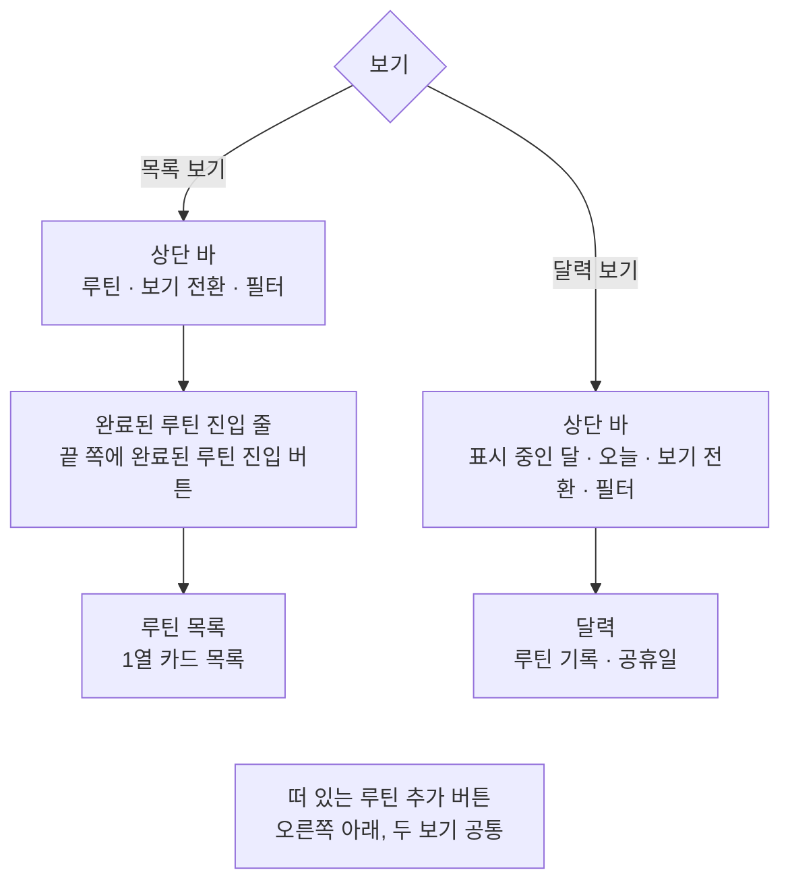
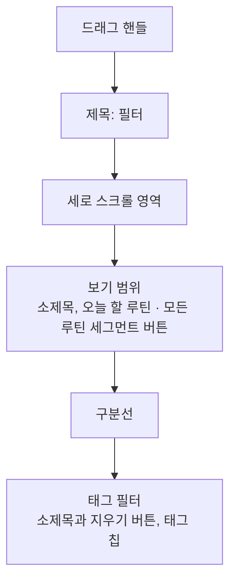
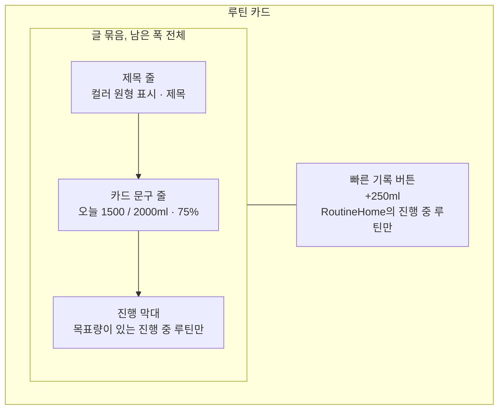
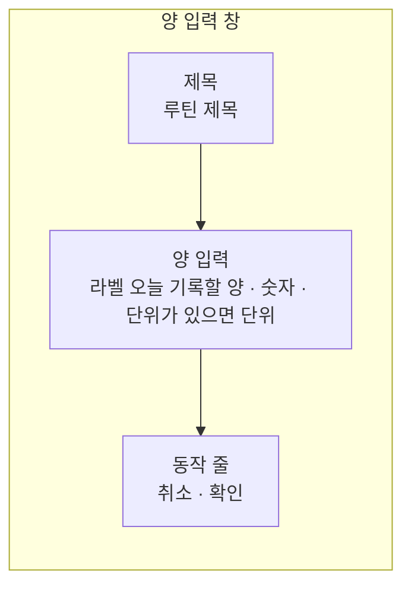

# RoutineHome 화면 디자인

기준 스펙: [RoutineHome 화면 스펙](../spec/client/routine-home.md), [루틴 앱 스펙](../spec/client/routine.md), [SwipeToFinishAndDelete 컴포넌트 스펙](../spec/client/swipe-to-finish-and-delete.md), [캘린더 루틴 기록 표시 스펙](../spec/client/calendar-routine.md), [Routine 목록·상세 배치 스펙](../spec/client/routine-list-detail.md), [태그 필터 스펙](../spec/client/tag-filter.md), [목록 필터 반영 스펙](../spec/client/list-filter.md), [새로고침 스펙](../spec/client/sync-refresh.md), [페이지 조회 목록의 자리 표시 스펙](../spec/client/paged-list-placeholder.md), [목록 빈 상태 스펙](../spec/client/list-empty-state.md)

목록 보기의 추가 버튼, 카드 글줄의 한 줄 유지와 누름 표현, 자리 표시·빈 상태·새로고침, 추가 단축키의 공통 표현은 [항목 목록 화면 공통 디자인](./entity-home.md)의 `추가 버튼`, `카드`, `자리 표시`, `빈 상태`, `새로고침`, `키보드 단축키`를 따른다. 같은 문서의 `화면 구조`, `삭제 스와이프`와 `격자와 적응형 배치`는 따르지 않는다. RoutineHome은 `더보기`에서 이어지는 화면이 아니라 주요 목적지이고, 루틴에는 완료 여부가 있어 카드에서 완료와 삭제를 함께 제공하며, 카드에 빠른 기록 버튼을 두어 1열 목록으로 놓기 때문이다. 카드의 완료와 삭제는 [SwipeToFinishAndDelete 컴포넌트 디자인](./swipe-to-finish-and-delete.md)을 따른다. 달력 보기의 달력은 [CalendarHome 디자인](./calendar-home.md)의 해당 절을 따른다.

이 문서는 RoutineHome에서만 다른 표현과, 다른 화면이 함께 쓰는 `루틴 카드`를 다룬다.

## 화면 구조

RoutineHome 화면은 `루틴` 주요 목적지의 첫 화면이므로 앱의 공통 내비게이션 영역과 함께 표시한다. 목록이나 달력이 상세 영역과 자리를 나눠 쓰는 배치와 그 자리에서의 버튼 노출은 [Routine 목록·상세 배치 디자인](./routine-list-detail.md)을 따른다.

화면 상단에는 상단 바를 두고 뒤로가기 버튼은 두지 않는다. 상단 바 아래 본문은 보기에 따라 완료된 루틴 진입 줄과 루틴 목록 영역 또는 달력 영역 하나로 채우고, 오른쪽 아래에 떠 있는 루틴 추가 버튼을 겹쳐 표시한다.

## 상단 바

상단 바의 제목 자리와 끝 쪽 동작 버튼은 보기에 따라 다음과 같이 둔다. 끝 쪽 버튼은 표의 순서대로 시작 쪽에서 끝 쪽으로 놓는다.

| 보기 | 제목 자리 | 끝 쪽 동작 버튼 |
| --- | --- | --- |
| 목록 보기 | 화면 이름 `루틴`을 시작 쪽에 맞춘 글자 제목 | 보기 전환 버튼, 필터 버튼 |
| 달력 보기 | 표시 중인 달의 년도와 월을 가운데에 둔 누를 수 있는 제목 | 오늘 버튼, 보기 전환 버튼, 필터 버튼 |

필터 버튼은 두 보기 모두 상단 바의 가장 끝에, 보기 전환 버튼은 그 바로 앞에 둔다. 달력 보기에서만 나타나는 오늘 버튼은 두 버튼보다 시작 쪽에 두어, 보기를 바꿔도 보기 전환 버튼과 필터 버튼의 자리가 옮겨지지 않게 한다. 루틴 검색은 이 화면의 범위 밖이므로 검색 버튼은 두지 않고, 기준 스펙이 정렬 선택을 제공하지 않으므로 정렬 컨트롤도 두지 않는다. 완료된 루틴 진입은 상단 바에 두지 않고 `완료된 루틴 진입`의 자리에 둔다.

달력 보기의 누를 수 있는 제목과 펼침·접힘 화살표, 오늘 버튼의 표시 조건과 숫자 표시, 플랫폼별 표현, 접근성 이름은 [CalendarHome 디자인](./calendar-home.md)의 `상단 바`와 `문구`를 그대로 따른다. 두 화면의 달력이 같은 자리에서 같은 방식으로 달을 알리고 옮기게 하기 위한 것이다.

보기를 바꾸면 제목 자리는 `보기 전환 표현`의 교차 페이드로 바뀌고, 오늘 버튼은 [상단 바](./top-bar.md)의 기준에 따라 전환 없이 곧바로 나타나고 사라진다.

## 보기 전환 버튼

보기 전환 버튼은 하나이고, 누를 때마다 목록 보기와 달력 보기를 오간다. 버튼에는 지금 누르면 이동할 보기를 나타내는 아이콘만 표시하고 라벨과 배지는 두지 않는다.

| 지금 보기 | 아이콘 |
| --- | --- |
| 목록 보기 | 달력을 뜻하는 Material Symbols `calendar_month` |
| 달력 보기 | [장소 보기 모드 디자인](./place-view-mode.md)의 `보기 모드 전환 표현`이 쓰는 가로 줄이 쌓인 목록 아이콘 |

버튼은 기본 상단 바 아이콘 색을 사용하고, 목록이 비어 있거나 필터를 적용했거나 새로고침이 진행 중이어도 같은 자리에 같은 모양으로 두며 비활성 표현을 사용하지 않는다. 버튼의 이름은 [아이콘 버튼 설명 디자인](./icon-button-tooltip.md)의 설명 표시와 접근성 이름으로 제공하고, iOS의 설명 표시는 [상단 바](./top-bar.md)를 따른다.

### 보기 전환 표현

보기를 바꿀 때 본문과 상단 바 제목 자리, 보기 전환 버튼의 아이콘은 이전 보기가 사라지면서 새 보기가 나타나는 교차 페이드로 전환한다. 지속 시간과 완급은 전환 기본값을 따른다. 이는 [장소 보기 모드 디자인](./place-view-mode.md)의 `보기 모드 전환 표현`과 같은 표현이다.

전환하는 동안에도 보기 전환 버튼, 필터 버튼과 루틴 추가 버튼은 자리를 옮기지 않고 그대로 조작할 수 있다. 완료된 루틴 진입 줄은 목록 보기의 본문에 속하므로 루틴 목록과 함께 교차 페이드로 나타나고 사라진다.

목록 보기에서 보이던 기록 안내, 완료 안내나 삭제 안내 스낵바는 달력 보기로 바꾸는 순간 전환을 기다리지 않고 곧바로 닫는다. 장소 보기 모드에서는 보기를 바꿔도 스낵바가 남지만, 이 화면은 기준 스펙의 `기록 안내와 실행 취소`가 달력 보기로 바꾸는 것을 목록을 떠난 것으로 보기 때문에 다르다.

목록 보기로 돌아오면 목록은 맨 위부터, 달력 보기로 돌아오면 달력은 바꾸기 전에 보던 달부터 전환 없이 그 자리에서 나타난다.

보기가 바뀌어도 별도의 낭독 안내는 두지 않는다. 보기 전환 버튼의 접근성 이름이 바뀐 보기를 알린다.

## 필터 진입

필터 아이콘 버튼의 아이콘과 적용 상태 표현, Bottom Sheet의 표시, 닫는 조작, 필터 반영 전환, 적응형 배치는 [필터 Bottom Sheet 디자인](./filter-bottom-sheet.md)을 따른다. RoutineHome의 Bottom Sheet는 태그 필터에 더해 보기 범위를 함께 담으므로, 아래의 `필터 Bottom Sheet 구성`이 이 화면의 내용과 배치를 소유한다.

필터 아이콘 버튼은 선택한 태그가 하나도 없으면 기본 상단 바 아이콘 색을, 하나 이상이면 주요 색을 사용한다. 보기 범위는 버튼의 색을 바꾸지 않는다. `오늘 할 루틴`을 골라 두었든 `모든 루틴`을 골라 두었든 선택한 태그가 없으면 기본 색이며, 기준은 [목록 필터 반영 스펙](../spec/client/list-filter.md)의 `필터 적용 상태`를 따른다. 두 보기가 같은 선택을 함께 쓰므로 보기를 바꿔도 버튼의 색은 바뀌지 않는다.

필터 아이콘 버튼을 누르면 지금 보기의 본문과 넓은 창의 상세 영역을 어둡게 처리한 배경 아래에 그대로 유지한 채 필터 Bottom Sheet를 표시한다. 목록 보기와 달력 보기에서 여는 Bottom Sheet는 구성이 같다. 태그 추가 칩을 누르면 Bottom Sheet를 닫고 TagAdd 화면으로 이동한다.

달력 보기에서 태그 선택을 바꾸면 달력은 보던 달에 그대로 두고 루틴 기록 아이템만 좁힌 결과로 바꾼다. 남는 아이템이 다른 줄로 옮겨질 때의 표현은 [CalendarWeekOfMonth 컴포넌트 디자인](./calendar-week-of-month.md)의 `아이템 위치 이동`을 따르고, 공휴일 이름은 그대로 둔다. 달력 보기에서 보기 범위를 바꾸면 세그먼트 버튼의 선택만 바뀌고 달력은 그대로다.

## 필터 Bottom Sheet 구성

Bottom Sheet 상단에는 드래그 핸들을 표시하고, 그 아래에 `필터` 제목을 배치한다. 별도 닫기 버튼은 표시하지 않는다.

제목 아래에는 보기 범위 영역과 태그 필터 영역을 이 순서로 세로로 잇고, 두 영역 사이에는 좌우를 제목 영역과 맞춘 구분선을 둔다. 제목만 Bottom Sheet 위쪽에 고정하고 두 영역은 하나의 세로 스크롤 영역에 함께 둔다. 하나를 고르는 필터를 위에, 태그 필터를 아래에 두고 구분선으로 가르는 구성과 스크롤 범위는 [MemoHome 목록 디자인](./memo-home.md)의 `필터 Bottom Sheet 구성`과 같다.

태그 필터 영역의 소제목, 선택 전체 해제 버튼과 태그 칩은 [MemoHome 목록 디자인](./memo-home.md)의 `태그 필터 영역`과 같고, 태그 칩의 표현과 선택 조작, 태그 추가 칩은 [태그 필터 디자인](./tag-filter.md)을 따른다. 선택 전체 해제 버튼은 태그 선택만 되돌리고 보기 범위의 세그먼트 버튼은 바꾸지 않는다. 보기 범위가 무엇이든 태그 필터 영역은 언제나 조작할 수 있으므로, MemoHome의 `태그 필터가 적용되지 않는 상태`에 해당하는 표현은 이 화면에 두지 않는다.

## 보기 범위 영역

보기 범위 영역에는 위에서부터 소제목 `보기 범위`와 2분할 세그먼트 버튼을 두고, 그 사이에 [공통 여백과 간격](./dimens.md)의 `항목 간격`을 둔다. 소제목은 태그 필터 영역의 소제목과 같은 글자 크기로 표시한다. 영역의 좌우는 [공통 스타일](./styles.md)의 `Bottom Sheet 영역`을 따른다.

세그먼트 버튼은 `오늘 할 루틴`, `모든 루틴`을 이 순서로 담고, 두 버튼을 같은 폭으로 나눠 영역의 폭을 모두 사용한다. 처음 상태인 `오늘 할 루틴`을 시작 쪽에 둔다. 축 이름을 버튼 옆에 두는 MemoHome의 유무 필터와 달리 소제목을 버튼 위에 두는 것은, 두 라벨이 길어 좁은 창에서도 줄어들지 않고 한 줄로 보이게 하기 위한 것이다.

세그먼트 버튼의 표현은 [MemoHome 목록 디자인](./memo-home.md)의 `유무 필터 영역`이 세그먼트 버튼에 정한 것과 같다. 체크 아이콘 없이 라벨만 표시하고, 선택된 버튼은 Material 기본 선택 컨테이너 색으로 표시하며, 언제나 한 버튼만 선택된 상태로 보인다. 버튼을 누르면 선택을 즉시 바꾸고 Bottom Sheet는 열린 상태를 유지한다. 이미 선택된 버튼을 다시 눌러도 바뀌는 것은 없다. 키보드 조작도 같은 절을 따른다.

목록 보기에서 보기 범위를 바꾸면 Bottom Sheet 아래의 목록이 [필터 Bottom Sheet 디자인](./filter-bottom-sheet.md)의 `필터 반영 전환`에 따라 새 범위의 결과로 다시 놓인다. 어느 루틴이 각 범위에 드는지는 기준 스펙의 `보기 범위 기준`을 따른다.

## 완료된 루틴 진입

목록 보기에서는 상단 바 바로 아래, 루틴 목록 위에 완료된 루틴 진입 줄을 두고 그 끝 쪽에 완료된 루틴 진입 버튼을 둔다. 이 줄에는 정렬 컨트롤을 두지 않아 시작 쪽은 언제나 비어 있다. 줄의 높이와 좌우 바깥 여백, 목록을 스크롤해도 사라지지 않는 것은 [목록 정렬 디자인](./list-sort.md)의 `항목이 없는 동안의 정렬 줄`에서 정렬 컨트롤을 감추고 끝 쪽 컨트롤만 남긴 줄과 같다. 버튼의 해부구조, 폭, 상태, 조작과 접근성은 [목록 진입 버튼 디자인](./list-entry-button.md)을 따른다.

버튼의 라벨에는 `문구와 접근성`의 완료된 루틴 진입 라벨을 쓴다.

버튼을 누르면 RoutineFinishedList 화면을 RoutineHome과 함께 표시하지 않고 그 자리에 표시한다. 화면의 구조와 문구는 [RoutineFinishedList 화면 디자인](./routine-finished-list.md)을, 넓은 창에서 루틴 상세와 함께 쓰는 배치는 [RoutineFinishedList 목록·상세 배치 디자인](./routine-finished-list-detail.md)을 따른다.

목록이 비어 있어도, 필터를 적용해 두었어도, 완료된 루틴이 하나도 없어도 줄과 버튼은 같은 자리에 같은 모양으로 표시한다.

달력 보기에는 이 줄과 버튼을 두지 않고, 달력이 상단 바 바로 아래부터 본문을 채운다.

## 루틴 추가 버튼

버튼에는 추가를 뜻하는 Material Symbols `add` 아이콘만 표시하고 라벨은 두지 않는다. 버튼의 모양과 크기는 플랫폼 기본 플로팅 액션 버튼을 따르고, 플랫폼별 표현은 [떠 있는 동작 버튼 디자인](./floating-action-button.md)을, 설명 표시는 [아이콘 버튼 설명 디자인](./icon-button-tooltip.md)을 따른다.

버튼은 두 보기 모두 본문 오른쪽 아래 같은 자리에 같은 모양으로 표시하고, 목록이 비어 있거나 필터를 적용해 두었어도 비활성으로 표시하지 않는다. 보기를 바꾸는 동안에도 사라졌다 나타나지 않는다. 버튼을 누르면 진행 표시 없이 바로 [RoutineAdd 화면](./routine-add.md)으로 이동한다. 넓은 창에서 버튼을 표시하는 조건은 [Routine 목록·상세 배치 디자인](./routine-list-detail.md)의 `버튼 노출`을 따른다.

## 루틴 목록

목록 보기의 본문은 완료된 루틴 진입 줄 아래의 남은 높이를 루틴 목록 영역 하나로 채운다. 목록에는 완료되지 않은 루틴 가운데 `보기 범위 영역`에서 고른 범위에 드는 루틴만 놓인다. 카드는 창 너비와 관계없이 한 행에 하나씩 놓는 1열 목록으로 배치하고, 카드 사이에는 [공통 여백과 간격](./dimens.md)의 `항목 간격`을, 목록 바깥에는 `화면 가로 여백`과 `화면 세로 여백`을 둔다. 목록 영역이 넓어지면 카드가 함께 넓어진다.

1열로 두는 것은 카드마다 끝 쪽에 빠른 기록 버튼이 놓이기 때문이다. 버튼이 모든 카드에서 같은 세로선에 놓여 사용자가 여러 루틴을 이어서 기록할 때 손을 옮기지 않고, 진행 막대가 카드 폭을 넉넉히 써 달성 정도가 한눈에 비교된다.

진행 중인 루틴과 시작 전인 루틴 사이에는 구분선이나 묶음 이름을 두지 않는다. 진행 상태는 각 카드의 문구와 빠른 기록 버튼의 유무로 드러난다. 지금 고른 보기 범위를 알리는 이름이나 칩도 목록 위에 두지 않는다.

오늘이 다시 정해져 목록에 놓이는 루틴이 바뀌면 카드는 기본 항목 나타남·사라짐 애니메이션으로 나타나고 사라지며, 목록의 스크롤 위치는 옮기지 않는다.

## 루틴 카드

각 루틴은 카드로 표시한다. 카드의 글 묶음에는 위에서부터 제목 줄, 카드 문구 줄, 진행 막대를 둔다. 설명, 시작 날짜, 한 번에 기록할 양과 태그는 카드에 표시하지 않는다.

카드의 안쪽 여백은 [공통 스타일](./styles.md)의 `카드 내용`을 따르고, 제목 줄과 카드 문구 줄 사이, 카드 문구 줄과 진행 막대 사이에는 [카드 줄 간격](./dimens.md)을 둔다. 카드의 모양과 색은 카드 컴포넌트의 기본값을 쓴다.

### 제목 줄

제목 줄의 시작 쪽에는 루틴에 저장된 컬러로 채운 원형 표시를 [컬러 원형 표시 크기](./dimens.md)로 두고, 그 뒤에 [컬러 원형 표시 간격](./dimens.md)을 띄워 제목을 둔다. 원형 표시는 제목 줄의 세로 가운데에 맞춘다. 제목은 카드의 기본 글자 크기로 한 줄에 표시한다. 원형 표시와 제목의 구성은 [DDayHome 화면 디자인](./dday-home.md)의 `디데이 카드`와 같다.

### 카드 문구 줄

카드 문구 줄은 원형 표시와 같은 세로선에서 시작한다. 문구는 [루틴 앱 스펙](../spec/client/routine.md)의 `카드 문구`가 정한 글을 다음과 같이 나눠 놓는다.

| 완료 여부 | 진행 상태 | 목표량 | 시작 쪽 | 끝 쪽 |
| --- | --- | --- | --- | --- |
| 완료되지 않음 | 진행 중 | 있음 | 주기 이름과 합계 / 목표량. 예: `오늘 1500 / 2000ml` | 달성률. 예: `75%` |
| 완료되지 않음 | 진행 중 | 없음 | 주기 이름과 합계. 예: `이번 달 12000m` | 두지 않는다 |
| 완료되지 않음 | 시작 전 | 관계없음 | `시작 전` | 두지 않는다 |
| 완료됨 | 관계없음 | 관계없음 | `완료` | 두지 않는다 |

RoutineHome의 목록에는 완료되지 않은 루틴만 놓이므로 `완료` 문구는 이 화면에 나타나지 않는다. 이 문구는 이 카드를 함께 쓰는 완료된 루틴 목록과 검색 결과에서 쓴다.

완료되지 않은 진행 중 루틴의 시작 쪽 문구는 Material 3 타이포그래피의 `body medium` 크기와 본문 기본 색으로 표시한다. 달성률은 같은 줄의 끝 쪽에 `label large` 크기로 굵게, 앱 색 구성의 주 색으로 표시해 숫자가 먼저 읽히게 한다. 달성률은 내용만큼만 폭을 차지하고, 시작 쪽 문구는 남은 폭을 쓴다.

`시작 전`과 `완료`는 같은 크기에 본문 보조 색으로 표시해, 합계를 보여 주지 않는 루틴이 진행 중인 루틴보다 덜 눈에 띄게 한다. 카드 전체를 흐리게 바꾸지는 않는다. 시작 전이거나 완료된 루틴의 카드도 눌러서 상세로 이동할 수 있기 때문이다. 두 문구는 글로만 구분하고 색이나 아이콘을 달리하지 않으며, 완료된 루틴의 카드에 완료를 나타내는 배지를 더하지 않는다.

`평일만`과 `주말만` 루틴의 카드는 `매일` 루틴의 카드와 같은 문구와 모양을 쓴다. 주기 이름이나 요일을 알리는 문구, 배지와 아이콘을 카드에 더하지 않으며, 오늘의 요일이 그 루틴의 하는 요일에 들지 않는 날에도 카드를 흐리게 바꾸거나 표시를 달리하지 않는다.

제목과 시작 쪽 문구가 쓸 수 있는 폭을 넘었을 때의 한 줄 유지와 가로 이동은 [항목 목록 화면 공통 디자인](./entity-home.md)의 `카드`를 따른다. 달성률은 줄이거나 흘리지 않는다. 문구의 표기는 `카드 문구 표기`를 따른다.

### 진행 막대

목표량이 있고 완료되지 않은 진행 중 루틴의 카드에만 카드 문구 줄 아래에 진행 막대를 둔다. 목표량이 없거나, 시작 전이거나 완료된 루틴의 카드에는 막대를 두지 않고 그 자리도 차지하지 않는다.

막대는 Material 3의 값이 정해진 선형 진행 표시로 글 묶음의 폭 전체에 두고, 높이와 모서리, 트랙 색은 컴포넌트 기본값을 따른다. 채운 부분은 루틴의 컬러로 칠한다. 채운 길이는 달성률과 같아서 달성률이 `0%`이면 비어 있고 `100%`이면 끝까지 가득 찬다. 합계가 목표량을 넘어도 막대는 가득 찬 채로 남고 넘친 만큼을 따로 그리지 않는다.

기록을 넣거나 실행 취소해 달성률이 바뀌면 막대의 길이는 컴포넌트 기본 진행 애니메이션으로 이어서 바뀌고, 카드 문구와 달성률 숫자는 전환 효과 없이 바로 새 값으로 바꾼다. 화면에 돌아와 오늘이 다시 정해졌을 때와 상세에서 수정한 결과가 반영될 때도 같다.

막대는 달성률 숫자와 같은 값을 그림으로 반복하므로 화면 낭독 도구에는 따로 읽히지 않게 한다. 컬러가 트랙 색과 비슷해 막대가 잘 보이지 않는 경우에도 달성률 숫자가 같은 값을 알린다.

### 빠른 기록 버튼

RoutineHome의 진행 중 루틴 카드에는 글 묶음의 끝 쪽에 [컬러 원형 표시 간격](./dimens.md)을 띄워 빠른 기록 버튼을 둔다. 버튼은 카드의 세로 가운데에 맞추고 내용만큼만 폭을 차지한다. 시작 전인 루틴의 카드에는 버튼을 두지 않고, 글 묶음이 카드 안쪽 폭을 모두 쓴다.

버튼은 Material 3의 채워진 톤 버튼으로 두고, 더하기 기호와 그 루틴의 한 번에 기록할 양의 양 문구를 이어 붙인 라벨만 표시한다. 예를 들어 `+250ml`, `+1회`이고, 단위가 비어 있으면 `+1`이다. 라벨이 누르면 얼마가 기록되는지를 그대로 알리므로 아이콘은 두지 않는다. 라벨은 줄이거나 흘리지 않고 한 줄로 표시한다. 버튼의 높이와 모양, 색은 컴포넌트 기본값을 따르고, 누를 자리는 최소 터치 크기를 유지한다.

글자 라벨이 있는 버튼이므로 [아이콘 버튼 설명 디자인](./icon-button-tooltip.md)의 설명 표시는 두지 않는다. 이 버튼의 길게 누르기는 설명 표시가 아니라 `양 입력 창`을 여는 데 쓴다.

달성률이 `100%`여도 버튼의 모양과 라벨은 바뀌지 않는다. 기록을 처리하는 동안에도 버튼을 진행 표시나 비활성 표현으로 바꾸지 않는다. 기록은 기기에 곧바로 저장되어 처리 중인 상태가 눈에 보일 만큼 이어지지 않으며, 그동안 다시 누른 조작은 기준 스펙의 `기록 요청 제한`에 따라 처리되지 않을 뿐이다.

루틴의 한 번에 기록할 양이나 단위가 바뀌면 라벨은 전환 효과 없이 바로 바뀐다. 진행 상태가 달라져 버튼이 생기거나 없어질 때는 [나타나고 사라지는 버튼 디자인](./button-visibility.md)의 아이콘 버튼 모션을 따르고, 글 묶음의 폭은 버튼이 차지하는 자리에 맞춰 함께 바뀐다.

이 카드는 [TagDetail 루틴 탭 디자인](./tag-detail-routine.md)의 루틴 목록, [RoutineFinishedList 화면 디자인](./routine-finished-list.md)과 [TagRoutineFinishedList 화면 디자인](./tag-routine-finished-list.md)의 완료된 루틴 목록, [SearchHome 화면 디자인](./search-home.md)의 루틴 결과에도 쓴다. 이 자리들의 기준 스펙은 빠른 기록을 제공하지 않으므로, 그 자리의 카드는 진행 상태와 관계없이 빠른 기록 버튼 없이 글 묶음만 둔다.

### 카드 문구 표기

양 문구는 어느 언어 환경에서나 [루틴 앱 스펙](../spec/client/routine.md)의 `양의 문구`대로 숫자 바로 뒤에 그 루틴의 단위 글자를 띄우지 않고 그대로 붙인다. 단위 글자를 언어에 따라 다른 말로 바꾸거나 수에 따라 꼴을 바꾸지 않으며, 단위가 비어 있으면 숫자만 쓴다. 숫자에는 어느 언어에서도 자리 구분 기호를 넣지 않는다.

주기 이름과 `시작 전`, `완료`만 언어에 따라 달라진다. 한국어 환경에서는 같은 스펙의 `카드 문구`에 적힌 형식을 그대로 쓰고, 그 외 기본 환경에서는 다음과 같이 쓴다.

| 항목 | 한국어 | 그 외 기본 |
| --- | --- | --- |
| `매일`, `평일만`, `주말만` 루틴의 주기 이름 | `오늘` | `Today` |
| `매주` 루틴의 주기 이름 | `이번 주` | `This week` |
| `매월` 루틴의 주기 이름 | `이번 달` | `This month` |
| 양 문구 | `3회`, `1500ml` | `3회`, `1500ml` |
| 단위가 비어 있는 양 문구 | `3` | `3` |
| 목표량이 있는 진행 중 문구 | `이번 주 2 / 3회` | `This week 2 / 3회` |
| 목표량이 없는 진행 중 문구 | `오늘 0ml` | `Today 0ml` |
| 단위가 비어 있는 진행 중 문구 | `오늘 2 / 3`, `오늘 0` | `Today 2 / 3`, `Today 0` |
| 달성률 | `75%` | `75%` |
| 시작 전 문구 | `시작 전` | `Not started` |
| 완료 문구 | `완료` | `Finished` |
| 빠른 기록 버튼 라벨 | `+250ml`, `+1회`, `+1` | `+250ml`, `+1회`, `+1` |

이 양 문구 표기는 이 문서의 빠른 기록 버튼, 양 입력 창의 접미 글자, 기록 안내 스낵바와 달력 아이템, [RoutineDetail 화면 디자인](./routine-detail.md)의 기록 내역도 그대로 쓴다.

### 카드 조작

빠른 기록 버튼을 뺀 카드 전체가 하나의 누를 수 있는 대상이다. 카드를 누르면 진행 표시 없이 바로 그 루틴의 [RoutineDetail 화면](./routine-detail.md)으로 이동하고, 목록과 상세를 함께 표시하는 동안에는 이동하지 않고 상세 영역이 그 루틴의 상세로 바뀐다. 상세 영역에 어느 루틴이 놓여 있는지는 상세 영역의 상단 바 제목이 알리므로, 목록에서 선택 표시를 따로 두지 않는다.

빠른 기록 버튼을 누르거나 길게 누르는 동안에는 버튼에만 누름 표현을 두고 카드의 눌림 표현은 보이지 않는다. 카드를 길게 눌러도 아무 일도 일어나지 않는다. 카드를 좌우로 미는 조작은 `완료와 삭제 제스처`를 따른다.

제목이 바뀌거나 진행 상태가 달라져 카드가 다른 자리로 옮겨질 때는 기본 항목 이동 애니메이션으로 옮긴다. 기록을 넣거나 실행 취소한 카드는 자리를 옮기지 않는다.

## 빠른 기록 조작

빠른 기록 버튼은 한 버튼에서 두 가지 조작을 받는다.

| 조작 | 결과 |
| --- | --- |
| 누르기 | 한 번에 기록할 양을 곧바로 기록한다 |
| 길게 누르기 | `양 입력 창`을 연다 |

길게 누르기로 인식하는 시간은 플랫폼의 기본값을 따른다. 길게 누르기가 인식되면 손을 떼기를 기다리지 않고 곧바로 양 입력 창을 열고, 그 뒤 손을 떼어도 누르기의 기록은 실행하지 않는다. 손가락이 버튼 밖으로 벗어난 뒤 떼면 두 조작 모두 실행하지 않는다.

길게 누르기를 쓰기 어려운 입력 수단에서는 같은 양 입력 창을 다음 수단으로 연다. 어느 수단으로 열어도 창과 그 뒤의 결과는 같다.

| 입력 수단 | 누르기에 해당하는 조작 | 양 입력 창을 여는 조작 |
| --- | --- | --- |
| 터치 | 버튼을 누른다 | 버튼을 길게 누른다 |
| 마우스·트랙패드 | 버튼을 클릭한다 | 버튼을 보조 클릭(오른쪽 클릭)하거나, 누른 채로 길게 유지한다 |
| 물리 키보드 | 버튼에 초점을 두고 `Enter` 또는 `Space`를 누른다 | 버튼에 초점을 두고 `Shift`와 `Enter` 또는 `Shift`와 `Space`를 함께 누른다 |
| 화면 낭독 도구 | 버튼을 활성화한다 | 버튼의 사용자 지정 동작 `양 입력해 기록`을 실행한다 |

화면 낭독 도구에는 길게 누르기 동작을 따로 알리지 않고 사용자 지정 동작만 알린다. 같은 창을 여는 두 동작이 겹쳐 읽히지 않게 하기 위한 것이다.

### 촉각 피드백

길게 누르기가 인식되어 양 입력 창이 열리는 순간에는 플랫폼의 길게 누르기 촉각 피드백을 한 번 제공한다. 누르기로 기록할 때는 촉각 피드백을 주지 않고, 카드 문구와 진행 막대의 변화, `기록 안내`가 결과를 알린다. 보조 클릭, 키보드와 사용자 지정 동작으로 창을 열 때도 촉각 피드백을 주지 않는다.

촉각 피드백의 실제 제공 여부와 세기는 기기의 지원 범위와 사용자의 시스템 설정을 따르며, 이는 [Calendar 날짜 선택 디자인](./calendar-select.md)의 `촉각 피드백`과 같은 기준이다.

## 양 입력 창

양 입력 창은 화면 가운데에 띄우는 다이얼로그다. 위에서 아래로 제목, 양 입력, 동작 줄을 두고, 너비와 높이, 제목 위에 아이콘을 두지 않는 것, 동작 줄의 배치와 뒤의 가림막은 [MoreHome 화면 디자인](./more-home.md)의 `로그아웃 확인 다이얼로그`와 같다.

제목에는 창을 연 카드의 루틴 제목을 한 줄로 표시하고, 폭을 넘으면 끝을 말줄임표로 줄인다. 어느 루틴에 기록하는지를 창 안에서도 확인하게 하기 위한 것이다.

양 입력은 테두리가 있는 단일 줄 글자 입력으로 창 안쪽 폭을 모두 쓰고, 입력 안쪽 위에 라벨 `오늘 기록할 양`을 표시한다. 라벨이 기록하는 날짜가 오늘로 정해져 있음을 알리므로 날짜를 따로 표시하거나 고르는 컨트롤은 두지 않는다. 입력의 끝 쪽에는 그 루틴의 단위를 입력 컴포넌트의 접미 글자로 표시하고, 단위가 비어 있으면 접미 글자를 표시하지 않는다. 접미 글자의 표현은 [RoutineAdd 화면 디자인](./routine-add.md)의 `숫자 입력 공통`과 같다. 지우기 버튼은 두지 않는다.

창이 열리면 입력에 초점을 두고 숫자 소프트 키보드를 열며, 채워 둔 한 번에 기록할 양 전체를 선택된 상태로 둔다. 사용자가 숫자를 누르면 곧바로 새 값으로 바뀌게 하기 위한 것이다. 소프트 키보드는 소수점 없는 숫자 키보드를 요청하고, 입력을 마치는 키는 `완료`로 표시한다. 반영하지 않는 문자와 자리 수를 넘는 숫자에는 오류 색이나 안내를 표시하지 않고 값이 바뀌지 않는 것으로만 드러내며, 숫자 앞에 넣은 `0`도 입력한 그대로 표시한다.

동작 줄에는 취소와 확인을 이 순서로 끝 쪽에 맞춰 두고, 두 동작 모두 배경 없는 텍스트 버튼으로 둔다. 양이 비어 있거나 0이면 확인 버튼을 숨기지 않고 Material 기본 비활성 텍스트 버튼 표현으로 두며, 누를 수 없다. 입력에는 오류 색이나 보조 문구를 두지 않는다. 비활성인 동안 소프트 키보드의 `완료`나 물리 키보드의 `Enter`를 눌러도 아무 일도 일어나지 않고 창과 초점을 그대로 둔다.

확인 버튼을 누르거나 확인할 수 있는 상태에서 `완료`나 `Enter`를 누르면 창을 닫고 기록한다. 취소를 누르거나, 창 바깥을 누르거나, 뒤로가기나 `Esc`로 닫으면 기록하지 않고 창만 닫는다. 창이 닫히면 키보드 초점은 창을 연 빠른 기록 버튼으로 돌아간다.

창은 시스템 영역과 디스플레이 컷아웃에 가려지지 않게 두고, 소프트 키보드가 나타나면 키보드 위 영역의 가운데에 맞춘다. 목록과 상세를 함께 표시하는 동안에도 목록 영역이 아니라 창 가운데에 띄운다. 창이 떠 있는 동안 화면이 회전하거나 창 크기가 바뀌어도 입력하던 양과 함께 그대로 띄워 둔다.

확인했지만 기준 스펙의 `빠른 기록의 내용`에 따라 기록할 수 없게 되었거나 `기록 요청 제한`에 따라 처리하지 않는 경우에는 창만 닫고 스낵바나 다른 안내를 표시하지 않는다.

## 기록 안내

빠른 기록이나 양을 입력한 기록이 저장되면 결과 안내와 실행 취소 동작을 스낵바로 표시한다. 안내 문구에는 루틴 제목과 방금 기록한 양의 양 문구를 담는다. 예를 들어 `물 마시기 250ml 기록`이고, 단위가 비어 있으면 `운동 1 기록`이다. 양은 그 주기의 합계가 아니라 방금 넣은 기록 하나의 양이다.

스낵바의 표현과 자리는 `완료와 삭제 제스처`의 완료·삭제 안내 스낵바와 같다. 실행 취소 동작이 있으므로 Material 기본의 긴 표시 시간을 쓰고, 루틴 추가 버튼에 가리지 않는 자리에 둔다. 루틴 제목이 길어 문구가 한 줄을 넘으면 스낵바 기본 표현대로 두 줄까지 줄바꿈하고 그 뒤는 말줄임표로 줄인다.

기록 안내, 완료 안내와 삭제 안내는 같은 스낵바 자리를 함께 쓴다. 안내가 보이는 동안 다른 기록을 넣거나 루틴을 완료하거나 삭제하면 표시 시간이 지나기를 기다리지 않고 즉시 새 안내로 바꾼다. 완료나 삭제 안내가 보이는 동안 기록을 넣어도 같다.

실행 취소를 누르면 스낵바를 닫고, 그 카드의 문구와 진행 막대가 기록하기 전의 값으로 돌아간다. 실행 취소했음을 알리는 안내는 따로 표시하지 않는다. 기록이나 실행 취소가 저장되지 못하면 스낵바를 표시하지 않는다.

## 완료와 삭제 제스처

사용자는 목록 보기의 루틴 카드를 왼쪽에서 오른쪽으로 스와이프해 완료하고, 오른쪽에서 왼쪽으로 스와이프해 삭제한다. 진행 중인 루틴과 시작 전인 루틴의 카드가 같은 조작을 받는다.

스와이프 중 상태 아이콘, 완료·삭제 기준, 취소와 비활성 표현은 [SwipeToFinishAndDelete 컴포넌트 디자인](./swipe-to-finish-and-delete.md)을 따른다. 자리 표시 카드는 스와이프가 시작되지 않는다.

빠른 기록 버튼 위에서 시작한 가로 끌기도 카드의 스와이프로 처리하고, 그 끌기는 빠른 기록의 누르기나 길게 누르기로 처리하지 않는다.

완료 또는 삭제가 성립하면 카드를 목록에서 없애고, 결과 안내와 실행 취소 동작을 스낵바로 표시한다. 실행 취소 동작이 있는 스낵바는 Material 기본의 긴 표시 시간을 쓰고, 루틴 추가 버튼에 가리지 않는 자리에 둔다. 표현은 [MemoHome 목록 디자인](./memo-home.md)의 `완료와 삭제 제스처`와 같다. 이미 보이는 스낵바를 새 안내로 바꾸는 기준은 `기록 안내`를 따른다.

완료나 삭제가 저장되지 못하면 스낵바를 표시하지 않는다.

목록과 상세를 함께 표시하는 배치에서 완료 안내, 삭제 안내와 기록 안내 스낵바의 자리는 [목록·상세 배치 공통 디자인](./list-detail-pane.md)의 `진행과 피드백`을 따른다.

실행 취소로 돌아온 카드는 스와이프 전 모양과 카드 문구, 진행 막대 그대로 목록 순서에 맞는 자리에 다시 나타난다.

달력 보기에는 완료와 삭제 제스처를 두지 않는다.

## 자리 표시

이 목록의 자리 표시 카드는 원형 표시, 제목과 카드 문구를 비워 두고 진행 막대와 빠른 기록 버튼을 두지 않으며, 제목 줄과 카드 문구 줄만 있는 카드와 같은 높이를 차지한다.

## 빈 상태

목록 보기의 빈 상태는 기준 스펙의 `빈 이유의 구분`이 가르는 세 경우에 따라 아이콘과 문구가 달라진다. 태그 필터의 적용 여부는 `필터 진입`에서 필터 아이콘 버튼을 주요 색으로 표시하는 기준과 같다.

| 상태 | 아이콘 | 제목 문구 |
| --- | --- | --- |
| 필터 아이콘이 기본 색이고 완료되지 않은 루틴이 하나도 없는 상태 | 루틴 아이콘 | `아직 루틴이 없습니다` |
| 필터 아이콘이 기본 색이고 완료되지 않은 루틴은 있으나 오늘 할 루틴이 없는 상태 | 루틴 아이콘 | `오늘 할 루틴이 없습니다` |
| 필터 아이콘이 주요 색인 상태 | 필터 아이콘 | `조건에 맞는 루틴이 없습니다` |

오늘 할 루틴이 없는 상태는 필터 아이콘 버튼이 기본 색으로 남아 있으므로 필터 아이콘이 아니라 루틴 아이콘을 쓰고, 보조 문구로 필터에서 모든 루틴을 볼 수 있음을 알린다. 이 상태는 보기 범위가 `오늘 할 루틴`일 때만 나타난다.

루틴 아이콘은 [TopLevelNavigation 디자인](./top-level-navigation.md)의 `루틴` 목적지 아이콘과 같다. 세 빈 상태 사이의 전환과 보조 문구를 포함한 정확한 문구는 [목록 빈 상태 디자인](./list-empty-state.md)을 따른다.

목록을 불러오지 못했을 때는 별도 오류 안내나 다시 시도 버튼을 표시하지 않고 같은 빈 상태를 표시한다.

빈 상태에서도 상단 바의 보기 전환 버튼과 필터 버튼, 완료된 루틴 진입 줄의 완료된 루틴 진입 버튼, 떠 있는 루틴 추가 버튼은 같은 자리에 같은 모양으로 표시한다.

달력 보기에는 빈 상태를 두지 않는다. 표시할 루틴 기록이 없으면 아이템 없이 달력만 표시하고 안내 문구나 아이콘을 겹쳐 두지 않는다.

## 달력 보기

달력 보기의 본문 전체는 달력 영역 하나로 채운다. 달력의 전체 배치는 [Calendar 컴포넌트 디자인](./calendar.md)을 따르고, 오늘은 [CalendarWeekOfMonth 컴포넌트 디자인](./calendar-week-of-month.md)의 주요 날짜 표현으로 강조하며, 공휴일 날짜는 같은 문서의 `날짜 색상`을 따른다.

달 이동, 달 선택 다이얼로그, 오늘 버튼의 조작은 [CalendarHome 디자인](./calendar-home.md)의 `달 이동 조작`을 따른다. 공통 내비게이션에서 `루틴` 목적지를 다시 선택했을 때의 움직임은 [TopLevelNavigation 디자인](./top-level-navigation.md)의 `현재 목적지 다시 선택`을 따른다.

방향키로 달을 옮기는 조작은 달 선택 다이얼로그, 양 입력 창과 필터 Bottom Sheet가 닫혀 있고 글자 입력에 초점이 없는 동안에만 처리한다. 목록과 상세를 함께 표시하는 동안 상세 영역의 입력에 초점이 있으면 방향키는 그 입력의 커서 이동으로만 쓴다.

달력 보기에는 날씨, 메모, 디데이와 생일 아이템을 두지 않고, 빠른 기록 버튼, 완료와 삭제 제스처, 완료된 루틴 진입 버튼도 두지 않는다.

### 루틴 기록 아이템

루틴 기록은 [CalendarText 컴포넌트 디자인](./calendar-text.md)으로 표시하고, 루틴 제목 뒤에 한 칸을 띄워 그 날짜 합계의 양 문구를 붙인다. 예를 들어 `물 마시기 1500ml`, `운동 1회`로 표시하고, 단위가 비어 있는 루틴은 `운동 1`로 표시한다. 제목과 양 문구는 하나의 글이므로 그 문서의 `글 표시`에 따라 함께 가운데 정렬되고, 한 줄에 다 들어가지 않으면 같은 문서의 `넘치는 글 표시`에 따라 글 전체가 가로로 흐른다. 양 문구의 표기는 `카드 문구 표기`를 따른다.

글에는 제목과 양 문구만 표시하고 이모지나 아이콘을 앞에 붙이지 않는다. 이 달력에 놓이는 아이템은 루틴 기록과 공휴일 이름뿐이어서 종류를 알리는 표시가 없어도 색으로 구분되기 때문이다. 주기, 목표량, 달성률, 진행 상태와 완료 여부는 아이템에 드러내지 않으며, 완료된 루틴의 기록, 시작 전인 루틴의 기록, 오늘보다 뒤의 기록과 그 루틴의 하는 요일에 들지 않는 날짜의 기록도 모양이나 색을 달리하지 않는다.

아이템의 배경은 [캘린더 루틴 기록 표시 스펙](../spec/client/calendar-routine.md)이 정한 표시 색상인 루틴의 컬러를 사용한다. [CalendarHome 디자인](./calendar-home.md)의 `디데이 아이템`이 디데이의 컬러를 배경으로 쓰는 것과 같은 방식이며, 하루만 차지하지만 [CalendarBarText 컴포넌트 디자인](./calendar-bar-text.md)의 색상 바가 아니라 색을 채운 배경으로 표시한다. 글자색은 [CalendarText 컴포넌트 디자인](./calendar-text.md)의 색상 규칙을 따라 배경색과의 대비에 맞춰 정한다.

루틴 기록 아이템은 하루만 차지하므로 여러 주로 나뉘는 조각이 생기지 않는다. 합계가 바뀌면 글은 전환 효과 없이 바로 새 양 문구로 바뀐다.

### 공휴일 이름 아이템

공휴일 이름의 글 표시, 공휴일 여부에 따른 배경색, 글자색과 선택 가능한 아이템으로서의 표현은 [CalendarHome 디자인](./calendar-home.md)의 `공휴일과 메모 아이템`이 공휴일 이름에 정한 것을 그대로 따른다. 공휴일 이름을 눌렀는데 브라우저를 열지 못했을 때의 안내는 같은 문서의 `검색 결과 열기 실패 안내`를 따른다.

### 줄 배치

루틴 기록 아이템과 공휴일 이름은 어느 주에서나 같은 그룹에 함께 배치한다. 줄 위치는 [CalendarWeekOfMonth 컴포넌트 디자인](./calendar-week-of-month.md)의 아이템 줄 배치를 따라 그 주에 잘린 기간 순서로 정하고, 기간만으로 순서가 정해지지 않는 아이템 사이의 순서는 기준 스펙의 `같은 기간 아이템 순서`를 따른다. 따라서 같은 날짜에서 루틴 기록 아이템은 하루짜리 공휴일 이름 위에 놓이고, 같은 날짜에 루틴 기록이 여러 개면 기준 스펙의 조회 결과 정렬 순서대로 위에서 아래로 배치한다.

### 선택 조작

루틴 기록 아이템 전체를 하나의 클릭 영역으로 제공하고, 누르면 기준 스펙의 `루틴 기록 선택`이 실행된다. 누르면 아이템의 둥근 배경 안에 물결 효과를 표시한다. 같은 루틴의 어느 날짜 아이템을 눌러도 같은 모습으로 반응한다.

화면 낭독 도구에는 루틴 기록 아이템을 `문구와 접근성`의 접근성 이름을 가진 버튼으로 알린다.

물리 키보드 환경에서는 아이템에 차례로 초점을 옮길 수 있고 `Enter` 또는 `Space`로 선택한다.

### 길게 누르기와 날짜·주 누름

루틴 기록 아이템과 공휴일 이름 아이템 위의 길게 누르기에는 어떤 반응도 보이지 않는다. 그 표현은 [CalendarHome 디자인](./calendar-home.md)의 `디데이 아이템`에 있는 `길게 누르기`와 같아서, 촉각 피드백과 선택·이동 표현을 두지 않고, 길게 누르기로 인식된 뒤 손을 떼면 아이템 선택도 실행하지 않는다. 터치와 포인터 모두 같고, 화면 낭독 도구에는 길게 누르기 동작을 알리지 않는다.

날짜 숫자와 아이템이 놓이지 않은 빈 자리에는 클릭 영역을 두지 않는다. 눌러도, 길게 눌러도 물결 효과와 선택 배경, 촉각 피드백을 보이지 않으며, [CalendarWeekOfMonth 컴포넌트 디자인](./calendar-week-of-month.md)의 `날짜 누름과 주 누름`과 [Calendar 날짜 선택 디자인](./calendar-select.md)의 선택 조작은 이 달력에 두지 않는다. 화면 낭독 도구에도 날짜와 주를 버튼으로 알리지 않는다. 빈 자리에서 시작한 좌우 스와이프와 아래로 당기는 조작은 그대로 달 이동과 새로고침으로 처리한다.

## 새로고침

두 보기 모두 본문 전체를 [새로고침 디자인](./sync-refresh.md)의 당김 새로고침 컨테이너로 감싸고, 진행 표시는 본문 위쪽 가로 가운데에 둔다. 목록 보기의 완료된 루틴 진입 줄도 본문에 속하므로 컨테이너 안에 두며, 진행 표시는 그 줄 위에 겹쳐 표시하고 줄과 목록을 밀어내지 않는다. 두 보기에서 진행 표시의 자리를 같게 두기 위한 것이다. 목록 보기의 당김이 시작되는 조건은 [항목 목록 화면 공통 디자인](./entity-home.md)의 `새로고침`을, 달력을 아래로 당기는 조작은 [CalendarHome 디자인](./calendar-home.md)의 `새로고침`을 따른다.

새로고침 중에 보기를 바꿔도 진행 표시는 사라지지 않고 같은 자리를 유지한다. 진행 표시는 본문 위쪽에, 루틴 추가 버튼은 본문 오른쪽 아래에 놓이므로 두 요소는 겹치지 않는다.

## 시스템 영역과 적응형 배치

상단 바는 상태 표시줄 영역을 피해 배치하고, 본문과 루틴 추가 버튼, 스낵바는 공통 내비게이션 영역, 시스템 탐색 영역과 디스플레이 컷아웃 영역을 피해 배치한다. 이 화면의 본문에는 글자 입력이 없으므로 본문은 소프트 키보드를 고려해 옮기지 않는다. 양 입력 창의 소프트 키보드 처리는 `양 입력 창`을, 필터 Bottom Sheet의 시스템 영역 처리는 [필터 Bottom Sheet 디자인](./filter-bottom-sheet.md)의 `적응형 배치`를 따른다.

루틴 추가 버튼이 보이는 동안 목록 보기의 목록 내용 아래쪽에는 [공통 여백과 간격 디자인](./dimens.md)의 `플로팅 액션 버튼 아래 여백`을 두어 마지막 카드와 그 카드의 빠른 기록 버튼이 추가 버튼에 가리지 않게 한다. 달력 보기에서도 버튼이 보이는 동안 달력 영역 아래쪽에 같은 여백을 두고 달력은 그 위의 높이를 채워, 마지막 주의 날짜와 아이템이 버튼에 가리지 않게 한다. 버튼을 감춘 동안에는 두 보기 모두 `화면 세로 여백`으로 되돌린다.

창 너비, 창 높이, 자세와 입력 장치가 달라져도 상단 바의 구성과 1열 목록은 바뀌지 않는다. 포인터 환경에서는 카드, 빠른 기록 버튼, 달력 아이템과 상단 바 버튼에 Material 기본 포인터 올림 표현을 둔다. 키보드 환경에서 목록 보기의 초점은 상단 바, 완료된 루틴 진입 버튼, 각 카드와 그 카드의 빠른 기록 버튼, 추가 버튼 순서로 옮겨 가며, 카드는 `Enter` 또는 `Space`로 연다.

## 키보드 단축키

물리 키보드 환경에서는 두 보기 모두 `Command + A`를 눌러 루틴 추가 버튼과 같은 동작을 실행한다. 키 조합과 처리 조건은 [목록 추가 단축키 디자인](./list-add-shortcut.md)을 따른다. 양 입력 창이나 달 선택 다이얼로그가 열려 있는 동안에는 처리하지 않는다.

## 문구와 접근성

한국어 환경과 그 외 기본 환경에서 다음 문구를 사용한다. 실행 취소 동작은 [항목 목록 화면 공통 디자인](./entity-home.md)의 `문구와 접근성`을, 필터 적용 상태 접근성 설명, 태그 칩 영역 소제목과 태그 필터 안의 문구는 [태그 필터 디자인](./tag-filter.md)의 `문구와 접근성`을, 달력 보기의 년도와 월 표시, 달 선택 다이얼로그 문구, 화살표와 오늘 버튼의 접근성 이름, 검색 결과 열기 실패 안내는 [CalendarHome 디자인](./calendar-home.md)의 `문구`와 `검색 결과 열기 실패 안내`를 따른다. 카드 문구와 양 문구의 표기는 `카드 문구 표기`를 따른다.

| 항목 | 한국어 | 그 외 기본 |
| --- | --- | --- |
| 목록 보기의 상단 바 제목 | `루틴` | `Routine` |
| 목록 보기에서 보기 전환 버튼 접근성 이름 | `달력으로 보기` | `Show calendar` |
| 달력 보기에서 보기 전환 버튼 접근성 이름 | `목록으로 보기` | `Show list` |
| 루틴 추가 버튼 접근성 이름 | `루틴 추가` | `Add routine` |
| 필터 버튼 접근성 이름 | `필터` | `Filter` |
| Bottom Sheet 제목 | `필터` | `Filter` |
| 보기 범위 영역 소제목 | `보기 범위` | `Show` |
| `오늘 할 루틴` 세그먼트 버튼 | `오늘 할 루틴` | `Today's routines` |
| `모든 루틴` 세그먼트 버튼 | `모든 루틴` | `All routines` |
| 빠른 기록 버튼 접근성 이름 | `{제목} {양 문구} 기록` | `Record {amount} for {title}` |
| 빠른 기록 버튼 사용자 지정 동작 | `양 입력해 기록` | `Record a custom amount` |
| 양 입력 창 제목 | 창을 연 루틴의 제목 | 창을 연 루틴의 제목 |
| 양 입력 라벨 | `오늘 기록할 양` | `Amount for today` |
| 양 입력 창 확인 | `확인` | `OK` |
| 양 입력 창 취소 | `취소` | `Cancel` |
| 기록 안내 | `{제목} {양 문구} 기록` | `Recorded {amount} for {title}` |
| 완료된 루틴 진입 라벨 | `완료된 루틴` | `Finished routines` |
| 완료 안내 | `루틴이 완료되었습니다.` | `Routine finished.` |
| 삭제 안내 | `루틴이 삭제되었습니다.` | `Routine deleted.` |
| 완료 스와이프 아이콘 접근성 이름 | `루틴 완료` | `Finish routine` |
| 삭제 스와이프 아이콘 접근성 이름 | `루틴 삭제` | `Delete routine` |
| 빈 상태 제목 문구 | `아직 루틴이 없습니다` | `No routines yet` |
| 빈 상태 보조 문구 | `추가 버튼으로 새 루틴을 만들 수 있습니다` | `Use the add button to create a routine.` |
| 오늘 할 루틴이 없는 빈 상태 제목 문구 | `오늘 할 루틴이 없습니다` | `No routines for today` |
| 오늘 할 루틴이 없는 빈 상태 보조 문구 | `필터에서 모든 루틴을 볼 수 있습니다` | `Use the filter to see all routines.` |
| 필터를 적용한 빈 상태 제목 문구 | `조건에 맞는 루틴이 없습니다` | `No routines match the filter` |
| 필터를 적용한 빈 상태 보조 문구 | `필터를 바꾸면 다른 루틴을 볼 수 있습니다` | `Change the filter to see other routines.` |
| 달력의 루틴 기록 아이템 | `{제목} {양 문구}` | `{title} {amount}` |
| 달력의 루틴 기록 아이템 접근성 이름 | `{제목} {양 문구}, 루틴` | `{title} {amount}, routine` |

`{제목}`은 사용자가 저장한 루틴 제목을 그대로 쓴다. 빠른 기록 버튼과 기록 안내의 `{양 문구}`는 각각 그 루틴의 한 번에 기록할 양과 방금 넣은 기록의 양이고, 달력 아이템의 `{양 문구}`는 그 날짜의 합계다. 단위가 비어 있으면 `{양 문구}`는 숫자만이다. 예: `운동 1 기록`, `Recorded 1 for Workout`.

필터 적용 상태 접근성 설명은 태그를 하나 이상 골랐을 때만 제공하고, 보기 범위의 선택으로는 제공하지 않는다. 보기 범위의 세그먼트 버튼은 라벨이 무엇을 보여 주는지 그대로 알리므로 라벨을 접근성 이름으로 쓰고, 선택된 버튼은 선택된 상태를 함께 알린다. 소제목 `보기 범위`와 `태그 필터`는 화면 낭독 도구에 제목으로 알린다.

보기 전환 버튼의 접근성 이름은 지금 어떤 보기인지가 아니라 누르면 이동할 보기를 알린다. 아이콘이 가리키는 대상과 접근성 이름이 같은 보기를 가리킨다.

루틴 카드는 화면 낭독 도구가 버튼 하나로 읽게 하고, 접근성 이름은 카드에 표시한 제목, 카드 문구, 달성률을 이 순서로 이어 읽는다. 예: `물 마시기, 오늘 1500 / 2000ml, 75%`. 달성률이 없는 카드는 제목과 카드 문구만 읽는다. 원형 표시와 진행 막대는 컬러와 달성률을 그림으로만 보여 주는 장식이므로 따로 읽지 않는다.

빠른 기록 버튼은 카드와 따로 초점을 받는 버튼으로 알리고, 보이는 라벨 대신 루틴 제목을 함께 담은 접근성 이름을 읽는다. 여러 카드의 버튼을 이어서 탐색할 때 어느 루틴의 버튼인지 구분하게 하기 위한 것이다. 기록이 저장되어 카드 문구가 바뀌어도 따로 낭독 안내를 두지 않고, 기록 안내 스낵바가 결과를 알린다.

양 입력 창의 입력은 라벨과 단위를 함께 읽히게 하되 단위가 비어 있으면 라벨만 읽히게 하고, 확인 버튼이 비활성인 동안에는 비활성 상태를 함께 알린다.

달력의 루틴 기록 아이템은 보이는 글에 그것이 루틴임을 뜻하는 표시가 없으므로 화면 낭독 도구에는 루틴임을 글로 함께 알린다.

공통 내비게이션의 `루틴` 목적지 이름과 접근성 이름은 [TopLevelNavigation 디자인](./top-level-navigation.md)을 따른다.
