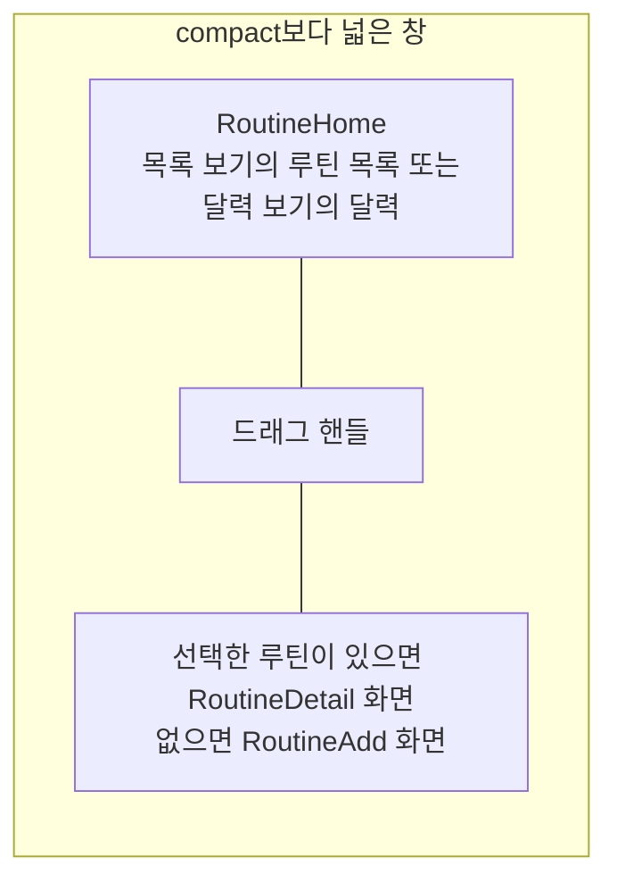

# Routine 목록·상세 배치 디자인

기준 스펙: [Routine 목록·상세 배치 스펙](../spec/client/routine-list-detail.md)

배치, 크기 조절, 버튼 노출, 진행과 피드백, 조절 상태 표시의 공통 표현과 상세 영역의 전환은 [목록·상세 배치 공통 디자인](./list-detail-pane.md)을 따르며, 이 배치는 그 문서의 `추가 화면이 선택 전 자리를 채우는 배치`에 해당한다. 다만 RoutineHome은 `더보기`에서 이어지는 화면이 아니라 주요 목적지이므로, 그 절에서 목록 영역 상단 바의 뒤로가기 버튼으로 두 영역을 함께 닫는 표현은 따르지 않는다.

## 두 영역에 두는 화면

목록 영역에는 [RoutineHome 화면](./routine-home.md)을 두고, 상세 영역에는 선택한 루틴의 [RoutineDetail 화면](./routine-detail.md)을 표시한다. 선택한 루틴이 없으면 [RoutineAdd 화면](./routine-add.md)을 표시한다. 목록 영역에는 RoutineHome의 보기에 따라 루틴 목록이나 달력이 놓인다.

공통 내비게이션 영역은 [TopLevelNavigation 스펙](../spec/client/top-level-navigation.md)의 `내비게이션 노출 기준`에 따라 두 영역과 함께 그대로 표시하며, 그 자리와 표현은 [TopLevelNavigation 디자인](./top-level-navigation.md)을 따른다.

목록 영역이 좁아져도 루틴 목록은 1열을 유지하고 카드가 함께 좁아진다. 카드의 빠른 기록 버튼은 폭을 줄이지 않고, 글 묶음이 남은 폭에서 [RoutineHome 화면 디자인](./routine-home.md)의 `루틴 카드`가 정한 대로 한 줄을 유지하며 가로로 흐른다. 달력은 목록 영역 폭에 맞춰 날짜 칸이 좁아지고, 아이템의 글은 [CalendarText 컴포넌트 디자인](./calendar-text.md)의 `넘치는 글 표시`에 따라 흐른다.

상세 영역에 놓인 화면의 카드와 입력도 상세 영역 폭에 맞춰 좁아지고, 카드 행의 이름이 줄바꿈되는 기준은 [RoutineAdd 화면 디자인](./routine-add.md)의 `시작 날짜 카드`와 `주기 카드`를 따른다. RoutineDetail의 기록 넣기 행은 양 입력만 좁아진다.

## 버튼 노출

상세 영역에 놓인 RoutineAdd와 RoutineDetail의 상단 바에는 뒤로가기 버튼을 표시하지 않는다. 상단 바 제목, RoutineDetail 상단 바의 완료 상태 전환 버튼과 삭제 버튼, 루틴 추가와 수정을 실행하는 떠 있는 버튼, 본문 카드 안의 버튼과 기록 영역의 넣기·빼기 버튼은 그대로 표시한다.

RoutineHome의 떠 있는 루틴 추가 버튼과 추가 단축키는 [목록·상세 배치 공통 디자인](./list-detail-pane.md)의 `버튼 노출`에 따라 상세 영역에 RoutineAdd가 놓여 있는 동안에는 제공하지 않고, RoutineDetail이 놓여 있는 동안에는 제공한다. 이 기준은 목록 보기와 달력 보기에서 같다. 버튼은 목록 영역의 오른쪽 아래에 두고 상세 영역으로 넘어가지 않는다.

## 목록 영역의 컨트롤

목록 영역 상단 바의 보기 전환 버튼과 필터 버튼, 달력 보기의 누를 수 있는 제목과 오늘 버튼, 목록 보기의 완료된 루틴 진입 줄과 그 버튼은 상세 영역에 어느 화면이 놓여 있어도 같은 자리에 같은 모양으로 둔다. 진입 줄은 목록 영역 안에만 두고 상세 영역으로 넘어가지 않는다. 목록 영역 상단 바에는 뒤로가기 버튼이 없다.

완료된 루틴 진입 버튼을 누르면 두 영역을 함께 [RoutineFinishedList 화면](./routine-finished-list.md)으로 바꾸고, 그 화면의 배치는 [RoutineFinishedList 목록·상세 배치 디자인](./routine-finished-list-detail.md)을 따른다. 그 화면에서 돌아오면 목록 영역과 상세 영역의 화면, 드래그 핸들의 자리와 두 영역의 너비 비율은 떠나기 전 그대로 표시한다.

보기를 바꾸면 목록 영역만 [RoutineHome 화면 디자인](./routine-home.md)의 `보기 전환 표현`으로 바뀌고, 상세 영역의 화면과 입력 중이던 내용, 드래그 핸들의 자리와 두 영역의 너비 비율은 그대로 둔다.

필터 Bottom Sheet를 여는 동안에는 목록 영역과 상세 영역을 함께 어둡게 처리한 배경 아래에 그대로 두며, 표현은 [RoutineHome 화면 디자인](./routine-home.md)의 `필터 진입`을 따른다. 필터를 바꿔도 상세 영역의 화면과 입력 중이던 내용은 바뀌지 않는다.

달력 보기의 방향키 달 이동이 상세 영역의 입력과 겹치지 않는 기준은 [RoutineHome 화면 디자인](./routine-home.md)의 `달력 보기`를 따른다.

## 목록과 상세의 표시

목록 보기의 카드나 달력 보기의 루틴 기록 아이템을 누르면 상세 영역이 그 루틴의 RoutineDetail로 교차 전환한다. 어느 보기에서 눌러도 상세 영역의 표현은 같다. 상세 영역에 어느 루틴이 놓여 있는지는 상세 영역의 상단 바 제목이 알리므로, 목록의 카드와 달력의 아이템에 선택 표시를 따로 두지 않는다.

RoutineHome의 양 입력 창과 달 선택 다이얼로그, 상세 영역에서 여는 날짜 선택 다이얼로그와 컬러 선택 다이얼로그는 연 영역이 아니라 창 가운데에 띄우고, 목록 영역과 상세 영역을 함께 가림막 아래에 둔다.

기록 안내, 완료 안내와 삭제 안내 스낵바는 [목록·상세 배치 공통 디자인](./list-detail-pane.md)의 `진행과 피드백`에 따라 목록 영역 안 아래쪽에, RoutineAdd와 RoutineDetail의 피드백 스낵바는 상세 영역 안 아래쪽에 표시한다. 두 스낵바는 서로를 대체하지 않는다.

목록의 카드에서 빠른 기록을 실행하거나 양을 입력해 기록해도 상세 영역의 화면은 바뀌지 않는다. 상세 영역에 그 루틴의 RoutineDetail이 놓여 있으면 방금 넣은 기록이 [RoutineDetail 화면 디자인](./routine-detail.md)의 `기록 행`이 정한 나타남 표현으로 기록 내역에 나타나고, 실행 취소하면 사라짐 표현으로 사라진다. 상세 영역의 스크롤 위치와 입력 중이던 내용은 그대로 둔다.

상세 영역에서 루틴을 추가하거나 수정하거나, 기록을 넣거나 뺀 뒤에는 바뀐 제목, 컬러, 카드 문구와 진행 막대, 목록 순서에 따라 옮겨진 자리가 목록에, 바뀐 제목, 컬러와 양 문구가 달력의 아이템에 반영되는 것을 같은 화면에서 확인한다. 카드가 바뀌고 자리를 옮기는 표현은 [RoutineHome 화면 디자인](./routine-home.md)의 `루틴 카드`를, 달력 아이템이 바뀌는 표현은 같은 문서의 `루틴 기록 아이템`을 따른다.

상세 영역의 RoutineDetail에서 루틴을 완료하면 그 카드는 목록에서 사라지지만 상세 영역은 같은 RoutineDetail 화면을 계속 표시하고, 완료 상태 전환 버튼만 켜진 상태로 바뀐다. 그 상세에서 다시 시작하면 카드가 지금 고른 보기 범위와 태그 필터에 맞을 때 목록 순서에 맞는 자리에 다시 나타난다. 달력의 아이템은 완료와 다시 시작으로 바뀌지 않는다.

목록의 카드를 스와이프해 완료했을 때 상세 영역에 그 루틴의 RoutineDetail이 놓여 있으면 상세 영역의 화면은 그대로 두고, 완료 상태 전환 버튼만 [RoutineDetail 화면 디자인](./routine-detail.md)의 `완료와 다시 시작`에 따라 켜진 상태로 바뀐다. 완료를 실행 취소하면 켜지지 않은 상태로 돌아간다.

달력 보기에서 완료된 루틴의 기록 아이템을 눌러도 상세 영역은 같은 표현으로 그 루틴의 RoutineDetail로 바뀐다.

상세 영역의 루틴이 고른 태그나 보기 범위에 맞지 않아 목록이나 달력에서 사라져도 상세 영역에는 그 루틴의 상세를 그대로 둔다. 상세 영역에서 시작 날짜나 주기를 고쳐 목록에서 사라졌을 때와 오늘이 다시 정해져 사라졌을 때도 같다.

목록의 당김 새로고침과 진행 표시는 두 보기 모두 [새로고침 디자인](./sync-refresh.md)의 `적응형 배치`에 따라 목록 영역 안에만 둔다.
