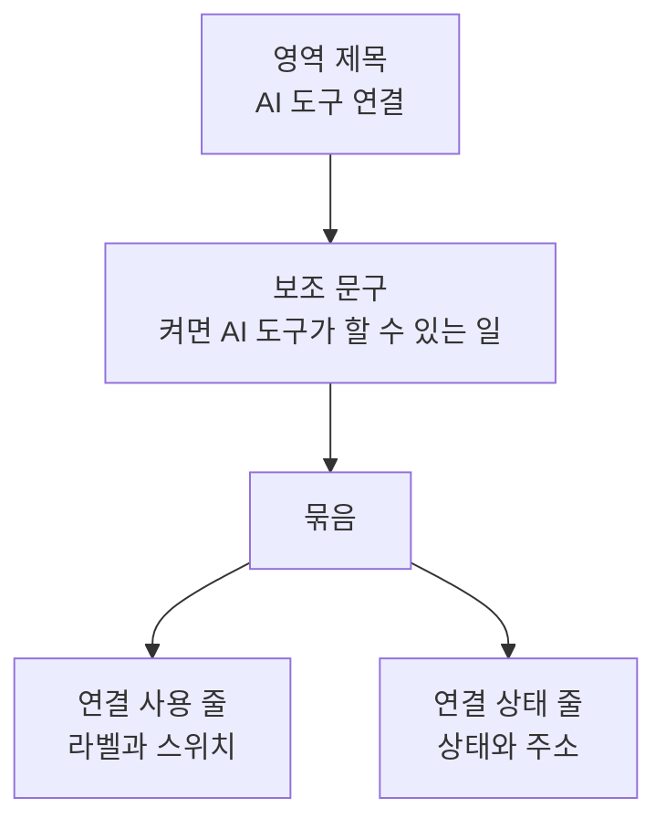

# SettingMcp 화면 디자인

기준 스펙: [SettingMcp 화면 스펙](../spec/client/setting-mcp.md), [AI 도구 연결 스펙](../spec/client/mcp-server.md)

화면 구조, 저장된 값을 확인하기 전의 표시와 공통 문구는 [기기 설정 화면 공통 디자인](./device-setting.md)을 따른다. 이 문서는 이 화면에서만 다른 표현을 다룬다.

이 화면은 데스크톱 앱에만 있으므로 마우스와 키보드 조작을 기준으로 하며, 터치 기기의 표현은 정하지 않는다.

## 화면 구조

본문에는 `AI 도구 연결` 영역 하나를 둔다.

## AI 도구 연결 영역

`AI 도구 연결` 설정 이름을 묶음 위에 두고, 그 아래에 연결을 켜면 AI 도구가 할 수 있는 일을 알리는 보조 문구를 설정 이름보다 작은 글자와 낮은 강조 색으로 둔다. 설정 이름과 보조 문구는 [SettingFile 화면](./setting-file.md)의 `다운로드 위치`와 같이 묶음 바깥의 영역 제목으로 두고, 묶음의 바깥 가장자리에 맞춰 시작 쪽으로 정렬하며, 보조 문구와 묶음 사이에는 [항목 간격](./dimens.md)을 둔다. 보조 문구는 연결이 켜져 있든 꺼져 있든 항상 표시하고 줄바꿈해 전체를 보여 준다.

묶음의 배경과 모양, 줄 사이 간격과 누름 표현은 [묶음 목록 항목 디자인](./segmented-list-item.md)을 따른다. 묶음에는 위에서부터 다음 줄을 둔다.

| 줄 | 내용 | 누를 수 있는가 |
| --- | --- | --- |
| 연결 사용 | 시작 쪽에 `MCP 서버 사용` 라벨, 끝 쪽에 스위치 | 그렇다. 누르면 켜짐과 꺼짐이 바뀐다 |
| 연결 상태 | 제목 줄에 연결 상태, 보조 줄에 연결 주소. 동작 중이면 끝 쪽에 복사 아이콘 | 동작 중일 때만 그렇다. 누르면 주소를 복사한다 |

저장된 설정을 확인하기 전이거나 읽지 못한 상태에서는 묶음을 감추고 설정 이름과 보조 문구만 남긴다. 보조 문구는 설정 값과 관계없이 항상 보여야 하기 때문이다.

### 연결 사용 줄

라벨과 스위치 사이에는 남은 폭을 두어 스위치를 줄 끝에 붙인다. 줄 전체를 하나의 조작 대상으로 두어 라벨을 눌러도 켜짐과 꺼짐이 바뀌고, 스위치는 따로 누르는 대상으로 두지 않는다. 스위치가 켜짐과 꺼짐을 나타내므로 [묶음 목록 항목 디자인](./segmented-list-item.md)의 선택 상태 강조 색은 쓰지 않는다. 스위치 전환은 Material 기본 모션을 따른다.

저장하는 동안에도 줄의 모양을 바꾸거나 진행 표시를 두지 않는다. 저장은 짧게 끝나며 끝나면 스위치가 저장된 값으로 바뀐다. 저장에 실패하면 스위치가 이전 상태로 남는 것으로 결과가 드러나므로 따로 안내하지 않는다.

### 연결 상태 줄

연결 상태에 따라 다음을 표시한다.

| 연결 상태 | 시작 쪽 아이콘 | 제목 줄 | 보조 줄 | 끝 쪽 |
| --- | --- | --- | --- | --- |
| 꺼짐 | 연결 아이콘, 낮은 강조 색 | `꺼져 있음` | 없음 | 없음 |
| 동작 중 | 연결 아이콘, 강조 색 | `동작 중` | 연결 주소 | 복사 아이콘 |
| 시작 실패, 주소를 다른 프로그램이 씀 | 경고 아이콘, 오류 색 | `다른 프로그램이 주소를 쓰고 있어 시작하지 못했습니다` | 연결 주소 | 없음 |
| 시작 실패, 그 밖의 이유 | 경고 아이콘, 오류 색 | `연결을 시작하지 못했습니다` | 없음 | 없음 |

꺼짐과 동작 중은 같은 연결 아이콘을 색으로만 구분하므로, 상태는 제목 문구로 함께 알린다. 시작 실패는 경고 아이콘으로 모양까지 바꾼다.

연결 주소는 고정폭 글꼴로 표시하고 줄바꿈해 전체를 보여 주며 말줄임하지 않는다. 사용자가 AI 도구에 그대로 옮겨 적을 값이기 때문이다.

연결 상태가 바뀌면 줄의 내용을 바로 바꾸고, 보조 줄이 나타나거나 사라질 때는 줄 높이가 자연스럽게 늘고 줄도록 크기 변화에 기본 전환을 쓴다.

### 진행과 피드백

주소를 복사하면 복사되었다는 안내를 스낵바로 표시하고 동작 버튼은 두지 않는다. 표시 시간은 Material 기본의 짧은 표시 시간이다. 설정 목록과 함께 표시할 때도 상세 영역 안에 표시한다.

## 키보드

연결 사용 줄과 연결 상태 줄은 Tab 키로 초점을 옮길 수 있고, 초점이 있을 때 Enter나 Space를 누르면 누른 것과 같은 결과가 된다. 연결 상태 줄은 동작 중일 때만 초점을 받는다. 초점 표시는 Material 기본 표현을 따른다.

## 표시 영역

본문과 스낵바는 창의 표시 영역 안에 배치한다. 이 화면에는 입력이 없으므로 키보드 입력 칸을 두지 않는다.

## 문구와 접근성

한국어 환경과 그 외 기본 환경에서는 다음 문구를 사용한다. 뒤로가기 접근성 이름은 [기기 설정 화면 공통 디자인](./device-setting.md)의 `문구와 접근성`을 따른다.

| 문구 | 한국어 | 그 외 기본 |
| --- | --- | --- |
| 상단 바 제목 | `MCP 설정` | `MCP Settings` |
| 영역 제목 | `AI 도구 연결` | `AI tool connection` |
| 보조 문구 | `켜면 이 Mac의 AI 도구가 확인 없이 현재 계정의 메모와 항목을 조회하고 추가, 수정, 삭제할 수 있습니다.` | `When on, AI tools on this Mac can view, add, edit, and delete your current account's memos and items without asking.` |
| 연결 사용 라벨 | `MCP 서버 사용` | `Use MCP server` |
| 꺼짐 | `꺼져 있음` | `Off` |
| 동작 중 | `동작 중` | `Running` |
| 주소 사용 중 실패 | `다른 프로그램이 주소를 쓰고 있어 시작하지 못했습니다` | `Couldn't start because another program is using the address` |
| 그 밖의 실패 | `연결을 시작하지 못했습니다` | `Couldn't start the connection` |
| 주소 복사 동작 이름 | `주소 복사` | `Copy address` |
| 복사 안내 | `주소를 복사했습니다.` | `Address copied.` |

연결 사용 줄은 라벨 문구를 이름으로 하는 스위치로 알리고, 켜짐과 꺼짐은 스위치의 기본 상태 표현으로 전달한다. 연결 상태 줄은 제목 줄과 보조 줄을 이어서 읽고, 동작 중이면 누름 동작의 이름을 `주소 복사`로 알리는 버튼으로 알린다. 아이콘은 장식으로 보고 따로 읽지 않는다.
