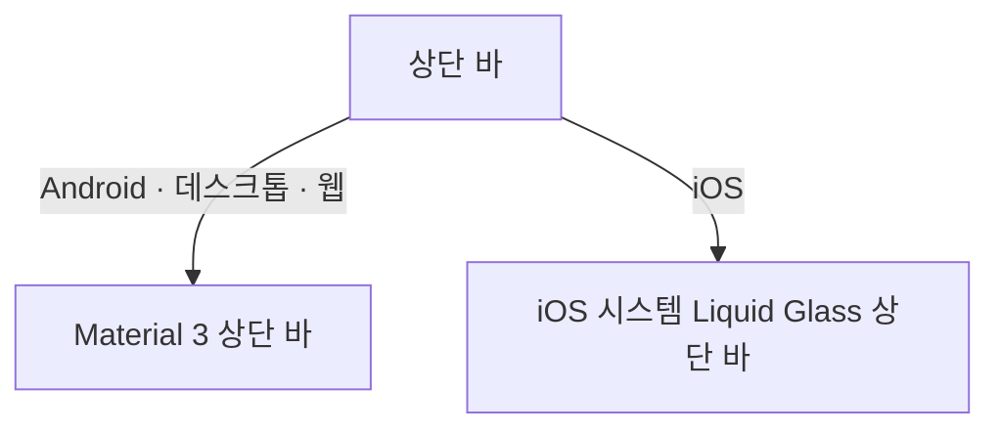

# 상단 바 디자인

이 문서는 모든 화면의 상단 바가 플랫폼마다 어떤 표현으로 그려지는지와, 상단 바에 둘 수 있는 요소의 종류를 소유한다. 각 화면의 상단 바에 어떤 제목과 버튼을 어떤 순서로 두는지, 버튼의 아이콘과 접근성 이름 문구, 버튼을 두는 조건은 그 화면 디자인이 소유한다.

이 문서는 이미 있는 상단 바의 표현만 다루고 사용자 행위나 제품 정책을 새로 정의하지 않으므로 기준 스펙을 두지 않는다.

## 구성

상단 바는 다음 세 자리로 이루어진다.

| 자리 | 내용 |
| --- | --- |
| 시작 쪽 | 화면을 떠나는 뒤로가기 버튼. 화면 디자인이 두지 않으면 비운다 |
| 제목 자리 | 제목. 정렬은 플랫폼별 표현을 따른다 |
| 끝 쪽 | 그 화면의 동작 버튼. 화면 디자인이 정한 순서대로 시작 쪽에서 끝 쪽으로 놓는다 |

### 제목의 종류

| 종류 | 표현 |
| --- | --- |
| 글자 제목 | 한 줄 제목. 화면 디자인이 정하면 아래에 한 줄 보조 제목을 둔다 |
| 흐르는 글자 제목 | 폭을 넘는 제목을 가로로 흘려 끝까지 보여 준다 |
| 누를 수 있는 제목 | 제목 글자 옆에 펼침·접힘 화살표를 두고, 제목 전체를 하나의 버튼으로 누른다 |
| 검색 입력 | 제목 자리 전체를 [검색 입력](./search-input.md)이 차지한다 |

### 동작 버튼의 종류

| 종류 | 표현 |
| --- | --- |
| 아이콘 버튼 | 아이콘 하나를 표시하고 누르면 동작을 실행한다 |
| 진행을 표시하는 아이콘 버튼 | 동작이 진행되는 동안 아이콘 자리를 진행 표시로 바꾼다. 진행 중에도 버튼 이름은 유지한다 |
| 켬·끔 버튼 | 켜짐과 꺼짐을 가진 아이콘 버튼. 켜지면 강조색으로 표시한다. 진행을 표시할 수 있다 |
| 적용 상태 버튼 | 무언가가 적용되어 있으면 아이콘을 강조색으로 표시하고 낭독 도구에 적용 상태를 함께 알린다 |
| 글자 버튼 | 아이콘 대신 짧은 글자를 모서리가 둥근 정사각형 외곽선 안에 표시한다. 외곽선은 글자에 맞춘 작은 크기이고, 누를 자리는 외곽선보다 넓은 최소 터치 크기를 유지한다 |

아이콘 버튼과 진행을 표시하는 아이콘 버튼은 비활성일 수 있다. 비활성 버튼은 흐리게 표시하고 누를 수 없다.

아이콘은 모든 플랫폼에서 같은 Material Symbols Rounded 아이콘을 쓴다. 플랫폼마다 다른 아이콘 체계로 바꾸지 않는다.

## 플랫폼별 표현

### Android, 데스크톱, 웹

Material 3 상단 바를 그대로 쓴다. 높이, 색, 글꼴, 버튼 크기는 Material 3 기본값을 따르고 이 문서에서 수치를 정하지 않는다.

제목은 시작 쪽에 맞춘다. 화면 디자인이 가운데 정렬을 정한 상단 바만 제목을 가운데에 둔다.

아이콘 버튼, 진행을 표시하는 아이콘 버튼, 켬·끔 버튼에는 [아이콘 버튼 설명](./icon-button-tooltip.md)의 설명 표시를 둔다. 적용 상태 버튼과 글자 버튼에는 설명을 두지 않는다.

누를 수 있는 제목은 글자와 화살표를 감싸도록 좌우 `8dp`, 위아래 `4dp` 안쪽 여백을 두고 모서리를 `12dp` 둥글게 깎은 하나의 누를 자리로 두며, 누르면 그 안에 물결 효과를 표시한다.

진행 표시는 물결 모양 원형 진행 표시를 쓴다. 강조색은 앱 색 구성의 주 색이고, 강조하지 않은 적용 상태 버튼은 보조 내용 색으로 표시한다.

### iOS

iOS 26의 시스템 Liquid Glass 표현으로 그린다. 상단 바 자체에는 배경 면을 두지 않고, 버튼과 버튼 묶음만 유리 질감의 면으로 띄운다.

| 요소 | 표현 |
| --- | --- |
| 상단 바 높이 | 상태 표시줄 아래 `52dp` |
| 좌우 여백 | `16dp` |
| 뒤로가기 버튼 | 지름 `44dp`의 원형 유리 면 안에 뒤로가기 아이콘 |
| 동작 버튼 묶음 | 동작 버튼 전체를 좌우 끝이 완전히 둥근 유리 면 하나로 묶는다. 버튼 하나는 `44dp` 정사각형 누를 자리를 갖는다 |
| 아이콘 크기 | `24dp` |
| 제목 | 가운데에 두고 iOS 시스템의 헤드라인 글꼴과 기본 글자색으로 쓴다 |
| 보조 제목 | 제목 아래에 iOS 시스템의 보조 글꼴과 보조 글자색으로 쓴다 |

제목은 화면 디자인의 정렬과 상관없이 iOS 상단 바의 관례대로 가운데에 둔다. 양쪽 버튼과 겹치지 않을 만큼만 폭을 쓰고, 그래도 넘치면 끝을 말줄임표로 줄인다. 흐르는 글자 제목도 iOS에서는 흘리지 않고 말줄임표로 줄인다. iOS 상단 바는 제목을 흘리지 않으며, 줄인 제목의 전체 문구는 낭독 도구가 그대로 읽는다.

누를 수 있는 제목은 유리 면 없이 글자와 화살표만 표시하고, 누르는 동안 시스템의 누름 표현을 따른다.

동작 버튼은 다음처럼 표시한다.

| 종류 | iOS 표현 |
| --- | --- |
| 아이콘 버튼 | 기본 글자색 아이콘 |
| 진행을 표시하는 아이콘 버튼 | 진행 중에는 아이콘 자리를 iOS 시스템 진행 표시로 바꾼다 |
| 켬·끔 버튼 | 켜지면 아이콘을 앱 색 구성의 주 색으로 표시한다 |
| 적용 상태 버튼 | 적용되면 아이콘을 앱 색 구성의 주 색으로 표시한다 |
| 글자 버튼 | 다른 동작 버튼과 같은 유리 면 묶음 안에 외곽선과 글자를 표시한다 |
| 비활성 버튼 | 시스템의 비활성 표현으로 흐리게 표시한다 |

iOS 상단 바의 버튼은 iOS 시스템 버튼으로 그려 길게 눌러 보는 설명이 없으므로 [아이콘 버튼 설명](./icon-button-tooltip.md)의 설명 표시를 두지 않는다. 포인터를 쓰는 iPad에서는 모든 버튼에 포인터를 올리면 시스템 설명으로 버튼의 접근성 이름을 보여 준다.

글자 버튼의 외곽선은 Android·데스크톱·웹의 Material 3 글자 버튼과 같은 모양으로 그린다. 한 변 `32dp` 정사각형에 모서리를 `12dp` 둥글게 깎고, 글자와 같은 기본 글자색으로 `1dp` 두께의 선을 그린다. 외곽선은 `44dp` 누를 자리의 가운데에 두고, 유리 면 묶음은 외곽선이 아니라 누를 자리 폭에 맞춘다.

화면이 바뀌는 동안 상단 바는 화면 본문과 같은 교차 전환으로 이전 화면의 상단 바에서 다음 화면의 상단 바로 바뀌고, 이전 화면의 전환이 끝나기를 기다리지 않는다.

진행 표시로 바뀌는 버튼과, 화면 디자인이 아이콘 교체를 교차 전환으로 정한 버튼은 버튼 자리를 그대로 두고 그 안에서 교차 전환한다. 그 밖의 버튼은 아이콘이 바뀌면 전환 없이 바꾼다.

누를 수 있는 제목은 낭독 도구에 제목 문구를 이름으로 알리고, 화면 디자인이 정한 화살표의 여는·닫는 이름을 안내로 함께 알린다.

[나타나고 사라지는 버튼](./button-visibility.md)이 상단 바에서 대상으로 꼽은 버튼은 그 문서의 아이콘 버튼 모션을 같은 유리 면 안에서 쓰고, 유리 면 묶음은 남은 버튼의 폭에 맞춰 함께 줄고 는다. 그 밖에 화면 디자인이 조건에 따라 두거나 빼는 버튼은 모든 플랫폼에서 전환 없이 곧바로 나타나고 사라진다.

검색 입력은 [검색 입력](./search-input.md)의 자리 구성을 따르되, 컨테이너를 좌우 끝이 완전히 둥근 유리 면으로 그린다. 높이는 `44dp`다.

## 시스템 영역

상단 바는 상태 표시줄, 디스플레이 컷아웃과 겹치지 않도록 그 아래와 안쪽에 놓는다. 가로 방향에서는 좌우 시스템 영역 안쪽에 버튼을 둔다.

본문은 상단 바 아래에서 시작하고 상단 바 밑으로 지나가지 않는다.

## 접근성

모든 플랫폼에서 버튼의 접근성 이름은 화면 디자인이 정한 문구를 쓴다. 진행 표시로 아이콘이 바뀐 동안에도 버튼 이름을 유지한다.

켬·끔 버튼은 낭독 도구에 켬·끔 버튼으로 알리고 지금 켜져 있는지를 함께 알린다. 적용 상태 버튼은 적용되어 있을 때 화면 디자인이 정한 적용 상태 문구를 함께 알린다.

글자 버튼은 표시하는 글자가 아니라 화면 디자인이 정한 접근성 이름을 읽는다.

## 이 문서를 참조하는 문서

- [아이콘 버튼 설명](./icon-button-tooltip.md)
- [검색 입력](./search-input.md)
- [CalendarHome](./calendar-home.md)
- [FileHome 화면](./file-home.md)
- [더보기 준비 중 화면 공통](./more-menu-placeholder.md)
- [QrHome 화면](./qr-home.md)
- [TagMemoFinishedList 화면](./tag-memo-finished-list.md)
- [항목 완료 메모 목록 화면](./entity-memo-finished-list.md)
- [WebDetail 화면](./web-detail.md)
- [ContactDetail 화면](./contact-detail.md)
- [MemoDetail 화면](./memo-detail.md)
- [MusicDetail 화면](./music-detail.md)
- [PlaceDetail 화면](./place-detail.md)
- [PlaceHome 화면](./place-home.md)
- [QrAdd 화면](./qr-add.md)
- [QrDetail 화면](./qr-detail.md)
- [TagDetail 화면](./tag-detail.md)

## 참고

- [Liquid Glass – Apple Developer](https://developer.apple.com/documentation/technologyoverviews/liquid-glass)
- [Top app bar – Material Design 3](https://m3.material.io/components/app-bars/overview)
