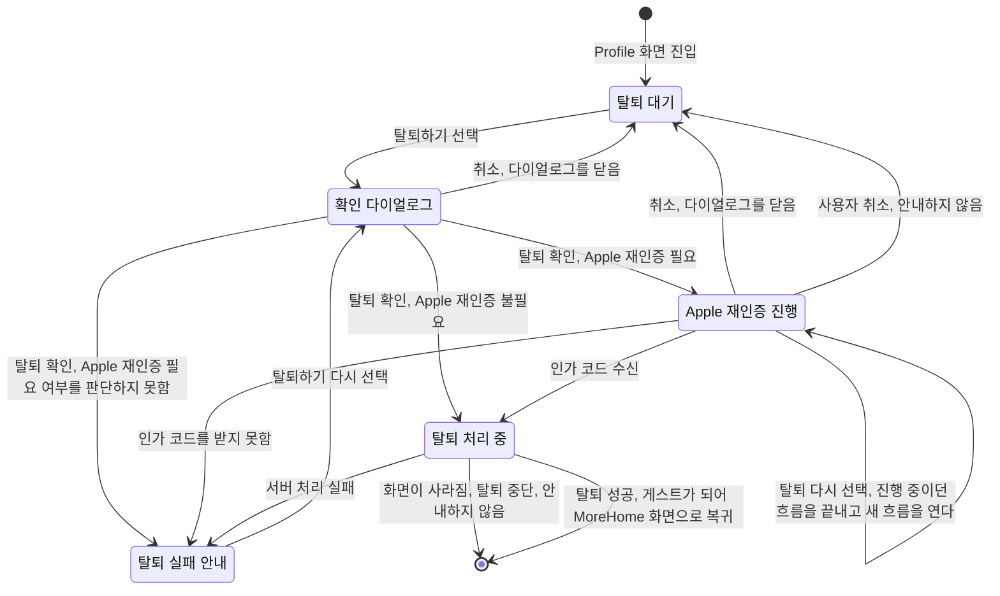
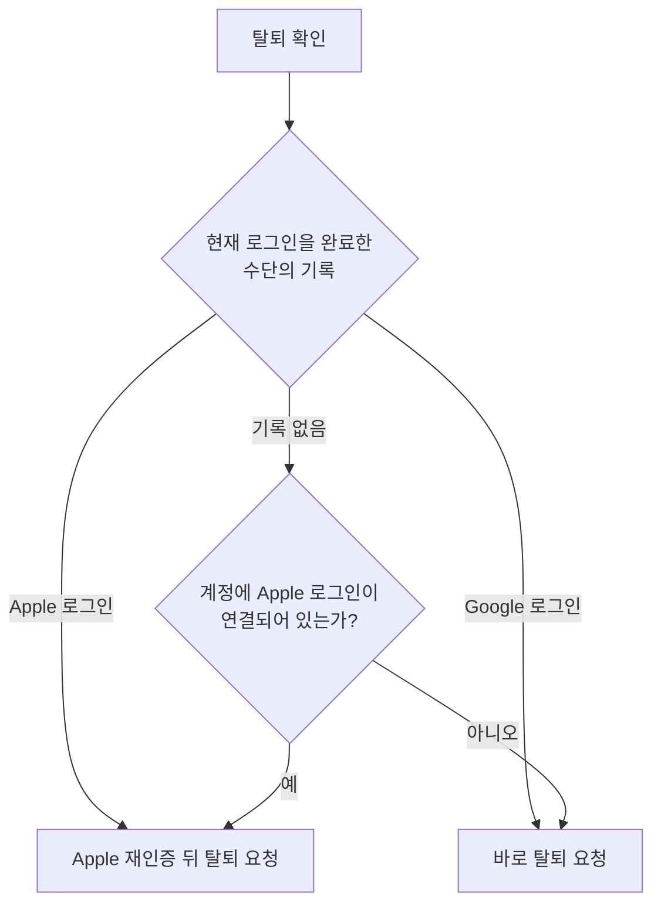

# 계정 탈퇴 스펙

이 문서는 사용자가 앱 안에서 자기 계정을 탈퇴하는 흐름과, 탈퇴에 성공했을 때 앱이 이 기기에서 처리하는 것을 다룬다. 탈퇴를 시작하는 화면은 [Profile 화면 스펙](./profile.md)이, 앱과 서버가 주고받는 탈퇴 요청과 결과의 약속은 [계정 탈퇴 스펙(common)](../common/account-deletion.md)이, 서버가 계정과 데이터를 지우는 처리는 [계정 탈퇴 스펙(server)](../server/account-deletion.md)이 소유한다.

디자인: [Profile 화면 디자인](../../design/profile.md)

## feature

탈퇴 한 번의 진행 흐름은 다음과 같다. 각 단계의 조건과 결과는 아래 절에서 정의한다.

### 탈퇴 확인

사용자가 Profile 화면에서 `탈퇴하기`를 선택하면 탈퇴를 한 번 더 확인하는 다이얼로그가 열린다.

다이얼로그는 다음을 알린다.

- 탈퇴하면 계정과 서버에 저장된 모든 데이터가 지워지며 되돌릴 수 없다.
- 이 기기에 저장된 그 계정의 데이터도 지워진다. 아직 서버에 반영되지 않은 변경도 함께 지워진다.

사용자는 다이얼로그에서 탈퇴와 취소 중 하나를 고른다.

- 탈퇴를 고르면 다이얼로그는 열린 채로 탈퇴가 진행된다. Apple 재인증이 필요하면 먼저 Apple 재인증을 진행한다. 필요한지는 `domain > Apple 재인증 필요 여부`를 따른다.
- 취소를 고르면 다이얼로그가 닫히고 아무것도 바뀌지 않는다.

다이얼로그를 고르지 않고 닫으면 취소를 고른 것과 같다. 다이얼로그가 열려 있는 동안에는 화면의 다른 조작을 할 수 없다.

탈퇴가 진행 중인 동안에는 다이얼로그에 진행 중인 상태를 표시하고, 탈퇴와 취소를 고를 수 없으며 다이얼로그를 닫을 수도 없다. 다만 Apple 로그인 흐름이 진행되는 동안은 `Apple 재인증`을 따른다. 진행 중인 상태가 끝나면 그 결과에 따라 다이얼로그가 닫힌다. 어떤 경우에 다이얼로그가 닫히는지는 아래 절이 정한다.

### Apple 재인증

Apple 재인증은 Apple이 이 앱에 준 로그인 권한을 탈퇴와 함께 취소하기 위해 Apple 로그인을 한 번 더 거치는 단계다. 사용자는 로그인할 때와 같은 플랫폼의 Apple 로그인 흐름에서 계정을 확인한다. 플랫폼별 흐름은 [Login 화면 스펙](./login.md)의 `domain > 제공하는 로그인 수단`을 따른다.

Apple 로그인 흐름이 진행되는 동안에는 확인 다이얼로그에 진행 중인 상태를 표시하지 않고 탈퇴와 취소를 그대로 고를 수 있다. 탈퇴를 다시 고르면 진행 중이던 흐름을 끝내고 새 흐름 하나만 연다. 취소를 고르거나 다이얼로그를 닫으면 진행 중이던 흐름을 끝내고 탈퇴하지 않는다. 끝낸 흐름의 결과는 받지 않는다.

사용자가 Apple 로그인 흐름을 취소하면 다이얼로그가 닫히고 탈퇴하지 않으며 오류를 안내하지 않는다. 무엇을 취소로 보는지는 [Login 화면 스펙](./login.md)의 `feature > 취소와 오류`와 같다.

Apple의 인가 코드를 받지 못하면 다이얼로그가 닫히고 탈퇴 실패를 안내하며 탈퇴하지 않는다.

### 탈퇴 처리

탈퇴를 요청한 뒤 결과를 받을 때까지 확인 다이얼로그에 진행 중인 상태를 표시한다.

진행 중에는 다이얼로그를 닫을 수 없으므로 사용자가 직접 Profile 화면을 떠날 수 없다. 다른 이유로 Profile 화면이 사라지면 진행 중이던 탈퇴는 중단되고 그 결과를 기다리지 않는다. 중단은 실패로 안내하지 않으며, 이 기기의 데이터를 지우거나 로그아웃하지 않는다. 중단하기 전에 서버에서 탈퇴가 이미 끝났을 때의 결과는 `domain > 실행 경계`를 따른다.

### 탈퇴 성공

탈퇴에 성공하면 이 기기에 저장된 그 계정의 데이터를 지우고 로그아웃한다. 계정 상태는 게스트로 바뀌고 Profile 화면은 닫혀 MoreHome 화면으로 돌아간다. 성공을 따로 안내하지 않으며, 사용자는 MoreHome 화면의 게스트 상태로 탈퇴를 확인한다.

지우는 데이터는 `data > 이 기기에서 지우는 것`을 따른다.

### 탈퇴 실패

탈퇴에 실패하면 다이얼로그가 닫히고 Profile 화면에 머무르며 탈퇴에 실패했음을 알린다. 계정과 이 기기의 데이터는 그대로 남고 사용자는 로그인한 상태를 유지한다. 사용자는 탈퇴하기를 다시 선택해 처음부터 다시 시도할 수 있다.

네트워크에 연결되지 않았거나 로그인 세션이 갱신되지 않아 서버에 요청할 수 없는 경우도 탈퇴 실패로 안내한다.

## domain

### Apple 재인증 필요 여부

이 기기의 현재 로그인을 Apple 로그인으로 완료했으면 Apple 재인증이 필요하다. Google 로그인으로 완료했으면 필요하지 않다. 같은 계정에 Apple 로그인이 함께 연결되어 있어도 현재 로그인이 Google 로그인이면 재인증하지 않는다.

현재 로그인을 어느 수단으로 완료했는지 기록이 없으면, 계정에 Apple 로그인이 연결되어 있을 때 Apple 재인증이 필요한 것으로 본다. 탈퇴 기능이 생기기 전 버전의 앱에서 로그인해 기록이 없는 기기가 여기에 해당한다. Apple 로그인으로 완료한 계정의 권한을 취소하지 않고 남기는 것보다, Apple 로그인도 연결된 계정의 사용자가 Apple 로그인을 한 번 더 거치는 쪽을 택한다. Apple 로그인이 연결되지 않은 계정은 Apple 로그인을 할 수 없으므로 재인증하지 않는다.

Apple 재인증이 필요한지 판단하는 데 필요한 로그인 수단 기록이나 저장된 사용자 정보를 읽지 못하면 탈퇴를 요청하지 않고 탈퇴 실패로 안내한다. Apple 로그인 권한을 취소하지 못한 채 탈퇴되는 것을 막기 위해서다.

Apple 재인증에서 사용자가 현재 계정과 다른 Apple 계정으로 인증하면 서버가 요청을 거절하므로 탈퇴는 실패한다. 판정 기준은 [계정 탈퇴 스펙(server)](../server/account-deletion.md)의 `data > 요청 검증`을 따른다.

### 탈퇴 요청 제한

탈퇴가 진행 중인 동안 같은 계정의 새 탈퇴 요청은 처리하지 않는다. 진행 중인 탈퇴가 실패로 끝나면 다시 요청할 수 있다.

### 탈퇴 실패 보고

탈퇴 실패 중 Apple 재인증의 Apple 로그인 흐름이 오류로 끝나 인가 코드를 받지 못한 것만 오류 보고 대상이다. Apple 로그인 흐름 자체의 문제를 확인하기 위한 것이며, 보고 방식은 [기능 실패 로깅](./usecase-failure-logging.md)의 오류 보고를 따른다. 사용자 취소와, 오류 없이 인가 코드 없이 끝난 흐름은 보고하지 않는다.

Apple 재인증 필요 여부를 판단하지 못한 것과 서버 처리 실패는 오류 보고 대상이 아니다. 탈퇴 요청이 서버의 실패 응답을 받았거나 응답 내용을 읽지 못한 경우는 [원격 응답 실패 보고 스펙](./remote-response-failure-logging.md)을 따른다.

### 실행 경계

확인 다이얼로그가 열려 있는 동안 화면이 회전하거나 시스템에 의해 재생성되면 다이얼로그는 열린 상태를 유지한다. 다이얼로그를 닫은 뒤에는 다시 열리지 않는다.

Apple 재인증이 필요한지 판단하는 동안 화면이 재생성되면 판단과 진행 상태가 이어진다. 판단이 끝나면 그 결과에 따라 Apple 재인증이나 탈퇴 요청을 진행한다.

Apple 재인증 흐름이 진행되는 동안 화면이 재생성되거나 앱이 다시 시작되면 그 흐름은 중단되고 그 뒤 돌아오는 결과는 받지 않는다. 중단은 실패로 안내하지 않으며, 다이얼로그가 닫히고 탈퇴 대기 상태로 돌아간다.

탈퇴 처리 중 화면이 재생성되면 진행 상태가 이어지고 처리가 끝나면 결과가 적용된다. 확인 다이얼로그가 열린 채 앱이 다시 시작되면(Apple 재인증 필요 여부를 판단하는 중이거나 탈퇴 요청을 처리하는 중 포함) 다이얼로그는 열린 채로 복원된다. 이때 진행 중 표시와 처리는 이어지지 않고 탈퇴 요청도 다시 이루어지지 않으며, 사용자는 탈퇴와 취소를 다시 고를 수 있다. Apple 로그인 흐름이 진행되던 중 다시 시작된 경우만 다이얼로그가 닫히며, 그 기준은 앞 문단을 따른다. 처리 중 사용자가 Profile 화면을 떠나거나 앱이 종료되면 그 결과를 받지 못한다. 서버에서 탈퇴가 이미 끝났다면 이 기기의 로그인 세션은 더 이상 갱신되지 않아 계정이 게스트가 되며, 그 기준은 [계정 조회 스펙](./account.md)의 `세션 갱신 여부`를 따른다. 이때 이 기기에 남은 그 계정의 데이터는 로그아웃했을 때처럼 남는다.

사용자가 Profile 화면을 떠난 뒤 다시 들어오면 탈퇴 대기 상태로 시작한다. 이전 시도의 실패 안내는 이어지지 않는다.

### 다른 기기

같은 계정으로 로그인한 다른 기기는 탈퇴 뒤 로그인 세션이 갱신되지 않아 게스트가 된다. 그 기준은 [계정 조회 스펙](./account.md)의 `세션 갱신 여부`를 따르며, 그 기기에 남은 그 계정의 데이터는 로그아웃했을 때처럼 남는다.

## data

### 로그인 수단 기록

앱은 로그인을 완료할 때마다 어느 수단으로 완료했는지 이 기기에 기록한다. 로그아웃하거나 탈퇴하면 기록을 지운다. 이 기록은 `domain > Apple 재인증 필요 여부`에만 쓴다.

계정에 Apple 로그인이 연결되어 있는지는 탈퇴를 확인한 시점에 이 기기에 저장된 사용자 정보의 연결된 로그인 수단으로 판단한다.

### 탈퇴 요청

앱은 인증된 로그인 세션으로 서버에 탈퇴를 요청한다. Apple 재인증을 거쳤으면 받은 Apple 인가 코드와 그 코드를 받은 이 앱의 식별 값을 함께 보낸다. 담는 정보는 [계정 탈퇴 스펙(common)](../common/account-deletion.md)의 `탈퇴 요청`을 따른다.

로그인 세션이 갱신되지 않은 동안에는 서버에 요청하지 않고 탈퇴 실패로 끝낸다.

Apple 재인증의 웹 로그인 흐름은 로그인할 때와 같은 방식으로 Apple에 요청하되 인가 코드도 함께 요청하며, 응답은 [로그인 스펙(server)](../server/login.md)의 `Apple 웹 로그인 중계`를 거쳐 앱으로 돌아온다. 응답의 상태 값을 확인하는 기준은 [Login 화면 스펙](./login.md)의 `domain > 허용되는 Apple 인증 결과`와 같다.

### 이 기기에서 지우는 것

서버가 탈퇴 성공을 돌려주면 앱은 이 기기에 저장된 그 계정의 데이터를 지운 뒤 로그아웃한다.

- 지우는 데이터의 범위는 [데이터 동기화 앱 스펙](./data-sync.md)의 `강제 전체 재동기화` 1단계와 같고, 그 계정의 마지막 동기화 시각 기록도 함께 지운다. 둘 중 하나를 지우지 못해도 나머지는 지운다.
- 로그아웃하면 이 기기의 로그인 정보와 로그인 수단 기록이 지워진다.

게스트 상태의 데이터와 계정이 아니라 기기에 유지하는 설정은 지우지 않는다.

이 기기의 데이터를 지우지 못해도 로그아웃은 진행하고 탈퇴는 성공으로 처리한다. 서버의 계정은 이미 지워져 되돌릴 수 없기 때문이다. 지우지 못한 것은 오류 보고로 남기지 않는다.

로그아웃으로 계정이 게스트가 된 뒤의 주기 동기화 해제, 푸시 알림 수신 해제, 올리기 중단은 로그아웃했을 때와 같은 기준을 따른다. 각각 [데이터 동기화 앱 스펙](./data-sync.md)의 `로그인과 로그아웃`, [푸시 알림 수신 등록 스펙](./fcm-token.md)의 `로그아웃과 해제`, [파일 보관 스펙](./file-storage.md)의 `올리기를 중단하는 계기`를 따른다.

## 참고

- [Offering account deletion in your app](https://developer.apple.com/support/offering-account-deletion-in-your-app/)
- [App Review Guidelines 5.1.1(v)](https://developer.apple.com/app-store/review/guidelines/#data-collection-and-storage)
