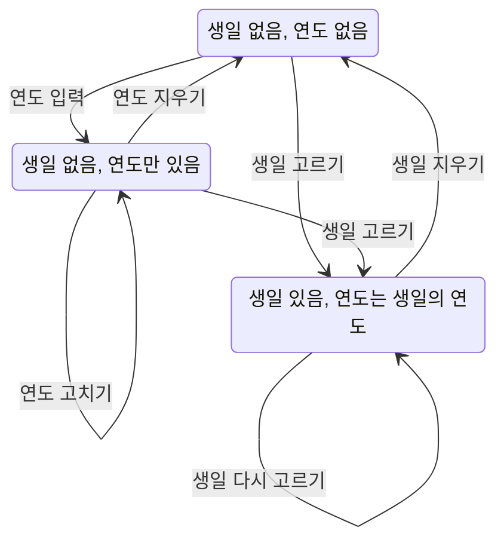
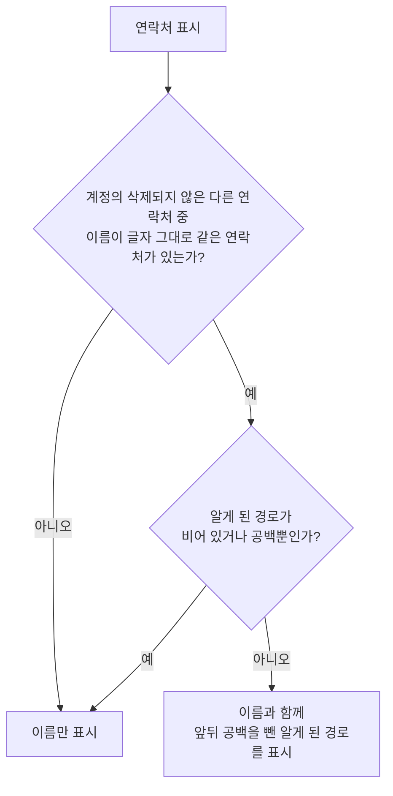

# ContactAdd 화면 스펙

이 문서는 사용자가 새 연락처를 작성해 추가하는 ContactAdd 화면의 내용과 행동, 그리고 추가되는 연락처가 갖는 정보와 정책을 다룬다. ContactAdd로 진입하는 흐름과 저장한 연락처의 목록 표시는 [ContactHome 화면 스펙](./contact-home.md)에서, 이 태그에 연결된 연락처를 확인하다가 진입하는 흐름은 [TagDetail 연락처 탭 스펙](./tag-detail-contact.md)에서, 저장된 연락처를 확인하고 수정하고 삭제하고 즐겨찾기를 바꾸는 흐름은 [ContactDetail 화면 스펙](./contact-detail.md)에서, 연락처 목록과 상세를 함께 사용하는 배치는 [Contact 목록·상세 배치 스펙](./contact-list-detail.md)에서, 설명 입력의 행동은 [설명 입력 컴포넌트 스펙](./description-input.md)에서, 추가한 연락처를 서버와 맞추는 규칙은 [데이터 동기화 스펙](../common/data-sync.md)에서 다룬다.

작성 상태 유지, 뒤로가기, 태그 입력의 반영 시점, 추가 요청 제한, 계정 연결과 저장·동기화 계약은 [항목 추가 화면 공통 스펙](./entity-add.md)을 따른다. 연결할 태그의 선택과 해제, 선택 목록의 행동과 정책은 [항목 태그 입력 컴포넌트 스펙](./entity-tag-input.md)을 따르고, 연락처와 태그의 연결 규칙은 [연락처 태그 스펙](../common/contact-tag.md)을 따른다. 이 문서에서는 ContactAdd 화면에서만 다른 시작 상태와 추가 결과를 다룬다.

이번 범위는 사용자가 이름, 설명, 키, 신발 사이즈, 생일, 태어난 연도, 고향, 알게 된 경로, 전화번호를 입력하고 태그를 연결해 연락처를 추가하는 것까지다. 저장된 연락처의 수정과 삭제, 즐겨찾기 변경은 [ContactDetail 화면 스펙](./contact-detail.md)에서 다룬다. 메모와 연락처의 연결은 [메모 연락처 스펙](../common/memo-contact.md)이 소유하며 이 화면은 연락처 입력을 제공하지 않는다.

디자인: [ContactAdd 화면 디자인](../../design/contact-add.md)

## feature

### 진입과 입력

사용자는 ContactHome 화면에서 연락처 추가를 선택해 ContactAdd 화면으로 이동한다. 목록과 상세를 함께 사용할 수 있는 환경에서는 이동하지 않고 연락처 목록과 함께 표시된 상세 영역에서 같은 입력을 사용하며, 그 기준은 [Contact 목록·상세 배치 스펙](./contact-list-detail.md)의 `상세 영역의 구성`을 따른다.

사용자는 메모의 연락처 입력에서도 ContactAdd 화면으로 이동한다. 이 경로와 돌아왔을 때 추가한 연락처가 선택되는 기준은 [메모 연락처 입력 컴포넌트 스펙](./memo-contact-input.md)의 `연락처 추가 이동`을 따른다. 이 경로로 진입한 ContactAdd 화면은 연락처 목록과 함께 표시하지 않고 단독으로 표시한다.

사용자는 이름, 설명, 키, 신발 사이즈, 생일, 태어난 연도, 고향, 알게 된 경로, 전화번호와 연결할 태그를 입력하거나 바꿀 수 있다. 이름, 고향과 알게 된 경로는 각각 한 줄 분량을 입력할 수 있다.

화면에 처음 진입하면 이름, 설명, 키, 신발 사이즈, 고향, 알게 된 경로, 태어난 연도가 비어 있고 생일을 고르지 않았으며 전화번호도 하나도 없는 상태로 시작한다. 사용자가 이름부터 바로 입력할 수 있도록 입력 초점을 이름 입력에 둔다.

ContactHome이나 메모의 연락처 입력에서 진입하면 태그를 하나도 고르지 않은 상태로 시작한다. [TagDetail 연락처 탭](./tag-detail-contact.md)에서 진입하면 그 태그를 최초 선택한 상태로 시작하며, 기준은 그 문서의 `연락처 추가의 초기값`을 따른다. 이 경로로 진입한 ContactAdd 화면도 연락처 목록과 함께 표시하지 않고 단독으로 표시한다.

다른 앱의 공유로도 이 화면이 열린다. 이 경로로 열린 화면이 놓이는 자리, 처음 채워지는 값과 시작 상태는 [공유로 항목 추가 스펙](./share-add.md)을 따르며, 이 경로로 열린 화면은 목록과 함께 표시하지 않고 단독으로 표시한다.

### 키와 신발 사이즈 입력

사용자는 키를 센티미터로, 신발 사이즈를 밀리미터로 입력한다.

키에는 숫자와 소수점을, 신발 사이즈에는 숫자만 입력할 수 있다. 숫자는 반각 숫자 `0`~`9`만 반영하고, 전각 숫자처럼 모양이 다른 숫자는 반영하지 않는다. 키의 소수점은 한 번만 넣을 수 있고 첫 자리에는 넣을 수 없다.

키는 소수점 앞 세 자리와 소수점 아래 한 자리까지, 신발 사이즈는 세 자리까지 입력할 수 있다. 반영하지 않는 문자와 자리 수를 넘는 숫자는 입력해도 값이 바뀌지 않으므로, 사용자가 만든 값은 항상 비어 있거나 그 단위의 수로 읽을 수 있다.

여러 문자를 한 번에 붙여 넣으면 앞의 문자부터 하나씩 입력한 것과 같이 들어갈 수 있는 문자까지만 반영한다. 예를 들어 비어 있는 키에 `17a5b`를 붙여 넣으면 `175`가 되고, `175.55`를 붙여 넣으면 `175.5`가 된다.

키의 숫자 사이에 소수점을 넣어 소수점 아래 숫자가 한 자리를 넘게 되면 소수점을 반영하지 않으므로 값이 바뀌지 않는다. 예를 들어 `175`의 첫 숫자 뒤에 소수점을 넣어도 `175` 그대로다.

값의 일부를 선택하고 그 위에 입력한 문자가 하나도 반영되지 않으면 선택한 부분도 지워지지 않고 값이 바뀌지 않는다. 예를 들어 `175`에서 `75`를 선택하고 `a`를 입력해도 `175` 그대로다.

키의 일부를 지워 남은 값이 위 기준에 맞지 않게 되면 남은 값을 기준에 맞게 다시 맞춘다. 첫 자리에 놓이게 된 소수점은 지우고, 소수점이 지워져 숫자가 세 자리를 넘으면 앞에서부터 세 자리만 남긴다. 예를 들어 `1.5`에서 `1`을 지우면 `5`가 되고, `175.5`에서 소수점을 지우면 `175`가 된다. 신발 사이즈는 일부를 지워도 기준에 맞지 않는 값이 되지 않는다.

키와 신발 사이즈는 비워 둘 수 있고, 입력한 값을 한 번에 지울 수 있다.

### 생일 입력

사용자는 생일 고르기를 열어 연, 월, 일을 고를 수 있다. 고르기를 확인하면 고른 날짜가 생일이 되고, 취소하면 고르기 전 상태를 그대로 유지한다.

생일을 아직 고르지 않았으면 고르기는 오늘 날짜에서 시작하고, 이미 골랐으면 고른 생일에서 시작한다. 이미 고른 생일이 음력이어도 고르기는 고른 연·월·일에서 그대로 시작한다.

생일을 고르면 양력으로 시작하며, 사용자는 고른 생일을 음력과 양력 사이에서 바꿀 수 있다. 구분을 바꿔도 고른 연·월·일은 그대로 두므로, 사용자는 날짜를 다시 고르지 않고 구분만 바로잡는다.

이미 고른 생일의 날짜만 다시 고르면 구분은 그대로 둔다. 구분은 사용자가 직접 바꾼 값이므로 날짜를 고쳤다고 되돌리지 않는다.

생일을 고르지 않은 동안에는 구분을 바꿀 수 없다. 구분은 고른 생일에 붙는 값이므로 고른 생일이 없으면 정할 것이 없다.

사용자는 고른 생일을 지워 고르지 않은 상태로 되돌릴 수 있다. 생일을 지우면 구분도 함께 사라지고, 다시 생일을 고르면 양력에서 시작한다.

### 태어난 연도 입력

사용자는 생일은 모르고 태어난 해만 알 때 태어난 연도만 입력할 수 있다.

태어난 연도에는 숫자만 입력할 수 있다. 숫자는 `키와 신발 사이즈 입력`과 같이 반각 숫자 `0`~`9`만 반영하고, 네 자리까지 입력할 수 있다. 반영하지 않는 문자와 자리 수를 넘는 숫자는 입력해도 값이 바뀌지 않는다. 여러 문자를 한 번에 붙여 넣었을 때의 결과도 `키와 신발 사이즈 입력`과 같다.

값의 일부를 선택하고 그 위에 입력한 문자가 하나도 반영되지 않으면 선택한 부분도 지워지지 않고 값이 바뀌지 않는다. 예를 들어 `1990`에서 `990`을 선택하고 `a`를 입력해도 `1990` 그대로다.

태어난 연도는 비워 둘 수 있고, 입력한 값을 한 번에 지울 수 있다.

생일을 고르면 태어난 연도는 고른 생일의 연도로 채워진다. 사용자가 먼저 입력한 연도가 있어도 고른 생일의 연도로 바뀐다. 생일의 날짜를 다시 고르면 다시 고른 날짜의 연도로 바뀌고, 생일의 달력 구분을 바꿔도 연도는 그대로다.

생일을 고른 동안에는 태어난 연도를 확인만 하고 직접 바꾸거나 지울 수 없다. 태어난 연도를 바꾸려면 생일을 다시 고른다. 생일과 다른 연도를 입력할 수 있으면 한 사람의 태어난 해가 두 개가 되기 때문이다.

생일을 지우면 태어난 연도도 함께 지워져 비어 있는 상태가 된다. 그 뒤에는 사용자가 태어난 연도를 다시 직접 입력할 수 있다.

### 고향 입력

사용자는 그 사람의 고향을 한 줄로 입력한다.

고향에는 입력할 수 있는 문자나 형식의 제한을 두지 않는다. 사용자가 적은 내용이 그대로 값이 되며, 입력하는 동안 형식이 맞는지 알리지 않는다.

고향은 비워 둘 수 있고, 입력한 값을 한 번에 지울 수 있다.

### 알게 된 경로 입력

사용자는 그 사람을 어떻게 알게 되었는지를 한 줄로 입력한다.

알게 된 경로의 입력 제한, 비워 두기와 한 번에 지우기는 `고향 입력`과 같다.

### 전화번호 입력

사용자는 전화번호를 여러 개 입력할 수 있다. 전화번호 하나는 번호 한 줄로 이루어진다.

전화번호 항목의 추가와 삭제, 순서와 입력 초점은 [항목 추가 화면 공통 스펙](./entity-add.md)의 `여러 개 입력하는 값`을 따른다.

### 연락처 추가

사용자는 입력한 내용으로 연락처 추가를 실행할 수 있다.

연락처 추가를 처리하는 동안에는 진행 상태를 표시한다.

추가에 성공하면 화면을 유지한 채 이름, 설명, 키, 신발 사이즈, 태어난 연도, 고향과 알게 된 경로를 비우고 고른 생일을 지우며 입력한 전화번호 항목을 모두 없앤다. 사용자가 다음 연락처 입력을 바로 이어갈 수 있도록 입력 초점을 이름 입력으로 옮기고 성공 피드백을 제공한다.

태그 선택은 비우지 않고 그대로 유지한다. 사용자가 같은 태그의 연락처를 이어서 추가할 수 있게 하기 위한 것이며, 기준은 [MemoAdd 화면 스펙](./memo-add.md)의 `추가 성공`에서 태그 선택을 유지하는 것과 같다.

### 이름 미입력

이름이 비어 있거나 공백만 있는 상태에서 추가를 실행하면 연락처를 추가하지 않고 이름 입력이 필요하다는 피드백을 제공한다.

입력 중이던 설명, 키, 신발 사이즈, 생일, 태어난 연도, 고향, 알게 된 경로와 전화번호는 유지하고 입력 초점을 이름 입력으로 옮기므로, 사용자는 이름을 바로 입력한 뒤 다시 시도할 수 있다.

### 전화번호 미입력

전화번호의 필수 값은 번호다. 번호가 비어 있거나 공백만 있는 전화번호 항목이 하나라도 있는 상태에서 추가를 실행하면 연락처를 추가하지 않고 전화번호 입력이 필요하다는 피드백을 제공한다. 입력 유지와 입력 초점은 [항목 추가 화면 공통 스펙](./entity-add.md)의 `여러 개 입력하는 값`을 따른다.

### 추가 실패

이름과 전화번호가 추가 성립 조건을 만족했는데도 저장에 실패했을 때의 결과는 [항목 추가 화면 공통 스펙](./entity-add.md)의 `저장 실패`를 따른다.

### 작성 상태 유지 대상

[항목 추가 화면 공통 스펙](./entity-add.md)의 `작성 상태 유지`가 유지하는 대상은 입력 중이던 이름, 설명, 키, 신발 사이즈, 고른 생일, 태어난 연도, 고향, 알게 된 경로와 전화번호 항목의 번호·순서, 그리고 고른 태그다.

시스템이 앱을 메모리에서 정리한 뒤 화면을 복원하면 고른 태그를 뺀 나머지 대상은 모두 복원하지만 고른 태그는 복원하지 않는다. 이때 태그 선택은 `진입과 입력`의 시작 상태로 돌아가므로, TagDetail 연락처 탭에서 진입했으면 그 태그만 선택된 상태가 되고 다른 경로로 진입했으면 태그를 하나도 고르지 않은 상태가 된다.

## domain

### 연락처의 정보

연락처 하나는 다음 정보를 갖는다.

- 이름: 연락처를 가리키는 이름.
- 설명: 연락처에 대한 부가 설명으로, 비어 있을 수 있다.
- 키: 그 사람의 키로, 없을 수 있다.
- 신발 사이즈: 그 사람의 신발 사이즈로, 없을 수 있다.
- 생일: 그 사람의 생일로, 없을 수 있다. 생일에는 날짜와 함께 그 날짜를 음력과 양력 중 어느 달력으로 읽는지가 있다.
- 태어난 연도: 그 사람이 태어난 해로, 없을 수 있다. 생일이 있으면 생일의 연도와 같다.
- 고향: 그 사람의 고향으로, 비어 있을 수 있다.
- 알게 된 경로: 사용자가 그 사람을 어떻게 알게 되었는지로, 비어 있을 수 있다.
- 전화번호: 그 사람이나 조직에 연락할 번호 목록으로, 비어 있을 수 있다.
- 즐겨찾기 여부: 사용자가 그 연락처를 즐겨찾기로 표시했는지로, 항상 둘 중 하나의 값을 갖는다.

연락처와 태그의 연결은 연락처가 가지는 값이 아니라 연락처와 태그 사이의 별개 항목이다. 그 규칙은 [연락처 태그 스펙](../common/contact-tag.md)을 따른다.

### 전화번호

전화번호 하나는 번호를 갖는다. 번호는 비어 있을 수 없다.

전화번호에는 집, 휴대폰 같은 종류나 라벨을 두지 않는다. 사용자가 번호를 구분해야 하면 [설명 입력 컴포넌트 스펙](./description-input.md)의 설명에 적는다.

전화번호 목록의 순서와 같은 번호를 합치지 않는 기준은 [항목 추가 화면 공통 스펙](./entity-add.md)의 `여러 개 입력하는 값의 기록`을 따르며, 같은 번호인지는 번호로 판단한다. 이 순서가 [ContactHome 화면 스펙](./contact-home.md)의 목록에 표시하는 첫 번째 전화번호를 정한다.

이번 범위에서는 번호가 특정 형식을 만족하는지 검사하지 않는다.

### 키와 신발 사이즈

키는 센티미터 단위의 수이고, 소수점 아래 한 자리까지 갖는다. 더 정밀한 키는 다루지 않는다.

신발 사이즈는 밀리미터 단위의 정수다.

두 값이 사람의 키와 신발 사이즈로 있을 만한 크기인지는 검사하지 않는다. `전화번호`에서 번호의 형식을 검사하지 않는 것과 같은 기준이다. 입력할 수 있는 자리 수는 값을 수로 읽을 수 있게 하기 위한 입력 제한이며, 이 판단과 별개다.

값이 없는 것을 `0`으로 대신하지 않는다. 사용자가 비워 둔 키와 신발 사이즈는 없는 값 그대로 다룬다.

### 생일

생일은 연, 월, 일을 모두 갖는 날짜와 그 날짜를 읽는 달력 구분으로 이루어진다. 연도가 없는 생일은 다루지 않는다.

달력 구분은 양력과 음력 둘 중 하나이고, 기본값은 양력이다.

생일이 없으면 달력 구분도 없다. 달력 구분은 날짜에 붙는 값이므로 날짜 없이 구분만 갖는 생일은 다루지 않는다.

기록한 생일을 캘린더에 표시하는 기준은 [캘린더 연락처 생일 표시 스펙](./calendar-contact-birthday.md)을 따른다.

음력 생일은 사용자가 고른 연·월·일을 음력 날짜 그대로 기록하고 양력 날짜로 환산하지 않는다. 환산한 날짜를 기록하면 사용자가 적은 생일과 저장된 생일이 달라져, 사용자가 자신이 적은 생일을 다시 확인할 수 없다.

음력의 윤달은 다루지 않는다. 같은 달이 두 번 오는 해에 태어난 사람의 생일도 연·월·일로만 기록하며, 두 달 중 어느 쪽인지는 구분하지 않는다.

날짜는 양력 달력에 있는 연·월·일 조합에서 고른다. 음력에는 있고 양력에는 없는 조합은 음력 생일에도 고를 수 없다.

생일이 오늘보다 뒤인지는 검사하지 않는다. 음력 생일로 고른 날짜가 그 해의 음력에 실제로 있는 날짜인지도 같은 기준으로 검사하지 않는다.

### 태어난 연도

태어난 연도는 그 사람이 태어난 해를 나타내는 정수다. 생일을 모르고 태어난 해만 아는 사람도 태어난 해를 기록할 수 있게 한다.

생일이 있으면 태어난 연도는 언제나 생일의 연도다. 생일과 다른 태어난 연도를 갖는 연락처는 다루지 않으며, 생일이 있는데 태어난 연도가 없는 연락처도 다루지 않는다. 생일이 없으면 태어난 연도만 있거나 둘 다 없을 수 있다.

음력 생일의 태어난 연도는 사용자가 고른 음력 연도 그대로다. 음력 생일을 양력 날짜로 환산하지 않는 `생일`의 기준과 같으므로, 음력 1990년 12월 20일 생일의 태어난 연도는 양력으로 1991년 1월이더라도 1990이다.

생일이 지워지면 태어난 연도도 함께 없어진다. 생일에서 채워진 연도가 생일 없이 남으면 사용자가 직접 확인하지 않은 연도가 기록되기 때문이다.

태어난 연도가 오늘이 속한 해보다 뒤인지, 사람의 태어난 해로 있을 만한지는 검사하지 않는다. `키와 신발 사이즈`에서 크기를 검사하지 않는 것과 같은 기준이다. 네 자리까지라는 입력 제한은 값을 연도로 읽을 수 있게 하기 위한 것이며, 앞자리에 `0`을 넣어 입력한 연도는 그 수로 읽는다. 예를 들어 `0990`은 990년이다.

값이 없는 것을 `0`으로 대신하지 않는다. 사용자가 비워 둔 태어난 연도는 없는 값 그대로 다룬다.

생일 없이 태어난 연도만 있는 연락처는 월·일이 없으므로 캘린더에 생일을 표시하지 않는다. 기준은 [캘린더 연락처 생일 표시 스펙](./calendar-contact-birthday.md)의 `노출 기준`을 따른다.

### 고향

고향은 그 사람이 어디 출신인지를 사용자가 적은 한 줄의 글이다.

고향은 사용자가 적은 글 그대로이며, 행정 구역이나 장소 목록과 맞추지 않는다. `서울`처럼 짧게 적어도, `강원도 춘천시`처럼 길게 적어도 모두 그대로 기록한다. 형식을 검사하지 않는 기준은 `전화번호`에서 번호의 형식을 검사하지 않는 것과 같다.

고향은 언제나 한 줄의 글이며, 적지 않은 고향과 비어 있는 고향을 구분하지 않는다. 사용자가 고향을 비워 두면 비어 있는 고향이 된다. 공백 문자만 적어도 설명과 마찬가지로 적은 그대로 기록하고 비어 있는 값으로 바꾸지 않는다.

고향은 [PlaceAdd 화면 스펙](./place-add.md)의 장소와 무관한 값이다. 고향을 적어도 장소가 만들어지지 않고, 좌표를 갖지 않으며, 지도에 나타나지 않는다.

### 알게 된 경로

알게 된 경로는 사용자가 그 사람을 어떻게 알게 되었는지를 적은 한 줄의 글이다.

알게 된 경로는 사용자가 적은 글 그대로이며, 정해진 항목 중에서 고르지 않는다. `친구 소개`처럼 짧게 적어도, `대학 동아리 신입생 환영회`처럼 길게 적어도 모두 그대로 기록한다. 형식을 검사하지 않는 기준, 적지 않은 값과 비어 있는 값을 구분하지 않는 기준, 공백 문자만 적은 값을 그대로 기록하는 기준은 `고향`과 같다.

알게 된 경로는 다른 연락처나 메모와 연결되지 않는다. 알게 된 경로에 다른 사람의 이름을 적어도 그 연락처와 이어지지 않는다.

### 이름이 같은 연락처의 구분

이름이 같은 연락처가 여럿이면 연락처를 이름만으로 보여 주는 곳에서 서로를 알아보기 어렵다. 이런 곳에서는 이름이 같은 연락처를 알게 된 경로로 구분해 보여 준다.

연락처는 현재 사용자 계정의 삭제되지 않은 다른 연락처 가운데 이름이 글자 그대로 같은 연락처가 하나라도 있으면 이름이 같은 연락처다. 함께 보이는지와 관계없이 계정 전체를 기준으로 판단하므로, 같은 연락처는 어느 곳에서든 같은 모습으로 보인다. 삭제한 연락처와 다른 계정의 연락처는 판단에 쓰지 않는다. 대소문자나 띄어쓰기가 다르면 다른 이름이다.

이름이 같은 연락처는 이름 뒤에 알게 된 경로를 함께 보여 준다. 예를 들어 `김철수`가 둘이고 알게 된 경로가 각각 `친구 소개`와 `회사`이면 `김철수(친구 소개)`와 `김철수(회사)`로 보인다. 알게 된 경로는 앞뒤 공백을 빼고 보여 주며, 저장된 알게 된 경로는 바꾸지 않는다.

이름이 같은 연락처라도 알게 된 경로가 비어 있거나 공백 문자로만 이루어져 있으면 이름만 보여 준다. 이름이 같고 알게 된 경로도 같은 연락처는 같은 모습으로 보이며, 이를 더 구분하지 않는다.

이 구분은 다음 곳에 적용한다.

- [ContactHome 화면 스펙](./contact-home.md)의 연락처 목록
- [메모 연락처 입력 컴포넌트 스펙](./memo-contact-input.md)의 선택한 연락처와 연락처 선택 목록
- [캘린더 연락처 생일 표시 스펙](./calendar-contact-birthday.md)의 생일

연락처 하나를 다루는 화면의 제목처럼 대상이 이미 정해진 곳에는 적용하지 않는다. [ContactDetail 화면 스펙](./contact-detail.md)의 화면 제목은 이름만 표시한다.

구분은 보여 주는 방법만 바꾼다. 이름순 정렬은 이름만으로 정하고, 검색어 판정은 [검색어 일치 판정 스펙](./search-match.md)을 따르므로 알게 된 경로를 쓰지 않는다.

다른 연락처를 추가하거나 이름을 바꾸거나 삭제하거나 되돌려 이름이 같은 연락처인지가 바뀌면, 사용자가 별도 조작을 하지 않아도 이 구분을 적용하는 곳의 표시가 바로 바뀐다. 알게 된 경로를 바꿔도 같다.

### 즐겨찾기

즐겨찾기는 사용자가 자주 찾는 연락처를 앞에 두기 위해 그 연락처에 표시하는 값이다.

즐겨찾기 여부는 연락처마다 하나이며, 즐겨찾기인 연락처의 수에 제한을 두지 않는다.

새로 추가하는 연락처는 즐겨찾기가 아닌 상태로 시작한다. ContactAdd 화면은 즐겨찾기를 고르는 입력을 제공하지 않으며, 즐겨찾기를 바꾸는 조작은 [ContactDetail 화면 스펙](./contact-detail.md)의 `즐겨찾기`가 소유한다.

즐겨찾기 여부는 연락처의 이름, 설명, 키, 신발 사이즈, 생일, 태어난 연도, 고향, 알게 된 경로, 전화번호와 무관하며, 그 값들이 바뀌어도 즐겨찾기 여부는 바뀌지 않는다.

즐겨찾기 여부는 [ContactHome 화면 스펙](./contact-home.md)의 `목록 정렬`이 정하는 순서만 바꾼다. 즐겨찾기는 목록에 노출하는 연락처의 집합을 바꾸지 않으므로, 즐겨찾기가 아닌 연락처도 모두 목록에 그대로 나타난다. 연락처를 조회하는 다른 곳의 순서에는 영향을 주지 않으며, 그 기준은 [메모 연락처 입력 컴포넌트 스펙](./memo-contact-input.md)의 `선택할 수 있는 연락처`와 [메모 연락처 앱 스펙](./memo-contact.md)의 `연결된 연락처의 정렬`을 따른다.

즐겨찾기 여부는 연락처에 저장되는 값이므로 그 값이 바뀌면 연락처의 수정 시각도 함께 갱신되고 서버와 동기화된다. 기준은 [ContactDetail 화면 스펙](./contact-detail.md)의 `즐겨찾기 변경`을 따른다.

### 추가 성립 조건

연락처는 이름을 가져야 추가할 수 있다. 이름이 비어 있거나 공백 문자로만 이루어져 있으면 추가하지 않는다.

연락처는 번호가 없는 전화번호를 가질 수 없다. 번호가 비어 있거나 공백 문자로만 이루어진 전화번호 항목이 하나라도 있으면 [항목 추가 화면 공통 스펙](./entity-add.md)의 `여러 개 입력하는 값의 기록`에 따라 추가하지 않는다.

설명, 키, 신발 사이즈, 생일, 태어난 연도, 고향, 알게 된 경로와 전화번호는 비어 있어도 연락처를 추가할 수 있다.

두 조건이 함께 성립하지 않으면 이름, 전화번호 순으로 판단하고 먼저 성립하지 않은 조건 하나의 결과만 알린다.

### 추가되는 연락처의 내용

기록되는 공통 값은 [항목 추가 화면 공통 스펙](./entity-add.md)의 `추가되는 항목의 내용`을 따른다.

이름은 앞뒤 공백 문자를 지우고 기록한다. `김철수 `처럼 끝에 공백을 넣어 입력해도 `김철수`로 기록하므로, `이름이 같은 연락처의 구분`에서 보이지 않는 공백 때문에 다른 이름으로 다뤄지지 않는다. 이름 가운데의 공백은 그대로 둔다. 설명, 고향과 알게 된 경로는 앞뒤 공백을 지우지 않고 적은 그대로 기록한다.

연락처에는 사용자가 입력한 이름, 설명, 키, 신발 사이즈, 생일, 태어난 연도, 고향, 알게 된 경로와 전화번호를 기록한다. 설명, 고향과 알게 된 경로를 입력하지 않으면 비어 있는 값으로 기록하고, 키·신발 사이즈·생일·태어난 연도를 비워 두었으면 없는 값으로 기록한다. 생일을 골랐으면 태어난 연도는 `태어난 연도`에 따라 생일의 연도로 기록한다.

전화번호 항목은 [항목 추가 화면 공통 스펙](./entity-add.md)의 `여러 개 입력하는 값의 기록`에 따라 배치한 순서대로 모두 기록한다.

즐겨찾기 여부는 `즐겨찾기`에 따라 즐겨찾기가 아닌 상태로 기록한다.

## data

### 연락처 생성과 저장

저장 흐름은 [항목 추가 화면 공통 스펙](./entity-add.md)의 `생성과 저장`을 따른다. 이때 함께 반영되는 것은 새 연락처, 현재 사용자 계정의 연결, 그리고 고른 태그와의 연결이다.

키, 신발 사이즈, 생일, 태어난 연도, 고향과 알게 된 경로는 연락처가 가지는 값으로 함께 저장한다. 키·신발 사이즈·생일·태어난 연도는 없는 값을 없는 상태로 저장하고, 고향과 알게 된 경로는 비어 있어도 비어 있는 값으로 저장한다. 생일은 날짜와 달력 구분을 함께 저장하며, 생일이 없으면 날짜와 구분을 모두 없는 상태로 저장한다. 날짜만 있고 달력 구분이 없는 저장 값은 기본값인 양력 생일로 읽어, 생일을 잃지 않고 그대로 다룬다.

생일이 있으면 태어난 연도는 생일의 연도와 같은 값으로 저장한다. 생일과 다른 태어난 연도가 저장되어 있으면 생일의 연도를 태어난 연도로 읽어, 사용자가 고른 생일을 기준으로 다룬다.

태어난 연도가 생기기 전에 기기에 저장해 둔 연락처는 앱을 업데이트한 뒤 처음 열 때 생일이 있으면 그 생일의 연도를 태어난 연도로 채우고, 생일이 없으면 태어난 연도를 없는 상태로 둔다. 사용자는 따로 조작하지 않아도 기존 연락처의 태어난 연도를 확인할 수 있다. 서버도 저장된 연락처를 같은 기준으로 채우므로, 이 채우기는 연락처를 고친 것으로 보지 않아 수정 시각을 바꾸지 않고 업로드 대기로도 기록하지 않는다.

이 업데이트에서는 연락처의 내려받기 위치를 처음으로 돌려, 다음 동기화 때 계정의 연락처를 태어난 연도와 함께 처음부터 다시 내려받는다. 이전 버전의 앱은 태어난 연도 없이 연락처를 내려받으므로, 다른 기기에서 생일 없이 태어난 연도만 기록한 연락처는 기기에 연도 없이 저장되어 있다. 다시 내려받지 않으면 그 연락처를 이 기기에서 고칠 때 비어 있는 연도가 서버에 올라가 기록된 연도가 지워지기 때문이다. 다른 종류의 내려받기 위치와 업로드 대기 상태는 그대로 둔다.

다시 내려받기로 지키는 연도는 업데이트 전에 서버와 맞춘 연락처의 연도다. 동기화는 올리기를 내려받기보다 먼저 하므로, 이전 버전의 앱에서 고친 뒤 서버에 올리기 전에 업데이트한 연락처는 그 변경이 먼저 올라간다. 그 연락처가 생일 없이 다른 기기에서 기록한 태어난 연도만 가졌다면 서버의 연도가 지워질 수 있으며, 이 경우는 막지 않는다.

알게 된 경로가 생기기 전에 기기에 저장해 둔 연락처는 앱을 업데이트한 뒤 비어 있는 알게 된 경로를 갖는다. 서버도 저장된 연락처를 같은 기준으로 비워 두므로, 이 채우기는 연락처를 고친 것으로 보지 않아 수정 시각을 바꾸지 않고 업로드 대기로도 기록하지 않는다.

이 업데이트에서도 태어난 연도가 생기는 업데이트와 같은 이유로 연락처의 내려받기 위치를 처음으로 돌려, 다음 동기화 때 계정의 연락처를 알게 된 경로와 함께 처음부터 다시 내려받는다. 이전 버전의 앱은 알게 된 경로 없이 연락처를 내려받으므로, 다른 기기에서 기록한 알게 된 경로를 이 기기에서 고칠 때 지우지 않게 하기 위한 것이다. 다른 종류의 내려받기 위치와 업로드 대기 상태는 그대로 두며, 내려받기 전에 먼저 올라가는 변경이 서버의 알게 된 경로를 비울 수 있는 경우도 태어난 연도와 같이 막지 않는다.

전화번호는 연락처에 딸린 순서 있는 목록으로 함께 저장한다.

즐겨찾기 여부도 연락처가 가지는 값으로 함께 저장하며, 즐겨찾기가 아닌 상태로 저장한다.

### 동기화

추가한 연락처를 서버와 맞추는 흐름은 [항목 추가 화면 공통 스펙](./entity-add.md)의 `동기화`를 따르며, 연락처는 [데이터 동기화 스펙](../common/data-sync.md)의 동기화 대상이다.

전화번호는 연락처에 딸린 값이므로 별개의 동기화 종류로 두지 않고 연락처의 전체 상태에 포함해 함께 반영한다.
