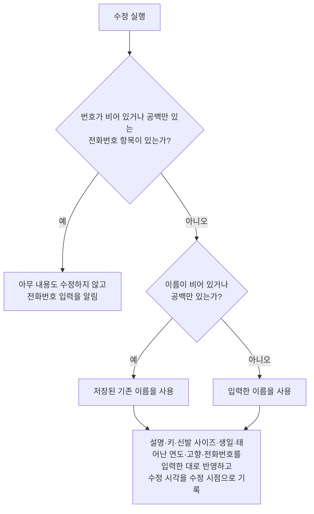

# ContactDetail 화면 스펙

이 문서는 사용자가 선택한 연락처의 상세를 확인하고 이름, 설명, 키, 신발 사이즈, 생일, 태어난 연도, 고향과 전화번호를 수정하고, 그 연락처의 즐겨찾기를 바꾸고, 그 연락처를 삭제하는 ContactDetail 화면의 내용과 행동을 다룬다. ContactDetail로 진입하는 흐름과 삭제한 연락처가 목록에서 사라지는 것, 즐겨찾기가 목록 순서에 반영되는 것은 [ContactHome 화면 스펙](./contact-home.md)에서, 연락처 목록과 상세를 함께 사용하는 배치는 [Contact 목록·상세 배치 스펙](./contact-list-detail.md)에서, 연락처가 갖는 정보와 키·신발 사이즈·생일·태어난 연도·고향·전화번호·즐겨찾기의 규칙은 [ContactAdd 화면 스펙](./contact-add.md)에서, 설명 입력의 행동은 [설명 입력 컴포넌트 스펙](./description-input.md)에서, 대상 연락처를 정하는 계정 기준은 [계정 조회 스펙](./account.md)에서, 연락처를 서버와 맞추는 규칙은 [데이터 동기화 스펙](../common/data-sync.md)에서 다룬다.

이번 범위는 연락처 목록에서 연락처를 선택해 상세를 확인하고, 저장된 이름·설명·키·신발 사이즈·생일·태어난 연도·고향·전화번호를 확인하고 수정하고, 즐겨찾기를 바꾸고, 연락처를 삭제하고, 이 연락처에 연결된 메모를 확인하는 것까지다. 연락처와 태그의 연결은 [ContactAdd 화면 스펙](./contact-add.md)과 같은 기준으로 이번 범위에서 정하지 않으므로 이 화면은 태그 입력을 제공하지 않는다.

화면은 연락처 디테일, 메모 두 탭으로 나뉜다. 이 문서는 화면 전체와 연락처 디테일 탭을 소유하고, 메모 탭의 내용과 행동은 [ContactDetail 메모 탭 스펙](./contact-detail-memo.md)이 소유한다.

진입할 때의 입력 초점, 조회 상태, 내용 수정의 반영과 성공·실패 결과, 삭제, 외부 변경, 여러 개 입력하는 값, 요청 제한과 저장·동기화 계약은 [항목 상세 화면 공통 스펙](./entity-detail.md)을 따른다. 연결 입력을 제공하지 않으므로 그 문서의 연결 입력과 태그 입력 관련 규칙은 적용하지 않는다. 메모 탭과 다른 탭 사이의 공통 규칙은 [항목 상세 메모 탭 공통 스펙](./entity-detail-memo.md)의 `탭과 상세 화면`을 따른다.

디자인: [ContactDetail 화면 디자인](../../design/contact-detail.md)

## feature

### 진입과 내용

사용자는 ContactHome 화면의 연락처 목록에서 연락처를 선택해 그 연락처의 ContactDetail 화면으로 이동한다. 목록과 상세를 함께 사용할 수 있는 환경에서는 이동하지 않고 목록과 함께 표시된 상세 영역에서 같은 내용을 사용하며, 그 기준은 [Contact 목록·상세 배치 스펙](./contact-list-detail.md)을 따른다.

사용자는 캘린더 홈 화면에 표시된 생일을 선택해서도 그 연락처의 ContactDetail 화면으로 이동한다. 이 경로로 진입한 화면은 연락처 목록과 함께 표시하지 않으며, 진입 흐름은 [CalendarHome 스펙](./calendar-home.md)의 `생일 선택`을 따른다.

MemoAdd 화면과 MemoDetail 화면의 연락처 입력에 표시된 연락처를 눌러서도 그 연락처의 ContactDetail 화면으로 이동한다. 이 경로로 진입한 화면도 연락처 목록과 함께 표시하지 않으며, 진입 흐름은 [메모 연락처 입력 컴포넌트 스펙](./memo-contact-input.md)의 `연락처 상세 이동`을 따른다.

연락처 조회에 성공하면 사용자는 저장된 이름, 설명, 키, 신발 사이즈, 생일, 태어난 연도, 고향과 전화번호를 확인하고 수정할 수 있으며, 그 연락처의 즐겨찾기를 바꾸고 그 연락처를 삭제할 수 있다. 화면 제목에는 대상 연락처의 최신 저장 이름을 표시한다.

### 탭 전환

화면은 연락처 디테일, 메모 두 탭으로 나뉘고 이 순서로 놓인다. 연락처 디테일 탭에서는 이 문서의 `내용 수정`과 `전화번호 입력`을, 메모 탭에서는 [ContactDetail 메모 탭 스펙](./contact-detail-memo.md)의 행동을 실행한다.

화면에 처음 진입하면 연락처 디테일 탭이 선택된 상태로 시작한다.

사용자는 탭을 직접 선택해 전환할 수 있고, 본문을 좌우로 밀어서도 전환할 수 있다. 전환 방법과 관계없이 선택한 탭과 표시하는 내용은 항상 일치한다.

다만 메모 탭의 메모 카드 위에서 좌우로 미는 조작은 탭 전환보다 그 카드의 완료·삭제가 우선한다. 카드 위에서 밀면 탭은 바뀌지 않고 [ContactDetail 메모 탭 스펙](./contact-detail-memo.md)이 따르는 카드 동작이 실행된다. 이때 탭을 바꾸려면 탭을 직접 선택하거나 카드 밖 여백에서 민다. 기준은 [TagDetail 화면 스펙](./tag-detail.md)의 `탭 전환`과 같다.

조회 중의 탭 전환, 탭을 전환할 때 유지되는 것과 뒤로가기는 [항목 상세 메모 탭 공통 스펙](./entity-detail-memo.md)의 `탭과 상세 화면`을 따른다. 즐겨찾기 변경과 삭제는 선택한 탭과 관계없이 항상 실행할 수 있다.

### 조회 상태

연락처 조회 중 상태에서는 내용 수정과 즐겨찾기 변경과 삭제를 실행할 수 없다. 조회 상태가 바뀌는 기준은 [항목 상세 화면 공통 스펙](./entity-detail.md)의 `조회 상태`를 따르며, 조회 상태는 연락처 디테일 탭의 내용과 화면 제목, 즐겨찾기 변경과 삭제에만 적용하고 메모 탭에는 적용하지 않는다.

### 내용 수정

사용자는 이름, 설명, 키, 신발 사이즈, 생일, 태어난 연도, 고향과 전화번호를 입력하거나 바꿀 수 있다. 각 입력에서 할 수 있는 조작은 [ContactAdd 화면 스펙](./contact-add.md)의 `키와 신발 사이즈 입력`, `생일 입력`, `태어난 연도 입력`, `고향 입력`, `전화번호 입력`을 따른다.

수정 반영 동작을 제공하는 기준은 `domain > 수정 동작의 제공 기준`을 따른다.

이름은 [항목 상세 화면 공통 스펙](./entity-detail.md)의 `제목`에 해당하므로, 이름을 비운 채 수정했을 때의 결과는 그 문서의 `수정되는 내용`을 따른다. 수정에 성공하거나 실패했을 때의 결과는 같은 문서의 `내용 수정`을 따른다.

### 전화번호 입력

전화번호는 [항목 상세 화면 공통 스펙](./entity-detail.md)의 `여러 개 입력하는 값`이다. 전화번호 항목 하나는 번호 하나로 이루어지며 번호가 필수 값이다. 사용자가 전화번호 항목을 추가하고 삭제하고 번호를 입력하는 행동은 [ContactAdd 화면 스펙](./contact-add.md)의 `전화번호 입력`을 따른다.

### 전화번호 미입력

번호가 비어 있거나 공백만 있는 전화번호 항목이 하나라도 있는 상태에서 수정을 실행하면 아무 내용도 수정하지 않고 전화번호 입력이 필요하다는 피드백을 제공한다. 입력 내용의 유지와 입력 초점은 [항목 상세 화면 공통 스펙](./entity-detail.md)의 `여러 개 입력하는 값`을 따른다.

### 즐겨찾기

사용자는 대상 연락처를 즐겨찾기로 표시하거나 표시를 해제할 수 있다. 사용자는 지금 그 연락처가 즐겨찾기인지도 함께 확인한다.

즐겨찾기 변경은 누르는 즉시 저장된 내용을 바꾼다. 별도의 확정 동작이 필요하지 않으며, 수정 반영 동작과는 별개로 실행한다.

즐겨찾기 변경은 입력 중이던 이름, 설명, 키, 신발 사이즈, 생일, 태어난 연도, 고향과 전화번호를 바꾸지 않고, 수정 반영 동작을 제공할지에도 영향을 주지 않는다. 사용자는 내용을 수정하는 중에도 즐겨찾기를 바꿀 수 있다.

즐겨찾기 변경을 처리하는 동안에는 진행 상태를 표시하며, 그동안에도 사용자는 내용 수정과 삭제를 그대로 실행할 수 있다.

즐겨찾기 변경에 성공해도 별도로 안내하지 않는다. 바뀐 결과가 화면에 나타나는 것으로 충분하다.

즐겨찾기 변경에 실패하면 화면과 입력 내용을 유지하며 진행 상태만 해제하고, 저장된 즐겨찾기 여부를 그대로 표시한다. 사용자는 즐겨찾기 변경을 다시 실행할 수 있다.

### 삭제

사용자는 대상 연락처를 삭제할 수 있다. 삭제의 진행과 성공·실패 결과는 [항목 상세 화면 공통 스펙](./entity-detail.md)의 `삭제`를 따른다. 목록과 상세 영역을 함께 표시하는 상태에서 삭제에 성공한 뒤의 상세 영역은 [Contact 목록·상세 배치 스펙](./contact-list-detail.md)의 `상세 영역의 구성`을 따른다.

### 외부 변경

같은 연락처의 저장 내용이 다른 경로에서 바뀌거나 연락처가 삭제 상태가 되었을 때의 결과는 [항목 상세 화면 공통 스펙](./entity-detail.md)의 `외부 변경`을 따른다. 즐겨찾기 표시는 저장된 값을 그대로 보여 주는 표시이므로 최신 저장 값으로 갱신한다.

### 진행 상태 유지

화면이 회전하거나 시스템에 의해 재생성되어도 입력 중이던 이름, 설명, 키, 신발 사이즈, 고른 생일, 태어난 연도, 고향과 전화번호 항목의 번호·순서, 그리고 선택한 탭을 유지한다.

즐겨찾기 여부는 이미 저장된 값이므로 화면이 재생성되어도 저장된 값을 그대로 다시 표시한다.

즐겨찾기 변경을 처리하는 동안에도 사용자가 보고 있던 화면 위치를 유지한다. 그 밖에 화면 위치를 유지하는 경우와 다시 진입할 때의 기준은 [항목 상세 화면 공통 스펙](./entity-detail.md)의 `진행 상태 유지`를 따른다.

### 뒤로가기

사용자가 뒤로가면 [항목 상세 메모 탭 공통 스펙](./entity-detail-memo.md)의 `탭과 상세 화면`에 따라 선택한 탭과 관계없이 ContactDetail 화면에 진입하기 전 화면으로 돌아간다. 반영하지 않은 수정 내용은 저장되지 않는다.

목록과 상세 영역을 함께 표시하는 상태에서 뒤로가기를 실행하면 상세 영역은 선택한 연락처가 없을 때의 화면인 연락처 추가로 되돌아간다.

## domain

### 상세 대상과 내용 표시

상세 대상 연락처를 정하는 기준과 삭제 상태인 연락처를 다루는 기준은 [항목 상세 화면 공통 스펙](./entity-detail.md)의 `상세 대상`을 따른다.

### 선택한 탭

선택한 탭의 유지와 초기화는 [항목 상세 메모 탭 공통 스펙](./entity-detail-memo.md)의 `탭과 상세 화면`을 따르며, 처음 선택은 연락처 디테일 탭이다. 연락처 목록에서 다른 연락처를 선택해 상세 대상이 바뀔 때도 연락처 디테일 탭으로 초기화한다. 연락처의 즐겨찾기 여부도 선택할 수 있는 탭을 바꾸지 않는다.

### 입력 내용 채우기

입력 내용을 채우는 시점은 [항목 상세 화면 공통 스펙](./entity-detail.md)의 `입력 내용 채우기`를, 전화번호를 채우는 기준은 같은 문서의 `여러 개 입력하는 값`을 따른다.

설명이 비어 있으면 빈 설명으로, 키·신발 사이즈·생일·태어난 연도·고향이 없으면 비어 있거나 고르지 않은 상태로 채운다.

저장된 키는 소수점 아래 한 자리까지 표시하고, 소수점 아래가 0이면 정수로 표시한다.

즐겨찾기 여부는 입력 내용이 아니라 저장된 값을 그대로 표시하는 값이므로 이 규칙을 적용하지 않는다. 즐겨찾기 표시는 `즐겨찾기 변경`에 따라 저장된 값이 바뀔 때마다 함께 바뀐다.

연락처가 갖는 정보의 정의는 [ContactAdd 화면 스펙](./contact-add.md)의 `연락처의 정보`를, 전화번호의 규칙은 같은 문서의 `전화번호`를, 키와 신발 사이즈와 생일과 태어난 연도와 고향의 규칙은 같은 문서의 `키와 신발 사이즈`, `생일`, `태어난 연도`, `고향`을 따른다.

### 수정 성립 조건

연락처는 번호가 없는 전화번호를 가질 수 없다. 번호가 비어 있거나 공백 문자로만 이루어진 전화번호 항목이 하나라도 있으면 이름, 설명, 키, 신발 사이즈, 생일, 태어난 연도, 고향을 포함해 어떤 내용도 수정하지 않으며, 그 기준은 [항목 상세 화면 공통 스펙](./entity-detail.md)의 `여러 개 입력하는 값`을 따른다.

이름을 비운 수정은 [항목 상세 화면 공통 스펙](./entity-detail.md)의 `수정되는 내용`에 따라 저장된 기존 이름을 사용한다.

이름을 비운 상태와 번호가 없는 전화번호 항목이 함께 있으면 전화번호 입력을 알리고 아무 내용도 수정하지 않는다.

### 수정되는 내용

수정은 대상 연락처의 이름, 설명, 키, 신발 사이즈, 생일, 태어난 연도, 고향과 전화번호를 바꾸고 수정 시각을 수정 시점으로 기록한다.

설명과 고향은 비어 있으면 비어 있는 값으로, 키·신발 사이즈·생일·태어난 연도는 비어 있거나 고르지 않았으면 없는 값으로 반영한다. 생일이 있으면 태어난 연도는 [ContactAdd 화면 스펙](./contact-add.md)의 `태어난 연도`에 따라 생일의 연도로 반영한다. 값이 없는 것을 `0`으로 대신하지 않는 기준은 [ContactAdd 화면 스펙](./contact-add.md)의 `키와 신발 사이즈`를 따른다.

전화번호를 반영하는 기준은 [항목 상세 화면 공통 스펙](./entity-detail.md)의 `여러 개 입력하는 값`을 따른다.

즐겨찾기 여부는 내용 수정으로 바뀌지 않는다. 삭제 여부, 생성 시각과 계정 연결이 바뀌지 않는 기준은 [항목 상세 화면 공통 스펙](./entity-detail.md)의 `수정되는 내용`을 따른다.

### 수정 동작의 제공 기준

입력한 이름, 설명, 키, 신발 사이즈, 생일, 태어난 연도, 고향 또는 전화번호가 저장된 내용과 하나라도 다르면 수정 동작을 제공한다.

수정 동작은 연락처 디테일 탭을 선택한 동안에만 제공한다. 메모 탭에서는 입력 내용이 저장 내용과 달라도 수정 동작을 제공하지 않고, 연락처 디테일 탭으로 돌아오면 다시 제공한다.

전화번호를 비교하는 기준은 [항목 상세 화면 공통 스펙](./entity-detail.md)의 `여러 개 입력하는 값`을 따른다.

즐겨찾기 여부는 입력하는 값이 아니라 즉시 반영되는 값이므로 이 비교에 넣지 않는다. 즐겨찾기를 바꾸는 것만으로는 수정 동작이 나타나지 않고, 이미 나타난 수정 동작도 사라지지 않는다. 이는 [항목 상세 화면 공통 스펙](./entity-detail.md)의 `수정 동작의 제공 기준`이 태그 연결을 비교에서 빼는 기준과 같다.

### 즐겨찾기 변경

즐겨찾기 변경은 대상 연락처의 즐겨찾기 여부를 지금과 반대 값으로 바꾸고 수정 시각을 변경 시점으로 기록한다. 즐겨찾기 여부가 갖는 의미와 기본값은 [ContactAdd 화면 스펙](./contact-add.md)의 `즐겨찾기`를 따른다.

즐겨찾기 변경은 대상 연락처의 이름, 설명, 키, 신발 사이즈, 생일, 태어난 연도, 고향, 전화번호, 삭제 여부, 생성 시각과 계정 연결을 바꾸지 않는다.

즐겨찾기 변경이 수정 시각을 갱신하므로, 즐겨찾기를 바꾼 연락처는 [목록 정렬 스펙](./list-sort.md)의 `최근 수정순`에서 앞으로 옮겨진다. 수정 시각은 연락처가 마지막으로 바뀐 시점이고 즐겨찾기 여부도 그 연락처에 저장되는 값이므로, 같은 문서의 `정렬 기준`이 정한 수정의 범위에 포함된다.

대상 연락처가 삭제 상태여도 사용자는 즐겨찾기를 바꿀 수 있다. 즐겨찾기 변경은 삭제 여부를 되돌리지 않는다.

바뀐 즐겨찾기 여부는 [ContactHome 화면 스펙](./contact-home.md)의 `목록 정렬`에 따라 목록의 순서에 반영된다.

### 삭제

삭제는 [항목 상세 화면 공통 스펙](./entity-detail.md)의 `삭제`에 따라 대상 연락처의 삭제 여부와 수정 시각을 바꾸며, 이름, 설명, 키, 신발 사이즈, 생일, 태어난 연도, 고향, 전화번호와 즐겨찾기 여부는 바꾸지 않는다.

삭제한 연락처는 [ContactHome 화면 스펙](./contact-home.md)의 노출 기준에 따라 연락처 목록에서 사라진다.

### 요청 제한

[항목 상세 화면 공통 스펙](./entity-detail.md)의 `요청 제한`에서 같은 종류로 보는 것은 내용 수정, 즐겨찾기 변경, 삭제이며, 세 종류는 서로를 제한하지 않는다.

메모 탭에서 실행하는 메모의 완료, 삭제와 실행 취소는 이 화면의 요청 제한에 포함하지 않으며, 그 기준은 [ContactDetail 메모 탭 스펙](./contact-detail-memo.md)이 따르는 공통 스펙이 정한다.

## data

### 대상 연락처 조회

상세에 표시할 연락처를 정하는 기준과 서버에서 다시 가져오는 계기는 [항목 상세 화면 공통 스펙](./entity-detail.md)의 `대상 조회`를 따른다. 전화번호는 연락처에 딸린 순서 있는 목록으로, 고향과 즐겨찾기 여부는 연락처가 가지는 값으로 함께 조회한다.

### 수정의 저장

수정을 반영하면 대상 연락처의 이름, 설명, 키, 신발 사이즈, 생일, 태어난 연도, 고향, 전화번호와 수정 시각을 기기에 저장해 기존 값을 바꾼다. 즐겨찾기 여부와 계정과의 연결은 바꾸지 않는다.

전화번호의 저장은 [항목 상세 화면 공통 스펙](./entity-detail.md)의 `여러 개 입력하는 값`을, 저장 대상과 계정 기준은 같은 문서의 `수정과 삭제의 저장`을 따른다.

### 즐겨찾기의 저장

즐겨찾기 변경을 실행하면 대상 연락처의 즐겨찾기 여부와 수정 시각을 기기에 저장해 기존 값을 바꾼다. 이름, 설명, 키, 신발 사이즈, 생일, 태어난 연도, 고향, 전화번호, 삭제 여부, 생성 시각과 계정 연결은 바꾸지 않는다.

즐겨찾기 변경은 현재 사용자 계정과 연결된 대상 연락처에만 반영한다. 그런 연락처가 기기에 없으면 아무것도 바꾸지 않는다.

### 삭제의 저장

삭제의 저장은 [항목 상세 화면 공통 스펙](./entity-detail.md)의 `수정과 삭제의 저장`을 따르며, 전화번호, 고향, 즐겨찾기 여부도 지우거나 바꾸지 않는다.

### 저장 실패

수정이나 즐겨찾기 변경이나 삭제에 실패한 결과는 [항목 상세 화면 공통 스펙](./entity-detail.md)의 `저장 실패`를 따른다. 즐겨찾기 변경에 실패하면 즐겨찾기 여부는 바뀌지 않는다.

### 결과의 표시

수정 내용과 바뀐 즐겨찾기 여부는 [ContactHome 화면 스펙](./contact-home.md)의 연락처 목록처럼 그 연락처를 조회하는 모든 곳에 반영된다.

이름이 바뀌면 [ContactHome 화면 스펙](./contact-home.md)의 `목록 정렬`에 따라 목록에서 이동하고, 첫 번째 전화번호나 생일, 태어난 연도가 바뀌면 목록에 표시되는 전화번호와 생일 또는 태어난 연도도 함께 바뀐다. 즐겨찾기 여부가 바뀌면 같은 `목록 정렬`에 따라 그 연락처가 즐겨찾기 묶음의 안팎으로 옮겨지고, 함께 갱신된 수정 시각이 `최근 수정순`에서의 자리도 바꾼다.

이름이 바뀌면 [메모 연락처 입력 컴포넌트 스펙](./memo-contact-input.md)의 연락처 입력과 연락처 선택 목록에도 바뀐 이름이 나타나고, 삭제하면 그 연락처가 두 곳에서 사라진다. 이는 표시 기준일 뿐이며 저장된 메모와 연락처의 연결은 [메모 연락처 스펙](../common/memo-contact.md)에 따라 그대로 남는다.

### 수정과 즐겨찾기 변경과 삭제의 동기화

수정과 삭제의 동기화는 [항목 상세 화면 공통 스펙](./entity-detail.md)의 `수정과 삭제의 동기화`를 따르며, 즐겨찾기 변경도 같은 방식으로 업로드 대기로 기록되고 동기화된다.

즐겨찾기 변경도 수정 시각을 갱신하므로 세 동작은 모두 같은 충돌 기준으로 판정된다. 즐겨찾기만 바꾼 연락처도 다른 내용을 수정한 연락처와 같은 방식으로 서버에 반영되며, 서버에 더 늦은 수정이 있으면 [데이터 동기화 스펙](../common/data-sync.md)의 `충돌 기준`에 따라 서버 내용이 최신이 된다.

