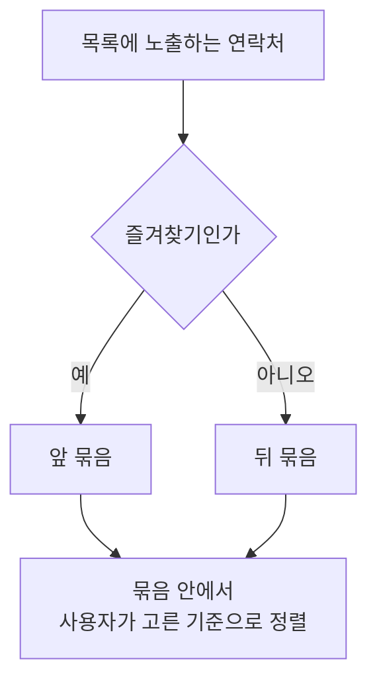

# ContactHome 화면 스펙

이 문서는 사용자가 `더보기`의 `연락처` 메뉴에서 진입하는 ContactHome 화면의 내용과 행동을 다룬다. 항목 목록 화면이 공통으로 따르는 노출 기준, 목록 갱신과 조회, 추가·상세로 이동, 목록에서의 삭제와 실행 취소, 화면 유지는 [항목 목록 화면 공통 스펙](./entity-home.md)를 따르며, 이 문서에는 연락처 목록에만 있는 내용을 둔다. `더보기` 메뉴 영역의 표시와 선택은 [MoreHome 화면 스펙](./more-home.md)에서, 세부 화면에서의 공통 내비게이션 노출 규칙은 [TopLevelNavigation 스펙](./top-level-navigation.md)에서, 연락처를 작성해 추가하는 흐름과 연락처가 갖는 정보는 [ContactAdd 화면 스펙](./contact-add.md)에서, 선택한 연락처를 확인하고 수정하고 상세에서 삭제하는 흐름은 [ContactDetail 화면 스펙](./contact-detail.md)에서, 목록 카드에서 삭제를 실행하는 상호작용의 공통 규칙은 [SwipeToFinishAndDelete 컴포넌트 스펙](./swipe-to-finish-and-delete.md)에서, 연락처 목록과 상세를 함께 사용하는 배치는 [Contact 목록·상세 배치 스펙](./contact-list-detail.md)에서, 나누어 불러오는 목록이 나타나는 순서와 아직 준비되지 않은 자리의 처리는 [페이지 조회 목록의 자리 표시 스펙](./paged-list-placeholder.md)에서, 목록이 비어 있을 때의 안내는 [목록 빈 상태 스펙](./list-empty-state.md)에서, 정렬 기준의 선택과 반영은 [목록 정렬 스펙](./list-sort.md)에서, 필터를 열고 바꾸는 행동의 공통 결과는 [목록 필터 반영 스펙](./list-filter.md)에서, 목록을 당겨 서버와 맞추는 조작은 [새로고침 스펙](./sync-refresh.md)에서, 연락처를 서버와 맞추는 규칙은 [데이터 동기화 스펙](../common/data-sync.md)에서 다룬다.

디자인: [ContactHome 화면 디자인](../../design/contact-home.md)

이번 범위는 `더보기`에서 ContactHome으로 이동하고, 계정에 저장된 연락처를 기기에서 불러와 즐겨찾기를 앞세운 목록으로 표시하고, 목록의 정렬 기준을 바꾸고, 생일, 태어난 연도, 전화번호의 유무로 목록을 좁히고, 목록을 당겨 서버와 다시 맞추고, ContactHome에서 연락처 추가와 연락처 상세로 이동하고, 목록에서 연락처를 삭제하고 되돌리는 것까지다. 연락처의 즐겨찾기 여부와 생일이 무엇인지는 [ContactAdd 화면 스펙](./contact-add.md)이, 즐겨찾기를 바꾸는 조작은 [ContactDetail 화면 스펙](./contact-detail.md)이 소유한다.

연락처 검색은 이번 범위에서 정하지 않는다.

## feature

### 진입

사용자는 `더보기` 화면의 메뉴 영역에서 `연락처` 항목을 선택해 ContactHome 화면으로 이동한다.

### 연락처 목록

사용자는 ContactHome에서 계정에 저장된 연락처 전체를 목록으로 볼 수 있다. 사용자는 각 항목의 이름과 전화번호, 생일 또는 태어난 연도를 확인하고 그 연락처가 즐겨찾기인지 확인한다.

전화번호를 여러 개 가진 연락처는 첫 번째 전화번호만 목록에 표시한다. 전화번호가 하나도 없는 연락처는 그 자리를 비운다. 전화번호의 순서 기준은 [ContactAdd 화면 스펙](./contact-add.md)의 `전화번호`를 따른다.

생일이 있는 연락처는 저장된 생일을 목록에 표시하고, 저장된 달력 구분도 함께 알아볼 수 있게 표시한다. 생일이 있으면 태어난 연도는 생일에 이미 들어 있으므로 따로 표시하지 않는다. 생일이 없고 태어난 연도만 있는 연락처는 생일 자리에 태어난 연도를 그 해에 태어났다는 뜻으로 표시하고, 달력 구분은 표시하지 않는다. 생일과 태어난 연도가 모두 없는 연락처는 그 자리를 비운다. 생일과 달력 구분의 규칙은 [ContactAdd 화면 스펙](./contact-add.md)의 `생일`을 따르며, 음력 생일도 저장된 연·월·일을 그대로 표시하고 양력으로 환산하지 않는다.

즐겨찾기인 연락처는 목록에서 즐겨찾기임을 알아볼 수 있게 표시한다. 목록에서는 즐겨찾기를 바꿀 수 없으며, 즐겨찾기를 바꾸는 조작은 [ContactDetail 화면 스펙](./contact-detail.md)의 `즐겨찾기`가 소유한다.

연락처의 설명, 키, 신발 사이즈, 고향은 목록에 표시하지 않는다. 이 값들은 [ContactAdd 화면 스펙](./contact-add.md)의 `연락처의 정보`가 정의한 대로 연락처에 기록되지만, 목록에서는 어떤 연락처인지 알아보는 데 필요한 이름, 전화번호, 생일 또는 태어난 연도만 보여 준다.

목록이 나타나는 순서, 아직 준비되지 않은 자리와 추가한 연락처가 목록에 나타나는 조건은 [항목 목록 화면 공통 스펙](./entity-home.md)의 `목록 표시`를 따른다.

### 유무 필터

사용자는 ContactHome에서 필터를 열어 생일, 태어난 연도, 전화번호 각각에 대해 `있음`, `없음`, `전체` 중 하나를 고를 수 있다. 세 축은 서로 독립이며, 축마다 하나의 상태만 고를 수 있다.

축을 바꾸면 목록은 고른 조건을 만족하는 연락처만 보여 준다. 어떤 연락처가 각 축을 만족하는지는 `domain`의 `유무 필터 기준`을 따른다.

필터를 열고 닫는 행동, 선택의 반영 시점, 필터가 적용되었는지 알리는 기준, 필터를 바꾼 뒤 목록을 처음부터 보게 되는 결과는 [목록 필터 반영 스펙](./list-filter.md)을 따른다. 필터는 목록이 비어 있어도 언제나 열 수 있다.

필터를 바꿔도 즐겨찾기 우선과 사용자가 고른 정렬은 그대로 적용되며, 필터는 목록에 놓이는 연락처의 범위만 좁힌다.

### 빈 상태

표시할 연락처가 하나도 없으면 목록 자리에 비어 있음을 알린다. 필터를 적용하지 않았으면 아직 연락처가 없으며 새로 추가할 수 있음을, 필터를 적용했으면 고른 조건에 맞는 연락처가 없으며 필터를 바꾸면 다른 연락처를 볼 수 있음을 알린다. 판정 시점, 빈 상태에서 할 수 있는 행동, 목록과의 전환, 좁힌 상태의 기준은 [목록 빈 상태 스펙](./list-empty-state.md)을 따른다.

빈 상태에서도 사용자는 연락처 추가를 그대로 실행할 수 있다. 빈 상태에서 정렬을 고를 수 없는 것은 [목록 정렬 스펙](./list-sort.md)의 `준비 중과 빈 상태에서의 정렬`을 따른다.

### 새로고침

목록을 당겨 새로고침하는 행동과 결과는 [항목 목록 화면 공통 스펙](./entity-home.md)의 `새로고침`을 따른다.

### 연락처 추가로 이동

사용자는 ContactHome에서 연락처 추가를 선택해 [ContactAdd 화면](./contact-add.md)으로 이동한다. 언제 제공하는지, 추가 단축키, 목록과 상세를 함께 사용하는 동안의 추가 수단과 돌아왔을 때의 결과는 [항목 목록 화면 공통 스펙](./entity-home.md)의 `추가로 이동`을 따른다. 추가한 연락처가 적용한 유무 필터의 조건을 만족하지 않으면 목록에 나타나지 않는다.

### 정렬 선택

사용자는 목록 위에서 현재 정렬을 확인하고 다른 기준으로 바꿀 수 있다. 고를 수 있는 기준과 정렬 선택·반영·유지의 결과는 [목록 정렬 스펙](./list-sort.md)을 따른다.

### 연락처 상세로 이동

사용자는 목록의 연락처를 선택해 그 연락처의 [ContactDetail 화면](./contact-detail.md)으로 이동한다. 준비되지 않은 자리와 돌아왔을 때의 목록은 [항목 목록 화면 공통 스펙](./entity-home.md)의 `상세로 이동`을 따른다.

목록과 상세를 함께 사용할 수 있는 환경에서는 이동하지 않고 상세 영역이 선택한 연락처의 상세로 바뀐다. 그 기준은 [Contact 목록·상세 배치 스펙](./contact-list-detail.md)의 `상세 영역의 구성`을 따른다.

### 삭제

사용자는 목록의 연락처를 삭제할 수 있다. 연락처에는 완료 여부가 없으므로 삭제 방향만 제공하며, 삭제와 실행 취소의 결과는 [항목 목록 화면 공통 스펙](./entity-home.md)의 `삭제`를 따른다.

실행 취소로 돌아온 연락처는 즐겨찾기 묶음과 목록의 정렬 기준에 맞는 위치에 다시 나타난다. 그 위치는 `domain`의 `목록 정렬`을 따른다.

### 안내와 실행 취소

삭제의 안내와 실행 취소는 [항목 목록 화면 공통 스펙](./entity-home.md)의 `안내와 실행 취소`를 따른다. [ContactDetail 화면 스펙](./contact-detail.md)의 `삭제`가 여기에 해당하는 상세 화면의 삭제다.

### 뒤로가기

뒤로가기의 결과는 [항목 목록 화면 공통 스펙](./entity-home.md)의 `뒤로가기`를 따른다. 상세 영역에 어떤 화면이 놓여 있는지와 관계없이 같으며, 상세 영역과 함께 표시되는 상태에서 시스템 뒤로가기를 사용한 결과는 [Contact 목록·상세 배치 스펙](./contact-list-detail.md)의 `뒤로가기`를 따른다.

## domain

### 목록에 노출하는 연락처

노출 기준은 [항목 목록 화면 공통 스펙](./entity-home.md)의 `목록에 노출하는 항목`을 따른다. 연락처에는 더하는 상태 조건이 없다.

### 유무 필터 기준

유무 필터의 각 축은 `있음`, `없음`, `전체` 중 하나의 상태를 가진다. 사용자가 아무것도 고르지 않은 처음 상태에서는 세 축이 모두 `전체`다.

| 축 | `있음`으로 보는 연락처 | `없음`으로 보는 연락처 |
| --- | --- | --- |
| 생일 | 생일이 저장된 연락처 | 생일이 저장되지 않은 연락처 |
| 태어난 연도 | 태어난 연도가 저장된 연락처 | 태어난 연도가 저장되지 않은 연락처 |
| 전화번호 | 전화번호를 하나 이상 가진 연락처 | 전화번호를 하나도 갖지 않은 연락처 |

생일 축은 [ContactAdd 화면 스펙](./contact-add.md)의 `생일`이 정의한 생일만 기준으로 삼는다. 생일 없이 태어난 연도만 있는 연락처는 목록에서 생일 자리에 태어난 연도를 보여 주더라도 생일이 없는 연락처로 본다. 음력 생일과 양력 생일은 구분하지 않고 모두 생일이 있는 것으로 본다.

태어난 연도 축은 [ContactAdd 화면 스펙](./contact-add.md)의 `태어난 연도`를 기준으로 삼는다. 생일이 있는 연락처는 언제나 생일의 연도를 태어난 연도로 가지므로 태어난 연도가 있는 연락처로 보고, 생일 없이 태어난 연도만 있는 연락처도 태어난 연도가 있는 연락처로 본다. 생일과 태어난 연도가 모두 없는 연락처만 태어난 연도가 없는 연락처다.

`전체`인 축은 연락처를 거르지 않는다. 연락처는 목록의 노출 기준을 만족하면서 `전체`가 아닌 모든 축을 동시에 만족해야 표시된다.

유무 필터는 목록에 노출하는 연락처의 범위만 좁히며 즐겨찾기 우선과 정렬 순서는 바꾸지 않는다. 유무 필터는 ContactHome 목록에만 적용하며 다른 화면의 연락처 표시에는 적용하지 않는다.

### 목록 정렬

목록은 즐겨찾기인 연락처를 모두 앞에 놓고, 즐겨찾기가 아닌 연락처를 그 뒤에 놓는다. 즐겨찾기 여부의 정의는 [ContactAdd 화면 스펙](./contact-add.md)의 `즐겨찾기`를 따른다.

두 묶음 안에서는 사용자가 고른 기준의 순서를 그대로 적용한다. 사용자가 정렬을 고르지 않았으면 이름 오름차순이고, 고를 수 있는 다른 기준과 그 순서는 [목록 정렬 스펙](./list-sort.md)이 정한다. 최근 수정순에서 수정 시각이 같은 연락처끼리의 순서는 [목록 정렬 스펙](./list-sort.md)의 `정렬 기준`을 따른다. 같은 묶음 안에서 이름까지 같은 연락처끼리의 순서는 정하지 않는다.

즐겨찾기 우선은 사용자가 고른 기준과 무관하게 언제나 적용한다. 사용자가 이름순을 골랐든 최근 수정순을 골랐든 즐겨찾기인 연락처가 먼저 나타난다. 자주 찾는 연락처를 앞에 두려고 즐겨찾기를 표시했는데 정렬을 바꾸면 그 연락처가 목록 뒤로 밀리는 일이 없게 하기 위한 것이다.

즐겨찾기 우선은 목록에 노출하는 연락처를 바꾸지 않는다. 즐겨찾기가 하나도 없으면 목록은 고른 기준의 순서 하나로만 놓인다.

### 목록 갱신

목록의 자동 갱신은 [항목 목록 화면 공통 스펙](./entity-home.md)의 `목록 갱신`을 따른다. 유무 필터를 적용한 동안 연락처의 생일, 태어난 연도, 전화번호가 바뀌어 판정이 달라지면 그 연락처는 사용자가 필터를 다시 고르지 않아도 목록에서 사라지거나 나타난다.

연락처의 즐겨찾기 여부가 바뀌면 그 연락처는 즐겨찾기 묶음의 안팎으로 옮겨지고, 함께 갱신된 수정 시각이 최근 수정순의 자리도 바꾼다. 갱신 기준은 [ContactDetail 화면 스펙](./contact-detail.md)의 `즐겨찾기 변경`을 따른다.

### 삭제와 실행 취소의 상태 전이

목록의 삭제와 실행 취소는 [항목 목록 화면 공통 스펙](./entity-home.md)의 `삭제와 실행 취소의 상태 전이`를 따른다. 이름, 설명, 키, 신발 사이즈, 생일, 태어난 연도, 고향, 전화번호와 즐겨찾기 여부는 바꾸지 않고, 메모와의 연결은 [메모 연락처 스펙](../common/memo-contact.md)에 따라 그대로 남는다.

실행 취소도 즐겨찾기 여부를 바꾸지 않으므로, 즐겨찾기였던 연락처는 즐겨찾기 묶음으로, 즐겨찾기가 아니었던 연락처는 즐겨찾기가 아닌 묶음으로 돌아온다. 최근 수정순에서는 실행 취소로 돌아온 연락처가 자기 묶음의 앞쪽에 놓인다.

### 화면 유지

목록 위치와 정렬·유무 필터 선택의 유지는 [항목 목록 화면 공통 스펙](./entity-home.md)의 `화면 유지`를 따른다.

## data

### 삭제와 실행 취소의 저장

삭제와 실행 취소의 저장과 동기화는 [항목 목록 화면 공통 스펙](./entity-home.md)의 `삭제와 실행 취소의 저장`을 따른다. 전화번호, 고향, 즐겨찾기 여부와 메모와의 연결은 기기에서 지우거나 바꾸지 않는다.

### 목록 조회

목록의 조회, 조회 실패와 서버에서 다시 가져오는 계기는 [항목 목록 화면 공통 스펙](./entity-home.md)의 `목록 조회`를 따른다.

`전체`가 아닌 유무 필터 축이 있으면 그 축의 기준을 함께 만족하는 연락처만 조회한다. 유무 필터를 바꾸면 목록의 조회를 바뀐 기준으로 다시 시작하고, 이전 기준으로 준비해 둔 결과는 쓰지 않는다. 유무 필터 선택은 기기에 남기지 않으며 서버와 동기화하지 않는다.

즐겨찾기 우선도 이 조회의 정렬 조건에 함께 넘긴다. 조회한 뒤 기기에서 즐겨찾기를 앞으로 다시 옮기지 않으므로, 아직 조회하지 않은 구간에 있는 즐겨찾기 연락처가 목록 뒤쪽에 나타나지 않는다. 정렬을 조회 조건으로 넘기는 기준은 [목록 정렬 스펙](./list-sort.md)의 `정렬된 목록 조회`를 따른다.

각 연락처의 전화번호 목록은 연락처와 함께 저장한 순서 그대로 조회하고, 생일과 달력 구분, 태어난 연도, 즐겨찾기 여부는 연락처가 가지는 값으로 함께 조회한다.

다른 화면에서 즐겨찾기를 바꾼 연락처도 사용자가 목록을 당기지 않아도 바로 보인다.
