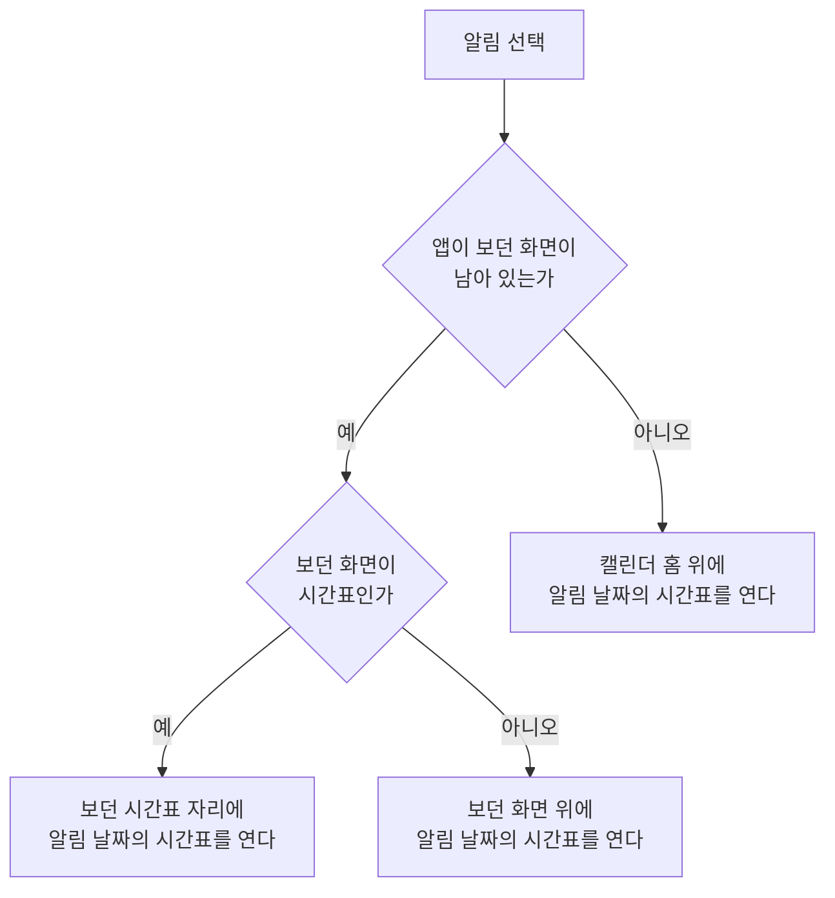

# 일일 메모 알림 스펙

이 문서는 로그인한 사용자가 기기에서 오늘의 메모를 알려 주는 알림을 받아 보고, 알림으로 앱을 여는 규칙을 다룬다.

서버가 알림을 언제 누구에게 보내고 무엇을 담는지는 [일일 메모 알림 스펙(server)](../server/daily-memo-notification.md)이, 알림에 담겨 오는 정보의 의미는 [일일 메모 알림 스펙(common)](../common/daily-memo-notification.md)이 소유한다. 알림을 받을 기기를 언제 서버에 등록하고 해제하는지는 [푸시 알림 수신 등록 스펙](./fcm-token.md)이 소유한다.

알림을 보려면 알림 권한이 필요하고, 권한을 언제 어떻게 요청하는지는 [알림 권한 요청 스펙](./notification-permission.md)이 소유한다.

알림에 표시하는 정확한 문구와 표현은 [일일 메모 알림 디자인](../../design/daily-memo-notification.md)이 소유한다.

## feature

### 오늘의 메모 확인 안내 받기

로그인한 사용자는 Android와 iOS 기기에서 매일 아침 오전 8시에 오늘의 메모를 알려 주는 알림을 받는다. 시각과 오늘의 메모를 고르는 기준은 [일일 메모 알림 스펙(server)](../server/daily-memo-notification.md)의 `발생 시각`과 `오늘의 메모`를 따른다.

알림을 받기 위해 사용자가 앱에서 따로 준비할 일은 없다. 알림은 앱을 사용하고 있지 않을 때도 도착하고, 앱을 오랫동안 실행하지 않아도 이 기기의 등록이 남아 있는 동안(마지막 등록 뒤 60일 안) 계속 도착한다. 등록이 지워지는 기준은 [일일 메모 알림 스펙(server)](../server/daily-memo-notification.md)의 `오래 남은 수신 정보의 정리`를 따른다. 어떤 기기가 받는지는 `domain > 알림을 받는 기기`를 따른다.

알림에는 오늘의 메모가 몇 개인지와 각 메모의 제목이 담긴다. 오늘의 메모가 하나도 없으면 메모가 없다는 안내만 담고, 서버가 오늘의 메모를 정하지 못하면 오늘의 메모를 확인하라는 안내만 담는다. 세 가지 내용은 [일일 메모 알림 스펙(common)](../common/daily-memo-notification.md)의 `알림 내용`을 따른다.

알림에 담기는 메모가 언제의 서버 내용인지는 [일일 메모 알림 스펙(server)](../server/daily-memo-notification.md)의 `알림 내용을 정하는 시점`을 따른다.

게스트는 알림을 받지 않는다. 게스트로 작성한 메모는 알림 대상이 아니며, 로그인하면 그 뒤에 오는 첫 알림부터 받는다.

### 앱을 사용하는 중에 받은 알림

앱을 화면에 띄워 사용하는 중에 알림이 도착해도 앱을 사용하지 않을 때와 같은 방식으로 알림이 표시된다. 앱 화면 안에는 따로 안내를 표시하지 않고, 보고 있던 화면도 바뀌지 않는다.

### 알림에서 앱 열기

사용자가 알림을 선택하면 앱이 열리고 알림이 발생한 날을 하루 형식으로 표시하는 시간표가 보인다. 선택한 알림은 알림 목록에서 사라진다. 시간표의 내용과 행동은 [CalendarTimetable 화면 스펙](./calendar-timetable.md)을 따르며, 여는 날짜는 `domain > 알림으로 여는 날짜`를 따른다.

시간표가 어디에 열리는지는 앱이 보던 화면이 남아 있는지와 보던 화면이 무엇인지에 따라 다르다.

- 앱을 새로 시작하면 캘린더 홈 화면 위에 시간표를 연다. 시간표에서 뒤로 가면 캘린더 홈 화면이 보인다.
- 앱이 보던 화면이 남아 있으면 앱이 앞으로 나오고 그 화면 위에 시간표를 연다. 보던 화면은 닫지 않으므로 시간표에서 뒤로 가면 알림을 선택하기 전에 보던 화면이 그대로 보인다. 앱이 화면 뒤에 있었을 때와 화면에 보이던 때가 같다.
- 보던 화면이 시간표면 시간표를 하나 더 쌓지 않고, 보던 시간표 자리에 알림이 발생한 날을 하루 형식으로 표시하는 시간표를 연다. 보던 시간표가 주간 형식이었거나 다른 날짜를 보고 있었어도 같다. 새로 연 시간표이므로 보던 시간대를 이어 보지 않고 [Timetable 컴포넌트 스펙](./timetable.md)의 `시간대 안내`에 따라 처음 표시될 때의 시간대부터 보이고, 뒤로 가면 보던 시간표 아래에 있던 화면이 보인다. 보던 시간표 위에 다른 화면을 열어 두었으면 그 화면 위에 시간표를 연다.

사용자가 알림을 선택하지 않고 지우거나 그대로 두어도 앱에서 달라지는 것은 없다.

### 알림 그만 받기

앱은 이 알림을 끄는 설정을 제공하지 않고, 사용자가 알림 시각을 바꾸는 수단도 제공하지 않는다.

사용자가 알림을 그만 받으려면 시스템의 알림 설정에서 이 앱의 알림을 끈다. Android에서는 이 알림만 따로 끌 수도 있다. 시스템에서 알림을 끄면 알림이 보이지 않고, 그 밖에 앱에서 할 수 있는 행동은 줄어들지 않는다.

로그아웃한 기기에는 알림이 오지 않는다. 로그아웃 뒤에도 잠시 알림이 도착할 수 있는 경우는 `domain > 알림을 받는 기기`를 따른다.

## domain

### 알림을 받는 기기

알림을 받는 기기는 다음을 모두 만족하는 기기다.

- Android 또는 iOS다.
- [푸시 알림 수신 등록 스펙](./fcm-token.md)에 따라 로그인한 계정으로 서버에 등록되어 있다.

서버가 등록된 기기 중 어디로 보내는지는 [일일 메모 알림 스펙(server)](../server/daily-memo-notification.md)의 `발송 대상`을 따른다. 같은 계정으로 여러 기기에 로그인했으면 기기마다 알림을 받는다.

로그아웃한 기기는 해제가 서버에 반영된 뒤부터 알림을 받지 않는다. 해제가 반영되기 전까지 이전 계정의 알림이 도착할 수 있으며, 그 기준은 [푸시 알림 수신 등록 스펙](./fcm-token.md)의 `로그아웃과 해제`를 따른다.

데스크톱 앱과 웹은 이 알림을 제공하지 않는다. 두 환경에서도 앱은 그대로 사용할 수 있고 알림을 제공하지 않는다는 안내는 표시하지 않는다.

### 표시 조건

알림 권한이 허용되어 있어야 사용자에게 알림이 보인다. 권한이 허용되어 있지 않으면 알림은 사용자에게 보이지 않으며, 앱은 이를 사용자에게 따로 안내하지 않는다. 권한이 거부되어 있어도 기기는 등록되고 서버는 알림을 보내며, 그 결정은 [푸시 알림 수신 등록 스펙](./fcm-token.md)의 `등록 정보`를 따른다.

제목과 본문의 표시 기준은 [일일 메모 알림 스펙(common)](../common/daily-memo-notification.md)의 `알림 내용`을 따르며, 본문이 없는 알림은 제목만 표시한다.

앱이 실행 중이 아니거나 화면에 보이지 않을 때는 시스템이 받은 알림을 표시한다. 앱이 화면에 보이는 동안에는 앱이 같은 모양으로 알림을 표시하므로, 사용자는 앱의 상태와 관계없이 같은 알림을 본다.

### 하루에 표시되는 알림

같은 날의 알림은 한 기기에 하나만 보인다. 같은 날 알림이 다시 도착하더라도 나중에 도착한 알림이 앞서 도착한 알림을 대신한다.

사용자가 지우지 않은 이전 날의 알림이 남아 있으면 새 알림이 그 자리를 대신한다. 한 기기에는 이 알림이 하나만 남는다. 알림을 서로 대신하게 하는 정보는 [일일 메모 알림 스펙(common)](../common/daily-memo-notification.md)의 `알림에 담기는 정보`를 따른다.

### 알림 분류

Android에서는 앱이 시작될 때마다 이 알림 전용 알림 분류가 있는지 확인해 없으면 만든다. 알림이 도착해 앱이 깨어날 때도 먼저 만들어 두므로 알림을 표시할 때 이 분류가 없어 표시하지 못하는 일은 없고, 사용자는 시스템 설정에서 이 분류만 끌 수 있다.

알림은 알림에 담겨 온 알림 분류로 표시한다. 알림에 분류가 담겨 오지 않으면 이 알림 전용 분류로 표시한다. 서버는 이 알림에 늘 이 분류를 담아 보내므로, 사용자에게 보이는 일일 메모 알림은 모두 이 분류로 표시된다. 분류의 이름과 설명은 기기의 앱 언어를 따르며, 문구는 [일일 메모 알림 디자인](../../design/daily-memo-notification.md)이 소유한다. 분류의 소리, 진동, 배지 같은 표시 방식도 같은 디자인의 `표시 방식`이 소유한다.

### 알림으로 여는 날짜

알림으로 여는 시간표의 날짜는 알림이 발생한 날이다. 알림이 발생한 날은 [일일 메모 알림 스펙(server)](../server/daily-memo-notification.md)의 `오늘의 메모`가 정하는 날로, 알림에 담긴 오늘의 메모와 같은 날이다. 알림을 선택한 날이 아니므로, 전날 받은 알림을 다음 날 선택하면 전날을 연다. 알림을 받은 뒤 기기의 시간대를 바꾸어도 여는 날짜는 바뀌지 않는다.

알림이 열 화면은 [일일 메모 알림 스펙(common)](../common/daily-memo-notification.md)의 `알림에 담기는 정보`에서 열 화면으로 정해진다. 열 화면이 가리키는 시간표의 형식이나 날짜를 앱이 알아볼 수 없으면 앱이 알아보지 못하는 열 화면으로 본다. 열 화면이 담겨 있지 않거나 앱이 알아보지 못하는 열 화면이 담긴 알림을 선택하면 앱은 특정 화면으로 이동하지 않고, 앱을 새로 시작하면 사용자가 앱을 직접 실행했을 때와 같은 화면에서 시작하며 보던 화면이 남아 있으면 그 화면이 그대로 보인다.

### 실행 경계에서의 유지

앱의 실행 상태와 알림 발생의 관계는 [일일 메모 알림 스펙(server)](../server/daily-memo-notification.md)의 `발생 조건`을 따른다.

화면이 재생성되거나 앱이 백그라운드에 갔다가 돌아오는 것은 알림에 아무 영향을 주지 않는다.

알림으로 연 시간표는 다른 화면과 같이 화면이 재생성되어도 남아 있고, 재생성 때문에 시간표를 다시 열지 않는다. 보던 날짜와 시간대의 유지는 [CalendarTimetable 화면 스펙](./calendar-timetable.md)의 `보던 날짜와 시간대 유지`를 따른다.
