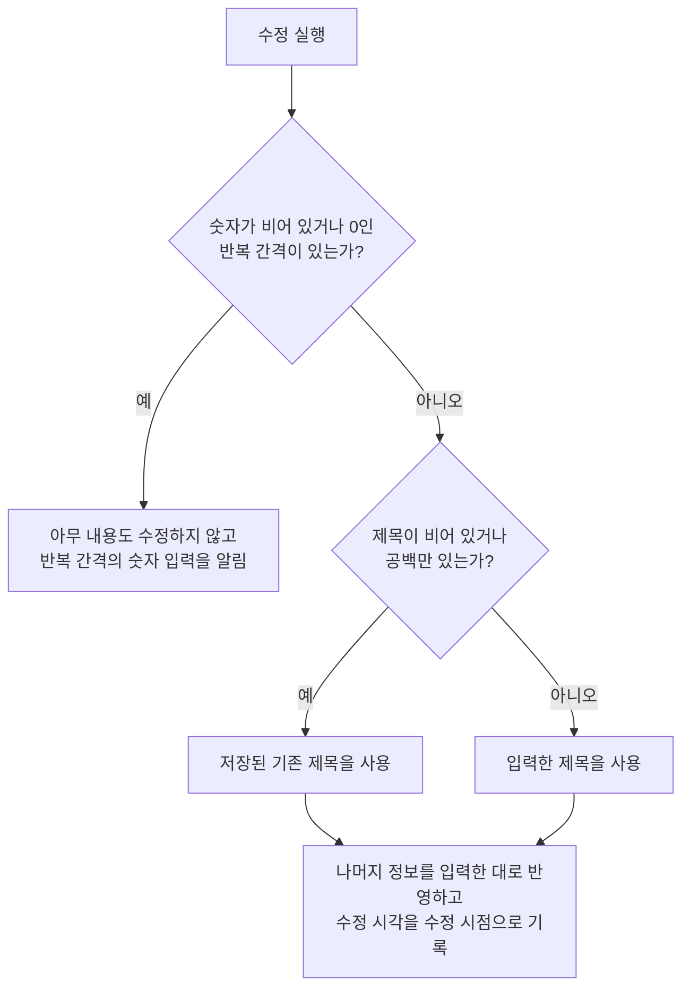

# DDayDetail 화면 스펙

이 문서는 사용자가 선택한 디데이의 정보를 확인하고 수정하고, 그 디데이가 연결한 태그를 바꾸고, 그 디데이를 삭제하는 DDayDetail 화면의 내용과 행동을 다룬다. 디데이가 갖는 정보와 유효 범위는 [디데이 스펙](../common/dday.md)을, 각 입력의 행동과 반복 간격을 기록하는 기준은 [DDayAdd 화면 스펙](./dday-add.md)을 따른다. DDayDetail로 진입하는 흐름과 삭제한 디데이가 목록에서 사라지는 것은 [DDayHome 화면 스펙](./dday-home.md)에서, 디데이 목록과 상세를 함께 사용하는 배치는 [DDay 목록·상세 배치 스펙](./dday-list-detail.md)에서, 대상 디데이를 정하는 계정 기준은 [계정 조회 스펙](./account.md)에서, 디데이를 서버와 맞추는 규칙은 [데이터 동기화 스펙](../common/data-sync.md)에서 다룬다. 제목 입력, 설명 입력, 컬러 입력 자체의 동작은 [제목 입력 스펙](./title-input.md), [설명 입력 컴포넌트 스펙](./description-input.md), [컬러 입력 컴포넌트 스펙](./diary-color-input.md)을 따른다.

연결할 태그의 선택과 해제, 선택 목록의 행동과 정책은 [항목 태그 입력 컴포넌트 스펙](./entity-tag-input.md)을 따르고, 디데이와 태그의 연결 규칙은 [디데이 태그 스펙](../common/dday-tag.md)을 따른다.

이번 범위는 디데이 목록이나 다른 화면의 디데이에서 상세로 이동하고, 저장된 제목·설명·컬러·기준일·기준일을 1일로 세기·반복 간격·종료일·달력에 없는 날짜 처리를 확인하고 수정하고, 연결한 태그를 확인하고 바꾸고, 디데이를 삭제하는 것까지다. 카드 문구와 기념일은 이 화면에 표시하지 않는다. 프리셋은 DDayAdd에서만 제공한다.

목록과 상세를 함께 사용하는 동안에는 디데이 상세가 목록과 함께 놓이며, 그 배치는 [DDay 목록·상세 배치 스펙](./dday-list-detail.md)을 따른다.

진입할 때의 입력 초점, 조회 상태, 내용 수정의 반영과 성공·실패 결과, 삭제, 외부 변경, 태그 입력의 반영, 요청 제한과 저장·동기화 계약은 [항목 상세 화면 공통 스펙](./entity-detail.md)을 따른다.

디자인: [DDayDetail 화면 디자인](../../design/dday-detail.md)

## feature

### 진입과 내용

사용자는 DDayHome 화면의 디데이 목록에서 디데이를 선택해 그 디데이의 DDayDetail 화면으로 이동한다. 목록과 상세를 함께 사용할 수 있는 환경에서는 이동하지 않고 목록과 함께 표시된 상세 영역에서 같은 내용을 사용하며, 그 기준은 [DDay 목록·상세 배치 스펙](./dday-list-detail.md)을 따른다.

다음 경로에서도 그 디데이의 DDayDetail 화면으로 이동한다. 이 경로로 진입한 화면은 디데이 목록과 함께 표시하지 않고 단독으로 표시하며, 진입 흐름은 각 문서를 따른다.

| 진입 경로 | 진입 흐름 |
| --- | --- |
| 캘린더 홈 화면에 표시된 디데이 선택 | [CalendarHome 스펙](./calendar-home.md) |
| 시간표에 표시된 디데이 선택 | [CalendarTimetable 화면 스펙](./calendar-timetable.md) |
| TagDetail 디데이 탭의 태그별 디데이 목록에서 선택 | [TagDetail 디데이 탭 스펙](./tag-detail-dday.md), [TagDetail 화면 스펙](./tag-detail.md)의 `목록 탭 공통` |
| SearchHome의 디데이 검색 결과에서 선택 | [SearchHome 화면 스펙](./search-home.md) |

캘린더에서 기준일 당일이 아닌 기념일을 선택해 들어와도 상세 대상은 그 기념일의 디데이이며, 화면은 어느 날짜에서 들어왔는지와 관계없이 같은 내용을 보여 준다.

디데이 조회에 성공하면 사용자는 저장된 정보를 확인하고 수정할 수 있고, 이 디데이가 연결한 태그를 확인하고 바꿀 수 있으며, 그 디데이를 삭제할 수 있다. 화면 제목에는 대상 디데이의 최신 저장 제목을 표시한다.

### 화면 내용

화면에는 화면 제목, 뒤로가기, 삭제, 제목 입력, 설명 입력, 컬러 입력, 기준일 입력, 기준일을 1일로 세기, 반복 간격 입력, 종료일 입력, 달력에 없는 날짜 처리, 태그 입력과 수정 반영 동작만 둔다. 수정 반영 동작은 `내용 수정`이 정한 조건에서만 둔다.

### 조회 상태

디데이 조회 중 상태에서는 입력, 내용 수정, 태그 연결과 해제와 삭제를 실행할 수 없다. 조회 상태가 바뀌는 기준은 [항목 상세 화면 공통 스펙](./entity-detail.md)의 `조회 상태`를 따른다.

### 내용 수정

사용자는 제목, 설명, 컬러, 기준일, 기준일을 1일로 세기, 반복 간격, 종료일과 달력에 없는 날짜 처리를 입력하거나 바꿀 수 있다. 각 입력에서 할 수 있는 조작은 [DDayAdd 화면 스펙](./dday-add.md)의 `제목과 설명 입력`, `컬러 입력`, `기준일 입력`, `기준일을 1일로 세기`, `반복 간격 입력`, `종료일 입력`, `달력에 없는 날짜 처리`를 따른다.

수정 반영 동작을 제공하는 기준은 `domain > 수정 동작의 제공 기준`을 따른다. 제목을 비운 채 수정했을 때의 결과는 [항목 상세 화면 공통 스펙](./entity-detail.md)의 `수정되는 내용`을 따르며, 이때 나머지 정보만 반영한다. 수정에 성공하거나 실패했을 때의 결과는 같은 문서의 `내용 수정`을 따른다.

### 반복 간격 미입력

숫자가 비어 있거나 0인 간격이 하나라도 있는 상태에서 수정을 실행하면 아무 내용도 수정하지 않고 반복 간격의 숫자 입력이 필요함을 알린다. 입력 중이던 내용과 간격은 모두 그대로 두며, 입력 초점은 옮기지 않는다.

### 태그 입력

반영 시점과 다른 동작과의 관계는 [항목 상세 화면 공통 스펙](./entity-detail.md)의 `태그 입력`을 따른다. 태그 선택 목록에서의 연결과 해제는 [항목 태그 입력 컴포넌트 스펙](./entity-tag-input.md)을, 태그 입력의 구성과 표현은 [항목 태그 입력 컴포넌트 디자인](../../design/entity-tag-input.md)을 따른다.

태그를 연결하거나 해제해도 입력 중이던 내용은 바뀌지 않는다.

### 삭제

사용자는 대상 디데이를 삭제할 수 있다. 삭제의 진행과 성공·실패 결과는 [항목 상세 화면 공통 스펙](./entity-detail.md)의 `삭제`를 따르며, 성공하면 뒤로가기와 같은 결과로 진입하기 전 화면으로 돌아간다. 목록과 상세 영역을 함께 표시하는 상태에서 삭제에 성공한 뒤의 상세 영역은 [DDay 목록·상세 배치 스펙](./dday-list-detail.md)의 `상세 영역의 구성`을 따른다.

### 외부 변경

같은 디데이의 저장 내용이나 태그 연결이 다른 경로에서 바뀌거나 디데이가 삭제 상태가 되었을 때의 결과는 [항목 상세 화면 공통 스펙](./entity-detail.md)의 `외부 변경`을 따른다. 반복 간격 입력도 다른 입력과 같이 덮어쓰지 않는다.

### 진행 상태 유지

화면 재생성과 백그라운드 복귀 뒤에도 입력 중이던 제목, 설명, 컬러, 기준일, 기준일을 1일로 세기, 반복 간격 각각의 단위·숫자와 놓인 순서, 종료일과 달력에 없는 날짜 처리를 유지한다. 기준일이나 종료일을 고르는 중이었으면 고르기도 열린 상태로 남는다. 시스템이 앱을 메모리에서 정리한 뒤 화면을 복원해도 이 입력 내용은 복원한다.

수정 결과 피드백과 반복 간격 미입력 안내는 화면 재생성이나 앱 재실행 뒤에 다시 표시하지 않는다.

태그 연결은 저장된 값이므로 유지 대상이 아니고 항상 저장된 연결을 표시한다. 태그 선택 목록의 열림 상태와 검색어는 [태그 선택 입력 공통 스펙](./tag-select-input.md)의 `태그 선택 목록의 열림 상태`와 `태그 검색어`를 따른다. 그 밖에 화면 위치를 유지하는 경우와 다시 진입할 때의 기준은 [항목 상세 화면 공통 스펙](./entity-detail.md)의 `진행 상태 유지`를 따른다.

### 뒤로가기

사용자가 뒤로가면 DDayDetail 화면에 진입하기 전 화면으로 돌아간다. DDayHome에서 들어왔으면 DDayHome으로, 캘린더 홈 화면이나 시간표에서 들어왔으면 그 화면으로, TagDetail 디데이 탭에서 들어왔으면 디데이 탭이 선택된 같은 태그의 TagDetail 화면으로, SearchHome에서 들어왔으면 SearchHome으로 돌아간다. 반영하지 않은 수정 내용은 저장되지 않으며, 이미 반영된 태그 연결과 해제는 그대로 남는다.

목록과 상세 영역을 함께 표시하는 상태에서 뒤로가기를 실행하면 상세 영역은 선택한 디데이가 없을 때의 화면인 디데이 추가로 되돌아간다.

## domain

### 상세 대상과 내용 표시

상세 대상 디데이를 정하는 기준과 삭제 상태인 디데이를 다루는 기준은 [항목 상세 화면 공통 스펙](./entity-detail.md)의 `상세 대상`을 따른다.

### 입력 내용 채우기

입력은 대상 디데이를 처음 조회한 값으로 채우며, 채우는 시점은 [항목 상세 화면 공통 스펙](./entity-detail.md)의 `입력 내용 채우기`를 따른다. 제목과 설명은 저장된 그대로, 설명이 비어 있으면 빈 설명으로 채운다. 종료일이 없으면 종료일을 고르지 않은 상태로 채운다.

반복 간격은 저장된 간격마다 하나씩 채운다. 일 간격은 `일` 단위로, 12의 배수인 개월 간격은 개월 수를 12로 나눈 숫자의 `년` 단위로, 그 밖의 개월 간격은 `개월` 단위로 채운다. 예를 들어 저장된 24개월 간격은 `2년`으로, 6개월 간격은 `6개월`로 보인다. 저장된 간격에는 순서가 없으므로 `일`, `개월`, `년` 단위 순으로 놓고 같은 단위 안에서는 숫자가 작은 순으로 놓는다. 저장된 간격이 없으면 간격이 하나도 없는 상태로 시작한다.

### 태그 입력에 표시하는 태그

기준은 [항목 상세 화면 공통 스펙](./entity-detail.md)의 `태그 입력에 표시하는 태그`를 따르며, 어떤 태그가 조회되는지는 [항목 태그 연결 앱 스펙](./entity-tag.md)의 `연결된 태그의 조회`를 따른다.

### 태그 연결의 반영

기준은 [항목 상세 화면 공통 스펙](./entity-detail.md)의 `태그 연결의 반영`을 따른다. 연결과 해제는 수정 중이던 입력 내용도 바꾸지 않는다.

### 수정 성립 조건

숫자가 비어 있거나 0인 간격이 하나라도 있으면 제목을 포함해 어떤 내용도 수정하지 않는다. 그 간격을 조용히 빼고 수정하지 않는다.

제목을 비운 수정은 [항목 상세 화면 공통 스펙](./entity-detail.md)의 `수정되는 내용`에 따라 저장된 기존 제목을 사용한다. 제목을 비운 상태와 숫자가 빈 간격이 함께 있으면 반복 간격의 숫자 입력을 알리고 아무 내용도 수정하지 않는다.

종료일이 기준일보다 앞인 상태는 [DDayAdd 화면 스펙](./dday-add.md)의 `기준일 입력`과 `종료일 입력`에 따라 생기지 않는다.

### 수정되는 내용

수정은 대상 디데이의 제목, 설명, 컬러, 기준일, 기준일을 1일로 세기, 반복 간격, 종료일과 달력에 없는 날짜 처리를 바꾸고 수정 시각을 수정 시점으로 기록한다. 제목과 설명은 앞뒤 공백을 포함해 입력한 그대로 기록하고, 설명이 비어 있으면 빈 설명으로 기록한다. 종료일을 지웠으면 종료일이 없는 디데이로 기록한다.

반복 간격은 [DDayAdd 화면 스펙](./dday-add.md)의 `반복 간격의 기록`에 따라 기록하며, 저장된 간격 모음을 입력한 간격 모음으로 바꾼다. 간격을 모두 지운 수정을 반영하면 반복 간격은 하나도 남지 않는다.

그 밖에 바뀌지 않는 값은 [항목 상세 화면 공통 스펙](./entity-detail.md)의 `수정되는 내용`을 따른다.

### 수정 동작의 제공 기준

입력한 제목, 설명, 컬러, 기준일, 기준일을 1일로 세기, 반복 간격, 종료일 또는 달력에 없는 날짜 처리가 저장된 내용과 하나라도 다르면 수정 동작을 제공한다. 제목과 설명은 공백과 줄바꿈까지 그대로 비교한다.

반복 간격은 [DDayAdd 화면 스펙](./dday-add.md)의 `반복 간격의 기록`에 따라 기록할 간격 모음으로 바꾼 뒤 저장된 간격 모음과 비교한다. 간격을 놓은 순서, 같은 간격을 여러 번 입력한 것, `1년`과 `12개월`처럼 단위만 다르고 기록하는 값이 같은 것은 차이로 보지 않는다. 숫자가 비어 있거나 0인 간격이 있으면 저장된 내용과 다른 것으로 보아, 사용자가 수정을 실행해 `반복 간격 미입력` 안내를 받을 수 있게 한다.

태그 연결은 [항목 상세 화면 공통 스펙](./entity-detail.md)의 `수정 동작의 제공 기준`에 따라 비교에 넣지 않는다.

### 삭제

삭제는 [항목 상세 화면 공통 스펙](./entity-detail.md)의 `삭제`에 따라 대상 디데이의 삭제 여부와 수정 시각을 바꾸며, 디데이의 정보와 태그 연결은 바꾸지 않는다.

삭제한 디데이는 [DDayHome 화면 스펙](./dday-home.md)의 `목록에 노출하는 디데이`에 따라 목록에서 사라진다.

### 요청 제한

[항목 상세 화면 공통 스펙](./entity-detail.md)의 `요청 제한`에서 같은 종류로 보는 것은 내용 수정과 삭제이며, 두 종류는 서로를 제한하지 않는다.

## data

### 대상 디데이 조회

상세에 표시할 디데이를 정하는 기준과 서버에서 다시 가져오는 계기는 [항목 상세 화면 공통 스펙](./entity-detail.md)의 `대상 조회`를 따른다. 반복 간격은 디데이가 가지는 값으로 함께 조회한다.

### 변경의 저장

수정을 반영하면 대상 디데이의 정보와 수정 시각을 기기에 저장해 기존 값을 바꾼다. 저장 대상과 계정 기준, 삭제의 저장은 [항목 상세 화면 공통 스펙](./entity-detail.md)의 `수정과 삭제의 저장`을 따르며, 태그 연결은 기기에서 지우지 않는다. 저장에 실패한 결과는 같은 문서의 `저장 실패`를 따른다.

### 결과의 표시

수정 내용은 그 디데이를 조회하는 모든 곳에 반영된다. [DDayHome 화면 스펙](./dday-home.md)의 목록에서는 바뀐 제목, 컬러와 카드 문구로 보이고 `목록 정렬`에 따라 자리를 옮기며, [캘린더 디데이 표시 스펙](./calendar-dday.md)에 따라 캘린더의 기준일 당일과 기념일도 바뀐 정보로 다시 정해진다. 삭제하면 그 디데이가 이 곳들에서 사라진다.

### 태그 입력의 조회와 저장

조회와 저장 흐름은 [항목 상세 화면 공통 스펙](./entity-detail.md)의 `태그 입력의 조회`와 `태그 연결의 저장`을 따른다.

### 태그 연결 결과의 표시

연결을 만들면 그 태그의 [TagDetail 디데이 탭](./tag-detail-dday.md)에 이 디데이가 노출 기준에 맞게 나타나고, 연결을 해제하면 그 탭에서 사라진다. [DDayHome 화면 스펙](./dday-home.md)에서 태그 필터를 적용해 두었으면 그 필터의 판정에도 바뀐 연결이 쓰인다.

태그 연결이 DDayHome의 노출 기준과 정렬을 바꾸지 않는 기준은 [항목 상세 화면 공통 스펙](./entity-detail.md)의 `태그 연결 결과의 표시`를 따른다.

### 변경의 동기화

수정과 삭제의 동기화는 [항목 상세 화면 공통 스펙](./entity-detail.md)의 `수정과 삭제의 동기화`를 따른다.
