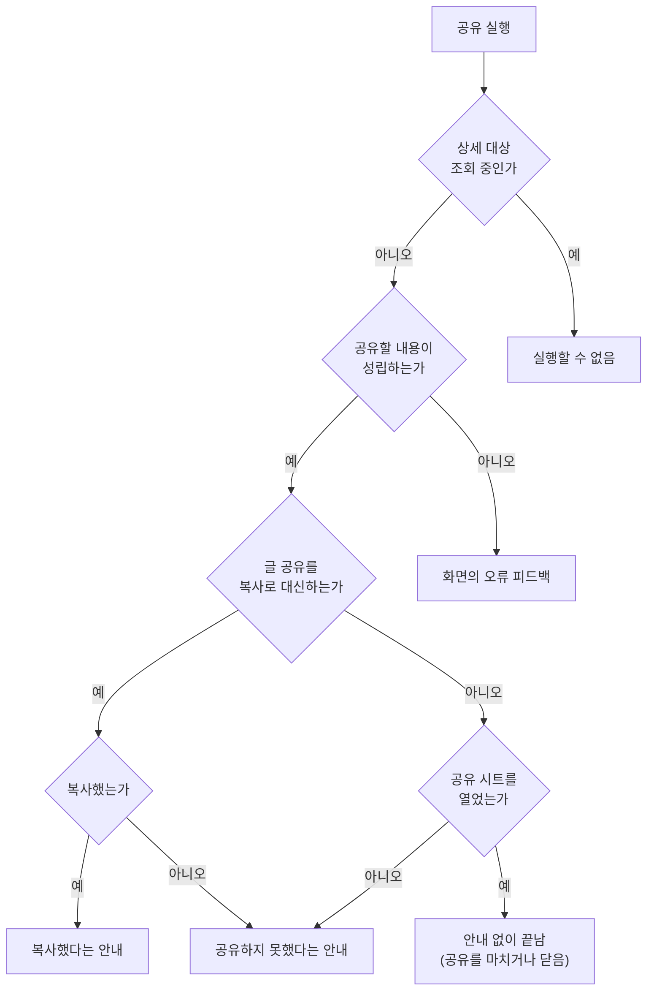
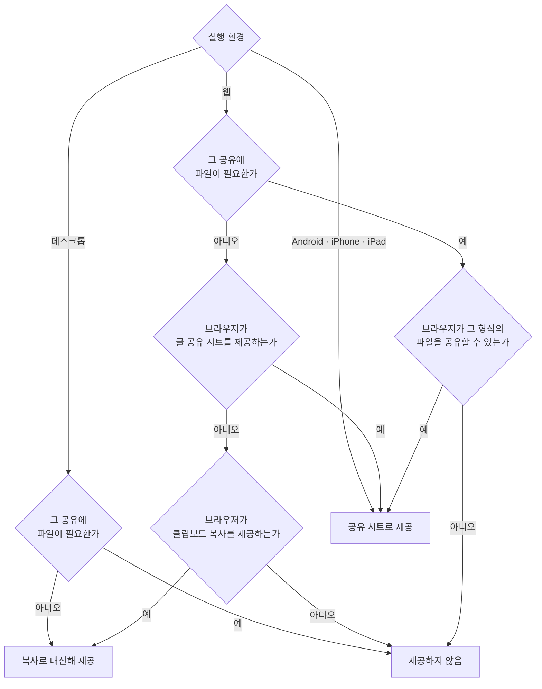

# 항목 공유 공통 스펙

이 문서는 상세 화면에서 보고 있는 항목을 기기의 공유 시트로 다른 앱에 보내는 행동의 공통 결과를 다룬다. 공유를 제공하는 환경과 자리, 공유 시트 대신 글을 복사하는 환경과 그 결과, 공유할 수 없을 때의 결과, 보내는 값을 정하는 기준, 공유 시트를 닫거나 열지 못했을 때의 결과, 글과 파일로 보낼 때의 공통 형식을 정한다. 무엇을 어떤 형식으로 보내는지, 내용이 비어 공유할 수 없는 경우가 무엇이고 그때 무엇을 알리는지는 각 화면 스펙이 정한다. 다른 앱의 공유를 Diary가 받는 행동은 [공유로 항목 추가 스펙](./share-add.md)이 다룬다.

이 문서를 따르는 화면 스펙은 문서 끝의 `이 문서를 참조하는 문서`에 둔다.

디자인: [항목 공유 공통 디자인](../../design/entity-share.md)

이 문서에서 `공유`는 기기가 제공하는 공유 시트로 다른 앱에 내용을 보내는 것을 가리킨다. `공유 시트`는 기기나 브라우저가 띄우는, 내용을 받을 앱이나 대상을 고르는 화면이다. `공유 내용`은 화면이 공유 시트에 넘기는 글과 파일이다. `복사로 대신하기`는 글 공유 시트를 제공하지 않는 환경에서 글 공유를 실행했을 때 공유할 글을 기기의 클립보드에 복사하는 것을 가리킨다.

사용자 데이터를 만들거나 바꾸지 않으므로 `data` 영역은 생략한다.

## feature

### 제공 환경

Android, iPhone, iPad, 웹과 데스크톱에서 제공한다. 환경마다 어떤 공유를 제공하는지는 `domain > 웹에서 제공하는 공유`를 따른다.

데스크톱과, 브라우저가 글 공유 시트를 제공하지 않는 웹에서는 글 공유를 공유 시트 대신 복사로 대신해 제공하고, 파일 공유는 제공하지 않는다. 복사로 대신하는 기준은 `domain > 글 공유를 복사로 대신하는 환경`을 따른다. 제공하지 않는 공유만 남은 화면에서는 공유를 실행하는 수단이 보이지 않는다.

### 공유를 제공하는 자리

공유는 상세 화면의 상단 바에서만 제공한다. 목록 화면과 목록의 카드에서는 제공하지 않는다.

상단 바의 다른 동작과 어떤 순서로 놓이는지는 각 화면 디자인이 정한다.

### 공유하기

사용자가 공유를 실행하면 공유 시트가 열리고, 사용자는 공유 시트에서 내용을 보낼 앱이나 대상을 고른다. 넘기는 값은 `domain > 공유하는 값`을, 공유 시트에 함께 넘기는 제목은 `domain > 공유 제목`을 따른다.

화면이 공유 형식을 고르게 하는 경우 사용자가 형식을 고른 뒤 공유 시트가 열린다. 어떤 형식을 고르게 하는지는 그 화면 스펙이 정한다.

공유는 화면을 떠나지 않으며 화면의 입력과 상태를 바꾸지 않는다. 입력 중이던 내용, 입력 초점이 있던 입력, 선택한 탭, 보고 있던 위치는 그대로 남으므로, 사용자가 공유를 마치거나 공유 시트를 닫고 돌아오면 공유하기 전과 같은 화면을 이어서 본다.

공유는 항목을 수정하지 않는다. 반영하지 않은 입력으로 공유해도 저장된 내용은 바뀌지 않고, 수정 동작을 제공하는지도 바뀌지 않는다. 사용자는 공유한 뒤에도 수정을 이어서 실행할 수 있다.

수정이나 삭제를 처리하는 동안에도 공유할 수 있다. 공유는 앱의 데이터를 바꾸지 않으므로 [항목 상세 화면 공통 스펙](./entity-detail.md)의 `요청 제한` 대상이 아니다.

### 복사로 대신했을 때

글 공유를 복사로 대신하는 환경에서 사용자가 글 공유를 실행하면 공유 시트를 열지 않고, 그 화면이 글 공유로 보낼 글을 기기의 클립보드에 복사한 뒤 복사했다는 안내를 짧게 표시한다. 복사하는 글은 `domain > 공유하는 값`과 `domain > 글 형식`에 따라 공유 시트에 넘겼을 글과 같으며, 공유 제목은 넣지 않는다.

화면이 공유 형식을 고르게 하는 경우 사용자가 글을 고른 뒤 복사한다. 복사로 대신하는 환경에서는 파일 공유를 제공하지 않으므로, 남은 형식이 글뿐이면 형식을 고르지 않고 곧바로 복사하는지는 그 화면 스펙이 정한다.

복사도 공유와 같이 화면을 떠나지 않고, 화면의 입력과 상태와 항목을 바꾸지 않는다. `공유하기`의 유지 기준과 `요청 제한` 기준을 그대로 따른다.

복사하지 못하면 `공유하지 못했을 때`와 같게 화면을 그대로 유지하고 공유하지 못했다는 안내를 짧게 표시한다. 브라우저가 클립보드 쓰기를 허락하지 않은 경우가 여기에 해당한다.

### 공유를 마치거나 닫았을 때

사용자가 공유 시트에서 앱을 골라 공유를 마치거나, 공유 시트를 닫거나 취소하면 Diary는 아무 안내 없이 끝낸다. 공유한 결과는 사용자가 고른 앱이 보여 준다. 복사로 대신한 경우의 안내는 `복사로 대신했을 때`를 따른다.

### 공유하지 못했을 때

공유 시트를 열지 못하면 [앱 밖 브라우저 열기 스펙](./external-browser-open.md)의 `열지 못했을 때`와 같은 방식으로 화면을 그대로 유지하고 공유하지 못했다는 안내를 짧게 표시한다. 보낼 파일을 준비하지 못해 공유 시트를 열지 못한 경우도 같다.

### 공유할 수 없을 때

상세 대상을 조회하는 동안에는 공유를 실행할 수 없다. 조회 상태의 기준은 [항목 상세 화면 공통 스펙](./entity-detail.md)의 `조회 상태`를 따른다. 조회하는 동안 공유를 실행하는 수단을 어떻게 보여 주는지는 [항목 공유 공통 디자인](../../design/entity-share.md)의 `비활성`이 정한다.

내용 표시 상태에서 공유할 내용이 비어 있거나 성립하지 않으면, 공유를 실행하는 수단은 그대로 실행할 수 있게 두고 실행했을 때 공유 시트를 열지 않는다. 이때는 그 화면이 같은 값의 오류를 알릴 때 쓰는 피드백과 같은 방식으로 알리며, 입력 중이던 내용과 입력 초점도 그 피드백과 같게 다룬다. 어떤 경우가 공유할 수 없는 경우이고 어떤 피드백을 쓰는지는 각 화면 스펙이 정한다.

### 진행 상태 유지

공유와 복사에는 Diary가 이어서 진행하는 상태가 없다. 복사는 실행한 즉시 끝나므로 화면이 재생성되거나 앱이 백그라운드에 다녀와도 다시 복사하지 않는다. 공유 시트가 열린 동안 화면이 재생성되거나 앱이 백그라운드에 다녀와도 Diary는 공유를 다시 시작하지 않으며, 공유 시트를 계속 보여 줄지는 기기가 정한다. 화면의 입력과 상태를 유지하는 기준은 각 화면 스펙을 따른다.

## domain

### 웹에서 제공하는 공유

웹에서는 브라우저가 알려 주는 공유 능력에 따라 다음처럼 제공한다.

- 글 공유는 브라우저가 글 공유 시트를 제공하면 공유 시트로 제공한다. 제공하지 않으면 `글 공유를 복사로 대신하는 환경`에 따라 복사로 대신해 제공하고, 클립보드 복사도 제공하지 않는 브라우저에서는 제공하지 않는다.
- 파일 공유는 브라우저가 그 화면이 보내려는 형식의 파일을 공유 시트로 보낼 수 있을 때만 제공한다. 파일을 보낼 수 있는지는 연락처 파일, 일정 파일, 이미지처럼 형식마다 따로 판단하며, 보낼 수 없는 파일 공유를 복사로 대신하지 않는다.
- 화면이 공유 형식을 고르게 하면 제공하지 않는 형식은 고를 수 없다. 남은 형식으로 무엇을 보여 주는지는 그 화면 스펙이 정한다. 남은 형식이 없으면 그 화면은 공유를 제공하지 않는다.

Android, iPhone과 iPad는 이 문서가 다루는 글과 파일을 모두 공유 시트로 공유할 수 있으므로 언제나 제공한다. 데스크톱은 글 공유를 언제나 복사로 대신해 제공하고, 파일 공유는 제공하지 않는다.

### 글 공유를 복사로 대신하는 환경

글 공유를 복사로 대신하는 환경은 데스크톱과, 글 공유 시트를 제공하지 않지만 클립보드 복사를 제공하는 브라우저의 웹이다. 이 환경에서도 공유를 실행하는 수단은 공유라는 이름 그대로 두며, 실행했을 때의 결과는 `feature > 복사로 대신했을 때`를 따른다.

복사로 대신하는지는 화면이 열려 있는 동안 바뀌지 않는다. 같은 환경에서 글 공유를 실행할 때마다 같은 방식으로 끝난다.

### 공유하는 값

공유하는 값은 저장된 값이 아니라 화면에 지금 입력된 값이다. 반영하지 않은 입력도 그대로 보낸다. 사용자가 화면에서 보고 있는 내용과 같은 내용을 보내기 위한 것이며, [PlaceDetail 화면 스펙](./place-detail.md)의 `외부 지도로 열기`와 같은 기준이다.

제목은 수정을 실행했을 때 저장될 제목과 같은 기준으로 정한다. 입력한 제목이 비어 있거나 공백만 있으면 저장된 제목을 쓴다. 기준은 [항목 상세 화면 공통 스펙](./entity-detail.md)의 `수정되는 내용`을 따른다.

제목 밖의 어떤 값을 보내고 어떻게 정리하는지는 각 화면 스펙이 정한다.

### 공유 제목

공유 내용과 함께 `공유하는 값`의 기준으로 정한 항목의 제목을 공유 제목으로 넘긴다. 받는 앱이 공유 제목을 어디에 쓰는지는 받는 앱이 정한다. 예를 들어 메일 앱은 메일 제목에 쓸 수 있다.

### 글 형식

글로 공유할 때는 화면 스펙이 정한 값을 정한 순서대로 한 줄에 하나씩 이어 보낸다. 각 값은 앞뒤 공백 문자를 지워 쓰고, 지운 값이 비어 있으면 그 줄을 만들지 않는다. 남은 줄 사이에는 줄바꿈을 하나씩 둔다.

| 화면이 정한 값 | 보내는 글 |
| --- | --- |
| 제목 `회의록`, 링크 `https://example.com` | `회의록`, `https://example.com` 두 줄 |
| 제목 없음, 링크 `https://example.com` | `https://example.com` 한 줄 |
| 제목 `강남역`, 주소 없음, 링크 `https://example.com` | `강남역`, `https://example.com` 두 줄 |

### 파일 형식

파일로 공유할 수 있는 형식은 연락처 파일, 일정 파일, PNG 이미지다. 파일과 함께 글이나 공유 제목을 넘길 수 있으며, 받는 앱이 그 글을 함께 쓰는지는 받는 앱이 정한다.

| 형식 | 파일 이름 끝 |
| --- | --- |
| 연락처 파일 | `.vcf` |
| 일정 파일 | `.ics` |
| PNG 이미지 | `.png` |

파일 이름은 화면 스펙이 정한 이름 뒤에 위 표의 끝을 붙인 것이다. 이름에 파일 이름으로 쓸 수 없는 글자(`/`, `\`, `:`, `*`, `?`, `"`, `<`, `>`, `|`와 줄바꿈 같은 제어 문자)가 있으면 그 글자를 `_`로 바꾸고, 이름의 앞뒤 공백 문자는 지운다. 앞뒤 공백을 지우고 쓸 수 없는 글자를 바꾼 이름이 비면 `share`를 이름으로 쓴다.

## 이 문서를 참조하는 문서

- [WebDetail 화면 스펙](./web-detail.md)
- [MusicDetail 화면 스펙](./music-detail.md)
- [PlaceDetail 화면 스펙](./place-detail.md)
- [ContactDetail 화면 스펙](./contact-detail.md)
- [MemoDetail 화면 스펙](./memo-detail.md)
- [QrDetail 화면 스펙](./qr-detail.md)

## 참고

- [Clipboard: writeText() method | MDN](https://developer.mozilla.org/en-US/docs/Web/API/Clipboard/writeText)

- [Send simple data to other apps | Android Developers](https://developer.android.com/training/sharing/send)
- [UIActivityViewController | Apple Developer Documentation](https://developer.apple.com/documentation/uikit/uiactivityviewcontroller)
- [Navigator: share() method | MDN](https://developer.mozilla.org/en-US/docs/Web/API/Navigator/share)
- [Navigator: canShare() method | MDN](https://developer.mozilla.org/en-US/docs/Web/API/Navigator/canShare)
