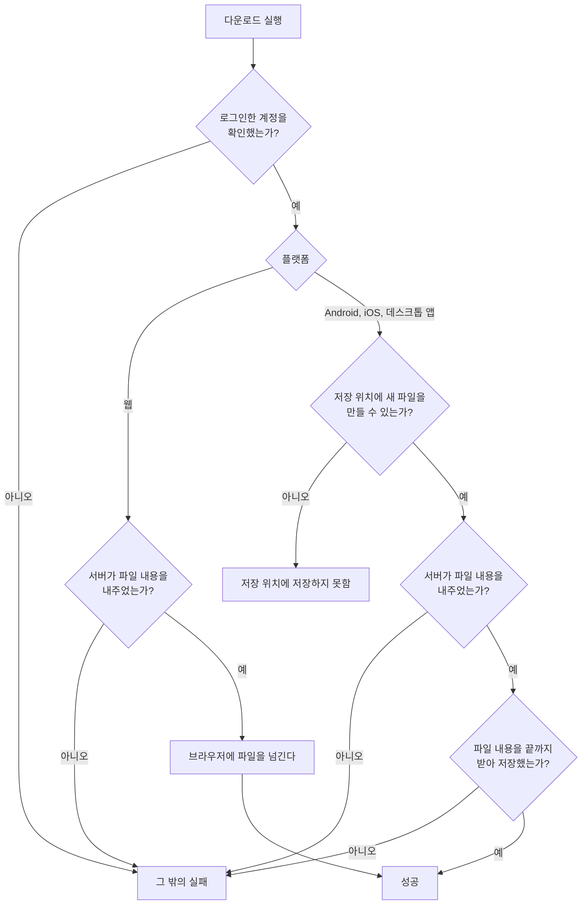

# 파일 내려받기 스펙

이 문서는 사용자가 올린 파일을 서버에서 받아 기기에 저장하는 규칙과, 저장 위치를 정하는 기준을 다룬다. 다운로드를 실행하는 자리와 결과를 알리는 방법은 [FileDetail 화면 스펙](./file-detail.md)에서, 저장 위치를 고르는 화면은 [SettingFile 화면 스펙](./setting-file.md)에서, 서버가 파일 내용을 내주는 약속은 [파일 보관 스펙(common)](../common/file-storage.md)의 `내용 내려받기`에서 다룬다.

이번 범위는 파일 하나를 사용자가 실행할 때마다 내려받아 저장 위치에 두는 것까지다. 여러 파일을 한 번에 내려받는 것, 내려받는 동안 백분율을 보여 주는 것, 화면을 떠난 뒤에도 내려받기를 이어 가는 것, 내려받은 파일을 앱 안에서 열거나 지우는 것은 이번 범위에서 다루지 않는다.

## feature

### 제공 범위

모든 플랫폼에서 내려받을 수 있다. 저장 위치는 플랫폼에 따라 다음과 같이 정한다.

| 플랫폼 | 저장 위치 | 사용자가 위치를 고를 수 있는가 |
| --- | --- | --- |
| Android | 고른 폴더. 고르지 않았으면 기기의 `Download` 폴더 | [SettingFile 화면](./setting-file.md)에서 고른다 |
| iOS | 고른 폴더. 고르지 않았으면 `파일` 앱의 `나의 iPhone` 안에 보이는 이 앱의 폴더 | [SettingFile 화면](./setting-file.md)에서 고른다 |
| 데스크톱 앱 | 고른 폴더. 고르지 않았으면 사용자 홈의 `Downloads` 폴더 | [SettingFile 화면](./setting-file.md)에서 고른다 |
| 웹 | 브라우저가 정한 다운로드 위치 | 앱에서는 고르지 않는다. 브라우저 설정을 따른다 |

iOS의 이 앱의 폴더에는 내려받은 파일만 보이고, 앱이 기기에 저장하는 다른 자료는 보이지 않는다.

어느 플랫폼에서도 내려받기에 사용자 권한을 따로 요청하지 않는다. Android와 iOS에서 사용자가 고른 폴더는 고를 때 시스템이 허락한 범위 안에서만 쓴다.

### 내려받기 결과

내려받기는 성공하거나 실패로 끝난다. 결과를 사용자에게 어떻게 알리는지는 [FileDetail 화면 스펙](./file-detail.md)의 `feature > 다운로드`를 따른다.

실패는 다음 둘로 나눈다.

| 실패 | 경우 |
| --- | --- |
| 저장 위치에 저장하지 못함 | 기본 위치나 고른 폴더에 새 파일을 만들 수 없다. 고른 폴더가 지워졌거나 옮겨졌다. 고른 폴더를 쓸 수 있도록 시스템이 허락한 것이 사라졌다. 저장 위치에 쓸 수 없다. 저장 위치가 그 이름의 파일을 만들지 못한다(이름이 기기가 허용하는 길이를 넘는 경우 포함) |
| 그 밖의 실패 | 서버에서 파일을 찾을 수 없다. 연결이 없거나 받는 도중 끊겼다. 기기의 저장 공간이 부족하다. 계정을 확인하지 못했다 |

저장 위치에 저장하지 못해도 앱은 기본 위치에 대신 저장하지 않는다. 사용자가 고른 위치가 아닌 곳에 파일이 생기면 찾지 못하기 때문이다. 사용자는 [SettingFile 화면](./setting-file.md)에서 위치를 다시 고르거나 기본 위치로 되돌린 뒤 다시 내려받는다.

## domain

### 내려받기 흐름

Android, iOS와 데스크톱 앱은 저장 위치에 새 파일을 먼저 만든 뒤 서버에 내용을 요청한다. 그래서 저장 위치에 저장할 수 없으면 서버의 응답과 관계없이 저장 위치에 저장하지 못한 실패로 끝난다.

받는 도중 실패하거나 사용자가 화면을 떠나 멈추면 받던 내용을 저장 위치에 남기지 않는다. 저장 위치에는 끝까지 받은 파일만 남는다.

앱은 실패한 내려받기를 스스로 다시 시도하지 않는다. 사용자가 다시 실행하면 처음부터 받는다.

### 진행 유지 범위

| 플랫폼 | FileDetail 화면을 떠남 | 앱이 화면 뒤로 감 | 앱 종료 |
| --- | --- | --- | --- |
| Android, iOS | 멈추고 받던 내용을 남기지 않는다 | 진행을 보장하지 않는다 | 멈춘다 |
| 데스크톱 앱, 웹 | 멈추고 받던 내용을 남기지 않는다 | 계속 진행한다 | 멈춘다 |

Android와 iOS는 앱이 화면 앞에 있는 동안만 진행을 보장한다. 앱이 화면 뒤에 있는 동안 플랫폼이 앱의 동작을 멈추거나 연결을 끊으면 그 내려받기는 그 밖의 실패로 끝나고 받던 내용을 남기지 않는다. 사용자는 앱으로 돌아와 다시 실행한다.

### 저장하는 파일 이름

파일은 내려받을 때 서버에 저장된 파일 이름으로 저장한다. 내용은 서버에 보관한 그대로이며 바꾸지 않는다.

다음 글자는 기기에서 파일 이름에 쓸 수 없으므로, 모든 플랫폼에서 같게 `_`로 바꿔 저장한다. `/`, `\`, `:`, `*`, `?`, `"`, `<`, `>`, `|`, 그리고 줄바꿈 같은 눈에 보이지 않는 제어 문자. 바꾼 결과가 `.`이나 `..`이면 `_`로 저장한다. 서버에 저장된 파일 이름은 바꾸지 않는다.

웹은 바꾼 이름을 브라우저에 넘기며, 브라우저가 이름을 더 바꾸거나 겹칠 때 번호를 붙일 수 있다.

### 이름이 겹칠 때

Android, iOS와 데스크톱 앱에서는 저장 위치에 같은 이름의 파일이나 폴더가 이미 있으면 덮어쓰지 않고 이름에 번호를 붙여 새 파일로 저장한다. 번호는 확장자 앞에 ` (1)`, ` (2)`처럼 붙이고, 겹치지 않는 가장 작은 번호를 쓴다. 확장자는 이름의 마지막 `.` 뒤 부분이며, `.`이 없거나 이름이 `.`으로 시작해 그 밖에 `.`이 없으면 확장자가 없는 것으로 보고 이름 끝에 번호를 붙인다.

| 저장된 이름 | 이미 있는 파일 | 저장하는 이름 |
| --- | --- | --- |
| `report.pdf` | 없음 | `report.pdf` |
| `report.pdf` | `report.pdf` | `report (1).pdf` |
| `report.pdf` | `report.pdf`, `report (1).pdf` | `report (2).pdf` |
| `archive.tar.gz` | `archive.tar.gz` | `archive.tar (1).gz` |
| `README` | `README` | `README (1)` |
| `.env` | `.env` | `.env (1)` |

같은 파일을 여러 번 내려받으면 번호가 붙은 파일이 여러 개 생긴다. 앱은 이미 내려받은 파일인지 확인하지 않는다.

Android에서 기본 위치인 `Download` 폴더에 저장할 때 번호를 붙이는 방식은 기기의 시스템이 정한다. 덮어쓰지 않는다는 것은 같다.

## data

### 받는 내용

앱은 서버에 파일 하나의 내용을 요청해 받는다. 요청과 응답의 약속은 [파일 보관 스펙(common)](../common/file-storage.md)의 `내용 내려받기`를 따른다. 받은 파일이나 그 목록을 앱이 따로 기록하지 않으며, 서버에도 내려받았다는 사실을 남기지 않는다.

### 저장 위치 설정

저장 위치를 고르고 보관하는 규칙은 [SettingFile 화면 스펙](./setting-file.md)을 따른다. 내려받기는 실행할 때마다 그 시점의 저장 위치 설정을 읽는다. 설정을 읽지 못하면 사용자가 고른 위치를 알 수 없으므로 기본 위치에 저장하지 않고 그 밖의 실패로 끝난다.
