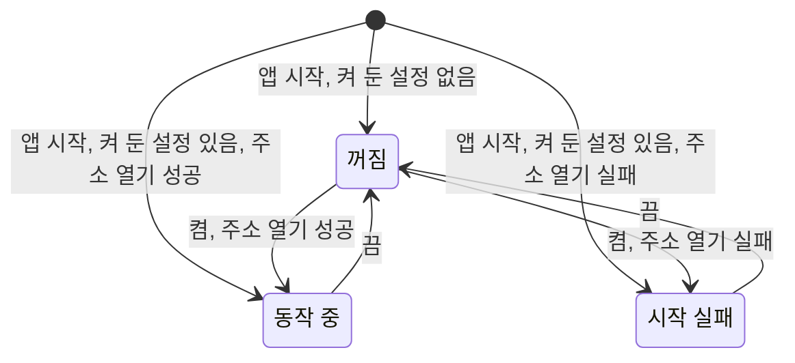

# AI 도구 연결 스펙

이 문서는 데스크톱 앱이 실행되는 동안 같은 Mac의 AI 도구가 MCP로 앱의 기능을 사용할 수 있게 하는 연결을 다룬다. 연결을 켜고 끄며 연결 주소와 상태를 확인하는 화면은 [SettingMcp 화면 스펙](./setting-mcp.md)에서 다룬다.

AI 도구에 제공하는 기능, 대상 계정, 화면이 없어서 달라지는 부분과 저장·동기화는 [AI 도구 제공 공통 스펙](./ai-tool.md)을 따른다. 이 문서는 연결이 성립하는 조건과 이 연결에만 있는 동작을 정한다. Android와 iOS에서 AI 도구가 앱의 기능을 사용하는 방법은 [앱 동작 제공 스펙](./app-action.md)에서 다룬다.

연결 자체는 화면 없이 동작하므로 `feature` 영역은 생략한다.

## domain

### 제공 환경

AI 도구 연결은 macOS 데스크톱 앱에서만 제공한다. Android, iOS와 웹에는 이 연결이 없다.

### 연결 동작 상태

연결은 다음 상태 중 하나다.

- 꺼짐: 사용자가 연결을 켜지 않았거나 끈 상태. AI 도구가 접속할 수 없다.
- 동작 중: AI 도구가 연결 주소로 접속할 수 있는 상태
- 시작 실패: 사용자가 연결을 켰지만 연결 주소를 열지 못한 상태. 그 주소를 다른 프로그램이 이미 쓰고 있는 경우와 그 밖의 이유를 구분한다.

연결은 앱이 실행되는 동안에만 동작한다. 앱을 종료하면 연결도 함께 끝나고, 앱을 다시 시작하면 켜 둔 설정에 따라 다시 시작한다.

켜 둔 설정을 확인하기 전이거나 읽지 못했으면 연결을 시작하지 않는다.

시작 실패 상태에서 앱이 저절로 다시 시도하지 않는다. 사용자는 연결을 껐다가 다시 켜거나 앱을 다시 시작해 다시 시도한다.

연결을 끄면 그 시점부터 새 요청을 받지 않는다.

연결 상태는 앱 활성 상태와 관계없다. 앱 창이 최소화되거나 포커스를 잃어도 연결은 동작한다.

### 연결 주소

연결 주소는 이 Mac 안에서만 접속할 수 있는 주소이며 환경마다 고정한다. 개발 환경과 운영 환경을 함께 실행해도 서로 다른 주소를 쓰므로 두 앱의 연결이 동시에 동작할 수 있다.

| 환경 | 연결 주소 |
| --- | --- |
| 운영 | `http://127.0.0.1:38450/mcp` |
| 개발 | `http://127.0.0.1:38451/mcp` |

다른 기기에서는 이 주소로 접속할 수 없다.

### 접속 허용 기준

같은 Mac에서 접속하는 AI 도구는 별도 인증 없이 접속할 수 있다.

웹 페이지가 브라우저를 통해 보내는 요청은 거절한다. 사용자가 방문한 웹 사이트가 연결 주소로 데이터를 읽거나 바꾸지 못하게 하기 위한 것이다.

### 연결 중 계정 변경

연결이 동작하는 동안 계정이 바뀌어도 연결을 다시 시작하지 않는다. 그 뒤의 요청을 처리하는 계정은 [AI 도구 제공 공통 스펙](./ai-tool.md)의 `대상 계정`을 따른다.

## 참고

- [Model Context Protocol](https://modelcontextprotocol.io/)
