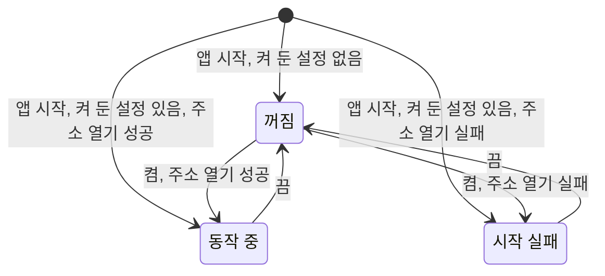

# AI 도구 연결 스펙

이 문서는 데스크톱 앱이 실행되는 동안 같은 Mac의 AI 도구가 MCP로 앱의 기능을 사용할 수 있게 하는 연결을 다룬다. 연결을 켜고 끄며 연결 주소와 상태를 확인하는 화면은 [SettingMcp 화면 스펙](./setting-mcp.md)에서 다룬다.

연결 자체는 화면 없이 동작하므로 `feature` 영역은 생략한다.

## domain

### 제공 원칙

AI 도구 연결은 새 기능을 만들지 않고, 앱이 화면에서 제공하는 기능을 AI 도구에도 같은 기준으로 제공한다. 각 기능이 무엇을 보여 주고 무엇을 바꾸는지, 어떤 조건에서 실패하는지는 그 기능을 소유한 스펙을 따른다. 그래서 앱 기능의 스펙이 바뀌면 AI 도구가 받는 결과도 함께 바뀐다.

이 문서는 어떤 기능을 제공하는지, 연결이 성립하는 조건, 그리고 화면이 없어서 달라지는 부분만 정한다.

### 제공 환경

AI 도구 연결은 macOS 데스크톱 앱에서만 제공한다. Android, iOS와 웹에는 이 기능이 없다.

### 연결 동작 상태

연결은 다음 상태 중 하나다.

- 꺼짐: 사용자가 연결을 켜지 않았거나 끈 상태. AI 도구가 접속할 수 없다.
- 동작 중: AI 도구가 연결 주소로 접속할 수 있는 상태
- 시작 실패: 사용자가 연결을 켰지만 연결 주소를 열지 못한 상태. 그 주소를 다른 프로그램이 이미 쓰고 있는 경우와 그 밖의 이유를 구분한다.

연결은 앱이 실행되는 동안에만 동작한다. 앱을 종료하면 연결도 함께 끝나고, 앱을 다시 시작하면 켜 둔 설정에 따라 다시 시작한다.

켜 둔 설정을 확인하기 전이거나 읽지 못했으면 연결을 시작하지 않는다.

시작 실패 상태에서 앱이 저절로 다시 시도하지 않는다. 사용자는 연결을 껐다가 다시 켜거나 앱을 다시 시작해 다시 시도한다.

연결을 끄면 그 시점부터 새 요청을 받지 않는다.

연결 상태는 앱 활성 상태와 관계없다. 앱 창이 최소화되거나 포커스를 잃어도 연결은 동작한다.

### 연결 주소

연결 주소는 이 Mac 안에서만 접속할 수 있는 주소이며 환경마다 고정한다. 개발 환경과 운영 환경을 함께 실행해도 서로 다른 주소를 쓰므로 두 앱의 연결이 동시에 동작할 수 있다.

| 환경 | 연결 주소 |
| --- | --- |
| 운영 | `http://127.0.0.1:38450/mcp` |
| 개발 | `http://127.0.0.1:38451/mcp` |

다른 기기에서는 이 주소로 접속할 수 없다.

### 접속 허용 기준

같은 Mac에서 접속하는 AI 도구는 별도 인증 없이 접속할 수 있다.

웹 페이지가 브라우저를 통해 보내는 요청은 거절한다. 사용자가 방문한 웹 사이트가 연결 주소로 데이터를 읽거나 바꾸지 못하게 하기 위한 것이다.

### 대상 계정

각 요청은 앱 화면과 같이 그 요청을 처리하는 시점의 현재 계정을 기준으로 처리한다. 현재 계정이 게스트이면 게스트의 항목을, 사용자이면 그 사용자의 항목을 다룬다. 계정 상태의 결정은 [계정 조회 스펙](./account.md)을 따른다.

앱이 막 시작해 계정 상태가 아직 확정되지 않았으면 확정될 때까지 기다렸다가 처리한다. 계정 조회가 실패하면 요청을 처리하지 않고 실패를 알린다.

기기에 남아 있는 다른 계정의 항목은 어떤 요청으로도 조회하거나 바꿀 수 없다.

연결이 동작하는 동안 계정이 바뀌면 그 뒤의 요청은 바뀐 계정을 기준으로 처리한다. 연결을 다시 시작하지 않는다.

### 제공하는 기능

AI 도구에 제공하는 기능과 그 결과를 정하는 스펙은 다음과 같다.

| 대상 | 조회 | 바꾸기 |
| --- | --- | --- |
| 메모 | [MemoHome 목록](./memo-home.md), [MemoFinishedList 화면](./memo-finished-list.md), [MemoDetail 화면](./memo-detail.md) | [MemoAdd 화면](./memo-add.md), [MemoDetail 화면](./memo-detail.md), [MemoHome 목록](./memo-home.md)의 완료·삭제와 실행 취소, [캘린더 메모 이동](./calendar-memo-move.md) |
| 태그 | [TagHome 목록](./tag-home.md), [TagFinishedList 화면](./tag-finished-list.md), [TagDetail 화면](./tag-detail.md)과 그 메모·웹·장소 탭, [TagMemoFinishedList 화면](./tag-memo-finished-list.md) | [TagAdd 화면](./tag-add.md), [TagDetail 화면](./tag-detail.md), [TagHome 목록](./tag-home.md)의 완료·삭제와 실행 취소 |
| 장소 | [PlaceHome 화면](./place-home.md), [PlaceDetail 화면](./place-detail.md)과 그 메모 탭 | [PlaceAdd 화면](./place-add.md), [PlaceDetail 화면](./place-detail.md), [PlaceHome 화면](./place-home.md)의 삭제와 실행 취소 |
| 웹 | [WebHome 화면](./web-home.md), [WebDetail 화면](./web-detail.md)과 그 메모 탭 | [WebAdd 화면](./web-add.md), [WebDetail 화면](./web-detail.md), [WebHome 화면](./web-home.md)의 삭제와 실행 취소 |
| 연락처 | [ContactHome 화면](./contact-home.md), [ContactDetail 화면](./contact-detail.md)과 그 메모 탭 | [ContactAdd 화면](./contact-add.md), [ContactDetail 화면](./contact-detail.md), [ContactHome 화면](./contact-home.md)의 즐겨찾기·삭제와 실행 취소 |
| 체크리스트 | [ChecklistHome 화면](./checklist-home.md), [ChecklistDetail 화면](./checklist-detail.md) | [ChecklistAdd 화면](./checklist-add.md), [ChecklistDetail 화면](./checklist-detail.md), [ChecklistHome 화면](./checklist-home.md)의 삭제와 실행 취소 |
| QR | [QrHome 화면](./qr-home.md), [QrDetail 화면](./qr-detail.md) | [QrAdd 화면](./qr-add.md), [QrDetail 화면](./qr-detail.md), [QrHome 화면](./qr-home.md)의 삭제와 실행 취소 |
| 곡 | [PlaylistHome 화면](./playlist-home.md), [MusicDetail 화면](./music-detail.md) | [MusicAdd 화면](./music-add.md), [MusicDetail 화면](./music-detail.md), [PlaylistHome 화면](./playlist-home.md)의 삭제와 실행 취소 |
| 검색 | [SearchHome 화면](./search-home.md) | — |
| 캘린더 | [캘린더 메모 표시](./calendar-memo.md), [캘린더 연락처 생일 표시](./calendar-contact-birthday.md) | — |
| 공휴일 | [공휴일 노출 설정](./holiday-visibility.md)을 반영해 캘린더에 표시하는 공휴일 | — |
| 음력 | [음력 자료 동기화](./lunar-fetch.md)로 기기에 저장한 음력 날짜 | — |

다음 기능은 제공하지 않는다.

- 기기 설정을 바꾸는 기능. 목록 필터 선택, 공휴일 국가와 노출, 지도, Gemini, 파일 내려받기 위치, AI 도구 연결 설정이 여기에 해당한다. AI 도구가 받는 목록과 공휴일에는 사용자가 앱에서 고른 설정이 그대로 반영된다.
- 로그인, 로그아웃, 계정 탈퇴, 프로필 이미지 변경
- 파일. 파일은 서버에만 보관하므로 [파일 보관 스펙](./file-storage.md)을 따르는 앱 화면에서만 다룬다.
- 앱 밖의 서비스에 조회하는 기능. 장소 검색, 웹 페이지 정보 가져오기, 링크로 곡 정보 불러오기, Gemini 작성 도우미, 날씨, 공휴일과 음력 자료를 서버에서 받아 오는 것이 여기에 해당한다. 이 기능을 쓰는 추가 화면과 상세 화면의 나머지 기능은 제공한다.
- 링크나 주소를 앱 밖에서 여는 기능
- 기기 장치가 필요한 기능. QR 스캔과 현재 위치 확인이 여기에 해당한다.
- 화면 배치, 보던 자리, 입력 중인 내용처럼 화면에만 있는 상태

### 화면이 없어서 달라지는 부분

목록의 정렬은 화면에서 사용자가 고르듯 AI 도구가 요청에 담아 고른다. 고를 수 있는 기준은 그 목록이 [목록 정렬 스펙](./list-sort.md)에서 제공하는 기준이며, 요청에 담지 않으면 그 목록의 처음 정렬을 쓴다.

목록은 화면처럼 끝에 다가가면 이어서 보여 주는 대신 페이지로 나눠 준다. 한 페이지에는 최대 100개를 담고, 다음 페이지가 있으면 다음 페이지를 요청할 수 있는 위치를 함께 알린다. 각 페이지의 내용과 순서는 그 목록 스펙의 노출 기준과 정렬을 따르므로, 페이지를 이어 받는 사이에 항목이 바뀌면 화면에서 스크롤하는 동안 목록이 바뀔 때와 같이 결과가 달라질 수 있다.

검색어는 요청할 때 한 번에 전달하므로 [검색어 일치 판정 스펙](./search-match.md)의 `검색어 반영 시점`은 따르지 않는다. 빈 검색어의 결과는 SearchHome과 같다.

추가 화면이 처음 채워 두는 값처럼 사용자가 바꾸지 않으면 화면이 정하는 값은 AI 도구가 요청에 담지 않았을 때 화면이 처음 제시하는 것과 같은 기준으로 정한다.

화면은 삭제 뒤 실행 취소를 안내로 제공하지만, AI 도구는 삭제한 항목을 되돌리는 요청으로 같은 결과를 얻는다. 삭제된 항목은 목록과 상세에 나타나지 않으므로 되돌릴 대상은 삭제할 때 쓴 항목으로 지정한다.

AI 도구의 요청은 사용자에게 다시 확인받지 않고 바로 반영한다. 화면에서 확인을 거치는 동작도 AI 도구에서는 확인 없이 실행한다.

화면이 요청 하나를 처리하는 동안 같은 화면의 다음 요청을 처리하지 않는 제한은 AI 도구에 적용하지 않는다. AI 도구는 요청마다 결과를 받은 뒤 다음 요청을 보낸다.

## data

### 저장과 화면 반영

AI 도구가 바꾼 내용은 앱 화면에서 바꾼 것과 같은 곳에 저장된다. 그래서 앱에 열려 있는 목록과 상세 화면은 새로고침하지 않아도 바로 바뀐 내용을 보여 주며, 상세 화면이 보던 항목이 바뀌거나 삭제되었을 때는 [항목 상세 화면 공통 스펙](./entity-detail.md)의 `외부 변경`을 따른다.

반대로 앱 화면에서 바꾼 내용은 AI 도구의 다음 조회부터 보인다.

### 동기화

AI 도구가 바꾼 항목과 연결은 앱 화면에서 바꾼 것과 같이 처리되므로, 사용자 계정이면 서버와 다른 기기에도 반영되고 게스트이면 이 기기 안에만 남는다. 동기화의 계기, 순서, 실패와 재시도는 [데이터 동기화 앱 스펙](./data-sync.md)을 따른다.

AI 도구 요청의 성공 여부는 기기에 저장한 결과로만 판단하며 서버 반영을 기다리지 않는다.

AI 도구는 서버에 직접 접속하지 않는다. 그래서 AI 도구가 보는 내용은 이 기기에 저장된 내용이며, 다른 기기에서 바꾼 내용은 이 앱이 동기화한 뒤부터 보인다. 공휴일과 음력도 이 기기에 받아 둔 연도만 조회된다.

## 참고

- [Model Context Protocol](https://modelcontextprotocol.io/)
