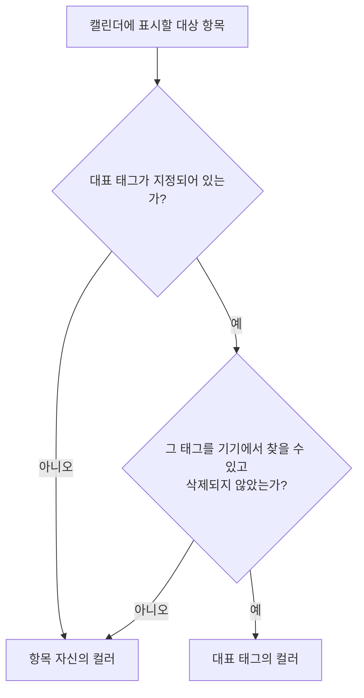

# 대표 태그 앱 스펙

이 문서는 메모와 디데이의 대표 태그 가운데 사용자가 기기에서 대표 태그를 지정하고 바꾸는 규칙, 대표 태그와 연결을 함께 바꾸는 저장, 앱이 캘린더에 항목을 표시할 때 대표 태그로 색상을 정하는 규칙을 다룬다. 대표 태그 자체의 규칙과 저장·동기화는 [대표 태그 공통 스펙](../common/primary-tag.md)을 따르며, 이 문서의 `대상 항목`도 그 문서와 같이 메모 또는 디데이 하나를 가리킨다.

캘린더 표시 색상 규칙을 사용하는 앱 스펙은 [캘린더 메모 표시 스펙](./calendar-memo.md), [캘린더 디데이 표시 스펙](./calendar-dday.md), [MemoDetail 화면 스펙](./memo-detail.md)이다. 사용자가 대표 태그를 고르는 조작은 [대표 태그 입력 컴포넌트 스펙](./primary-tag-input.md)이 소유하므로 이 문서에는 `feature` 영역을 두지 않는다.

## domain

### 기기에서의 대표 태그 변경

사용자는 대상 항목을 추가할 때 대표 태그를 지정할 수 있고, 이미 저장된 대상 항목의 대표 태그도 바꿀 수 있다. 완료된 메모와 삭제된 대상 항목의 대표 태그도 바꿀 수 있다.

대표 태그 변경이 항목의 다른 값을 바꾸지 않는다는 규칙은 [대표 태그 공통 스펙](../common/primary-tag.md)의 `항목 변경과 대표 태그`를 따른다.

### 대표 태그와 연결의 관계

사용자가 기기에서 지정하는 대표 태그는 그 대상 항목과 연결된 태그 중 하나다.

사용자가 기기에서 대표 태그로 지정한 태그는 같은 저장 작업에서 그 대상 항목의 연결된 태그에도 포함된다. 사용자 행동의 기기 저장 결과로 연결되지 않은 태그만 대표 태그로 지정된 상태는 허용하지 않는다.

사용자가 기기에서 태그와 대상 항목의 연결을 해제하면 같은 저장 작업에서 그 태그의 대표 태그 지정도 함께 해제된다.

이 관계는 기기에서의 사용자 행동에만 적용된다. 서버 동기화로 받은 내용에서 이 관계가 성립하지 않을 수 있는 범위는 [대표 태그 공통 스펙](../common/primary-tag.md)의 `동기화에서의 대표 태그와 연결`을 따른다.

### 캘린더 표시 색상

캘린더에서 대상 항목을 색상으로 표시할 때, 항목에 대표 태그가 있으면 대표 태그의 컬러를 사용하고 없으면 항목 자신의 컬러를 사용한다.

대표 태그로 지정된 태그를 기기에서 찾을 수 없거나 그 태그가 삭제된 상태면, 대표 태그가 없을 때와 같이 항목 자신의 컬러를 사용한다. 대표 태그가 완료된 상태인지는 색상 결정에 영향을 주지 않는다.

항목 자신의 컬러는 대표 태그가 있어도 지워지거나 바뀌지 않는다.

이 규칙은 캘린더의 메모와 디데이 표시에만 적용한다. 메모 목록과 디데이 목록, TagDetail의 메모·디데이 탭, 검색 결과의 컬러 표시는 대표 태그와 무관하게 항목 자신의 컬러를 사용한다.

캘린더에 표시할 항목을 정하는 기준과 이 색상 규칙이 적용된 결과는 [캘린더 메모 표시 스펙](./calendar-memo.md)과 [캘린더 디데이 표시 스펙](./calendar-dday.md)에서 다룬다.

## data

### 대표 태그를 함께 바꾸는 저장

연결 해제와 대표 태그 지정 해제, 대표 태그 지정과 연결 생성처럼 연결과 대상 항목을 함께 바꿔야 하는 경우에도 기기의 하나의 저장 작업으로 함께 반영해 한쪽만 반영된 기기 상태가 남지 않게 한다. 저장이 실패하면 연결과 대표 태그 지정 모두 바꾸기 전 상태로 남는다.

## 이 문서를 참조하는 문서

- [대표 태그 공통 스펙](../common/primary-tag.md)
- [대표 태그 입력 컴포넌트 스펙](./primary-tag-input.md)
- [메모 태그 앱 스펙](./memo-tag.md)
- [디데이 태그 앱 스펙](./dday-tag.md)
- [캘린더 메모 표시 스펙](./calendar-memo.md)
- [캘린더 디데이 표시 스펙](./calendar-dday.md)
- [MemoDetail 화면 스펙](./memo-detail.md)
