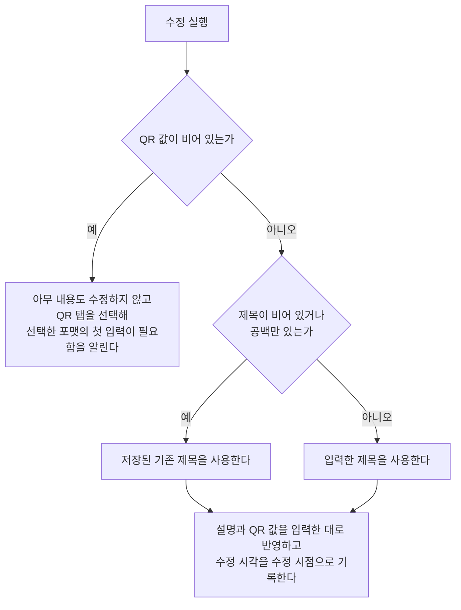

# QrDetail 화면 스펙

이 문서는 사용자가 선택한 QR의 상세를 확인하고 제목, 설명과 QR 값을 수정하고, 그 QR을 삭제하는 QrDetail 화면의 내용과 행동을 다룬다. QrDetail로 진입하는 흐름과 삭제한 QR이 목록에서 사라지는 것은 [QrHome 화면 스펙](./qr-home.md)에서, QR이 갖는 정보와 QR 값을 포맷별 입력으로 보고 고치는 규칙, QR 스캔과 되돌리기의 규칙은 [QrAdd 화면 스펙](./qr-add.md)에서, 카메라로 QR을 읽는 화면은 [QrScan 화면 스펙](./qr-scan.md)에서, 대상 QR을 정하는 계정 기준은 [계정 조회 스펙](./account.md)에서, QR을 서버와 맞추는 규칙은 [데이터 동기화 스펙](../common/data-sync.md)에서 다룬다. 제목 입력 자체의 동작은 [제목 입력 스펙](./title-input.md)을, 설명 입력 자체의 동작은 [설명 입력 컴포넌트 스펙](./description-input.md)을 따른다.

이번 범위는 QrHome의 QR 목록에서 QR을 선택해 상세로 이동하고, 저장된 제목·설명·QR 값을 확인하고 수정하고, QR을 삭제하는 것까지다. QR은 태그와 연결되지 않으므로 이 화면은 태그 입력을 제공하지 않고, 메모 탭처럼 연결된 항목을 보여 주는 탭도 두지 않는다.

QrDetail은 목록과 함께 배치하지 않고 언제나 단독 화면으로 사용한다.

진입할 때의 입력 초점, 내용 수정의 반영과 성공 결과, 요청 제한과 저장 계약은 [항목 상세 화면 공통 스펙](./entity-detail.md)을 따른다. 태그 입력을 제공하지 않으므로 그 문서의 태그 입력 관련 규칙은 적용하지 않는다.

디자인: [QrDetail 화면 디자인](../../design/qr-detail.md)

## feature

### 진입과 내용

사용자는 QrHome 화면의 QR 목록에서 QR을 선택해 그 QR의 QrDetail 화면으로 이동한다.

QR 조회에 성공하면 사용자는 저장된 제목, 설명과 QR 값을 확인하고 수정할 수 있으며, 그 QR을 삭제할 수 있다. 화면 제목에는 대상 QR의 최신 저장 제목을 표시한다.

### 화면 내용

화면에는 화면 제목, 뒤로가기, 삭제, 되돌리기, QR 그림, 정보 탭과 QR 탭, QR 스캔 시작과 수정 반영 동작만 둔다. 정보 탭에는 제목 입력과 설명 입력을, QR 탭에는 포맷 선택과 선택한 포맷의 입력을 둔다.

QR 그림은 두 탭 바깥에 놓여 어느 탭을 보고 있든 사라지지 않으며, 언제나 입력 중인 QR 값을 담아 그린다. QR 그림이 바뀌는 방식과 빈 값일 때의 표시는 [QrAdd 화면 스펙](./qr-add.md)의 `QR 값`을 따른다.

### 조회 상태

처음에는 QR 조회 중 상태를 제공하며 입력, 탭 전환, 되돌리기, QR 스캔 시작, 내용 수정과 삭제를 실행할 수 없다.

조회에 성공하면 내용 표시 상태로 바뀐다. QR을 조회할 수 없거나 조회에 실패하면 조회 중 상태를 유지하며, 별도의 오류 안내는 제공하지 않는다.

### 입력과 탭

내용 표시 상태에서 사용자가 제목, 설명과 QR 값을 입력하고 고치는 방법은 [QrAdd 화면 스펙](./qr-add.md)의 `탭 전환`, `제목과 설명 입력`, `QR 값`, `포맷 선택`, `텍스트 포맷 입력`, `포맷별 입력`, `위치 입력`을 따른다. 그 문서의 QrAdd 화면은 이 화면으로 읽는다.

처음 내용이 표시되면 정보 탭이 선택되어 있고, 입력 내용은 `domain > 입력 내용 채우기`에 따라 저장된 QR로 채워진다. 되돌릴 기록은 없다.

탭이 스스로 바뀌는 경우는 `QR 스캔`, `되돌리기`, `QR 내용 미입력`에서 정한 경우뿐이다.

### QR 스캔

사용자는 QR 스캔 시작을 선택해 카메라로 읽은 값을 QR 값으로 넣을 수 있다. 카메라 권한 확인, QrScan 화면으로의 이동, 읽은 값의 반영과 읽지 않고 돌아왔을 때의 결과는 [QrAdd 화면 스펙](./qr-add.md)의 `QR 스캔 시작`과 `스캔 결과 반영`을 따르며, 그 문서의 QrAdd 화면은 이 화면으로 읽는다.

### 되돌리기

사용자는 되돌리기를 선택해 QR 값이 통째로 바뀌기 직전의 상태로 돌아갈 수 있다. 기록이 남는 경우, 되돌린 결과와 되돌릴 기록이 없을 때의 결과는 [QrAdd 화면 스펙](./qr-add.md)의 `되돌리기`를 따른다.

되돌리기는 입력 중인 QR 값과 포맷만 바꾸며 저장된 QR은 바꾸지 않는다. 되돌린 결과를 저장하려면 수정을 반영해야 한다.

### 내용 수정

사용자가 입력한 제목, 설명 또는 QR 값이 저장된 내용과 하나라도 다를 때만 수정 반영 동작을 제공한다. 비교 기준은 `domain > 수정 동작의 제공 기준`을 따른다.

수정 반영 동작은 어느 탭을 보고 있든 실행할 수 있다. 수정 시점에 제목이 비어 있거나 공백만 있으면 저장된 기존 제목을 유지한 채 나머지 내용만 반영한다.

수정에 성공하면 화면, 입력 내용, 선택한 포맷, 보고 있던 탭과 되돌리기 기록을 유지하고 성공 피드백을 제공한다. 화면 제목은 새로 저장된 제목으로 갱신된다. 수정에 실패했을 때의 결과는 [항목 상세 화면 공통 스펙](./entity-detail.md)의 `내용 수정`을 따른다.

### QR 내용 미입력

QR 값이 비어 있는 상태에서 수정을 실행하면 아무 내용도 수정하지 않고, 선택한 포맷에서 무엇을 입력해야 하는지 알리는 피드백을 제공한다. 알리는 입력과 초점을 옮길 자리는 [QrAdd 화면 스펙](./qr-add.md)의 `포맷별 첫 입력`을 따른다.

입력 중이던 제목, 설명, 선택한 포맷과 되돌리기 기록은 유지하고, QR 탭을 선택한 뒤 입력 초점을 그 입력으로 옮기므로, 사용자는 내용을 바로 입력하거나 QR 스캔 시작으로 값을 넣은 뒤 다시 시도할 수 있다.

### 삭제

사용자는 대상 QR을 삭제할 수 있다. 삭제는 어느 탭을 보고 있든 실행할 수 있으며, 실행하기 전에 확인을 되묻지 않는다.

삭제를 처리하는 동안에는 진행 상태를 표시한다.

삭제에 성공하면 뒤로가기와 같은 결과로 QrDetail 화면에서 빠져나가 QrHome 화면으로 돌아가고, 삭제한 QR은 목록에서 사라진다. 이 화면에서 삭제한 QR에는 QrHome의 삭제 안내와 실행 취소를 제공하지 않는다.

삭제한 QR에서 수정 중이던 내용은 유지하지 않는다.

삭제에 실패하면 화면에 머무르며 진행 상태만 해제한다. 사용자는 삭제를 다시 실행할 수 있다.

### 외부 변경

화면이 열려 있는 동안 같은 QR의 저장 내용이 다른 경로에서 바뀌면 화면 제목을 최신 저장 제목으로 갱신한다. 입력 중인 제목, 설명, QR 값과 선택한 포맷은 덮어쓰지 않는다.

다른 기기에서 삭제한 QR이 서버에서 내려받아져 대상 QR이 삭제 상태가 되어도 화면은 내용 표시 상태를 유지한다. 사용자는 입력 중이던 내용을 잃지 않고 수정과 삭제를 그대로 실행할 수 있으며, 화면에서 밀려나거나 조회 중 상태로 되돌아가지 않는다.

### 진행 상태 유지

화면 재생성, 백그라운드 복귀, QrScan 화면에 다녀온 뒤에도 입력 중이던 제목, 설명, QR 값, 선택한 포맷과 그 포맷의 입력, 보고 있던 탭과 되돌리기 기록을 유지하고, 시스템이 앱을 메모리에서 정리한 뒤 화면을 복원해도 모두 복원한다. 위치 포맷의 지점 표시와 지도는 [QrAdd 화면 스펙](./qr-add.md)의 `작성 상태 유지 대상`과 같은 기준으로 유지한다.

표시 중이던 권한 안내와 수정 결과 피드백은 화면 재생성이나 앱 재실행 뒤에 다시 표시하지 않는다. 카메라 권한 요청에 응답하기 전에 화면이 재생성되었을 때의 결과는 [QrAdd 화면 스펙](./qr-add.md)의 `작성 상태 유지 대상`과 같다.

수정이나 삭제를 처리하는 동안, 그리고 저장된 내용이 갱신되어 화면이 다시 그려질 때도 사용자가 보고 있던 화면 위치를 유지한다.

화면을 떠난 뒤 다시 들어오거나 앱을 종료한 뒤 새로 진입하면 수정 중이던 내용을 복원하지 않고 저장된 내용으로 다시 시작한다.

### 뒤로가기

사용자가 뒤로가면 보고 있던 탭과 관계없이 QrHome 화면으로 돌아간다. 반영하지 않은 수정 내용은 저장되지 않는다.

## domain

### 상세 대상과 내용 표시

상세 대상을 정하는 계정 기준은 [항목 상세 화면 공통 스펙](./entity-detail.md)의 `대상 조회`를 따른다.

삭제 여부는 상세 대상을 정하는 기준이 아니다. 삭제 상태인 QR도 상세 대상으로 조회하며, 대상 QR이 삭제 상태로 바뀌어도 화면은 내용 표시 상태를 유지한다. 이때의 화면 동작은 `외부 변경`을 따른다.

수정은 삭제 여부를 바꾸지 않으므로, 삭제 상태가 된 QR을 이 화면에서 수정해도 그 QR은 삭제 상태로 남는다.

### 입력 내용 채우기

입력 내용은 대상 QR을 처음 조회한 값으로 한 번만 채운다. 같은 QR의 저장 내용이 바뀌어도 다시 채우지 않는다.

제목, 설명과 QR 값은 저장된 그대로 채운다. 선택한 포맷은 저장된 QR 값을 [QrAdd 화면 스펙](./qr-add.md)의 `포맷 알아보기`로 알아본 포맷이며, 그 포맷의 입력은 같은 문서의 `포맷 입력 읽기`로 채운다.

### 수정 성립 조건

QR은 QR 값 없이 있을 수 없으므로 QR 값이 비어 있으면 어떤 내용도 수정하지 않는다. 비어 있는지는 [QrAdd 화면 스펙](./qr-add.md)의 `QR 값` 기준으로 판단하므로 공백만 있는 값은 비어 있지 않다. QR 값의 길이는 입력할 때 같은 문서의 `QR 값의 길이`로 이미 제한되므로 수정 성립 조건에서 따로 판단하지 않는다.

제목은 QR이 반드시 가져야 하는 정보이므로 비우는 수정을 허용하지 않고 저장된 기존 제목을 사용한다. 제목을 비운 것은 기존 제목을 사용하는 것이므로 수정을 막지 않는다. 제목을 비운 상태와 빈 QR 값이 함께 있으면 QR 내용 미입력을 알리고 아무 내용도 수정하지 않는다.

### 수정되는 내용

수정은 대상 QR의 제목, 설명과 QR 값을 바꾸고 수정 시각을 수정 시점으로 기록한다. 제목과 설명은 앞뒤 공백을 포함해 입력한 그대로, QR 값은 화면의 QR 값 그대로 기록한다. 설명이 비어 있으면 빈 설명으로 기록한다.

포맷, 포맷별 입력과 되돌리기 기록은 [QrAdd 화면 스펙](./qr-add.md)의 `QR의 정보`에 따라 기록하지 않는다. 삭제 여부, 생성 시각과 계정 연결은 내용 수정으로 바뀌지 않는다.

### 수정 동작의 제공 기준

입력한 제목, 설명 또는 QR 값이 저장된 내용과 하나라도 다르면 수정 동작을 제공한다. 글자는 공백과 줄바꿈까지 그대로 비교한다.

선택한 포맷, 보고 있던 탭과 되돌리기 기록은 비교에 넣지 않는다. 포맷만 바꾸거나 되돌려서 QR 값이 저장된 값과 같아지면 수정 동작은 나타나지 않는다.

제목을 비운 채 수정해 저장된 기존 제목이 유지되면, 비어 있는 제목 입력이 저장된 제목과 계속 다르므로 수정 동작도 계속 제공된다.

### 삭제

삭제는 대상 QR의 삭제 여부를 삭제로 바꾸고 수정 시각을 삭제 시점으로 갱신한다. 제목, 설명과 QR 값은 바꾸지 않는다.

삭제한 QR은 [QrHome 화면 스펙](./qr-home.md)의 `목록에 노출하는 QR`에 따라 목록에서 사라진다.

### 요청 제한

[항목 상세 화면 공통 스펙](./entity-detail.md)의 `요청 제한`에서 같은 종류로 보는 것은 내용 수정과 삭제이며, 두 종류는 서로를 제한하지 않는다.

## data

### 대상 QR 조회

상세에 표시할 QR은 기기에 저장된 QR 중 현재 사용자 계정과 연결된 대상 QR 하나다. 이 조회는 삭제 여부를 가리지 않으므로 삭제 상태인 QR도 조회된다.

QrDetail에 진입하는 것만으로는 서버에서 QR을 다시 가져오지 않는다. 서버와 맞추는 조회는 [데이터 동기화 스펙](../common/data-sync.md)이 정한 계기에서만 일어난다.

### 수정과 삭제의 저장

수정을 반영하면 대상 QR의 제목, 설명, QR 값과 수정 시각을 기기에 저장해 기존 값을 바꾼다. 삭제를 실행하면 대상 QR의 삭제 여부와 수정 시각을 기기에 저장하며, QR 자체와 계정 연결은 기기에서 지우지 않는다.

수정과 삭제는 현재 사용자 계정과 연결된 대상 QR에만 반영한다. 그런 QR이 기기에 없으면 아무것도 바꾸지 않는다.

수정이나 삭제에 실패하면 성공으로 바꾸지 않는다. 수정에 실패하면 저장된 QR의 내용은 바뀌지 않고, 삭제에 실패하면 대상 QR은 삭제되지 않은 채로 남는다.

### 결과의 표시

수정한 제목과 QR 값은 [QrHome 화면 스펙](./qr-home.md)의 QR 목록처럼 그 QR을 조회하는 모든 곳에 반영된다. 제목이 바뀌면 같은 문서의 `목록 정렬`에 따라 목록에서 자리를 옮기고, QR 값이 바뀌면 목록의 QR 그림도 바뀐 값을 담아 다시 그려진다.

### 수정과 삭제의 동기화

수정과 삭제를 기기에 반영하면 그 QR은 업로드 대기로 기록되고 백그라운드 동기화가 시작된다. 삭제한 QR도 서버에서 제거하지 않고 삭제 상태로 반영한다.

두 동작의 성공 여부는 기기에 저장한 결과로만 판단하며 서버 반영 결과를 기다리지 않는다. 업로드 단위, 충돌 기준과 실패 시 재시도는 [데이터 동기화 스펙](../common/data-sync.md)의 규칙을 따른다. 내려받기로 서버의 더 늦은 수정 내용이 반영되면 그 결과는 `결과의 표시`와 같은 기준으로 나타나며, 화면에서 입력 중인 내용은 `외부 변경`에 따라 덮어쓰지 않는다.

로그인하지 않은 상태에서 수정하거나 삭제한 QR은 서버에 반영되지 않고 기기 안에만 유지된다.
