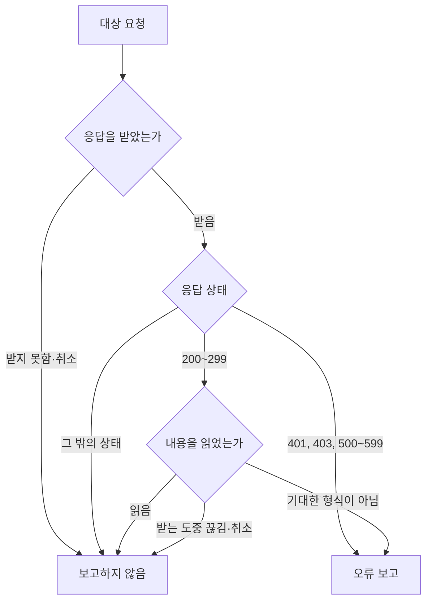

# 원격 응답 실패 보고 스펙

이 문서는 앱이 서버나 외부 서비스에 보낸 요청이 실패 응답을 받았거나 성공 응답의 내용을 읽지 못했을 때 오류 보고를 남기는 정책을 다룬다. [앱 로깅](./app-logging.md)의 공통 창구와 오류 보고 기록 위에서 동작한다. 화면 없이 앱 내부에서 진행되므로 `feature` 영역을 생략하고, 보고는 저장·동기화되지 않으므로 `data` 영역도 생략한다.

## domain

### 보고 목적

원격 응답 실패 보고는 서버와 외부 서비스가 앱의 요청을 처리하지 못한 경우와, 서비스가 돌려준 내용이 앱이 기대한 형식과 달라진 경우를 개발자가 찾아내기 위한 것이다. 사용자의 기기와 네트워크 상태 때문에 생긴 실패는 서비스의 문제가 아니므로 보고하지 않는다.

### 대상 요청

앱의 기능이 보내는 원격 요청이 대상이다. 어느 기능이 보낸 요청인지는 가리지 않는다.

- Diary 서버에 보내는 요청. 로그인 정보 갱신, 데이터 동기화, 파일 정보, 계정 관리, 푸시 알림 수신 등록, Play Integrity 판정 요청을 포함한다.
- 외부 서비스에 보내는 요청. Gemini, Google 장소 검색, 네이버 장소 검색, 날씨, 공휴일, 음력, 위치 추정, YouTube 영상 정보를 포함한다.
- 보관한 파일의 내용을 내려받는 요청

다음 요청은 대상이 아니다.

- 웹 링크의 페이지 정보를 가져오는 요청. 사용자가 입력한 아무 사이트에 보내므로 그 사이트의 차단이나 장애는 앱이 고칠 수 있는 문제가 아니다.
- 프로필 사진, 썸네일처럼 이미지를 표시하기 위해 내려받는 요청
- iOS에서 파일을 올리는 요청. 운영체제가 앱 대신 올리기를 이어서 진행하므로 앱이 응답을 직접 받지 않는다.

### 보고하는 실패

대상 요청이 다음 중 하나로 끝나면 오류 보고를 하나 남긴다.

- 응답 상태가 `401`, `403`이거나 `500`부터 `599` 사이인 실패 응답을 받았다.
- 성공 응답(`200`부터 `299` 사이)을 받았지만 응답 내용을 앱이 기대한 형식으로 읽지 못했다. 내용의 구조가 다르거나, 기대하지 않은 종류의 내용이 온 경우가 여기에 해당한다.

### 보고하지 않는 경우

다음은 보고하지 않는다.

- 응답을 받지 못한 경우. 네트워크에 연결되어 있지 않거나, 서버에 연결하지 못했거나, 응답을 기다리다 시간이 초과된 경우가 여기에 해당한다.
- 응답을 받는 도중 연결이 끊겨 내용을 끝까지 받지 못한 경우. 응답을 받지 못한 것과 같이 본다.
- 화면을 떠나거나 사용자가 멈추는 등으로 요청이 취소된 경우
- `401`, `403`이 아닌 `400`번대 응답. 찾는 자료가 없다는 응답이나 잘못된 요청이라는 응답처럼 기능이 정상 흐름으로 다루는 응답이 포함되기 때문이다.
- 실패 응답의 내용을 읽지 못한 경우. 실패 응답은 응답 상태로 보고 기준을 판단한다.

### 기능 결과와의 관계

보고 여부는 요청을 보낸 기능이 그 응답을 어떻게 다루는지와 무관하다. 기능이 실패 응답을 정상 결과로 바꾸어 처리하거나 다시 시도하더라도, 받은 응답이 보고 기준에 맞으면 응답마다 보고한다.

보고를 남기는 것은 요청의 결과에 영향을 주지 않는다. 기능은 보고와 무관하게 정해진 방식으로 결과를 처리하고, 화면도 보고와 무관하게 정해진 방식으로 실패를 표시한다.

원격 응답 실패 보고는 [기능 실패 로깅](./usecase-failure-logging.md)의 오류 보고와 별개로 남는다. 한 요청의 실패로 오류 보고 대상인 기능이 함께 실패하면 두 보고가 모두 남는다.

### 보고 내용

보고에는 다음을 담는다.

- 요청 방식
- 요청한 서버의 이름과 주소 경로
- 받은 응답 상태
- 내용을 읽지 못한 경우 읽지 못한 이유

보관한 파일의 내용을 내려받는 요청은 주소 경로가 파일마다 다르고 계정을 알아볼 수 있는 값이 들어 있으므로, 주소 경로를 담지 않고 서버의 이름만 담는다.

주소에 붙은 검색 조건, 요청에 담아 보낸 내용과 응답 내용은 담지 않는다. 인증 키, 검색어, 위치, 사용자가 적은 내용이 들어 있을 수 있기 때문이다. 이 제한은 [앱 로깅](./app-logging.md)의 `로그 내용 제한`을 따른다.

### 보고 묶음

보고는 요청 방식, 서버의 이름, 주소 경로가 같은 요청끼리 하나의 오류로 묶여 보이고, 셋 중 하나라도 다르면 서로 다른 오류로 보인다. 같은 오류로 묶인 보고는 응답 상태와 읽지 못한 이유로 구분한다.

### 플랫폼과 빌드

오류 보고를 남기는 플랫폼과 빌드 조건은 [앱 로깅](./app-logging.md)의 `오류 보고 기록`을 따른다.
