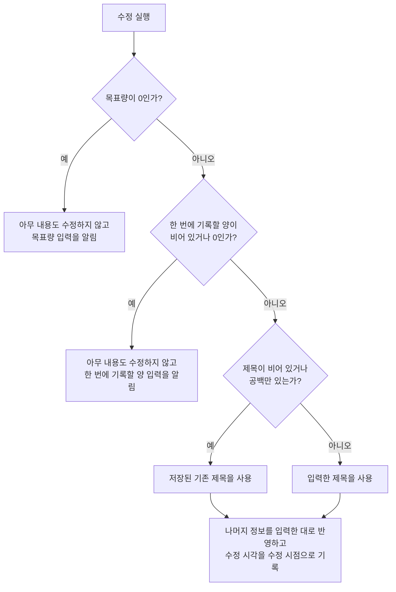

# RoutineDetail 화면 스펙

이 문서는 사용자가 선택한 루틴의 정보를 확인하고 수정하고, 그 루틴의 기록을 확인하고 넣고 빼고, 그 루틴이 연결한 태그를 바꾸고, 그 루틴을 완료하거나 다시 시작하고 삭제하는 RoutineDetail 화면의 내용과 행동을 다룬다. 루틴과 루틴 기록이 갖는 정보와 유효 범위는 [루틴 스펙](../common/routine.md)을, 진행 상태와 양의 문구, 기록할 수 있는 날짜를 정하는 규칙은 [루틴 앱 스펙](./routine.md)을, 각 입력의 행동과 숫자를 입력하는 규칙은 [RoutineAdd 화면 스펙](./routine-add.md)을 따른다. RoutineDetail로 진입하는 흐름과 완료하거나 삭제한 루틴이 목록에서 사라지는 것은 [RoutineHome 화면 스펙](./routine-home.md)에서, 루틴 목록과 상세를 함께 사용하는 배치는 [Routine 목록·상세 배치 스펙](./routine-list-detail.md)에서, 완료된 루틴 목록과 상세를 함께 사용하는 배치는 [RoutineFinishedList 목록·상세 배치 스펙](./routine-finished-list-detail.md)과 [TagRoutineFinishedList 목록·상세 배치 스펙](./tag-routine-finished-list-detail.md)에서, 대상 루틴을 정하는 계정 기준은 [계정 조회 스펙](./account.md)에서, 루틴과 루틴 기록을 서버와 맞추는 규칙은 [데이터 동기화 스펙](../common/data-sync.md)에서 다룬다. 제목 입력, 설명 입력, 컬러 입력 자체의 동작은 [제목 입력 스펙](./title-input.md), [설명 입력 컴포넌트 스펙](./description-input.md), [컬러 입력 컴포넌트 스펙](./diary-color-input.md)을 따른다.

연결할 태그의 선택과 해제, 선택 목록의 행동과 정책은 [항목 태그 입력 컴포넌트 스펙](./entity-tag-input.md)을 따르고, 루틴과 태그의 연결 규칙은 [루틴 태그 스펙](../common/routine-tag.md)을 따른다. 태그는 루틴에만 연결하며 루틴 기록에는 연결하지 않는다.

이번 범위는 루틴 목록이나 다른 화면의 루틴에서 상세로 이동하고, 저장된 제목·설명·컬러·시작 날짜·주기·단위·목표량·한 번에 기록할 양을 확인하고 수정하고, 기록 내역을 확인하고 날짜와 양을 정해 기록을 넣고 기록을 빼고, 연결한 태그를 확인하고 바꾸고, 루틴을 완료하거나 다시 시작하고, 루틴을 삭제하는 것까지다. 이미 넣은 기록의 날짜와 양을 고치는 것은 제공하지 않으며, 고치려면 그 기록을 빼고 다시 넣는다. 카드 문구, 곧 이번 주기의 합계와 달성률은 이 화면에 표시하지 않는다.

목록과 상세를 함께 사용하는 동안에는 루틴 상세가 목록과 함께 놓이며, 그 배치는 [Routine 목록·상세 배치 스펙](./routine-list-detail.md)을 따른다.

진입할 때의 입력 초점, 조회 상태, 내용 수정의 반영과 성공·실패 결과, 삭제, 외부 변경, 태그 입력의 반영, 요청 제한과 저장·동기화 계약은 [항목 상세 화면 공통 스펙](./entity-detail.md)을 따른다.

디자인: [RoutineDetail 화면 디자인](../../design/routine-detail.md)

## feature

### 진입과 내용

사용자는 RoutineHome 화면의 루틴 목록에서 루틴을 선택하거나, RoutineHome 화면의 달력 보기에 표시된 루틴 기록 아이템을 선택해 그 루틴의 RoutineDetail 화면으로 이동한다. 목록과 상세를 함께 사용할 수 있는 환경에서는 이동하지 않고 목록과 함께 표시된 상세 영역에서 같은 내용을 사용하며, 그 기준은 [Routine 목록·상세 배치 스펙](./routine-list-detail.md)을 따른다. 진입 흐름은 [RoutineHome 화면 스펙](./routine-home.md)의 `루틴 목록`과 `달력 보기`, [캘린더 루틴 기록 표시 스펙](./calendar-routine.md)을 따른다.

다음 경로에서도 그 루틴의 RoutineDetail 화면으로 이동한다. 이 경로로 진입한 화면은 루틴 목록과 함께 표시하지 않고 단독으로 표시하며, 진입 흐름은 각 문서를 따른다.

| 진입 경로 | 진입 흐름 |
| --- | --- |
| TagDetail 루틴 탭의 태그별 루틴 목록에서 선택 | [TagDetail 루틴 탭 스펙](./tag-detail-routine.md), [TagDetail 화면 스펙](./tag-detail.md)의 `목록 탭 공통` |
| SearchHome의 루틴 검색 결과에서 선택 | [SearchHome 화면 스펙](./search-home.md) |
| iOS의 Spotlight 검색 결과에서 루틴 선택 | [Spotlight 항목 노출 스펙](./spotlight.md)의 `고른 항목 열기` |

사용자는 완료된 루틴 목록에서 루틴을 선택해서도 그 루틴의 RoutineDetail 화면으로 이동한다. RoutineFinishedList 화면에서 진입한 화면을 완료된 루틴 목록과 함께 표시하는 상태는 [RoutineFinishedList 목록·상세 배치 스펙](./routine-finished-list-detail.md)을, TagRoutineFinishedList 화면에서 진입한 화면의 상태는 [TagRoutineFinishedList 목록·상세 배치 스펙](./tag-routine-finished-list-detail.md)을 따른다. 진입 흐름은 [RoutineFinishedList 화면 스펙](./routine-finished-list.md)과 [TagRoutineFinishedList 화면 스펙](./tag-routine-finished-list.md)을 따른다.

달력 보기에서 어느 날짜의 아이템을 선택해 들어와도 상세 대상은 그 아이템의 루틴이며, 화면은 어느 날짜에서 들어왔는지와 관계없이 같은 내용을 보여 준다.

루틴 조회에 성공하면 사용자는 저장된 정보를 확인하고 수정할 수 있고, 기록 내역을 확인하고 기록을 넣고 뺄 수 있고, 이 루틴이 연결한 태그를 확인하고 바꿀 수 있으며, 그 루틴을 완료하거나 다시 시작하고 삭제할 수 있다. 완료된 루틴에서도 이 행동을 모두 그대로 할 수 있다. 화면 제목에는 대상 루틴의 최신 저장 제목을 표시한다.

### 화면 내용

화면에는 화면 제목, 뒤로가기, 완료 또는 다시 시작, 삭제, 제목 입력, 설명 입력, 컬러 입력, 시작 날짜 입력, 주기 선택, 단위 입력, 목표량 입력, 한 번에 기록할 양 입력, 태그 입력, 수정 반영 동작, 기록 날짜 고르기, 기록의 양 입력, 기록 넣기, 기록 내역과 각 기록의 기록 빼기만 둔다. 수정 반영 동작은 `내용 수정`이 정한 조건에서만 둔다. 완료와 다시 시작은 `완료와 다시 시작`에 따라 둘 중 하나만 둔다.

### 조회 상태

루틴 조회 중 상태에서는 입력, 내용 수정, 기록 넣기와 빼기, 태그 연결과 해제, 완료·다시 시작과 삭제를 실행할 수 없다. 조회 상태가 바뀌는 기준은 [항목 상세 화면 공통 스펙](./entity-detail.md)의 `조회 상태`를 따른다.

### 내용 수정

사용자는 제목, 설명, 컬러, 시작 날짜, 주기, 단위, 목표량과 한 번에 기록할 양을 입력하거나 바꿀 수 있다. 각 입력에서 할 수 있는 조작은 [RoutineAdd 화면 스펙](./routine-add.md)의 `제목과 설명 입력`, `컬러 입력`, `시작 날짜 입력`, `주기 선택`, `단위 입력`, `목표량 입력`, `한 번에 기록할 양 입력`을 따른다. 단위에 입력할 수 있는 글자는 같은 문서의 `단위 입력 기준`을 따른다.

수정 반영 동작을 제공하는 기준은 `domain > 수정 동작의 제공 기준`을 따른다. 제목을 비운 채 수정했을 때의 결과는 [항목 상세 화면 공통 스펙](./entity-detail.md)의 `수정되는 내용`을 따르며, 이때 나머지 정보만 반영한다. 수정에 성공하거나 실패했을 때의 결과는 같은 문서의 `내용 수정`을 따르며, 기록 내역과 기록 넣기의 입력도 화면과 함께 유지한다.

루틴의 정보를 수정해도 이미 넣은 기록은 지워지지 않고 날짜와 양도 바뀌지 않는다. 시작 날짜를 뒤로 옮겨 시작 날짜보다 앞에 놓인 기록도 [루틴 앱 스펙](./routine.md)의 `기록할 수 있는 날짜`에 따라 그대로 남고 기록 내역에 계속 보인다. 단위를 바꾸면 기록의 양은 그대로 두고 바뀐 단위로 읽으며, 단위를 비우면 숫자만으로 읽는다. 주기를 바꿔도 기록은 그대로이며, `평일만`이나 `주말만`으로 바꿔 하는 요일에 들지 않게 된 날짜의 기록도 그대로 남는다.

기록 넣기와 빼기는 이미 저장된 값을 바꾸는 동작이므로 수정 반영 동작의 제공 여부에 영향을 주지 않는다.

완료된 루틴도 완료되지 않은 루틴과 같은 방법으로 수정한다. 수정은 완료 여부를 바꾸지 않는다.

### 목표량 미입력

목표량이 0인 상태에서 수정을 실행하면 아무 내용도 수정하지 않고 목표량 입력이 필요함을 알리며, 입력 초점을 목표량 입력으로 옮긴다. 입력 중이던 내용은 모두 그대로 둔다.

목표량을 비운 것은 이 경우가 아니며, 수정을 반영하면 목표량이 없는 루틴이 된다.

### 한 번에 기록할 양 미입력

한 번에 기록할 양이 비어 있거나 0인 상태에서 수정을 실행하면 아무 내용도 수정하지 않고 한 번에 기록할 양 입력이 필요함을 알리며, 입력 초점을 한 번에 기록할 양 입력으로 옮긴다. 입력 중이던 내용은 모두 그대로 둔다.

### 기록 내역

사용자는 대상 루틴에 넣은 기록을 한 목록으로 확인한다. 각 기록에서 날짜와 양의 문구를 확인한다. 양의 문구는 [루틴 앱 스펙](./routine.md)의 `양의 문구`에 따라 저장된 루틴의 단위로 쓴다. 어떤 기록을 보여 주는지는 `domain > 기록 내역에 노출하는 기록`을, 순서는 `domain > 기록 내역의 순서`를 따른다.

기록 내역은 순서의 앞부분부터 나타나고, 사용자가 목록 끝에 다가가면 그다음 기록이 이어서 더 보인다. 아직 준비되지 않은 자리와 불러오는 동안의 표시, 조회에 실패했을 때의 결과는 [페이지 조회 목록의 자리 표시 스펙](./paged-list-placeholder.md)을 따른다.

기록 내역 불러오기가 끝났고 노출할 기록이 하나도 없으면 목록 자리에 아직 기록이 없음을 알린다. 불러오는 동안에는 이 안내를 보여 주지 않는다. 빈 상태에서도 사용자는 기록 넣기, 내용 수정, 태그 연결과 해제, 완료·다시 시작과 삭제를 그대로 실행할 수 있다.

기록을 선택해도 아무 일도 일어나지 않는다. 기록에서 할 수 있는 행동은 `기록 빼기`뿐이다.

### 기록 넣기

사용자는 기록할 날짜를 고르고 양을 입력한 뒤 기록 넣기를 실행해 대상 루틴에 기록을 하나 추가한다. 기록 넣기는 별도의 반영 동작 없이 즉시 저장되며, 루틴 정보의 수정 반영과는 무관하다. 완료된 루틴에도 같은 방법으로 기록을 넣을 수 있고, 기록을 넣어도 루틴은 완료된 채로 남는다.

사용자는 기록 날짜 고르기를 열어 연, 월, 일을 고를 수 있다. 고르기를 확인하면 고른 날짜가 기록할 날짜가 되고, 취소하면 고르기 전 날짜를 그대로 유지한다. 고르기는 지금 기록할 날짜에서 시작한다. 고르기에서는 `domain > 기록할 날짜의 범위`를 벗어난 날짜를 고를 수 없다. 기록할 날짜는 항상 있어야 하므로 지울 수 없다. 처음 값은 `domain > 기록 넣기의 처음 값`을 따른다.

사용자는 기록의 양을 숫자로 입력한다. 숫자를 입력하는 규칙은 [RoutineAdd 화면 스펙](./routine-add.md)의 `숫자 입력`을 따른다. 양이 비어 있거나 0이면 기록 넣기를 제공하지 않는다.

기록 넣기를 처리하는 동안에는 진행 상태를 표시한다. 처리하는 동안에도 사용자는 날짜와 양을 고칠 수 있고 화면의 다른 동작을 그대로 실행할 수 있으며, 다시 실행한 기록 넣기는 `domain > 요청 제한`에 따라 처리하지 않는다.

기록을 넣으면 새 기록이 기록 내역의 `domain > 기록 내역의 순서`에 맞는 자리에 나타난다. 기록할 날짜는 그대로 두고, 양은 `domain > 기록 넣기의 처음 값`의 양으로 되돌린다. 입력 초점은 옮기지 않으며, 기록 내역에 나타나는 것 말고 별도의 성공 안내는 제공하지 않는다. 같은 날짜에 같은 양의 기록이 이미 있어도 새 기록으로 넣는다.

기록 넣기를 저장하지 못하면 기록을 추가하지 않고 고른 날짜와 입력한 양을 그대로 두며, 별도 안내는 제공하지 않는다. 사용자는 같은 내용으로 다시 넣을 수 있다.

### 기록 빼기

사용자는 기록 내역의 기록을 하나씩 뺄 수 있다. 별도의 반영 동작 없이 즉시 저장되며, 빼기 전에 확인을 되묻지 않고 실행 취소도 제공하지 않는다.

뺀 기록은 기록 내역에서 사라지고 남은 기록의 순서는 그대로다. 시작 날짜보다 앞에 놓인 기록과 완료된 루틴의 기록도 같은 방법으로 뺄 수 있다.

기록 빼기를 저장하지 못하면 별도 안내 없이 그 기록은 기록 내역에 그대로 남는다. 사용자는 다시 뺄 수 있다.

### 태그 입력

반영 시점과 다른 동작과의 관계는 [항목 상세 화면 공통 스펙](./entity-detail.md)의 `태그 입력`을 따른다. 태그 선택 목록에서의 연결과 해제는 [항목 태그 입력 컴포넌트 스펙](./entity-tag-input.md)을, 태그 입력의 구성과 표현은 [항목 태그 입력 컴포넌트 디자인](../../design/entity-tag-input.md)을 따른다.

태그를 연결하거나 해제해도 기록과 입력 중이던 내용은 바뀌지 않는다.

### 완료와 다시 시작

루틴의 저장된 완료 여부에 따라 완료되지 않은 루틴에는 완료 동작을, 완료된 루틴에는 다시 시작 동작을 제공한다.

사용자는 완료되지 않은 루틴을 완료할 수 있다. 완료에 성공하면 화면과 수정 중이던 내용, 고른 기록할 날짜와 입력한 기록의 양은 그대로 유지되고, 이후 다시 시작 동작을 사용할 수 있다.

사용자는 완료된 루틴을 완료되지 않은 상태로 되돌릴 수 있다. 다시 시작에 성공하면 화면과 수정 중이던 내용, 고른 기록할 날짜와 입력한 기록의 양은 그대로 유지되고, 이후 완료 동작을 사용할 수 있다.

완료나 다시 시작을 처리하는 동안에는 진행 중인 상태를 표시한다. 완료나 다시 시작에 성공해도 별도로 안내하지 않으며, 제공되는 동작이 완료와 다시 시작 사이에서 바뀌는 것으로 결과를 확인할 수 있다. 실행하기 전에 확인을 되묻지 않고 실행 취소도 제공하지 않으며, 되돌리려면 반대 동작을 실행한다.

완료나 다시 시작의 저장에 실패하면 화면과 수정 중이던 내용은 그대로 유지되고 제공되는 동작도 바뀌지 않는다. 별도의 오류 안내나 재시도 동작은 제공하지 않으며, 사용자는 같은 동작을 다시 실행할 수 있다.

완료와 다시 시작은 화면을 떠나지 않는다. 완료된 루틴의 화면에서도 내용 수정, 기록 넣기와 빼기, 태그 연결과 해제, 삭제를 그대로 실행할 수 있다.

### 삭제

사용자는 대상 루틴을 삭제할 수 있다. 삭제의 진행과 성공·실패 결과는 [항목 상세 화면 공통 스펙](./entity-detail.md)의 `삭제`를 따르며, 성공하면 뒤로가기와 같은 결과로 진입하기 전 화면으로 돌아간다. 목록과 상세 영역을 함께 표시하는 상태에서 삭제에 성공한 뒤의 상세 영역은 [Routine 목록·상세 배치 스펙](./routine-list-detail.md)의 `상세 영역의 구성`을, 완료된 루틴 목록과 함께 표시하는 상태에서는 각 완료 목록의 목록·상세 배치 스펙을 따른다.

### 외부 변경

같은 루틴의 저장 내용이나 태그 연결이 다른 경로에서 바뀌거나 루틴이 삭제 상태가 되었을 때의 결과는 [항목 상세 화면 공통 스펙](./entity-detail.md)의 `외부 변경`을 따른다. 기록의 양 입력도 입력 중인 내용과 같이 덮어쓰지 않는다.

같은 루틴이 다른 경로로 완료되거나 다시 시작되면 제공하는 완료·다시 시작 동작이 저장된 완료 여부에 맞게 바뀐다. 목록의 완료, 완료된 루틴 목록의 다시 시작, 검색 결과와 AI 도구의 완료·다시 시작, 다른 기기에서 바꾼 완료 여부가 기기에 반영된 것이 모두 여기에 해당한다.

기록 내역은 저장된 상태를 그대로 보여 주므로, RoutineHome의 빠른 기록이나 AI 도구로 넣은 기록, 다른 기기에서 넣거나 뺀 기록이 기기에 반영되면 사용자가 아무것도 하지 않아도 기록 내역에 바로 나타난다. 이때 사용자가 보던 자리는 옮기지 않는다.

저장된 루틴의 단위가 바뀌면 기록 내역의 양의 문구가 바뀐 단위로 바뀐다. 저장된 시작 날짜가 바뀌면 기록 날짜 고르기의 범위와 고른 날짜가 `domain > 기록할 날짜의 범위`에 따라 바뀐다. 이 화면에서 수정을 반영해 저장된 값이 바뀐 경우도 같다.

### 진행 상태 유지

화면 재생성과 백그라운드 복귀 뒤에도 입력 중이던 제목, 설명, 컬러, 시작 날짜, 주기, 단위, 목표량, 한 번에 기록할 양, 고른 기록할 날짜와 입력한 기록의 양을 유지한다. 시작 날짜나 기록할 날짜를 고르는 중이었으면 고르기도 열린 상태로 남는다. 시스템이 앱을 메모리에서 정리한 뒤 화면을 복원해도 이 입력 내용은 복원한다.

수정 결과 피드백과 목표량 미입력·한 번에 기록할 양 미입력 안내는 화면 재생성이나 앱 재실행 뒤에 다시 표시하지 않는다.

기록 내역은 저장된 값이므로 유지 대상이 아니고 항상 저장된 기록을 표시한다. 기록 내역에서 보던 자리는 [페이지 조회 목록의 자리 표시 스펙](./paged-list-placeholder.md)의 `보던 자리 유지`를 따른다.

완료 여부도 저장된 값이므로 유지 대상이 아니고, 제공하는 완료·다시 시작 동작은 항상 저장된 완료 여부를 따른다.

태그 연결은 저장된 값이므로 유지 대상이 아니고 항상 저장된 연결을 표시한다. 태그 선택 목록의 열림 상태와 검색어는 [태그 선택 입력 공통 스펙](./tag-select-input.md)의 `태그 선택 목록의 열림 상태`와 `태그 검색어`를 따른다.

기록 넣기와 빼기를 처리하는 동안에도 사용자가 보고 있던 화면 위치를 유지한다. 그 밖에 화면 위치를 유지하는 경우와 다시 진입할 때의 기준은 [항목 상세 화면 공통 스펙](./entity-detail.md)의 `진행 상태 유지`를 따르며, 다시 진입하면 고른 기록할 날짜와 입력한 기록의 양도 복원하지 않고 `domain > 기록 넣기의 처음 값`으로 시작한다.

### 뒤로가기

사용자가 뒤로가면 RoutineDetail 화면에 진입하기 전 화면으로 돌아간다. RoutineHome의 루틴 목록이나 달력 보기에서 들어왔으면 RoutineHome으로, TagDetail 루틴 탭에서 들어왔으면 루틴 탭이 선택된 같은 태그의 TagDetail 화면으로, RoutineFinishedList나 TagRoutineFinishedList에서 들어왔으면 그 완료된 루틴 목록으로, SearchHome에서 들어왔으면 SearchHome으로 돌아간다. Spotlight 검색 결과에서 들어온 경우는 [Spotlight 항목 노출 스펙](./spotlight.md)의 `고른 항목 열기`를 따른다. 반영하지 않은 수정 내용과 넣지 않은 기록의 날짜와 양은 저장되지 않으며, 이미 넣거나 뺀 기록과 이미 반영된 태그 연결과 해제, 완료와 다시 시작은 그대로 남는다.

목록과 상세 영역을 함께 표시하는 상태에서 뒤로가기를 실행하면 상세 영역은 선택한 루틴이 없을 때의 화면인 루틴 추가로 되돌아간다. 그 기준은 [Routine 목록·상세 배치 스펙](./routine-list-detail.md)의 `뒤로가기`를 따른다. 완료된 루틴 목록과 함께 표시하는 상태에서는 선택 전 상태로 돌아가며, 그 기준은 [목록·상세 배치 공통 스펙](./list-detail-pane.md)의 `완료 목록의 배치`를 따른다.

## domain

### 상세 대상과 내용 표시

상세 대상 루틴을 정하는 기준과 삭제 상태인 루틴을 다루는 기준은 [항목 상세 화면 공통 스펙](./entity-detail.md)의 `상세 대상`을 따른다. 기록 넣기와 빼기도 루틴의 삭제 여부를 바꾸지 않는다. 완료된 루틴도 상세 대상이 되며, 완료 여부는 조회 상태와 화면이 제공하는 입력을 바꾸지 않는다.

### 오늘 기준

이 화면의 오늘은 화면에 진입한 날의 기기 날짜다. 화면을 보는 동안에는 자정이 지나도, 앱이 백그라운드에 갔다가 같은 화면으로 돌아와도, 화면이 회전하거나 시스템에 의해 재생성되어도 다시 정하지 않는다. 화면을 떠났다가 다시 진입하면 그때의 기기 날짜로 다시 정한다.

### 입력 내용 채우기

입력은 대상 루틴을 처음 조회한 값으로 채우며, 채우는 시점은 [항목 상세 화면 공통 스펙](./entity-detail.md)의 `입력 내용 채우기`를 따른다. 제목과 설명은 저장된 그대로, 설명이 비어 있으면 빈 설명으로 채운다. 단위는 저장된 글자 그대로 채우고, 단위가 비어 있으면 비어 있는 상태로 채운다. 목표량이 없으면 목표량이 비어 있는 상태로 채운다. 목표량과 한 번에 기록할 양은 앞에 `0`을 붙이지 않은 숫자로 채운다.

기록할 날짜와 기록의 양도 같은 시점에 `기록 넣기의 처음 값`으로 채운다.

### 기록 넣기의 처음 값

기록할 날짜의 처음 값은 저장된 루틴의 [루틴 앱 스펙](./routine.md)의 `진행 상태`에 따라 정한다.

| 진행 상태 | 기록할 날짜의 처음 값 |
| --- | --- |
| 진행 중 | 오늘 |
| 시작 전 | 저장된 시작 날짜 |

완료 여부는 처음 값을 바꾸지 않는다. 완료된 루틴도 진행 상태에 따라 같은 처음 값으로 시작한다.

기록의 양의 처음 값은 저장된 루틴의 한 번에 기록할 양이다. 기록을 넣은 뒤 양을 되돌릴 때는 그 시점에 저장된 한 번에 기록할 양을 쓴다. 한 번에 기록할 양 입력에 적어 두고 아직 반영하지 않은 값은 쓰지 않는다.

### 기록할 날짜의 범위

기록할 날짜로 고를 수 있는 범위는 [루틴 앱 스펙](./routine.md)의 `기록할 수 있는 날짜`를 따른다. 저장된 시작 날짜와 같거나 그 뒤인 날짜이며, 오늘보다 뒤의 날짜도 고를 수 있다. 시작 날짜 입력에서 고치고 아직 반영하지 않은 날짜는 범위에 쓰지 않는다. 완료 여부는 범위를 바꾸지 않는다. 주기와 하는 요일도 범위를 바꾸지 않으므로, `평일만`이나 `주말만` 루틴에도 어느 요일의 날짜든 고를 수 있다.

저장된 시작 날짜가 바뀌어 고른 기록할 날짜가 저장된 시작 날짜보다 앞이 되면 고른 날짜를 시작 날짜로 맞춘다. 시작 날짜와 같거나 그 뒤인 날짜는 바꾸지 않는다.

### 기록 내역에 노출하는 기록

기록 내역에는 대상 루틴에 속하고 현재 사용자 계정과 연결되어 있으며 삭제되지 않은 기록을 모두 노출한다. 날짜가 오늘보다 뒤인 기록과, 루틴의 시작 날짜가 바뀌어 시작 날짜보다 앞에 놓인 기록도 노출한다. 루틴의 완료 여부는 노출 기준에 쓰지 않는다.

같은 날짜의 기록은 [루틴 스펙](../common/routine.md)의 `루틴 기록의 정보`에 따라 하나로 합치지 않고 기록마다 따로 노출한다.

### 기록 내역의 순서

기록은 날짜가 늦은 순으로 놓는다. 날짜가 같은 기록끼리는 나중에 넣은 기록을 먼저 놓는다.

### 태그 입력에 표시하는 태그

기준은 [항목 상세 화면 공통 스펙](./entity-detail.md)의 `태그 입력에 표시하는 태그`를 따르며, 어떤 태그가 조회되는지는 [항목 태그 연결 앱 스펙](./entity-tag.md)의 `연결된 태그의 조회`를 따른다.

### 태그 연결의 반영

기준은 [항목 상세 화면 공통 스펙](./entity-detail.md)의 `태그 연결의 반영`을 따른다. 연결과 해제는 기록과 수정 중이던 입력 내용도 바꾸지 않는다.

### 수정 성립 조건

목표량이 0이거나 한 번에 기록할 양이 비어 있거나 0이면 제목을 포함해 어떤 내용도 수정하지 않는다. 0인 목표량을 목표량이 없는 것으로 바꾸거나, 빈 한 번에 기록할 양을 저장된 값으로 바꿔 수정하지 않는다. 두 조건이 함께 성립하지 않으면 목표량, 한 번에 기록할 양 순으로 판단하고 먼저 성립하지 않은 조건 하나의 결과만 알린다.

목표량이 비어 있는 수정은 성립하며, 목표량이 없는 루틴으로 반영한다.

제목을 비운 수정은 [항목 상세 화면 공통 스펙](./entity-detail.md)의 `수정되는 내용`에 따라 저장된 기존 제목을 사용한다. 제목을 비운 상태와 목표량이 0이거나 한 번에 기록할 양이 비어 있거나 0인 상태가 함께 있으면 그 숫자의 입력을 알리고 아무 내용도 수정하지 않는다.

### 수정되는 내용

수정은 대상 루틴의 제목, 설명, 컬러, 시작 날짜, 주기, 단위, 목표량과 한 번에 기록할 양을 바꾸고 수정 시각을 수정 시점으로 기록한다. 제목과 설명은 앞뒤 공백을 포함해 입력한 그대로 기록하고, 설명이 비어 있으면 빈 설명으로 기록한다. 목표량을 비웠으면 목표량이 없는 루틴으로 기록한다.

주기, 단위와 숫자는 [RoutineAdd 화면 스펙](./routine-add.md)의 `추가되는 루틴의 내용`과 같은 기준으로 기록한다. 단위를 비웠거나 공백만 입력했으면 빈 단위로 기록한다.

루틴 기록은 내용 수정으로 바뀌지 않는다. 기록의 날짜와 양, 삭제 여부와 수정 시각은 그대로이며, 바뀐 주기, 단위, 목표량과 시작 날짜로 다시 읽을 뿐이다. 완료 여부도 내용 수정으로 바뀌지 않는다. 그 밖에 바뀌지 않는 값은 [항목 상세 화면 공통 스펙](./entity-detail.md)의 `수정되는 내용`을 따른다.

### 수정 동작의 제공 기준

입력한 제목, 설명, 컬러, 시작 날짜, 주기, 단위, 목표량 또는 한 번에 기록할 양이 저장된 내용과 하나라도 다르면 수정 동작을 제공한다. 제목과 설명은 공백과 줄바꿈까지 그대로 비교한다.

단위는 앞뒤의 공백을 뺀 글자로 비교한다. 앞뒤에 공백만 더한 것은 차이로 보지 않고, 글자 사이의 공백과 대소문자가 다르면 다른 것으로 본다.

목표량과 한 번에 기록할 양은 [RoutineAdd 화면 스펙](./routine-add.md)의 `숫자 입력`에 따라 읽은 수로 비교한다. 앞에 `0`을 붙인 것은 차이로 보지 않는다. 비어 있는 목표량은 저장된 목표량이 없을 때 같은 것으로 본다. 목표량이 0이거나 한 번에 기록할 양이 비어 있거나 0이면 저장된 내용과 다른 것으로 보아, 사용자가 수정을 실행해 `목표량 미입력`이나 `한 번에 기록할 양 미입력` 안내를 받을 수 있게 한다.

고른 기록할 날짜, 입력한 기록의 양, 기록 내역과 완료 여부는 비교에 넣지 않는다. 태그 연결도 [항목 상세 화면 공통 스펙](./entity-detail.md)의 `수정 동작의 제공 기준`에 따라 비교에 넣지 않는다.

### 기록 넣기의 내용

새 기록은 대상 루틴에 속하고, 날짜는 고른 기록할 날짜로, 양은 [RoutineAdd 화면 스펙](./routine-add.md)의 `숫자 입력`에 따라 읽은 수로 기록하며, 삭제되지 않은 상태로 만든다. 생성 시각과 수정 시각은 넣은 시각으로 동일하게 기록하고, 현재 사용자 계정과 연결한다. 루틴의 내용, 완료 여부와 수정 시각은 바꾸지 않는다.

기록은 [루틴 스펙](../common/routine.md)의 `유효 범위`에 따라 양이 1 이상일 때만 성립하므로, 양이 비어 있거나 0이면 기록을 넣지 않는다.

### 기록 빼기

기록 빼기는 대상 기록의 삭제 여부를 삭제로 바꾸고 그 기록의 수정 시각을 동작 시점으로 갱신한다. 기록의 날짜와 양, 루틴의 내용, 완료 여부와 수정 시각은 바꾸지 않는다.

### 완료·다시 시작의 상태 전이

완료는 대상 루틴의 완료 여부를 완료 상태로, 다시 시작은 미완료 상태로 바꾸며, 모두 루틴의 수정 시각을 동작 시점으로 갱신한다. 기준은 [RoutineHome 화면 스펙](./routine-home.md)의 `완료와 실행 취소의 상태 전이`와 같다.

제공하는 동작은 상세 대상 루틴의 저장된 완료 여부로 정한다. 완료와 다시 시작은 루틴의 제목, 설명, 컬러, 시작 날짜, 주기, 단위, 목표량과 한 번에 기록할 양을 바꾸지 않고, 루틴 기록과 태그 연결도 바꾸지 않는다. [루틴 앱 스펙](./routine.md)의 `진행 상태`도 바뀌지 않는다.

### 삭제

삭제는 [항목 상세 화면 공통 스펙](./entity-detail.md)의 `삭제`에 따라 대상 루틴의 삭제 여부와 수정 시각을 바꾸며, 루틴의 정보, 완료 여부, 루틴 기록과 태그 연결은 바꾸지 않는다.

삭제한 루틴은 [RoutineHome 화면 스펙](./routine-home.md)의 `목록에 노출하는 루틴`에 따라 목록에서 사라지고, 완료된 루틴이었으면 완료된 루틴 목록에서도 사라진다.

### 요청 제한

[항목 상세 화면 공통 스펙](./entity-detail.md)의 `요청 제한`에서 같은 종류로 보는 것은 내용 수정, 완료·다시 시작, 삭제, 기록 넣기이며, 완료와 다시 시작은 같은 종류로 본다. 네 종류는 서로를 제한하지 않는다.

기록 빼기는 기록마다 따로 제한한다. 한 기록의 빼기를 처리하는 동안 그 기록의 빼기는 다시 처리하지 않는다. 서로 다른 기록의 빼기는 이어서 실행할 수 있다.

기록할 날짜를 고르는 것은 앱의 데이터를 바꾸지 않으므로 제한 대상이 아니다.

## data

### 대상 루틴과 기록 조회

상세에 표시할 루틴을 정하는 기준과 서버에서 다시 가져오는 계기는 [항목 상세 화면 공통 스펙](./entity-detail.md)의 `대상 조회`를 따른다.

기록은 기기에 저장된 루틴 기록 중 `domain > 기록 내역에 노출하는 기록`에 맞는 기록을 `domain > 기록 내역의 순서`로 나누어 조회하며, 사용자가 목록 끝에 다가가면 다음 기록을 이어서 조회한다. 나누어 조회하는 기준과 저장된 기록이 바뀌었을 때의 갱신은 [페이지 조회 목록의 자리 표시 스펙](./paged-list-placeholder.md)의 `페이지 조회`와 `자동 갱신`을 따른다.

기록도 RoutineDetail에 진입하는 것만으로는 서버에서 다시 가져오지 않는다.

### 변경의 저장

수정을 반영하면 대상 루틴의 정보와 수정 시각을 기기에 저장해 기존 값을 바꾼다. 저장 대상과 계정 기준, 삭제의 저장은 [항목 상세 화면 공통 스펙](./entity-detail.md)의 `수정과 삭제의 저장`을 따르며, 루틴 기록과 태그 연결은 기기에서 지우지 않는다.

완료와 다시 시작은 대상 루틴의 완료 여부와 수정 시각을 기기에 즉시 저장한다. 루틴 자체와 계정 연결, 루틴 기록과 태그 연결은 지우지 않는다.

기록 넣기는 새 기록과 그 기록의 현재 사용자 계정 연결을 한 번에 함께 기기에 저장한다. 기록 빼기는 대상 기록의 삭제 여부와 수정 시각을 기기에 저장한다. 뺀 기록과 그 계정 연결은 기기에서 지우지 않는다.

기록의 변경도 현재 사용자 계정과 연결된 대상 루틴의 기록에만 반영하며, 그런 루틴이나 기록이 기기에 없으면 아무것도 바꾸지 않는다. 저장에 실패한 변경은 [항목 상세 화면 공통 스펙](./entity-detail.md)의 `저장 실패`를 따른다.

### 결과의 표시

수정 내용은 그 루틴을 조회하는 모든 곳에 반영된다. [RoutineHome 화면 스펙](./routine-home.md)의 목록에서는 바뀐 제목, 컬러와 카드 문구로 보이고 `목록 정렬`에 따라 자리를 옮기며, 시작 날짜나 주기가 바뀌어 그 목록의 `보기 범위 기준`에 맞지 않게 되거나 맞게 되면 목록에서 사라지거나 나타난다. 또 [캘린더 루틴 기록 표시 스펙](./calendar-routine.md)에 따라 달력의 아이템도 바뀐 제목, 컬러와 단위로 보인다. [TagDetail 루틴 탭](./tag-detail-routine.md)과 [SearchHome 화면 스펙](./search-home.md)의 루틴 검색 결과에도 바뀐 정보로 보인다. 삭제하면 그 루틴이 이 곳들에서 사라지고, 그 루틴의 기록도 달력에 보이지 않는다.

완료하면 그 루틴은 RoutineHome 목록과 TagDetail 루틴 탭에서 사라지고 [RoutineFinishedList 화면 스펙](./routine-finished-list.md)과 [TagRoutineFinishedList 화면 스펙](./tag-routine-finished-list.md)의 목록에 나타나며, 다시 시작하면 그 반대가 된다. 다시 시작한 루틴이 RoutineHome 목록에 나타나는지는 그 목록의 `보기 범위 기준`도 함께 따른다. SearchHome의 루틴 검색 결과에는 완료 여부와 관계없이 남고 카드 문구만 [루틴 앱 스펙](./routine.md)의 `카드 문구`에 따라 바뀐다. 달력의 아이템은 완료 여부와 관계없이 그대로 보인다.

기록을 넣거나 빼면 그 루틴의 기록을 쓰는 모든 곳에 반영된다. [루틴 앱 스펙](./routine.md)의 `주기의 합계`와 `달성률`이 다시 정해져 RoutineHome 목록과 TagDetail 루틴 탭, SearchHome 검색 결과의 카드 문구가 바뀌고, `날짜별 합계`가 다시 정해져 달력의 그 날짜 아이템이 바뀐다. 그 날짜의 첫 기록을 넣으면 달력에 아이템이 새로 나타나고, 그 날짜의 마지막 기록을 빼면 아이템이 사라진다. 기록의 날짜가 이번 주기에 들지 않으면 카드 문구는 바뀌지 않는다. 완료된 루틴의 카드 문구는 `완료`이므로 기록을 넣거나 빼도 바뀌지 않는다.

### 태그 입력의 조회와 저장

조회와 저장 흐름은 [항목 상세 화면 공통 스펙](./entity-detail.md)의 `태그 입력의 조회`와 `태그 연결의 저장`을 따른다.

### 태그 연결 결과의 표시

연결을 만들면 그 태그의 [TagDetail 루틴 탭](./tag-detail-routine.md)에 이 루틴이 노출 기준에 맞게 나타나고, 연결을 해제하면 그 탭에서 사라진다. [RoutineHome 화면 스펙](./routine-home.md)에서 태그 필터를 적용해 두었으면 목록 보기와 달력 보기에서 그 필터의 판정에도 바뀐 연결이 쓰인다.

태그 연결이 RoutineHome의 노출 기준과 정렬을 바꾸지 않는 기준은 [항목 상세 화면 공통 스펙](./entity-detail.md)의 `태그 연결 결과의 표시`를 따른다.

### 변경의 동기화

루틴의 수정과 삭제의 동기화는 [항목 상세 화면 공통 스펙](./entity-detail.md)의 `수정과 삭제의 동기화`를 따른다. 완료와 다시 시작도 같은 방식으로 루틴의 정보로 업로드 대기로 기록되고 동기화된다. 기록 넣기와 빼기를 기기에 반영하면 바뀐 루틴 기록이 같은 방식으로 업로드 대기로 기록되고 동기화되며, 뺀 기록도 서버에서 제거하지 않고 삭제 상태로 반영한다. 루틴 기록이 동기화 대상으로 주고받는 정보는 [데이터 동기화 스펙](../common/data-sync.md)을 따른다.

루틴 기록은 루틴과 별개의 종류로 주고받으므로, 기록을 넣거나 빼도 루틴 자체는 업로드 대기가 되지 않는다. 기록의 충돌은 기록 하나 단위로 판정하므로, 같은 루틴에 여러 기기에서 넣은 기록은 모두 남는다.
