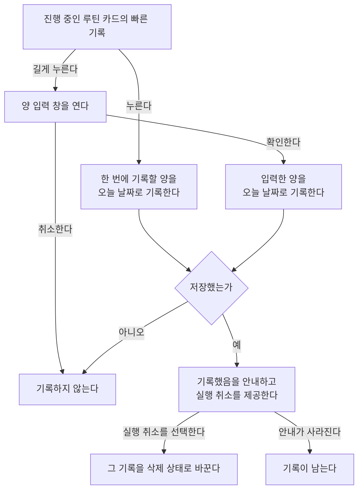
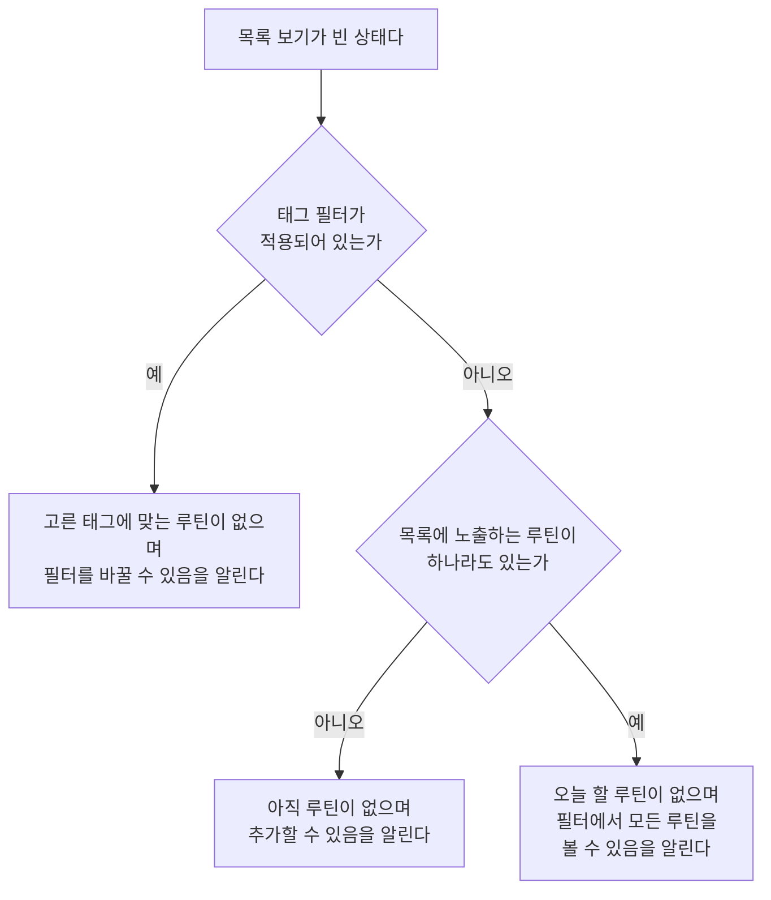

# RoutineHome 화면 스펙

이 문서는 사용자가 공통 내비게이션의 `루틴` 목적지에서 사용하는 RoutineHome 화면의 내용과 행동을 다룬다. 주요 목적지의 구성과 이동, 공통 내비게이션 노출은 [TopLevelNavigation 스펙](./top-level-navigation.md)에서, 루틴과 루틴 기록이 갖는 정보는 [루틴 스펙](../common/routine.md)에서, 진행 상태와 카드 문구, 오늘 할 루틴, 목록 순서를 정하는 계산은 [루틴 앱 스펙](./routine.md)에서, 달력 보기에 표시할 루틴 기록을 정하는 기준은 [캘린더 루틴 기록 표시 스펙](./calendar-routine.md)에서, 루틴을 작성해 추가하는 흐름은 [RoutineAdd 화면 스펙](./routine-add.md)에서, 저장한 루틴을 확인하고 수정하고 완료하고 삭제하고 날짜를 정해 기록을 넣고 빼는 흐름은 [RoutineDetail 화면 스펙](./routine-detail.md)에서, 완료된 루틴을 모아 확인하는 화면은 [RoutineFinishedList 화면 스펙](./routine-finished-list.md)에서, 루틴 목록과 상세를 함께 사용하는 배치는 [Routine 목록·상세 배치 스펙](./routine-list-detail.md)에서 다룬다.

목록 보기는 [항목 목록 화면 공통 스펙](./entity-home.md)을 `domain > 항목 목록 화면 공통 스펙에서 따르는 범위`가 정한 범위로 따르고, 달력 보기의 달 표시와 이동, 오늘 강조, 공휴일은 [CalendarHome 스펙](./calendar-home.md)의 해당 절을 따른다. 이 문서에는 루틴 화면에만 있는 내용을 둔다. 목록 카드에서 완료와 삭제를 실행하는 상호작용의 공통 규칙은 [SwipeToFinishAndDelete 컴포넌트 스펙](./swipe-to-finish-and-delete.md)에서, 목록이 비어 있을 때의 안내는 [목록 빈 상태 스펙](./list-empty-state.md)에서, 필터를 열고 바꾸는 행동의 공통 결과는 [목록 필터 반영 스펙](./list-filter.md)에서, 태그 필터의 선택 방식과 판정 규칙은 [태그 필터 스펙](./tag-filter.md)에서, 화면을 당겨 새로고침하는 행동과 동기화 진행 표시는 [새로고침 스펙](./sync-refresh.md)에서, 루틴과 루틴 기록을 서버와 맞추는 규칙은 [데이터 동기화 스펙](../common/data-sync.md)에서 다룬다.

디자인: [RoutineHome 화면 디자인](../../design/routine-home.md)

이번 범위는 계정에 저장된 루틴을 기기에서 불러와 카드 문구와 함께 목록으로 표시하고, 목록 카드에서 오늘의 기록을 빠르게 넣고 되돌리고, 목록 보기와 달력 보기를 오가며 기록이 있는 날짜를 달력에서 확인하고, 보기 범위로 목록 보기를 오늘 할 루틴만 보거나 모든 루틴을 보도록 바꾸고, 태그 필터로 두 보기를 함께 좁히고, 화면을 당겨 새로고침하고, 루틴 추가와 루틴 상세로 이동하고, 목록에서 루틴을 완료하거나 삭제하고 되돌리고, 완료된 루틴을 모아 확인하는 화면으로 이동하는 것까지다. 사용자가 목록의 정렬을 고르는 기능은 제공하지 않는다.

## feature

### 진입

사용자는 공통 내비게이션에서 `루틴` 목적지를 선택해 RoutineHome 화면으로 이동한다. 화면은 목록 보기로 시작한다.

### 화면 내용

화면에는 보기 전환, 필터 열기, 루틴 추가와, 지금 보기에 따라 루틴 목록이나 달력을 둔다. 목록 보기에는 여기에 더해 완료된 루틴 확인을 둔다. 달력 보기에는 여기에 더해 표시 중인 달 안내, 달 선택과 오늘이 속한 달로 이동을 둔다.

### 보기 전환

사용자는 보기를 목록 보기와 달력 보기 사이에서 바꿀 수 있다. 목록 보기에서는 루틴을 카드 목록으로 보고, 달력 보기에서는 루틴의 기록이 있는 날짜를 달력에서 본다.

보기 전환은 목록의 내용, 필터 선택, 새로고침 진행과 무관하게 언제나 실행할 수 있다. 보기를 바꿔도 필터 선택은 그대로다. 태그 필터 선택은 두 보기에 함께 적용되어 바꾼 보기도 같은 태그로 좁혀진 결과를 보여 주고, 보기 범위는 `보기 범위`에 따라 목록 보기에만 적용된다.

달력 보기에서 목록 보기로 바꿨다가 다시 달력 보기로 바꾸면 사용자는 바꾸기 전에 보던 달을 그대로 본다. 보기를 어디까지 유지하는지는 `domain > 보기의 유지`를 따른다.

### 루틴 목록

사용자는 목록 보기에서 계정에 저장된 루틴 가운데 완료되지 않은 루틴을 목록으로 볼 수 있다. 처음에는 그중 오늘 할 루틴만 보이며, 사용자는 `보기 범위`에서 완료되지 않은 루틴을 모두 보도록 바꿀 수 있다. 사용자는 각 카드에서 그 루틴의 제목과 카드 문구를 확인하고, 카드는 루틴의 컬러로 서로 구분해 보여 준다. 카드 문구는 [루틴 앱 스펙](./routine.md)의 `카드 문구`를 `domain > 오늘 기준`이 정한 오늘로 계산한 것이다.

진행 중인 루틴의 카드에는 `빠른 기록`도 함께 제공한다. 시작 전인 루틴의 카드에는 빠른 기록을 제공하지 않는다. 오늘의 요일이 하는 요일에 들지 않는 `평일만`·`주말만` 루틴의 카드도 진행 중이면 빠른 기록을 제공하고, 카드 문구도 다른 날과 같게 보여 준다.

루틴의 설명, 시작 날짜, 한 번에 기록할 양과 연결한 태그는 목록에 표시하지 않는다. 주기, 단위와 목표량은 카드 문구에 담긴 만큼만 보인다.

보기 범위가 `모든 루틴`이면 시작 전인 루틴과 오늘의 요일이 하는 요일에 들지 않는 루틴도 목록에서 빠지지 않고 카드 문구와 함께 보인다. 보기 범위가 `오늘 할 루틴`이면 이 루틴들은 목록에 보이지 않는다. 완료된 루틴은 보기 범위와 관계없이 목록에 보이지 않으며, [RoutineFinishedList 화면](./routine-finished-list.md)에서 확인한다. 목록에서의 자리는 `domain > 목록 정렬`을 따른다.

목록이 나타나는 순서, 아직 준비되지 않은 자리와 추가한 루틴이 목록에 나타나는 조건은 [항목 목록 화면 공통 스펙](./entity-home.md)의 `목록 표시`를 따른다.

사용자는 목록의 루틴을 선택해 그 루틴의 [RoutineDetail 화면](./routine-detail.md)으로 이동한다. 카드의 빠른 기록을 누르거나 길게 누르는 것은 루틴을 선택한 것이 아니므로 상세로 이동하지 않는다. 준비되지 않은 자리와 돌아왔을 때의 목록은 [항목 목록 화면 공통 스펙](./entity-home.md)의 `상세로 이동`을 따르며, 상세에서 루틴을 수정하거나 기록을 넣고 뺀 결과가 반영된 카드 문구와 순서를 본다. 상세에서 루틴을 완료한 뒤 돌아오면 그 루틴은 `domain > 목록에 노출하는 루틴`에 따라 목록에서 사라져 있다. 상세에서 시작 날짜나 주기를 고쳐 그 루틴이 `domain > 보기 범위 기준`에 맞지 않게 되었을 때도 같다.

목록과 상세를 함께 사용할 수 있는 환경에서는 이동하지 않고 상세 영역이 그 루틴의 상세로 바뀌며, 그 기준은 [Routine 목록·상세 배치 스펙](./routine-list-detail.md)의 `상세 영역의 구성`을 따른다.

### 빠른 기록

사용자는 목록 보기에서 진행 중인 루틴 카드의 빠른 기록을 눌러 양을 입력하지 않고 오늘의 기록을 넣을 수 있다. 누르면 확인을 되묻지 않고 그 루틴의 `한 번에 기록할 양`만큼이 오늘 날짜의 기록으로 즉시 저장되고, 그 카드의 문구가 늘어난 합계와 달성률로 바뀐다.

빠른 기록은 누를 때마다 기록 하나를 새로 넣는다. 달성률이 100이어도 계속 넣을 수 있다.

기록을 넣으면 기록했음을 안내하고, 안내와 함께 실행 취소 동작을 제공한다. 그 결과는 `기록 안내와 실행 취소`를 따른다.

기록을 저장하지 못하면 기록되지 않고 카드 문구도 바뀌지 않으며, 안내도 보이지 않는다. 사용자는 같은 카드에서 다시 기록할 수 있다.

달력 보기에서는 빠른 기록을 제공하지 않는다.

### 양을 입력해 기록

사용자는 진행 중인 루틴 카드의 빠른 기록을 길게 눌러 양 입력 창을 열고, 양을 직접 정해 오늘의 기록을 넣을 수 있다.

창은 그 루틴의 `한 번에 기록할 양`이 입력된 상태로 열린다. 기록하는 날짜는 오늘로 정해져 있으며 창에서 바꿀 수 없다. 다른 날짜의 기록은 [RoutineDetail 화면 스펙](./routine-detail.md)의 `기록 넣기`로 넣는다.

양에 입력할 수 있는 문자와 자리 수는 `domain > 양 입력 기준`을 따른다. 양이 비어 있거나 0이면 확인할 수 없다.

사용자가 확인하면 창이 닫히고 입력한 양이 오늘 날짜의 기록으로 즉시 저장된다. 그 뒤의 카드 문구, 안내와 실행 취소, 저장하지 못했을 때의 결과는 `빠른 기록`과 같다. 확인해도 창만 닫히고 기록하지 않는 경우는 `domain > 빠른 기록의 내용`과 `domain > 기록 요청 제한`을 따른다.

사용자가 취소하거나 창 밖으로 벗어나 창을 닫으면 기록하지 않는다. 입력하던 양은 남지 않으며, 다시 열면 `한 번에 기록할 양`이 입력된 상태로 열린다.

창에서 양을 바꿔 기록해도 그 루틴의 `한 번에 기록할 양`은 바뀌지 않는다.

### 기록 안내와 실행 취소

빠른 기록이나 양을 입력한 기록을 넣으면 기록했음을 안내하고 실행 취소 동작을 제공한다.

사용자가 실행 취소를 선택하면 방금 넣은 기록 하나가 삭제 상태가 되어, 그 카드의 문구가 기록하기 전의 합계와 달성률로 돌아간다. 실행 취소는 마지막으로 넣은 기록 하나만 되돌린다. 같은 루틴에 앞서 넣은 기록과 다른 루틴의 기록은 되돌리지 않는다.

안내가 보이는 동안 다른 기록을 넣거나 목록에서 루틴을 완료하거나 삭제하면 앞의 안내는 바로 사라지고 새 동작의 안내만 보인다. 완료나 삭제 안내가 보이는 동안 기록을 넣어도 같다. 사라진 안내의 동작은 이 화면에서 되돌릴 수 없다.

안내가 저절로 사라지는 것, 화면을 떠나거나 화면이 재생성될 때 안내가 닫히는 것, 앱이 백그라운드에 다녀왔을 때의 결과는 [SwipeToFinishAndDelete 컴포넌트 스펙](./swipe-to-finish-and-delete.md)의 `안내와 실행 취소`와 같다. 안내가 보이는 동안 달력 보기로 바꾸는 것도 목록을 떠난 것으로 보아 안내를 닫으며, 완료와 삭제 안내도 같다. 이렇게 닫힌 안내의 기록, 완료나 삭제는 다시 목록 보기로 돌아와도 이 화면에서 되돌릴 수 없다.

안내가 사라진 뒤에는 [RoutineDetail 화면 스펙](./routine-detail.md)의 `기록 빼기`로 그 기록을 뺄 수 있다.

실행 취소를 저장하지 못하면 기록은 그대로 남고 별도의 안내는 제공하지 않는다.

### 달력 보기

달력 보기에는 캘린더가 표시되며, 처음에는 오늘이 속한 달을 보여 준다. 표시하는 달의 날짜, 주요 날짜와 기간 아이템, 이전 달과 다음 달로의 이동은 [Calendar 컴포넌트 스펙](./calendar.md)을 따른다.

달력에는 루틴 기록과 공휴일만 표시한다. 메모, 디데이, 연락처 생일과 날씨는 표시하지 않는다.

오늘 강조, 표시 중인 달 안내, 달 선택과 오늘이 속한 달로 이동은 [CalendarHome 스펙](./calendar-home.md)의 `오늘 강조`, `표시 중인 달 안내`, `달 선택`, `오늘이 속한 달로 이동`을 따른다. 그 절들의 캘린더 홈 화면은 이 화면의 달력 보기로 읽으며, 오늘은 `domain > 오늘 기준`이 정한 오늘이다.

공통 내비게이션에서 `루틴` 목적지를 다시 선택했을 때 돌아가는 자리는 [TopLevelNavigation 스펙](./top-level-navigation.md)의 `다시 선택으로 돌아가는 자리`를 따른다.

달력 보기에는 빈 상태 안내를 두지 않는다. 표시할 루틴 기록이 없으면 기록 없이 달력을 표시한다.

### 달력의 루틴 기록

달력 보기에는 루틴의 기록이 있는 날짜마다 그 루틴의 아이템 하나를 그 날짜 하루에 걸쳐 표시한다. 어떤 기록이 표시되는지, 어떤 날짜를 차지하는지, 어떤 문구와 색상을 사용하는지는 [캘린더 루틴 기록 표시 스펙](./calendar-routine.md)을 따른다.

사용자는 각 아이템에서 루틴의 제목과 그 날짜 합계의 양 문구를 함께 확인한다. 예를 들어 `물 마시기 1500ml`, `운동 1회`처럼 보고, 단위가 비어 있는 루틴이면 `운동 1`처럼 본다. 한 루틴이 같은 날짜에 기록을 여러 개 가져도 그 날짜에는 아이템 하나만 보이며, 양은 그 날짜의 기록을 모두 더한 값이다. 제목과 문구를 함께 보여 주는 구체적인 방법은 [RoutineHome 화면 디자인](../../design/routine-home.md)을 따른다.

완료된 루틴의 기록도, 시작 전인 루틴의 기록도, 루틴의 시작 날짜보다 앞에 놓인 기록도 그 날짜에 그대로 보인다. 완료된 루틴은 목록 보기에는 보이지 않지만 그 기록은 달력 보기에 남는다. 오늘보다 뒤의 날짜에 넣은 기록도 그 날짜에 보인다.

아직 표시할 기록이 없으면 아이템 없이 달력을 표시하고, 기록이 준비되거나 바뀌면 사용자가 별도 조작을 하지 않아도 반영한다. 다른 달로 이동하면 이동한 달을 기준으로 표시할 기록을 다시 정한다.

### 루틴 기록 선택

사용자가 달력에 표시된 루틴 기록을 선택하면 그 루틴의 [RoutineDetail 화면](./routine-detail.md)으로 이동한다. 같은 루틴이면 어느 날짜의 아이템을 선택해도 같은 루틴의 상세로 이동한다. 완료된 루틴의 기록을 선택해도 그 루틴의 상세로 이동한다.

목록과 상세를 함께 사용할 수 있는 환경에서는 이동하지 않고 상세 영역이 그 루틴의 상세로 바뀌며, 그 기준은 [Routine 목록·상세 배치 스펙](./routine-list-detail.md)의 `상세 영역의 구성`을 따른다.

상세에서 뒤로 가거나 그 루틴을 삭제하면 RoutineHome으로 돌아오고, 달력 보기와 보던 달을 그대로 본다. 상세에서 루틴을 고치거나 기록을 넣고 뺐으면 바뀐 제목, 색상, 날짜와 양이 사용자가 별도 조작을 하지 않아도 달력에 반영되고, 삭제한 루틴의 기록은 모두 달력에서 사라진다. 상세에서 루틴을 완료하거나 다시 시작해도 그 루틴의 기록은 달력에 그대로 보인다.

루틴 기록을 길게 눌러도 아무 동작도 하지 않는다.

달력의 날짜나 주를 눌러도, 길게 눌러도 아무 일도 일어나지 않는다. 달력 보기는 날짜를 눌러 여는 화면과 날짜 기간 선택을 제공하지 않는다.

### 달력의 공휴일

달력 보기의 공휴일 날짜 강조, 공휴일 이름 표시와 공휴일 이름 선택은 [CalendarHome 스펙](./calendar-home.md)의 `공휴일 날짜 강조`, `공휴일 이름 표시`, `공휴일 이름 선택`을 따른다. 그 절들의 캘린더 홈 화면은 이 화면의 달력 보기로 읽는다.

공휴일 이름을 선택해 앱 밖의 브라우저에 다녀와도 사용자는 달력 보기와 보던 달을 그대로 본다.

### 태그 필터

사용자는 RoutineHome에서 필터를 열어 태그를 골라 목록과 달력을 좁힐 수 있다. 태그를 고르면 목록 보기는 고른 태그 중 하나 이상과 연결된 루틴만 보여 주고, 달력 보기는 그런 루틴의 기록만 보여 준다. 선택할 수 있는 태그, 여러 태그를 고를 때의 판정, 선택 전체 해제, 필터 안의 태그 추가와 선택할 수 없게 된 태그의 처리는 [태그 필터 스펙](./tag-filter.md)을 따르며, 그 문서의 메모는 이 화면에서 루틴으로 읽는다. 판정에 쓰는 연결은 `domain > 태그 필터 기준`을 따른다.

두 보기는 같은 필터 선택을 함께 쓴다. 한 보기에서 고른 태그는 다른 보기에도 그대로 적용되며, 보기마다 따로 고르는 선택은 없다.

필터를 열고 닫는 행동, 선택의 반영 시점, 필터가 적용되었는지 알리는 기준은 [목록 필터 반영 스펙](./list-filter.md)을 따른다. 필터는 어느 보기에서든, 목록이 비어 있어도 언제나 열 수 있다. 목록 보기에서 필터를 바꾸면 같은 문서의 `필터 반영`에 따라 목록을 처음부터 보게 된다. 달력 보기에서 필터를 바꾸면 보던 달을 그대로 둔 채 표시하는 기록만 바뀐다.

태그 필터는 목록에 놓이는 루틴과 달력에 놓이는 기록의 범위만 좁히며 목록 순서는 바꾸지 않는다. 공휴일 표시에는 영향을 주지 않는다.

### 보기 범위

사용자는 RoutineHome에서 필터를 열어 목록 보기에 보여 줄 루틴의 범위를 `오늘 할 루틴`과 `모든 루틴` 가운데 하나로 고를 수 있다. 보기 범위는 태그 필터와 같은 필터 안에서 함께 고른다. 언제나 둘 중 하나가 골라져 있으며, 처음에는 `오늘 할 루틴`이 골라져 있다.

| 보기 범위 | 목록 보기에 보이는 루틴 |
| --- | --- |
| `오늘 할 루틴` | 완료되지 않은 루틴 가운데 오늘 할 루틴. 시작 전인 루틴과, 오늘의 요일이 하는 요일에 들지 않는 `평일만`·`주말만` 루틴은 보이지 않는다. |
| `모든 루틴` | 완료되지 않은 루틴 전부. 시작 전인 루틴과 오늘의 요일이 하는 요일에 들지 않는 루틴도 보인다. |

판정 기준은 `domain > 보기 범위 기준`을 따른다.

보기 범위는 목록 보기에만 적용한다. 달력 보기는 어느 쪽을 골라 두었든 `달력의 루틴 기록`에 따라 기록이 있는 날짜를 모두 보여 주며, 목록 보기에서 고른 보기 범위가 달력 보기를 좁히지 않는다. 필터는 어느 보기에서 열어도 같은 필터이므로 보기 범위도 어느 보기에서든 고를 수 있고, 달력 보기에서 바꾼 보기 범위는 목록 보기로 바꿨을 때 적용되어 있다.

보기 범위와 태그 필터는 함께 적용한다. 태그를 골라 두었으면 목록 보기는 보기 범위에 맞고 고른 태그 중 하나 이상과 연결된 루틴만 보여 준다.

선택의 반영 시점과 필터를 열고 닫는 행동은 [목록 필터 반영 스펙](./list-filter.md)을 따른다. 목록 보기에서 보기 범위를 다른 값으로 바꾸면 같은 문서의 `필터 반영`에 따라 목록을 처음부터 보게 된다. 이미 고른 값을 다시 골라도 바뀌는 것은 없다.

보기 범위는 필터가 적용되었는지 알리는 기준에 쓰지 않는다. `오늘 할 루틴`을 골라 두었든 `모든 루틴`을 골라 두었든 필터 적용 알림은 태그 필터 선택으로만 정하며, 그 기준은 [목록 필터 반영 스펙](./list-filter.md)의 `필터 적용 상태`를 따른다.

보기 범위는 목록에 놓이는 루틴의 범위만 바꾼다. 카드 문구, 빠른 기록의 제공 여부와 목록 순서는 바꾸지 않는다.

### 빈 상태

목록 보기에서 목록 불러오기가 끝났고 `domain > 목록에 노출하는 루틴`, 보기 범위와 태그 필터에 모두 맞는 루틴이 하나도 없으면 목록 자리에 비어 있음을 알린다. 알리는 내용은 `domain > 빈 이유의 구분`에 따라 다음 셋 중 하나다.

- 태그 필터를 적용하지 않았고 완료되지 않은 루틴이 하나도 없으면, 아직 루틴이 없으며 새로 추가할 수 있음을 알린다.
- 태그 필터를 적용하지 않았고 완료되지 않은 루틴은 있지만 보기 범위가 `오늘 할 루틴`이어서 보일 루틴이 없으면, 오늘 할 루틴이 없으며 필터에서 모든 루틴을 볼 수 있음을 알린다.
- 태그 필터를 적용했으면, 고른 태그에 맞는 루틴이 없으며 필터를 바꾸면 다른 루틴을 볼 수 있음을 알린다.

판정 시점, 빈 상태에서 할 수 있는 행동, 목록과의 전환, 좁힌 상태의 기준은 [목록 빈 상태 스펙](./list-empty-state.md)을 따른다.

빈 상태에서도 사용자는 루틴 추가, 필터 열기, 보기 전환, 완료된 루틴 확인과 당겨서 새로고침을 그대로 실행할 수 있다.

달력 보기에는 빈 상태가 없다.

### 새로고침

사용자는 두 보기 모두에서 화면을 아래로 당겨 새로고침할 수 있다. 당기는 조작, 진행 표시 기준과 실패 처리는 [새로고침 스펙](./sync-refresh.md)을 따른다.

목록 보기에서 당긴 결과는 [항목 목록 화면 공통 스펙](./entity-home.md)의 `새로고침`을 따른다. 달력 보기에서 당기면 계정 데이터를 서버와 다시 맞추는 것과 함께 표시 중인 달의 공휴일도 다시 동기화하며, 그 기준은 `data > 표시 중인 달의 공휴일 동기화`를 따른다.

새로고침으로 내려받은 루틴과 루틴 기록은 사용자가 별도 조작을 하지 않아도 목록의 카드 문구와 순서, 달력의 아이템에 반영된다.

### 루틴 추가로 이동

사용자는 두 보기 모두에서 루틴 추가를 선택해 [RoutineAdd 화면](./routine-add.md)으로 이동한다. 루틴 추가는 모든 플랫폼에서 제공한다. 언제 제공하는지, 추가 단축키, 목록과 상세를 함께 사용하는 동안의 추가 수단과 돌아왔을 때의 결과는 [항목 목록 화면 공통 스펙](./entity-home.md)의 `추가로 이동`을 따른다. 추가한 루틴이 적용한 태그 필터의 조건을 만족하지 않으면 목록에 나타나지 않는다. 보기 범위가 `오늘 할 루틴`인 동안에는 추가한 루틴이 오늘 할 루틴이 아니어도 목록에 나타나지 않는다. 시작 날짜를 오늘보다 뒤로 정한 루틴과, 주기를 `평일만`이나 `주말만`으로 정했는데 오늘의 요일이 하는 요일에 들지 않는 루틴이 여기에 해당한다. 이 루틴은 보기 범위를 `모든 루틴`으로 바꾸면 보이고, `오늘 할 루틴`에서는 오늘 할 루틴이 되는 날부터 보인다.

루틴 추가에서 돌아오면 떠나기 전의 보기를 그대로 보고, 달력 보기였으면 보던 달도 그대로 본다.

### 완료된 루틴 확인

사용자는 목록 보기에서 완료된 루틴 확인을 선택해 RoutineFinishedList 화면으로 이동할 수 있다.

완료된 루틴이 하나도 없어도 이 동작은 제공된다. 목록이 비어 있는지, 태그 필터를 걸어 두었는지와 보기 범위가 무엇인지도 이 동작을 막지 않는다.

이동한 화면의 내용과 행동은 [RoutineFinishedList 화면 스펙](./routine-finished-list.md)을 따른다. 사용자가 그 화면에서 뒤로 가면 RoutineHome의 목록 보기로 돌아오며, 필터 선택과 보던 목록 위치는 떠나기 전 그대로다.

달력 보기에서는 완료된 루틴 확인을 제공하지 않는다. 달력 보기는 완료된 루틴의 기록도 함께 보여 주므로 완료된 루틴을 따로 모아 보는 짝이 되는 목록이 아니다.

### 완료

사용자는 목록 보기에서 목록의 루틴을 완료할 수 있다. 목록 카드에서 완료를 실행하는 상호작용은 [SwipeToFinishAndDelete 컴포넌트 스펙](./swipe-to-finish-and-delete.md)을 따르며, 실행하기 전에 확인을 되묻지 않는다. 아직 준비되지 않은 자리에서는 실행할 수 없다.

완료하면 루틴이 목록에서 사라지고 완료되었음을 안내하며, 실행 취소 동작을 제공한다. 완료한 루틴은 [RoutineFinishedList 화면 스펙](./routine-finished-list.md)의 노출 기준을 만족해 그 화면의 목록에 나타난다.

사용자가 실행 취소를 선택하면 루틴은 완료되지 않은 상태로 되돌아가 `domain > 목록 정렬`에 맞는 자리에 다시 나타난다. 되돌아온 루틴이 목록에 나타나는지는 `domain > 보기 범위 기준`과 `태그 필터 기준`의 판정을 그 시점에 다시 적용해 정한다.

완료는 루틴의 기록을 바꾸지 않는다. 완료한 루틴의 기록은 달력 보기에 그대로 보이고, 실행 취소로 돌아온 루틴의 카드 문구는 완료하기 전과 같다.

완료를 저장하지 못하면 루틴은 목록에 그대로 남고 안내도 보이지 않는다. 사용자는 같은 카드에서 다시 완료할 수 있다.

달력 보기에서는 루틴을 완료하는 동작을 제공하지 않는다.

### 삭제

사용자는 목록 보기에서 목록의 루틴을 삭제할 수 있다. 삭제와 실행 취소의 결과는 [항목 목록 화면 공통 스펙](./entity-home.md)의 `삭제`를 따른다.

루틴을 삭제하면 그 루틴의 기록은 달력 보기에서도 사라진다. 실행 취소로 돌아온 루틴은 완료의 실행 취소와 같이 `domain > 보기 범위 기준`과 `태그 필터 기준`에 맞으면 `domain > 목록 정렬`에 맞는 자리에 다시 나타나고, 삭제하기 전의 기록과 태그 연결을 그대로 가지므로 카드 문구와 달력의 아이템도 삭제하기 전과 같게 돌아온다.

달력 보기에서는 루틴을 삭제하는 동작을 제공하지 않는다.

### 안내와 실행 취소

완료와 삭제의 안내와 실행 취소는 [SwipeToFinishAndDelete 컴포넌트 스펙](./swipe-to-finish-and-delete.md)의 `안내와 실행 취소`를 따르며, 삭제는 [항목 목록 화면 공통 스펙](./entity-home.md)의 `안내와 실행 취소`도 함께 따른다. [RoutineDetail 화면 스펙](./routine-detail.md)의 `삭제`가 여기에 해당하는 상세 화면의 삭제다. 완료나 삭제 안내와 기록 안내가 이어질 때의 결과는 `기록 안내와 실행 취소`를 따른다.

### 뒤로가기

사용자가 RoutineHome에서 뒤로가기를 실행하면 어느 보기에 있든 기본 목적지로 돌아간다. 달력 보기에서의 뒤로가기는 목록 보기로 돌아가지 않는다. 주요 목적지 사이의 전환 이력은 [TopLevelNavigation 스펙](./top-level-navigation.md)의 `기본 목적지와 전환 이력`을 따르며, 상세 영역과 함께 표시되는 상태에서의 결과는 [Routine 목록·상세 배치 스펙](./routine-list-detail.md)의 `뒤로가기`를 따른다.

## domain

### 항목 목록 화면 공통 스펙에서 따르는 범위

RoutineHome의 목록 보기는 [항목 목록 화면 공통 스펙](./entity-home.md)에서 다음 절을 따른다.

| 영역 | 따르는 절 |
| --- | --- |
| `feature` | `목록 표시`, `새로고침`, `추가로 이동`, `상세로 이동`, `삭제`, `안내와 실행 취소` |
| `domain` | `목록에 노출하는 항목`, `목록 갱신`, `삭제와 실행 취소의 상태 전이` |
| `data` | `삭제와 실행 취소의 저장`, `목록 조회` |

`뒤로가기`와 `화면 유지`는 따르지 않는다. 두 절은 `더보기`에서 진입한 홈 화면의 기준이고 RoutineHome은 주요 목적지이므로, 뒤로가기는 이 문서의 `뒤로가기`가, 화면 유지는 이 문서의 `보기의 유지`와 `화면 유지`가 정한다.

그 문서는 완료 여부가 없는 항목을 기준으로 하므로, 루틴의 완료와 완료된 루틴 확인, 완료 여부를 더한 노출 기준은 이 문서의 `완료`, `완료된 루틴 확인`, `목록에 노출하는 루틴`, `완료와 실행 취소의 상태 전이`와 `완료와 실행 취소의 저장`이 정한다.

달력 보기는 항목을 카드 목록으로 보여 주는 자리가 아니므로 `추가로 이동`만 따른다. 달력 보기의 표시와 조회, 갱신은 이 문서와 [캘린더 루틴 기록 표시 스펙](./calendar-routine.md)이 정한다.

### 보기

보기는 목록 보기와 달력 보기 두 가지다. 두 보기는 동시에 성립하지 않으며, 화면은 언제나 둘 중 하나의 보기에 있다.

기본값은 목록 보기이고, RoutineHome에 진입하면 목록 보기에서 시작한다.

전환은 사용자의 조작으로만 일어난다. 목록의 내용, 필터 선택, 새로고침 진행, 계정 상태는 보기를 바꾸지 않는다.

| 보기 | 보여 주는 것 | 보기 범위 | 빠른 기록 | 목록에서의 완료와 삭제 | 완료된 루틴 확인 | 빈 상태 안내 | 공휴일 |
| --- | --- | --- | --- | --- | --- | --- | --- |
| 목록 보기 | `목록에 노출하는 루틴` | 적용한다 | 제공한다 | 제공한다 | 제공한다 | 표시한다 | 표시하지 않는다 |
| 달력 보기 | `달력에 표시하는 루틴 기록` | 적용하지 않는다 | 제공하지 않는다 | 제공하지 않는다 | 제공하지 않는다 | 표시하지 않는다 | 표시한다 |

보기 전환, 필터 열기, 루틴 추가와 당겨서 새로고침은 두 보기 모두에서 제공한다.

### 보기의 유지

보기는 화면 표시 상태이며 저장되는 사용자 데이터가 아니다.

사용자가 RoutineHome을 보고 있는 동안에는 보기를 유지한다. 화면이 회전하거나 시스템에 의해 화면이 재생성되어도, 앱이 백그라운드에 갔다가 같은 화면으로 돌아와도, 루틴 추가나 루틴 상세, 완료된 루틴 확인으로 갔다가 뒤로 돌아와도, 공휴일 이름을 선택해 앱 밖의 브라우저에 다녀와도 바꿔 둔 보기를 유지한다.

공통 내비게이션에서 다른 주요 목적지에 다녀와 `루틴`으로 돌아오거나 앱을 종료하고 다시 실행하면 목록 보기로 초기화한다. 보기는 기기에 남기지 않는다.

목록 보기에서 사용자가 보던 목록 위치도 같은 경계에서 유지한다. 달력 보기로 바꿨다가 다시 목록 보기로 돌아오면 목록의 맨 위부터 보여 준다.

달력 보기에서 사용자가 보던 달은 목록 보기로 바꿔도 유지한다. 다시 달력 보기로 바꾸면 그 달을 이어서 본다. 보던 달을 유지하는 그 밖의 경계는 `보던 달 유지`를 따른다.

### 목록에 노출하는 루틴

노출 기준은 [항목 목록 화면 공통 스펙](./entity-home.md)의 `목록에 노출하는 항목`에 완료되지 않은 루틴이라는 조건을 더한다. 완료되었거나 삭제된 루틴은 기기에 남아 있지만 목록에는 나타나지 않는다. 완료 여부는 [루틴 스펙](../common/routine.md)의 `완료 여부`를 따른다.

이 노출 기준은 목록 보기에만 적용한다. 달력 보기는 `달력에 표시하는 루틴 기록`에 따라 완료된 루틴의 기록도 표시하고, 완료된 루틴을 모아 보여 주는 목록의 노출 기준은 [RoutineFinishedList 화면 스펙](./routine-finished-list.md)을 따른다.

진행 상태, 오늘의 요일이 하는 요일에 드는지, 목표량이 있는지, 목표를 채웠는지, 기록이 있는지는 노출 기준에 쓰지 않는다. 목록 보기는 이 노출 기준을 만족하는 루틴을 `보기 범위 기준`과 `태그 필터 기준`으로 좁혀 보여 주며, 진행 상태와 하는 요일은 `보기 범위 기준`만 쓴다.

### 보기 범위 기준

보기 범위는 `오늘 할 루틴`과 `모든 루틴` 두 값 가운데 하나이며, 처음 상태는 `오늘 할 루틴`이다.

| 보기 범위 | 목록 보기에 놓이는 루틴 |
| --- | --- |
| `오늘 할 루틴` | `목록에 노출하는 루틴` 가운데 [루틴 앱 스펙](./routine.md)의 `오늘 할 루틴`인 루틴 |
| `모든 루틴` | `목록에 노출하는 루틴` 전부 |

`오늘 할 루틴`의 판정에 쓰는 오늘은 `오늘 기준`이 정한 오늘이다. `오늘 기준`에 따라 오늘을 다시 정하면 그 오늘의 요일과 진행 상태로 다시 판정하므로, 요일이 바뀌면 사용자가 아무것도 하지 않아도 목록에 놓이는 루틴이 바뀐다. 화면을 보는 동안 자정이 지나도 오늘을 다시 정하기 전에는 목록이 바뀌지 않는다.

보기 범위는 RoutineHome의 목록 보기에만 적용한다. 달력 보기에는 적용하지 않으며, [RoutineFinishedList 화면 스펙](./routine-finished-list.md), [TagDetail 루틴 탭 스펙](./tag-detail-routine.md), [TagRoutineFinishedList 화면 스펙](./tag-routine-finished-list.md)과 [SearchHome 화면 스펙](./search-home.md)의 루틴 목록에도 적용하지 않는다. 이 목록들은 오늘의 요일과 관계없이 각 문서의 노출 기준에 맞는 루틴을 모두 보여 준다.

보기 범위는 루틴이 목록에 놓이는지만 정한다. 카드 문구, 빠른 기록을 제공하는지와 `목록 정렬`은 보기 범위와 관계없이 같으므로, `모든 루틴`에서 보이는 루틴 가운데 오늘의 요일이 하는 요일에 들지 않는 루틴도 진행 중이면 같은 카드 문구와 빠른 기록을 갖는다.

이 화면의 완료와 삭제를 실행 취소해 되돌아온 루틴, 추가하거나 다시 시작한 루틴, 수정한 루틴도 같은 판정으로 목록에 놓이는지를 정한다. 기록은 판정에 쓰지 않으므로 빠른 기록과 그 실행 취소는 루틴이 목록에 놓이는지를 바꾸지 않는다. 오늘 목표를 채운 루틴도 목록에 그대로 남는다.

보기 범위 선택은 [목록 필터 반영 스펙](./list-filter.md)의 `필터 선택 유지`에 따라 현재 사용자 계정별로 유지한다. 필터가 적용된 상태를 정하는 데는 쓰지 않으며, 그 기준은 같은 문서의 `필터 적용 상태`를 따른다.

### 빈 이유의 구분

목록 보기가 빈 상태일 때 알리는 내용은 태그 필터의 적용 여부와 보기 범위, 완료되지 않은 루틴이 있는지로 가른다. 태그 필터의 적용 여부는 [목록 필터 반영 스펙](./list-filter.md)의 `필터 적용 상태`를 따른다.

태그 필터를 적용하지 않은 채 `목록에 노출하는 루틴`이 있는데도 목록이 비는 것은 보기 범위가 `오늘 할 루틴`일 때뿐이다. 보기 범위가 `모든 루틴`이면 `목록에 노출하는 루틴`이 하나라도 있는 한 목록이 비지 않는다.

`목록에 노출하는 루틴`이 있는지는 보기 범위와 태그 필터를 적용하지 않고 판정한다. 완료된 루틴과 삭제된 루틴만 있으면 루틴이 없는 것으로 본다.

태그 필터를 적용한 동안에는 보기 범위가 무엇이든 고른 태그에 맞는 루틴이 없음을 알린다.

### 달력에 표시하는 루틴 기록

표시 대상은 달력이 보여 주는 여섯 주를 표시 대상 기간으로 삼아 [캘린더 루틴 기록 표시 스펙](./calendar-routine.md)의 `노출 기준`을 적용한 결과에 `태그 필터 기준`을 더한 것이다. 조회는 `루틴 기록 조회 기간`으로 더 넓게 하며, 그중 표시 대상 기간에 드는 날짜의 기록만 달력에 나타난다.

루틴의 완료 여부는 달력의 표시 대상을 가르지 않는다. 완료된 루틴의 기록도 삭제되지 않은 루틴의 기록이면 표시한다.

보기 범위도 달력의 표시 대상을 가르지 않는다. 보기 범위가 `오늘 할 루틴`이어도 시작 전인 루틴의 기록과, 하는 요일에 들지 않는 날짜에 넣은 기록을 포함해 기록이 있는 날짜를 모두 표시한다.

태그 필터는 루틴 단위로 판정한다. 필터에 맞는 루틴은 표시 대상 기간에 드는 기록이 모두 표시되고, 맞지 않는 루틴은 기록이 모두 표시되지 않는다.

### 루틴 기록 조회 기간

루틴 기록 조회 기간은 [CalendarHome 스펙](./calendar-home.md)의 `디데이 조회 기간`과 같은 범위인 표시 중인 달의 두 달 전 1일부터 두 달 후 마지막 날까지다. 예를 들어 2026년 7월을 표시 중이면 2026년 5월 1일부터 2026년 9월 30일까지다.

이 기간은 달력이 사용자에게 보여 주는 날짜 범위를 항상 포함한다. 달을 이동하면 이동한 달을 기준으로 조회 기간을 다시 정하고, 화면이 재생성되거나 화면을 벗어났다가 복귀하면 그 시점의 표시 중인 달을 기준으로 다시 정한다.

### 루틴 기록 조회 실패

달력 보기에서 루틴 기록을 조회하지 못하면 기록 없이 달력을 표시하고 사용자에게 별도로 알리지 않는다. 조회 실패는 공휴일 표시와 달 이동을 막지 않는다.

### 같은 기간 아이템 순서

루틴 기록과 공휴일 이름 아이템의 줄 위치는 [CalendarWeekOfMonth 컴포넌트 스펙](./calendar-week-of-month.md)의 `아이템 줄 배치`에 따라 그 주에서 차지하는 기간으로 정한다.

그 주에서 차지하는 날짜와 전체 기간이 모두 같아 기간만으로 순서가 정해지지 않는 아이템은 루틴 기록, 공휴일 이름 순으로 놓는다. 같은 날짜의 루틴 기록끼리는 [캘린더 루틴 기록 표시 스펙](./calendar-routine.md)의 `조회 결과 정렬` 순서로 놓는다.

### 태그 필터 기준

태그 필터는 루틴과 태그의 해제되지 않은 연결로 판정한다. 연결의 규칙은 [루틴 태그 스펙](../common/routine-tag.md)을 따르며, 태그와 태그의 연결을 따라 판정하지 않는다.

선택한 태그가 없으면 노출 기준을 만족하는 루틴과 그 기록을 모두 표시하고, 선택한 태그가 있으면 그중 하나 이상과 연결된 루틴과 그 기록만 표시한다. 선택한 태그와 연결되어 있어도 노출 기준을 만족하지 않는 루틴과 기록은 표시하지 않는다.

RoutineHome이 함께 제공하는 보기 범위는 태그 필터 선택을 판정에서 무시하게 하지 않으며, 태그 추가 동작을 막지도 않는다. 목록 보기는 `보기 범위 기준`과 태그 필터를 모두 만족하는 루틴만 표시하고, 달력 보기는 태그 필터만 적용한다.

태그 필터 선택은 [목록 필터 반영 스펙](./list-filter.md)의 `필터 선택 유지`에 따라 현재 사용자 계정별로 유지하며, 목록 보기와 달력 보기가 하나의 선택을 함께 쓴다. MemoHome, CalendarHome, DDayHome의 태그 필터 선택과는 공유하지 않는다.

### 목록 정렬

목록은 [루틴 앱 스펙](./routine.md)의 `목록 순서`에 따라 진행 중, 시작 전 순으로 놓고, 진행 상태가 같은 루틴끼리는 제목 오름차순으로 놓는다. 진행 상태는 `오늘 기준`이 정한 오늘로 정한다. 사용자가 고를 수 있는 다른 정렬은 없다. 보기 범위는 순서를 바꾸지 않는다. 보기 범위가 `오늘 할 루틴`이면 목록의 루틴이 모두 진행 중이므로 제목 오름차순으로만 놓인다. 완료나 삭제의 실행 취소로 되돌아온 루틴도 같은 기준의 자리에 나타나며, 상태를 바꾼 순서는 목록 순서에 영향을 주지 않는다.

### 오늘 기준

카드 문구, 진행 상태, `보기 범위 기준`의 오늘 할 루틴 판정, 빠른 기록의 날짜와 달력의 오늘 강조에 쓰는 오늘은 [루틴 앱 스펙](./routine.md)의 `오늘`이며, 두 보기가 같은 오늘을 쓴다.

오늘을 다시 정하는 시점은 [CalendarHome 스펙](./calendar-home.md)의 `오늘 기준`을 따른다. 오늘은 RoutineHome에 들어오거나 다른 화면이나 다른 앱에서 RoutineHome으로 돌아올 때마다 다시 정하고, 화면을 보는 동안 자정이 지나도 다시 정하지 않는다. 사용자가 보고 있는 동안 카드 문구와 목록 순서, 목록에 놓인 루틴이 저절로 바뀌지 않게 하기 위한 것이다.

보기를 바꾸는 것은 RoutineHome을 떠난 것이 아니므로 오늘을 다시 정하지 않는다. 목록과 상세를 함께 사용하는 동안 상세 영역에서 화면이 바뀌는 것도 RoutineHome을 떠난 것이 아니므로 오늘을 다시 정하지 않는다.

### 빠른 기록의 내용

빠른 기록과 양을 입력한 기록은 모두 다음 내용의 루틴 기록 하나를 새로 만든다.

| 정보 | 빠른 기록 | 양을 입력한 기록 |
| --- | --- | --- |
| 속한 루틴 | 기록을 실행한 카드의 루틴 | 양 입력 창을 연 카드의 루틴 |
| 날짜 | `오늘 기준`이 정한 오늘 | `오늘 기준`이 정한 오늘 |
| 양 | 기록하는 시점에 기기에 저장된 그 루틴의 `한 번에 기록할 양` | 사용자가 창에 입력한 양 |

새 기록은 삭제되지 않은 상태로 만들고 현재 사용자 계정과 연결한다. 그 밖에 기록을 만들 때 함께 정하는 내용은 [RoutineDetail 화면 스펙](./routine-detail.md)의 `기록 넣기의 내용`과 같다.

화면을 보는 동안 자정이 지나 기기의 날짜가 바뀌어도 빠른 기록과 양을 입력한 기록의 날짜는 `오늘 기준`이 정해 둔 오늘이며, 바뀐 기기 날짜로 기록하지 않는다. 날짜를 `오늘 기준`의 오늘로 두는 것은 사용자가 카드에서 보고 있는 이번 주기의 합계에 방금 넣은 기록이 더해지게 하기 위한 것이다.

기록은 [루틴 앱 스펙](./routine.md)의 `기록할 수 있는 날짜`에 따라 진행 상태가 진행 중인 루틴에만 넣으며, 빠른 기록은 이 목록에 노출하는 완료되지 않은 루틴에만 제공한다. 양 입력 창을 연 뒤 그 루틴이 삭제되었거나 완료되었거나 진행 중이 아니게 되어 확인하는 시점에 이 목록의 빠른 기록을 제공하지 않는 루틴이 되었으면, 창을 닫고 기록하지 않으며 별도의 안내는 제공하지 않는다. 하는 요일은 빠른 기록의 제공 여부를 가르지 않으므로, 창을 연 뒤 오늘을 다시 정해 오늘의 요일이 그 루틴의 하는 요일에 들지 않게 되어 `보기 범위 기준`에 따라 목록에서 빠진 것만으로는 여기에 해당하지 않으며, 그 루틴이 진행 중이면 확인했을 때 기록한다. 완료된 루틴의 기록은 [RoutineDetail 화면 스펙](./routine-detail.md)의 `기록 넣기`로 넣는다.

기록을 넣어도 루틴의 정보는 바뀌지 않는다.

### 양 입력 기준

양 입력 창의 양에 입력할 수 있는 문자와 자리 수, 입력한 숫자를 읽는 방법은 [RoutineAdd 화면 스펙](./routine-add.md)의 `숫자 입력`을 따른다.

이렇게 읽은 값이 1 이상이면 [루틴 스펙](../common/routine.md)의 `유효 범위`가 정한 기록의 양에 들므로 확인할 수 있고, 비어 있거나 0이면 확인할 수 없다.

### 기록 실행 취소의 상태 전이

기록의 실행 취소는 방금 넣은 루틴 기록의 삭제 여부를 삭제 상태로 바꾸는 것이며 기록 자체를 지우지 않는다. 기록의 날짜와 양, 속한 루틴의 정보는 바꾸지 않는다. 이 상태 전이는 [RoutineDetail 화면 스펙](./routine-detail.md)의 `기록 빼기`와 같다.

실행 취소를 선택한 시점에 그 기록이 속한 루틴이 다른 경로에서 이미 삭제 상태가 되었거나 완료되었어도 그 기록은 삭제 상태로 바뀐다. 이때 루틴의 삭제 여부와 완료 여부는 바꾸지 않는다.

실행 취소한 기록은 주기의 합계, 날짜별 합계와 기록 내역에서 빠진다. 실행 취소를 다시 되돌리는 동작은 제공하지 않는다.

### 기록 요청 제한

한 루틴의 빠른 기록이나 양을 입력한 기록을 처리하는 동안에는 같은 루틴의 기록을 다시 처리하지 않는다. 그동안 같은 카드의 빠른 기록을 다시 눌러도, 그 루틴의 양 입력 창에서 확인해도 기록하지 않는다.

처리하는 동안에도 같은 카드의 빠른 기록을 길게 눌러 양 입력 창을 열 수 있다. 처리가 끝나기 전에 그 창에서 확인하면 창이 닫히고 기록되지 않으며, 별도의 안내는 제공하지 않는다.

처리가 끝나면 같은 루틴에 이어서 기록할 수 있다. 서로 다른 루틴의 기록은 이어서 실행할 수 있다.

### 목록 갱신

목록의 자동 갱신은 [항목 목록 화면 공통 스펙](./entity-home.md)의 `목록 갱신`을 따른다. 루틴의 제목, 컬러, 시작 날짜, 주기, 단위나 목표량이 바뀌면 그 카드의 문구도 함께 다시 정하고, 제목이 바뀌거나 시작 날짜가 바뀌어 진행 상태가 달라지면 목록에서의 자리도 바뀐다. 진행 상태가 달라지면 그 카드에 빠른 기록을 제공하는지도 함께 바뀐다. 시작 날짜나 주기가 바뀌어 그 루틴이 `보기 범위 기준`에 맞지 않게 되거나 맞게 되면 사용자가 필터를 다시 고르지 않아도 목록에서 사라지거나 나타난다.

루틴의 완료 여부가 바뀌면 목록을 `목록에 노출하는 루틴`에 따라 갱신한다. 이 화면의 완료와 실행 취소, 상세 화면이나 완료된 루틴 목록, 검색 결과에서 실행한 완료와 다시 시작, 서버에서 내려받은 루틴이 기기에 반영된 것이 모두 여기에 해당한다. 완료된 루틴은 목록에서 사라지고, 다시 시작한 루틴은 `보기 범위 기준`과 `태그 필터 기준`에 맞으면 `목록 정렬`에 맞는 자리에 나타난다.

루틴 기록이 추가되거나 삭제 상태가 바뀌면 그 루틴의 카드 문구를 다시 정한다. 이 화면의 빠른 기록과 실행 취소, 상세 화면의 기록 넣기와 기록 빼기, 서버에서 내려받은 기록이 기기에 반영된 것이 모두 여기에 해당한다. 기록은 목록 순서를 바꾸지 않는다.

태그 필터를 적용한 동안 루틴의 태그 연결이 바뀌면 그 루틴은 사용자가 필터를 다시 고르지 않아도 목록에서 사라지거나 나타나고, 달력에서는 그 루틴의 기록이 사라지거나 나타난다.

`오늘 기준`에 따라 오늘을 다시 정하면 그 오늘로 모든 카드의 문구와 진행 상태를 다시 정한다. 진행 상태가 달라진 루틴은 `목록 정렬`에 맞는 자리로 옮겨지고 빠른 기록의 제공 여부도 바뀐다. 보기 범위가 `오늘 할 루틴`이면 다시 정한 오늘로 `보기 범위 기준`을 다시 판정해, 오늘 시작하는 루틴과 오늘의 요일이 하는 요일에 드는 루틴은 목록에 나타나고 하는 요일에 들지 않게 된 루틴은 목록에서 사라진다. 이때 목록의 위치는 [목록 필터 반영 스펙](./list-filter.md)의 `되돌리지 않는 경우`에 따라 되돌리지 않는다.

달력 보기의 갱신은 [캘린더 루틴 기록 표시 스펙](./calendar-routine.md)의 `표시 갱신`을 따른다.

### 완료와 실행 취소의 상태 전이

완료는 루틴의 완료 여부를 완료 상태로 바꾸는 것이며 루틴 자체를 지우지 않는다. 실행 취소는 완료 여부를 미완료로 되돌린다. 완료와 그 실행 취소는 모두 루틴의 수정 시각을 동작 시점으로 갱신한다.

완료와 실행 취소는 루틴의 제목, 설명, 컬러, 시작 날짜, 주기, 단위, 목표량과 한 번에 기록할 양을 바꾸지 않고, 그 루틴에 속한 기록과 태그 연결도 바꾸지 않는다. 태그 연결이 남는 기준은 [항목 연결 공통 스펙](../common/entity-link.md)의 `항목의 상태 변화와 연결`을 따른다.

완료는 현재 사용자 계정과 연결된 루틴에만 적용한다.

### 삭제와 실행 취소의 상태 전이

목록의 삭제와 실행 취소는 [항목 목록 화면 공통 스펙](./entity-home.md)의 `삭제와 실행 취소의 상태 전이`를 따른다. 루틴의 정보와 그 루틴에 속한 기록은 바꾸지 않으며, 태그 연결이 남는 기준은 [루틴 태그 스펙](../common/routine-tag.md)을 따른다.

삭제된 루틴의 기록은 삭제 상태로 바뀌지 않고 그대로 남지만, 루틴이 삭제된 동안에는 목록과 달력 어디에도 보이지 않는다.

### 달력의 달 이동과 유지

달력 보기의 이동 범위, 보던 달 유지와 달 선택 진행 유지는 [CalendarHome 스펙](./calendar-home.md)의 `이동 범위`, `보던 달 유지`, `달 선택 진행 유지`를 따른다. 그 절들의 캘린더 홈 화면은 이 화면의 달력 보기로 읽는다.

다만 RoutineHome은 기본 목적지가 아니므로, 공통 내비게이션에서 다른 주요 목적지에 다녀와 `루틴`으로 돌아오면 보던 달을 유지하지 않는다. 이때 화면은 `보기의 유지`에 따라 목록 보기로 시작하고, 달력 보기로 바꾸면 오늘이 속한 달부터 본다. 열려 있던 달 선택도 닫히며, 그 기준은 [TopLevelNavigation 스펙](./top-level-navigation.md)의 `목적지 이동과 화면 상태`를 따른다.

### 달력의 공휴일 기준

달력 보기의 공휴일 동기화 대상, 중복 동기화 방지, 공휴일 표시 대상, 공휴일 이름 구분과 공휴일 표시 유지는 [CalendarHome 스펙](./calendar-home.md)의 `공휴일 동기화 대상`, `중복 동기화 방지`, `공휴일 표시 대상`, `공휴일 이름 구분`, `공휴일 표시 유지`를 따른다. 공휴일 이름을 선택해 여는 주소는 같은 문서의 `공휴일 이름 검색 주소`를 따른다. 그 절들의 캘린더 홈 화면은 이 화면의 달력 보기로 읽는다.

달력 보기는 연락처 생일을 표시하지 않으므로 `중복 동기화 방지`의 음력 자료 동기화는 해당하지 않는다.

공휴일 국가 설정과 노출 설정은 CalendarHome과 같은 설정을 쓴다. RoutineHome에만 적용하는 공휴일 설정은 없다.

### 양 입력 창의 유지

양 입력 창이 열려 있는 동안 화면이 회전하거나 시스템에 의해 화면이 재생성되어도, 앱이 백그라운드에 갔다가 돌아와도 창은 열린 채로 남고 입력하던 양도 그대로 남는다. 앱이 백그라운드에 있는 동안 시스템이 앱을 정리했다가 다시 만들어도 창은 입력하던 양과 함께 열린 채로 다시 보인다.

사용자가 앱을 종료하고 다시 실행하면 창은 닫힌 상태로 시작한다. 공통 내비게이션에서 다른 주요 목적지로 이동하면 창은 닫히고 입력하던 양은 남지 않으며, 그 기준은 [TopLevelNavigation 스펙](./top-level-navigation.md)의 `목적지 이동과 화면 상태`를 따른다.

창이 열려 있는 동안 오늘을 다시 정해도 창은 닫히지 않는다. 확인하면 `빠른 기록의 내용`에 따라 그 시점의 오늘로 기록한다.

### 화면 유지

목록 보기에서 보던 목록 위치는 화면이 회전하거나 다른 앱에 다녀와도, 이 화면에서 연 루틴 추가, 루틴 상세와 완료된 루틴 확인에서 돌아와도 그대로 유지한다. 앱이 백그라운드에 있는 동안 시스템이 앱을 정리했다가 다시 만들면 목록 위치는 [페이지 조회 목록의 자리 표시 스펙](./paged-list-placeholder.md)의 `보던 자리 유지`에 따라 떠나기 전 위치로 다시 보인다. 앱을 다시 실행하면 목록의 맨 위부터 보여 준다.

공통 내비게이션에서 다른 주요 목적지에 다녀와 `루틴`으로 돌아왔을 때의 목록 위치와 화면 상태는 [TopLevelNavigation 스펙](./top-level-navigation.md)의 `목적지 이동과 화면 상태`를 따른다.

태그 필터 선택과 보기 범위 선택의 유지는 [목록 필터 반영 스펙](./list-filter.md)의 `필터 선택 유지`를, 열어 둔 필터의 유지는 같은 문서의 `필터 열림 유지`를 따른다. 보기의 유지는 `보기의 유지`를, 달력의 유지는 `달력의 달 이동과 유지`를 따른다.

## data

### 빠른 기록의 저장

빠른 기록이나 양을 입력한 기록을 넣으면 `domain > 빠른 기록의 내용`이 정한 루틴 기록 하나가 현재 사용자 계정의 그 루틴에 속한 기록으로 기기에 즉시 저장된다. 같은 날짜에 이미 기록이 있어도 합치지 않고 새 기록으로 저장한다.

기록의 실행 취소는 그 기록의 삭제 여부와 수정 시각을 기기에 즉시 저장한다. 기록 자체는 기기에서 지우지 않는다.

저장하면 그 기록이 업로드 대기로 기록되고 화면 뒤에서 동기화가 시작되어, 같은 계정의 다른 기기에도 같은 기록으로 보인다. 성공 여부는 기기에 저장한 결과로만 판단하며, 업로드 단위와 실패 시 재시도는 [데이터 동기화 앱 스펙](./data-sync.md)의 `업로드 흐름`과 `오프라인과 실패`를 따른다. 로그인하지 않은 상태에서 넣거나 되돌린 기록은 서버에 반영되지 않고 기기 안에만 유지된다.

기록을 저장하지 못하면, 현재 계정을 확인할 수 없는 경우를 포함해 기록은 생기지 않는다. 실행 취소를 저장하지 못하면 기록은 삭제되지 않은 채로 남는다. 두 경우 모두 별도의 안내는 제공하지 않는다.

### 완료와 실행 취소의 저장

목록에서 루틴을 완료하면 현재 사용자 계정과 연결된 해당 루틴의 완료 여부와 수정 시각이 기기에 즉시 저장된다. 서버에는 [데이터 동기화 스펙](../common/data-sync.md)에 따라 루틴의 정보로 반영되어 같은 계정의 다른 기기에도 같은 상태로 보인다. 루틴에 속한 기록과 태그 연결은 기기에서 지우지 않고 바꾸지도 않는다.

실행 취소를 선택하면 되돌린 상태가 같은 방식으로 즉시 저장된다. 실행 취소를 저장하지 못하면 루틴은 완료된 채로 남고 별도의 안내는 제공하지 않는다.

### 삭제와 실행 취소의 저장

루틴의 삭제와 실행 취소의 저장과 동기화는 [항목 목록 화면 공통 스펙](./entity-home.md)의 `삭제와 실행 취소의 저장`을 따른다. 루틴에 속한 기록과 태그 연결은 기기에서 지우지 않고 삭제 여부도 바꾸지 않는다.

### 목록 조회

목록에 표시할 루틴은 현재 사용자 계정을 기준으로 기기에 저장된 루틴에서 `domain`의 노출 기준, 보기 범위 기준과 태그 필터를 만족하는 루틴을 `domain > 목록 정렬`에 따라 조회한다. 카드 문구와 진행 상태, 오늘 할 루틴인지는 기기에 따로 기록해 두지 않고 조회한 루틴의 정보와 그 루틴의 삭제되지 않은 기록으로 그때그때 정한다.

저장된 루틴, 루틴 기록이나 루틴과 태그의 연결이 바뀌면 조회 결과도 그에 맞게 갱신되어 목록에 반영된다. 태그 필터나 보기 범위를 바꾸거나 `domain > 오늘 기준`에 따라 오늘을 다시 정하면 바뀐 기준으로 다시 조회한다.

빈 상태에서 `domain > 빈 이유의 구분`을 가르는 데 쓰는 `목록에 노출하는 루틴`이 있는지도 같은 계정의 기기에 저장된 루틴에서 조회하며, 저장된 루틴이 바뀌면 함께 갱신된다.

목록을 조회하지 못하면 노출할 루틴이 없는 것과 같게 다루고 별도의 오류 안내는 제공하지 않는다. 이때의 표시는 [목록 빈 상태 스펙](./list-empty-state.md)의 `빈 상태 판정 기준`을 따른다.

서버에서 루틴과 루틴 기록을 다시 가져오는 계기는 [항목 목록 화면 공통 스펙](./entity-home.md)의 `목록 조회`를 따른다.

### 표시 중인 달의 루틴 기록 조회

달력 보기에 표시하는 루틴 기록은 `domain > 루틴 기록 조회 기간`을 기준으로 기기에 저장된 루틴과 루틴 기록에서 조회한다. 조회 대상과 데이터 정렬은 [캘린더 루틴 기록 표시 스펙](./calendar-routine.md)의 `data` 영역을 따른다.

필터의 선택은 [태그 필터 스펙](./tag-filter.md)의 `필터 판정 기준`에 따라 루틴과 태그의 연결로 조회에 함께 반영한다. 필터 선택 변경이 반영되면 조회 결과도 자동으로 갱신된다.

달력 보기로 바꾸거나 달을 이동하는 것만으로는 서버에서 루틴과 루틴 기록을 다시 가져오지 않는다. 서버와 맞추는 조회는 [데이터 동기화 스펙](../common/data-sync.md)이 정한 계기에서만 일어나며, 사용자가 화면을 당겨 새로고침하면 그 동기화로 내려받은 기록이 별도 조작 없이 달력에 반영된다.

같은 달을 계속 보고 있는 동안 기기에 저장된 루틴, 루틴 기록이나 루틴과 태그의 연결이 바뀌면, 사용자가 별도 조작을 하지 않아도 바뀐 내용을 달력에 반영한다. 로그인이나 로그아웃으로 현재 사용자 계정이 바뀌면 바뀐 계정을 기준으로 다시 조회한다.

조회가 실패하면 `domain > 루틴 기록 조회 실패`를 따라 기록 없이 표시한다.

### 표시 중인 달의 공휴일 동기화

달력 보기의 공휴일 동기화는 [CalendarHome 스펙](./calendar-home.md)의 `표시 중인 달의 공휴일 동기화`를 따른다. 그 절의 캘린더 홈 화면에 들어오는 것은 이 화면에서 달력 보기가 표시되는 것으로 읽는다. 목록 보기에서 달력 보기로 바꾸는 것과, 달력 보기를 둔 채 다른 화면에 다녀와 RoutineHome으로 돌아오는 것이 여기에 해당한다.

목록 보기에 있는 동안에는 공휴일을 동기화하지 않으며, 목록 보기에서 당겨 새로고침해도 공휴일은 다시 동기화하지 않는다.

### 표시 중인 달의 공휴일 조회

달력 보기에 표시하는 공휴일의 조회는 [CalendarHome 스펙](./calendar-home.md)의 `표시 중인 달의 공휴일 조회`를 따른다.

### 필터 선택 저장

RoutineHome의 태그 필터 선택 저장은 [태그 필터 스펙](./tag-filter.md)의 `필터 선택 저장`을 따른다. 두 보기는 하나의 선택을 저장해 함께 쓴다.

보기 범위 선택은 [목록 필터 반영 스펙](./list-filter.md)의 `필터 선택 저장`과 `필터 선택 조회`에 따라 현재 사용자 계정의 선택으로 기기에 즉시 저장하고 조회한다. 태그 필터의 선택 전체 해제는 보기 범위 선택을 바꾸지 않는다.

### 태그 필터 조회

RoutineHome의 태그 필터 조회는 [태그 필터 스펙](./tag-filter.md)의 `태그 필터 조회`를 따른다.
