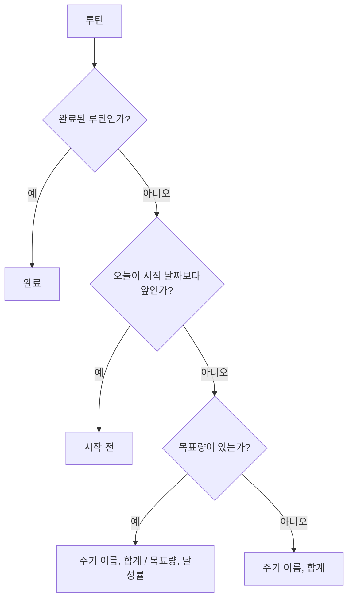
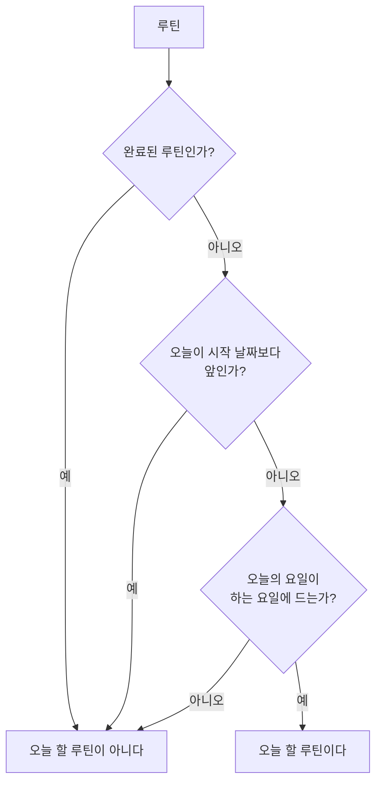

# 루틴 앱 스펙

이 문서는 루틴과 루틴 기록의 정보로 진행 상태, 완료 여부와 진행 상태의 관계, 이번 주기, 주기의 합계와 달성률, 카드 문구, 날짜별 합계, 기록할 수 있는 날짜, 오늘 할 루틴, 목록 순서를 정하는 앱의 계산 규칙을 다룬다. 루틴과 루틴 기록이 갖는 정보와 유효 범위는 [루틴 스펙](../common/routine.md)을 따른다.

이 규칙으로 계산한 결과를 어느 화면에 어떻게 보여 주는지는 각 화면 스펙이 정한다. 카드 문구는 [RoutineHome 화면 스펙](./routine-home.md)과 [RoutineFinishedList 화면 스펙](./routine-finished-list.md), [TagDetail 루틴 탭 스펙](./tag-detail-routine.md), [TagRoutineFinishedList 화면 스펙](./tag-routine-finished-list.md), [SearchHome 화면 스펙](./search-home.md)이, 날짜별 합계를 캘린더에 놓는 기준은 [캘린더 루틴 기록 표시 스펙](./calendar-routine.md)이, 기록할 수 있는 날짜는 [RoutineHome 화면 스펙](./routine-home.md)과 [RoutineDetail 화면 스펙](./routine-detail.md)이, 오늘 할 루틴은 [RoutineHome 화면 스펙](./routine-home.md)이 쓴다. 이 문서에는 사용자 조작과 저장 흐름이 없어 `feature`와 `data` 영역을 생략한다.

## domain

### 오늘

이 문서의 오늘은 기기의 현재 날짜다. 오늘을 언제 다시 정하는지는 계산 결과를 보여 주는 화면 스펙이 정한다.

### 진행 상태

루틴은 오늘과 시작 날짜에 따라 다음 두 상태 중 하나다.

| 진행 상태 | 조건 |
| --- | --- |
| 시작 전 | 오늘이 시작 날짜보다 앞이다. |
| 진행 중 | 오늘이 시작 날짜와 같거나 그 뒤다. |

진행 상태는 루틴에 기록해 두지 않고 오늘로 그때그때 정한다. 기록의 유무와 목표를 채웠는지는 진행 상태에 영향을 주지 않는다.

### 완료 여부와 진행 상태

[루틴 스펙](../common/routine.md)의 `완료 여부`는 진행 상태와 별개다. 진행 상태는 오늘과 시작 날짜로 정하고, 완료 여부는 사용자가 직접 바꾼 값이다. 따라서 완료된 루틴도 시작 전이거나 진행 중이며, 루틴을 완료하거나 다시 시작해도 진행 상태는 바뀌지 않는다.

완료 여부는 `이번 주기`, `주기의 합계`, `달성률`, `날짜별 합계`의 계산에 영향을 주지 않는다. 완료 여부가 바꾸는 것은 `카드 문구`와 `오늘 할 루틴`의 판정, 그리고 각 화면 스펙이 정하는 목록의 노출 기준과 빠른 기록의 제공 여부다.

### 이번 주기

이번 주기는 오늘이 속한 한 주기다. 주기의 범위는 [루틴 스펙](../common/routine.md)의 `주기`를 따른다.

| 주기 | 이번 주기 | 주기 이름 |
| --- | --- | --- |
| `매일` | 오늘 | `오늘` |
| `평일만` | 오늘 | `오늘` |
| `주말만` | 오늘 | `오늘` |
| `매주` | 오늘이 속한 주의 일요일부터 토요일까지 | `이번 주` |
| `매월` | 오늘이 속한 달의 1일부터 마지막 날까지 | `이번 달` |

`평일만`과 `주말만`의 이번 주기는 `매일`과 같이 오늘 하루다. 오늘의 요일이 그 루틴의 하는 요일에 들지 않아도 이번 주기는 오늘이며, 가장 가까운 하는 요일로 옮기지 않는다. 예를 들어 토요일에 보는 `평일만` 루틴의 이번 주기는 그 토요일이다.

이번 주기는 루틴의 시작 날짜로 좁히지 않는다. 예를 들어 수요일에 시작한 `매주` 루틴의 첫 주기도 그 주의 일요일부터 토요일까지다.

### 주기의 합계

주기의 합계는 그 루틴에 속한 삭제되지 않은 기록 가운데 날짜가 이번 주기에 드는 기록의 양을 모두 더한 값이다. 기록이 없으면 0이다.

`평일만`과 `주말만` 루틴의 합계는 `매일` 루틴과 같이 오늘 날짜의 기록을 더한 값이다. 하는 요일에 들지 않는 날짜에 넣은 기록도 그 날짜가 오늘이면 합계에 넣는다.

날짜가 오늘보다 뒤인 기록도 이번 주기에 들면 합계에 넣는다. 루틴의 시작 날짜가 바뀌어 시작 날짜보다 앞에 놓인 기록도 이번 주기에 들면 합계에 넣는다.

### 달성률

목표량이 있는 루틴의 달성률은 주기의 합계를 목표량으로 나눈 백분율이며, 소수점 아래를 버린 정수다. 합계가 목표량과 같거나 그보다 크면 달성률은 100이고, 100을 넘지 않는다.

예를 들어 목표량이 2000이고 합계가 1500이면 75, 합계가 1999이면 99, 합계가 2500이면 100이다. 목표량이 3이고 합계가 2이면 66이다.

목표량이 없는 루틴은 달성률을 갖지 않는다.

달성률이 100이어도 기록은 계속 넣을 수 있고 합계는 계속 늘어난다.

### 양의 문구

양은 숫자 바로 뒤에 그 루틴의 단위를 사이를 띄우지 않고 붙여 쓴다. 숫자에는 자릿수를 나누는 기호를 넣지 않는다. 예를 들어 단위가 `회`이면 `3회`, `ml`이면 `1500ml`, `쪽`이면 `20쪽`이다.

단위는 [루틴 스펙](../common/routine.md)의 `단위`에 따라 사용자가 적은 글자 그대로 붙이며, 언어 환경에 따라 다른 말로 바꾸지 않는다. 단위가 비어 있으면 숫자만 쓴다. 예를 들어 `3`, `1500`이다.

### 카드 문구

카드 문구는 루틴의 완료 여부, 진행 상태와 목표량에 따라 다음과 같이 정한다.

| 완료 여부 | 진행 상태 | 목표량 | 문구 | 예 |
| --- | --- | --- | --- | --- |
| 완료됨 | 관계없음 | 관계없음 | `완료` | `완료` |
| 완료되지 않음 | 진행 중 | 있음 | `<주기 이름> <합계> / <목표량의 양 문구>` 와 `<달성률>%` | `오늘 1500 / 2000ml`와 `75%`, `이번 주 2 / 3회`와 `66%`, 단위가 비어 있으면 `오늘 2 / 3`과 `66%` |
| 완료되지 않음 | 진행 중 | 없음 | `<주기 이름> <합계의 양 문구>` | `이번 달 12000m`, `오늘 0회`, 단위가 비어 있으면 `오늘 0` |
| 완료되지 않음 | 시작 전 | 관계없음 | `시작 전` | `시작 전` |

`평일만`과 `주말만` 루틴의 카드 문구는 `매일` 루틴과 같다. 주기 이름은 `오늘`이고, 오늘의 요일이 하는 요일에 들지 않는 날에도 같은 문구를 쓴다. 하는 요일이 아님을 알리는 문구는 없다.

완료된 루틴과 시작 전인 루틴은 합계와 달성률을 카드 문구에 쓰지 않는다. 완료된 루틴은 진행 상태가 시작 전이어도 `완료`로 쓴다. 완료된 루틴이 보이는 모든 카드가 이 문구를 쓴다.

### 날짜별 합계

날짜별 합계는 한 루틴에 속한 삭제되지 않은 기록 가운데 날짜가 같은 기록의 양을 모두 더한 값이다. 한 루틴은 기록이 있는 날짜마다 날짜별 합계 하나를 가지며, 기록이 없는 날짜에는 날짜별 합계가 없다.

날짜별 합계는 주기, 목표량, 진행 상태, 완료 여부와 오늘의 영향을 받지 않는다. 하는 요일에 들지 않는 날짜의 기록도 그 날짜의 날짜별 합계가 된다. 날짜별 합계의 문구는 `양의 문구`를 따른다.

### 기록할 수 있는 날짜

기록은 루틴의 시작 날짜와 같거나 그 뒤인 날짜에만 넣을 수 있다. 시작 날짜와 같거나 그 뒤이면 오늘보다 뒤의 날짜에도 넣을 수 있다.

오늘 날짜로 넣는 기록은 진행 상태가 진행 중일 때만 넣을 수 있다. 시작 전인 루틴에는 오늘 날짜의 기록을 넣을 수 없다.

주기와 하는 요일은 기록할 수 있는 날짜를 바꾸지 않는다. `평일만` 루틴에 토요일이나 일요일 날짜의 기록을, `주말만` 루틴에 월요일부터 금요일 사이 날짜의 기록을 넣을 수 있다.

완료 여부는 기록할 수 있는 날짜를 바꾸지 않는다. 완료된 루틴에도 같은 기준으로 기록을 넣을 수 있다. 완료된 루틴에 기록을 넣는 수단을 어디에 두는지는 각 화면 스펙이 정한다.

판정에는 기기에 저장된 루틴의 시작 날짜를 쓴다. 상세 화면에서 고치고 아직 반영하지 않은 날짜는 쓰지 않는다.

이미 넣은 기록은 이 기준과 관계없이 남는다. 루틴의 시작 날짜를 뒤로 옮겨 시작 날짜보다 앞에 놓인 기록도 지워지지 않고 합계와 캘린더에 그대로 쓰인다.

### 오늘 할 루틴

오늘 할 루틴은 다음을 모두 만족하는 루틴이다.

- 완료되지 않았다.
- 진행 상태가 진행 중이다.
- 오늘의 요일이 그 루틴의 하는 요일에 든다.

하는 요일은 [루틴 스펙](../common/routine.md)의 `주기`가 주기마다 정한 요일이다. `매일`, `매주`, `매월` 루틴은 모든 요일이 하는 요일이므로 완료되지 않았고 진행 중이면 언제나 오늘 할 루틴이다. `평일만` 루틴은 오늘이 월요일부터 금요일 사이일 때만, `주말만` 루틴은 오늘이 토요일이나 일요일일 때만 오늘 할 루틴이다. 오늘이 공휴일인지는 보지 않는다.

이번 주기에 기록이 있는지, 목표량이 있는지와 목표를 채웠는지는 이 판정에 쓰지 않는다. 오늘 목표를 다 채운 루틴도 오늘 할 루틴이다.

하는 요일은 이 판정에만 쓴다. `이번 주기`, `주기의 합계`, `달성률`, `카드 문구`, `날짜별 합계`, `기록할 수 있는 날짜`와 `목록 순서`는 하는 요일의 영향을 받지 않으며, 빠른 기록을 제공하는지도 하는 요일로 가르지 않는다.

오늘 할 루틴은 루틴에 기록해 두지 않고 오늘로 그때그때 정한다. 이 판정을 어느 목록에 쓰는지는 각 화면 스펙이 정한다.

### 목록 순서

루틴을 목록으로 보여 줄 때는 진행 상태에 따라 진행 중, 시작 전 순으로 놓는다. 진행 상태가 같은 루틴끼리는 제목의 오름차순으로 놓는다. 제목까지 같은 루틴끼리의 순서는 정하지 않는다.

합계, 달성률, 주기와 단위는 목록 순서에 영향을 주지 않는다. 오늘의 요일이 하는 요일에 드는지도 목록 순서에 영향을 주지 않는다. 완료 여부와 완료한 시점도 목록 순서에 영향을 주지 않으므로, 완료된 루틴만 모은 목록과 완료된 루틴이 함께 보이는 목록도 같은 순서로 놓는다. 오늘이 바뀌어 진행 상태가 달라진 루틴은 바뀐 상태의 자리로 옮겨진다.

## 이 문서를 참조하는 문서

- [RoutineHome 화면 스펙](./routine-home.md)
- [RoutineAdd 화면 스펙](./routine-add.md)
- [RoutineDetail 화면 스펙](./routine-detail.md)
- [RoutineFinishedList 화면 스펙](./routine-finished-list.md)
- [캘린더 루틴 기록 표시 스펙](./calendar-routine.md)
- [TagDetail 루틴 탭 스펙](./tag-detail-routine.md)
- [TagRoutineFinishedList 화면 스펙](./tag-routine-finished-list.md)
- [SearchHome 화면 스펙](./search-home.md)
