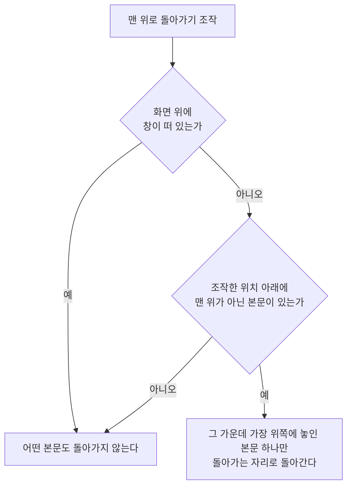

# 맨 위로 돌아가기 스펙

이 문서는 기기가 제공하는 맨 위로 돌아가기 조작으로, 아래로 내려 보던 화면 본문을 맨 위로 되돌리는 행동을 다룬다. 어느 화면이 대상이고 어디로 돌아가는지, 대상이 둘 이상 보일 때와 화면 위에 창이 떠 있을 때의 결과를 정한다. 주요 목적지를 다시 선택해 처음 보던 자리로 돌아가는 행동은 [TopLevelNavigation 스펙](./top-level-navigation.md)의 `현재 목적지 다시 선택`이 따로 다룬다.

디자인: [맨 위로 돌아가기 디자인](../../design/scroll-to-top.md)

보는 자리만 옮기고 사용자 데이터를 만들거나 저장하지 않으므로 `data` 영역은 생략한다.

## feature

### 제공 환경

iPhone과 iPad에서 제공한다. Android, 데스크톱, 웹은 기기가 같은 조작을 제공하지 않으므로 제공하지 않는다.

### 맨 위로 돌아가기

사용자는 본문을 아래로 내려 보다가 맨 위로 돌아가기 조작을 실행해 그 본문의 맨 위로 돌아갈 수 있다. 대상이 되는 화면은 `domain`의 `대상 화면`을, 화면마다 돌아가는 자리는 `돌아가는 자리`를 따른다.

돌아가는 것은 본문에 놓인 내용을 바꾸지 않고 사용자가 보고 있는 자리만 옮기는 것이다. 목록에 놓인 항목과 순서, 정렬과 필터 선택, 입력해 둔 내용은 그대로이고, 목록을 다시 조회하거나 새로고침하지 않는다. 돌아간 뒤에도 사용자가 그 화면에서 할 수 있는 행동은 그대로다.

이미 맨 위를 보고 있으면 화면은 그대로다.

입력하는 중에 조작해도 본문은 맨 위로 돌아간다. 입력하던 자리와 소프트 키보드는 그대로 남아 사용자는 입력을 이어갈 수 있다.

### 본문이 둘 이상 보일 때

한 번 조작하면 본문 하나만 돌아간다. 어느 본문이 돌아가는지는 기기가 기본으로 제공하는 방식과 같으며 `domain`의 `돌아가는 본문`을 따른다.

본문이 좌우로 나란히 보이면 조작한 위치 아래에 놓인 본문만 돌아가고, 다른 본문은 보던 자리를 그대로 유지한다. 목록과 상세를 함께 사용하는 동안 목록 위에서 조작하면 목록만, 상세 영역 위에서 조작하면 상세 영역의 화면만 돌아간다. 선택한 항목이 없어 상세 영역에 추가 화면이 놓여 있을 때도 같다. 목록과 상세를 함께 사용하는 기준은 [목록·상세 배치 공통 스펙](./list-detail-pane.md)을 따른다.

본문이 위아래로 놓여 있으면 한 번 조작할 때 위쪽 본문 하나만 돌아간다. 위쪽 본문이 이미 맨 위를 보고 있으면 그 아래 본문이 돌아간다. 따라서 사용자는 조작을 되풀이해 위에서부터 차례로 모든 본문을 맨 위로 돌릴 수 있다.

본문이 하나만 보이면 어느 위치에서 조작해도 그 본문이 돌아간다.

### 화면 위에 창이 떠 있을 때

화면 위에 창이 떠 있는 동안에는 조작해도 그 아래의 화면이 돌아가지 않는다. 본문이 여럿 보여도 모두 돌아가지 않고, 앱이 띄운 창 안의 내용도 돌아가지 않는다. 창을 닫은 뒤 조작하면 돌아간다. 무엇을 창으로 보는지는 `domain`의 `화면 위에 뜬 창`을 따른다.

## domain

### 대상 화면

본문이 위아래로 스크롤되는 화면은 모두 대상이다. 목록 화면과 완료 목록, 상세 화면과 그 안의 탭, 추가 화면, 검색 화면, 설정 화면, `더보기`처럼 화면의 종류를 가리지 않는다. [TopLevelNavigation 스펙](./top-level-navigation.md)의 `다시 선택으로 돌아가는 자리`가 돌아갈 자리를 두지 않은 `더보기`도 이 조작으로는 맨 위로 돌아간다.

화면 본문은 그 화면의 내용을 담고 위아래로 스크롤되는 가장 바깥 영역이다. 화면이 내용을 좌우나 위아래로 나누어 그런 영역을 둘 이상 두면 각각이 본문이다. 탭으로 본문을 나눈 화면에서는 지금 보이는 탭의 본문만 본문으로 보고, 보이지 않는 탭의 본문은 보던 자리를 그대로 유지한다.

다음은 대상이 아니다.

| 대상이 아닌 것 | 조작했을 때의 결과 |
| --- | --- |
| [CalendarHome](./calendar-home.md) | 반응하지 않는다. 처음부터 읽어 내려가는 본문이 아니라 날짜로 자리가 정해지는 화면이고, 오늘이 속한 달로 돌아가는 수단은 [TopLevelNavigation 스펙](./top-level-navigation.md)의 `현재 목적지 다시 선택`이 제공한다. |
| 본문 안이나 곁에 놓여 따로 스크롤되는 영역 | 화면 본문만 돌아가고 그 영역 안에서 보던 자리는 그대로다. [메모 장소 카드 컴포넌트](./memo-place-card.md)의 장소 목록, [설명 입력 컴포넌트](./description-input.md)의 설명 입력과 마크다운 미리보기가 해당한다. |
| 앱이 화면 위에 띄운 창 안의 내용 | 돌아가지 않는다. `화면 위에 뜬 창`을 따른다. |
| 앱 안에서 보여 주는 웹 페이지 | 앱이 정하지 않고, 기기가 웹 페이지에 제공하는 동작을 그대로 따른다. |
| 기기가 앱 위에 띄운 화면 안의 내용 | 앱이 정하지 않고, 기기가 그 화면에 제공하는 동작을 그대로 따른다. |

본문이 위아래로 스크롤되지 않는 화면은 돌아갈 자리가 없으므로 조작해도 그대로다.

### 돌아가는 자리

| 화면 본문 | 돌아가는 자리 |
| --- | --- |
| 항목을 순서대로 보여 주는 목록 | 목록의 첫 항목 |
| 입력 항목이나 정보를 이어서 보여 주는 본문 | 본문의 첫 부분 |
| [Timetable 컴포넌트](./timetable.md) | 위아래로 스크롤되는 영역의 맨 위. 종일 영역이 있으면 종일 영역부터, 없으면 0시부터 보인다. |

Timetable은 처음 표시될 때 오전 8시부터 보이지만, 이 조작은 처음 보이던 자리가 아니라 맨 위로 돌아간다. 돌아간 뒤 다른 날짜로 이동했을 때 이어서 보는 자리는 [Timetable 컴포넌트 스펙](./timetable.md)의 `시간대 안내`를 따른다. Timetable에서 기간을 선택하는 동안에는 같은 문서의 `기간 선택`에 따라 시간대가 스크롤되지 않으므로 조작해도 돌아가지 않는다.

### 돌아가는 본문

맨 위로 돌아가기 조작은 화면 위쪽 가장자리의 한 지점에서 실행하므로 가로 위치를 가진다. 조작한 가로 위치가 어떤 본문이 차지한 가로 범위 안에 있으면 그 본문 위에서 조작한 것으로 본다.

한 번의 조작으로 돌아가는 본문은 다음 순서로 하나가 정해진다.

1. 조작한 위치 아래에 놓인 본문만 후보가 된다.
2. 후보 가운데 이미 맨 위를 보고 있는 본문은 뺀다.
3. 남은 후보 가운데 화면에서 가장 위쪽에 놓인 본문 하나가 돌아간다.

남은 후보가 없으면 어떤 본문도 돌아가지 않는다. 조작한 위치가 어느 본문의 가로 범위에도 들지 않을 때가 그렇고, 공통 내비게이션이 화면 옆자리를 차지해 화면이 그 옆에 놓여 있을 때 공통 내비게이션 위에서 조작한 경우가 여기에 해당한다.

공통 내비게이션이 화면을 옆으로 밀지 않고 화면 위에 겹쳐 펼쳐져 있을 때는 그 아래에 화면이 그대로 놓여 있다. 이때 공통 내비게이션 위에서 조작하면 그 아래에 놓인 본문이 돌아간다.

목록과 상세를 함께 사용하는 동안 사용자가 표시 비율을 조절하면 두 화면의 가로 범위도 조절한 비율을 따른다.

### 화면 위에 뜬 창

화면 위에 겹쳐 표시되어, 닫기 전에는 그 아래 화면을 조작할 수 없는 표시를 창으로 본다. 다이얼로그, Bottom Sheet, 펼친 메뉴, 사진이나 파일을 고르는 화면처럼 기기가 앱 위에 띄운 화면이 해당한다.

떠 있는 동안에도 아래 화면을 그대로 조작할 수 있는 표시는 창으로 보지 않는다. 스낵바가 그렇고, 이런 표시가 보이는 동안에는 조작하면 화면이 돌아간다.

공통 내비게이션은 화면 위에 겹쳐 펼쳐져 있어도 창으로 보지 않는다. 그동안의 결과는 `돌아가는 본문`을 따른다.

### 판정 순서

조작 한 번의 결과는 다음 순서로 정해진다.

