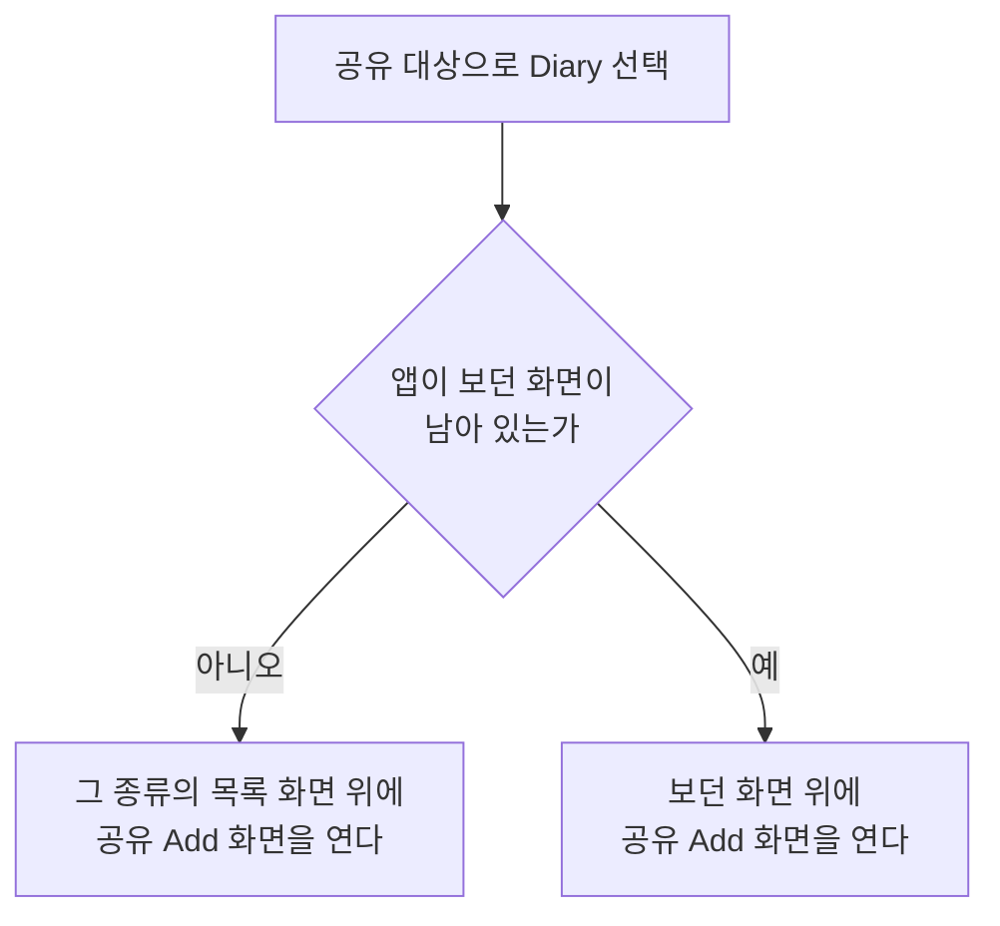
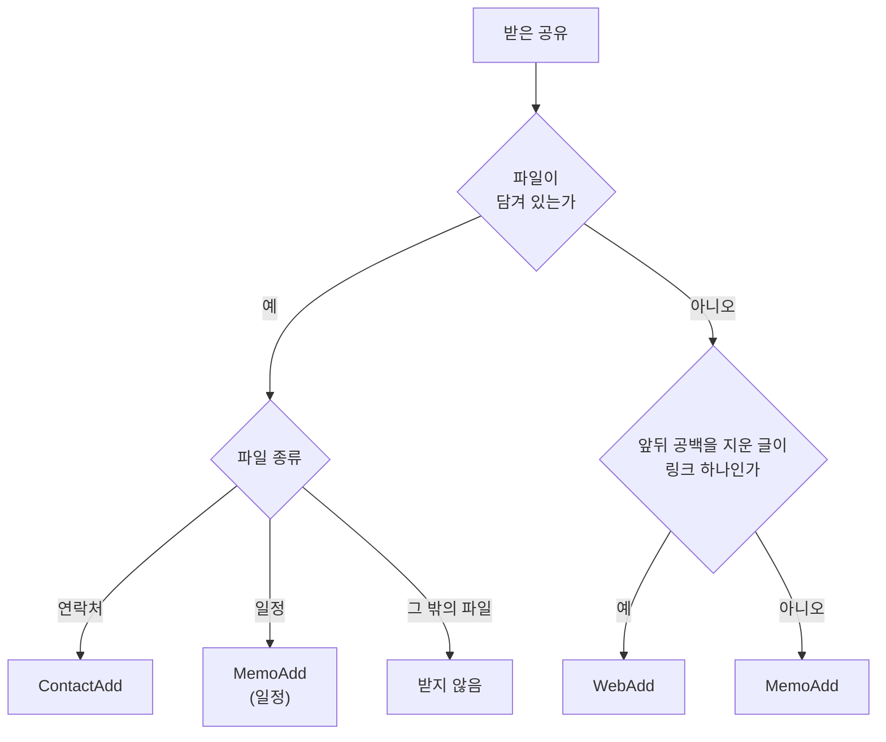

# 공유로 항목 추가 스펙

이 문서는 Android와 iOS에서 사용자가 다른 앱의 공유로 링크, 글, 연락처 또는 일정을 Diary에 보내면, 그 내용을 채운 항목 추가 화면이 열리는 것을 다룬다. 열린 화면의 입력과 추가 행동, 저장과 동기화는 각 화면 스펙과 [항목 추가 화면 공통 스펙](./entity-add.md)을 따르며, 이 문서에는 공유로 진입할 때만 다른 부분을 둔다.

이 문서에서 `공유 Add 화면`은 공유로 열린 [WebAdd 화면](./web-add.md), [MemoAdd 화면](./memo-add.md), [ContactAdd 화면](./contact-add.md)을 가리킨다.

디자인: [공유로 항목 추가 디자인](../../design/share-add.md)

이번 범위에서는 공유로 파일을 보관하는 [FileAdd 화면](./file-add.md)을 열지 않고, 사진과 스크린샷 같은 이미지를 받지 않으며, 지도 앱의 장소 공유를 장소로 추가하지 않는다.

## feature

### 공유 대상

Android와 iOS에서 사용자는 다른 앱의 공유에서 Diary를 공유 대상으로 고를 수 있다. 공유 대상에 보이는 이름은 [앱 이름 스펙](./app-name.md)을 따른다. Diary가 공유 대상에 나타나는 공유는 `domain > 받는 공유`를 따르며, 받지 않는 공유에서는 Diary가 공유 대상에 나타나지 않는다.

데스크톱과 웹에는 이 기능이 없다.

### 공유 Add 화면 열기

사용자가 Diary를 고르면 Diary 앱이 열리고, `domain > 공유 내용과 여는 화면`이 정한 화면이 공유 내용을 채운 상태로 보인다. 채우는 값은 `domain`의 화면별 채우기를 따른다. 공유만으로 항목이 추가되지는 않으며, 사용자는 채워진 내용을 확인하거나 고친 뒤 추가를 실행한다.

iOS에서는 다른 앱 위에 공유 시트가 잠깐 나타났다가 Diary 앱으로 넘어간다. Diary 앱을 열지 못하면 공유 시트에 Diary를 열지 못했다고 알리고, 사용자가 확인하면 공유 시트가 닫힌다. 이때 공유 내용은 남기지 않으므로 사용자는 다시 공유해야 한다. 공유 내용이 너무 길어 Diary 앱에 넘길 수 없을 때도 같다.

Android에서 공유 내용이 `domain > 받는 공유`의 크기 한도를 넘으면 공유 Add 화면을 열지 않고, 사용자가 공유하던 앱에 머문 채 공유한 내용이 너무 길다고 알린다.

공유 대상에 Diary가 나타났지만 `domain > 받는 공유`에 따라 받지 않는 공유이면 공유 Add 화면을 열지 않고 아무 안내 없이 끝난다.

### 화면이 열리는 자리

공유 Add 화면이 어디에 열리는지는 앱이 보던 화면이 남아 있는지에 따라 다르다.

- 앱을 새로 시작하면 아래 표의 화면 위에 공유 Add 화면을 연다. 공유 Add 화면에서 뒤로 가면 그 화면이 보인다.
- 앱이 보던 화면이 남아 있으면 앱이 앞으로 나오고 그 화면 위에 공유 Add 화면을 연다. 보던 화면은 닫지 않으므로 공유 Add 화면에서 뒤로 가면 공유하기 전에 보던 화면이 그대로 보인다. 보던 화면이 작성 중인 추가 화면이어도 같아서, 작성 중이던 내용은 그 화면에 그대로 남는다. 보던 화면이 같은 종류의 추가 화면이어도 그 위에 새로 연다.

| 여는 화면 | 앱을 새로 시작할 때 아래에 두는 화면 |
| --- | --- |
| WebAdd | [WebHome 화면](./web-home.md) |
| MemoAdd | [MemoHome 목록](./memo-home.md) |
| ContactAdd | [ContactHome 화면](./contact-home.md) |

공유 Add 화면은 목록에서 이어 진입한 화면이 아니므로, 목록과 상세를 함께 사용하는 환경에서도 [목록·상세 배치 공통 스펙](./list-detail-pane.md)의 `배치에 참여하는 화면`에 따라 어느 목록·상세 배치에도 참여하지 않고 단독으로 표시한다. 앱을 새로 시작해 위 표의 화면 위에 연 경우와, 그 항목의 목록을 보던 중에 공유한 경우도 같다.

### 공유 Add 화면에서의 행동

공유 Add 화면의 입력, 추가 실행, 추가 성공과 실패, 다른 화면으로 이어지는 입력은 각 화면 스펙을 그대로 따른다. 추가에 성공하면 다른 경로로 연 추가 화면과 같이 화면을 유지한 채 입력을 비운다.

사용자가 공유 Add 화면에서 뒤로 가면 `화면이 열리는 자리`에서 아래에 둔 화면이 보이며, 작성 중이던 내용은 남기지 않는다.

### 작성 상태 유지

공유로 채운 값은 사용자가 입력한 값과 같이 다룬다. 화면이 회전하거나 시스템에 의해 재생성될 때와 시스템이 앱을 메모리에서 정리한 뒤 복원할 때 무엇을 유지하고 복원하는지는 각 화면 스펙의 작성 상태 유지 대상을 따른다.

앱을 종료한 뒤 다시 열면 공유 Add 화면을 다시 열지 않는다.

## domain

### 받는 공유

Diary는 한 번에 하나를 공유할 때만 공유 대상에 나타난다. 여러 개를 한 번에 공유하면 나타나지 않는다. 사진 여러 장을 함께 공유하는 경우가 여기에 해당한다.

받는 공유는 다음과 같다. 여기에 없는 파일은 받지 않는다.

| 공유 | 예 |
| --- | --- |
| 글 | 브라우저의 링크 공유, 메모 앱의 글 공유 |
| 연락처 파일 | 연락처 앱의 연락처 공유 |
| 일정 파일 | 캘린더 앱의 일정 공유 |

공유 하나에 파일과 글이 함께 담겨 오면 파일을 기준으로 판단하고 글은 쓰지 않는다. 그 파일이 받지 않는 파일이면 글이 있어도 받지 않는다.

받는 공유이더라도 받은 글이 비어 있거나, 연락처·일정 파일의 내용이 비어 있거나 읽을 수 없으면 받지 않는다.

운영체제가 공유 대상을 정하는 방식 때문에 받지 않는 공유에도 Diary가 공유 대상에 나타나는 경우가 있다. Android에서는 글 파일처럼 글과 같은 형식으로 알려지는 파일이나 이미지와 글이 함께 담긴 공유가, iOS에서는 글 파일이나, 이미지나 그 밖의 받지 않는 파일과 글이 함께 담긴 공유가 여기에 해당한다. 이런 공유는 받지 않는다.

Android에서는 받은 글과 공유 제목, 또는 연락처·일정 파일의 글이 UTF-8 기준으로 64KiB를 넘으면 받지 않는다. 받은 내용을 앱 화면에 넘길 수 있는 크기의 한도이며, 메모 수십 쪽 분량이다.

### 공유 내용과 여는 화면

공유 내용에 따라 다음 화면 하나를 연다. 사용자가 여는 화면을 고르는 단계는 없다.

| 공유 내용 | 여는 화면 |
| --- | --- |
| 링크 하나로만 이루어진 글 | WebAdd |
| 그 밖의 글 | MemoAdd |
| 연락처 파일 | ContactAdd |
| 일정 파일 | MemoAdd |
| 그 밖의 파일 | 열지 않음 |

글이 링크 하나로만 이루어졌는지는 글의 앞뒤 공백 문자를 지운 뒤 판단한다. 지운 글이 `http://` 또는 `https://`로 시작하고 공백 문자와 줄바꿈을 포함하지 않으면 링크 하나로만 이루어진 글이다. 영문 대소문자는 구분하지 않는다. YouTube나 지도 앱의 링크도 같은 기준으로 판단하므로 WebAdd를 연다. 글 안에 링크가 섞여 있어도 링크 하나로만 이루어지지 않았으면 MemoAdd를 연다.

### 공유 제목

다른 앱은 공유하는 내용과 함께 제목을 보낼 수 있다. 예를 들어 브라우저는 링크와 함께 페이지 제목을 보낸다. 공유 제목이 비어 있거나 공백 문자로만 이루어져 있으면 공유 제목이 없는 것으로 본다. 공유 제목은 앞뒤 공백 문자를 지워 쓴다.

공유 제목은 글을 공유할 때만 쓴다.

### 공통 시작 상태

공유 Add 화면은 태그를 하나도 고르지 않은 상태로 시작한다. MemoAdd는 대표 태그와 웹, 연락처, 장소 선택도 없는 상태로 시작한다.

아래 화면별 채우기가 정하지 않은 입력과 입력 초점은 그 화면에 처음 진입한 상태와 같다. MemoAdd의 컬러에는 다른 경로로 진입할 때와 같이 무작위 컬러가 제시된다.

### WebAdd 채우기

URL에는 앞뒤 공백 문자를 지운 글을 채운다. 공유 제목이 있으면 제목에 채우고, 없으면 제목은 비워 둔다. 설명과 요청 헤더는 비어 있다.

### 글로 MemoAdd 채우기

공유 제목이 있으면 제목에 공유 제목을, 설명에 받은 글 전체를 그대로 채운다.

공유 제목이 없으면 받은 글의 앞뒤에 있는 공백 문자와 빈 줄을 지운 뒤, 첫 줄을 앞뒤 공백 문자를 지워 제목에 채우고 첫 줄 뒤의 나머지를 그대로 설명에 채운다. 글 가운데의 빈 줄은 지우지 않는다. 나머지가 없으면 설명은 비워 둔다.

| 받은 글 | 제목 | 설명 |
| --- | --- | --- |
| `내일 10시 회의` | `내일 10시 회의` | 비어 있음 |
| `장보기`, `우유`, `계란` 세 줄 | `장보기` | `우유`, `계란` 두 줄 |

기간은 선택되지 않은 상태로 시작한다.

### quoted-printable로 적힌 값

연락처 파일과 일정 파일의 속성에 `ENCODING=QUOTED-PRINTABLE` 또는 `QUOTED-PRINTABLE` 매개변수가 있으면 그 값은 `=XX` 형식을 풀어 UTF-8 글자로 읽는다. 줄이 `=`로 끝나면 그 `=`를 빼고 다음 줄을 이어서 읽는다. 아래 화면별 채우기는 이렇게 푼 값을 읽는다.

| 파일에 적힌 줄 | 읽은 값 |
| --- | --- |
| `FN;CHARSET=UTF-8;ENCODING=QUOTED-PRINTABLE:=ED=99=8D=EA=B8=B8=EB=8F=99` | `홍길동` |

이 기준은 공유로 받은 파일에만 적용하며 [QrAdd 화면](./qr-add.md)에는 적용하지 않는다.

### 일정으로 MemoAdd 채우기

일정 파일에 일정이 여러 개 있으면 첫 일정만 쓴다. 일정의 글자 값을 읽는 방법은 [QrAdd 화면 스펙](./qr-add.md)의 `포맷 입력 읽기`에서 연락처와 일정의 글자 값을 읽는 기준을 따른다. 반복 일정의 반복 규칙과 알림은 쓰지 않으며, 일정 안에 담긴 알림의 제목과 설명도 일정의 제목과 설명으로 읽지 않는다.

- 제목: 일정 제목.
- 설명: 일정 설명. 일정에 장소가 있으면 설명 뒤에 줄을 바꿔 `장소: ` 뒤에 장소를 이은 줄을 붙인다. 설명이 없으면 장소 줄만 채운다.
- 기간: 일정의 시작과 종료. 날짜만 있는 일정은 종일 기간이며 종료일은 일정 종료의 하루 전이다. 시각이 있는 일정은 날짜·시간 기간이며, 일정에 시간대가 적혀 있으면 기기의 현재 시간대로 바꾼 날짜와 시각을 쓰고, 적혀 있지 않거나 적힌 시간대를 알 수 없으면 적힌 날짜와 시각 그대로 쓴다.

일정에 종료가 없거나 종료가 시작보다 이르면 종료는 시작과 같다. 일정에 시작이 없으면 기간은 선택되지 않은 상태로 시작한다.

### 연락처로 ContactAdd 채우기

연락처 파일에 연락처가 여러 개 있으면 첫 연락처만 쓴다. 연락처의 글자 값을 읽는 방법과 이름을 정하는 방법은 [QrAdd 화면 스펙](./qr-add.md)의 `포맷 입력 읽기`에서 연락처를 읽는 기준을 따른다.

- 이름: 위 기준으로 정한 이름. 없으면 비워 둔다.
- 전화번호: 연락처의 전화번호를 적힌 순서대로 모두 채운다. 앞뒤 공백 문자를 지운 뒤 비어 있는 번호는 채우지 않는다.
- 생일: 연락처의 생일에 연, 월, 일이 모두 있으면 그 날짜를 양력 생일로 채우고, 태어난 연도는 [ContactAdd 화면 스펙](./contact-add.md)의 `태어난 연도`에 따라 생일의 연도가 된다.
- 설명: ContactAdd에 입력이 없는 값을 다음 순서로 한 줄씩 채운다. 각 값은 여러 개면 적힌 순서대로 모두 채우고, 없는 값의 줄은 빼고 채운다.

| 순서 | 값 | 채우는 줄 |
| --- | --- | --- |
| 1 | 메모 | 메모 내용 그대로 |
| 2 | 이메일 | `이메일: ` 뒤에 이메일 |
| 3 | 회사 | `회사: ` 뒤에 회사 |
| 4 | 주소 | `주소: ` 뒤에 주소 |
| 5 | 웹사이트 | `웹사이트: ` 뒤에 웹사이트 |
| 6 | 연도 없는 생일 | `생일: ` 뒤에 `M월 D일` 형식의 월과 일 |

회사와 주소는 [QrAdd 화면 스펙](./qr-add.md)의 `포맷 입력 읽기`에서 회사와 주소를 정하는 기준을 따른다.

연락처의 생일을 날짜로 읽을 수 없으면 생일은 채우지 않고 설명에 `생일: ` 뒤에 적힌 값을 그대로 이은 줄을 6번 자리에 채운다.

키, 신발 사이즈, 고향과 알게 된 경로는 비어 있다.

## 참고

- [Receive simple data from other apps | Android Developers](https://developer.android.com/training/sharing/receive)
- [Share | App Extension Programming Guide](https://developer.apple.com/library/archive/documentation/General/Conceptual/ExtensibilityPG/Share.html)
