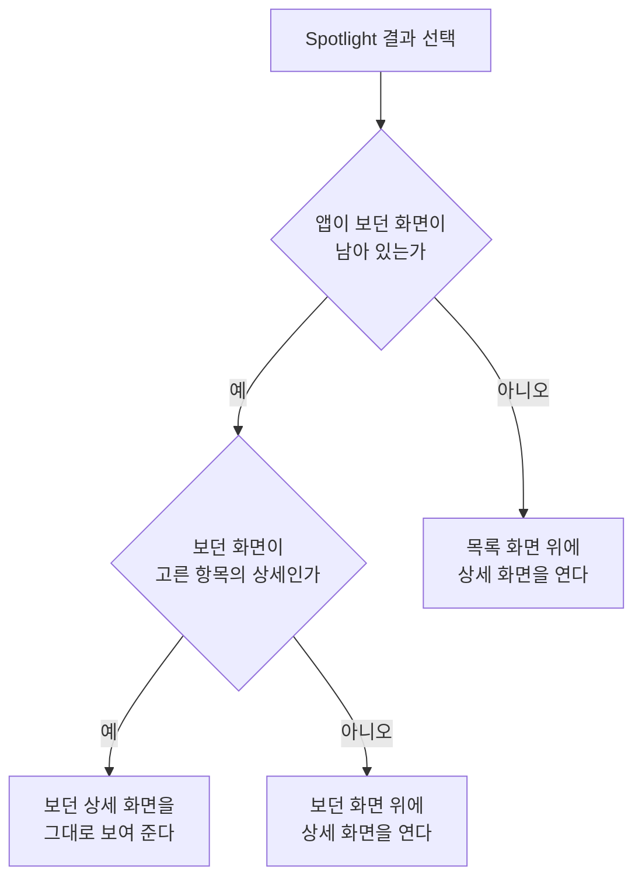

# Spotlight 항목 노출 스펙

이 문서는 iOS에서 사용자가 앱을 열지 않고 Spotlight 검색으로 앱의 항목을 찾고, 고른 항목을 앱에서 여는 것을 다룬다. 운영체제의 AI 도우미와 단축어가 앱의 동작을 실행하는 것은 [앱 동작 제공 스펙](./app-action.md)에서 다룬다.

## feature

### 항목 찾기

iOS에서 사용자는 Spotlight 검색에서 앱의 메모, 태그, 장소, 웹 항목, 연락처, 체크리스트, QR, 곡, 디데이, 루틴을 찾을 수 있다. 어떤 항목이 나타나는지는 `domain > 노출 대상`을, 무엇으로 찾을 수 있는지는 `domain > 담는 정보`를 따른다. 검색어와 항목을 맞춰 보는 방법과 결과의 순서는 운영체제가 정한다.

Android, 데스크톱과 웹에는 이 기능이 없다.

### 고른 항목 열기

사용자가 Spotlight 결과에서 항목을 고르면 앱이 열리고 그 항목의 상세 화면이 보인다.

| 항목 | 상세 화면 | 앱을 새로 시작할 때 상세 아래에 두는 화면 |
| --- | --- | --- |
| 메모 | [MemoDetail 화면](./memo-detail.md) | [MemoHome 목록](./memo-home.md) |
| 태그 | [TagDetail 화면](./tag-detail.md) | [TagHome 목록](./tag-home.md) |
| 장소 | [PlaceDetail 화면](./place-detail.md) | [PlaceHome 화면](./place-home.md) |
| 웹 | [WebDetail 화면](./web-detail.md) | [WebHome 화면](./web-home.md) |
| 연락처 | [ContactDetail 화면](./contact-detail.md) | [ContactHome 화면](./contact-home.md) |
| 체크리스트 | [ChecklistDetail 화면](./checklist-detail.md) | [ChecklistHome 화면](./checklist-home.md) |
| QR | [QrDetail 화면](./qr-detail.md) | [QrHome 화면](./qr-home.md) |
| 곡 | [MusicDetail 화면](./music-detail.md) | [PlaylistHome 화면](./playlist-home.md) |
| 디데이 | [DDayDetail 화면](./dday-detail.md) | [DDayHome 화면](./dday-home.md) |
| 루틴 | [RoutineDetail 화면](./routine-detail.md) | [RoutineHome 화면](./routine-home.md) |

상세 화면이 어디에 열리는지는 앱이 보던 화면이 남아 있는지와 보던 화면이 무엇인지에 따라 다르다.

- 앱을 새로 시작하면 위 표의 화면 위에 상세 화면을 연다. 상세에서 뒤로 가면 그 화면이 보인다.
- 앱이 보던 화면이 남아 있으면 앱이 앞으로 나오고 그 화면 위에 상세 화면을 연다. 보던 화면은 닫지 않으므로 상세에서 뒤로 가면 Spotlight에서 고르기 전에 보던 화면이 그대로 보인다.
- 보던 화면이 고른 항목의 상세 화면이면 상세 화면을 하나 더 쌓지 않고 보던 화면을 그대로 보여 준다.

Spotlight 결과에서 골라 연 상세 화면은 목록에서 이어 진입한 화면이 아니므로, 목록과 상세를 함께 사용하는 환경에서도 [목록·상세 배치 공통 스펙](./list-detail-pane.md)의 `배치에 참여하는 화면`에 따라 어느 목록·상세 배치에도 참여하지 않고 단독으로 표시한다. 앱을 새로 시작해 위 표의 화면 위에 연 경우와, 그 항목의 목록이나 완료 목록을 보던 중에 고른 경우도 같다. 목록과 상세를 함께 보던 중에 골랐으면 상세에서 뒤로 갔을 때 목록과 상세 영역에 고르기 전의 화면이 그대로 놓여 있다.

열린 상세 화면의 내용과 행동은 각 상세 화면 스펙을 따른다. 고른 항목을 현재 계정에서 조회할 수 없으면 [항목 상세 화면 공통 스펙](./entity-detail.md)의 `조회 상태`를 따른다.

## domain

### 노출 대상

Spotlight에는 현재 계정과 연결되어 있고 삭제되지 않은 메모, 태그, 장소, 웹 항목, 연락처, 체크리스트, QR, 곡, 디데이, 루틴이 나타난다. 현재 계정은 로그인한 사용자이면 그 사용자, 로그인하지 않았으면 게스트다. 계정 조회 규칙은 [계정 조회 스펙](./account.md)을 따르며, 현재 계정을 확인할 수 없으면 어떤 항목도 나타나지 않는다.

완료 여부는 노출 대상을 가르지 않는다. 완료된 메모, 완료된 태그와 완료된 루틴도 나타난다. 종료일이 지났거나 다가오는 날짜가 없는 디데이도 나타난다. 시작 전인 루틴도 나타난다. 목록 화면의 노출 기준과 사용자가 앱에서 고른 목록 필터는 적용하지 않는다.

기기에 남아 있는 다른 계정의 항목은 나타나지 않는다.

### 담는 정보

Spotlight에는 항목마다 다음 정보를 담고, 사용자는 이 정보로 항목을 찾는다.

| 항목 | 담는 정보 |
| --- | --- |
| 메모 | 제목, 설명 |
| 태그 | 이모지, 제목, 설명 |
| 장소 | 제목, 설명, 주소 |
| 웹 | 제목, 설명, URL |
| 연락처 | 이름, 설명 |
| 체크리스트 | 제목, 설명 |
| QR | 제목, 설명 |
| 곡 | 제목, 가수 |
| 디데이 | 제목, 설명 |
| 루틴 | 제목, 설명 |

메모, 태그, 장소, 웹, 연락처, 디데이, 루틴은 [검색어 일치 판정 스펙](./search-match.md)의 판정 대상 값과 같다. QR에 담긴 내용은 와이파이 비밀번호처럼 남에게 보이면 안 되는 값일 수 있으므로 담지 않는다.

메모, 태그, 장소, 디데이, 루틴은 앱 안의 목록처럼 색으로 항목을 구분할 수 있도록 그 항목의 컬러를 아이콘 색으로 함께 담는다. 아이콘 색은 결과를 보여 주는 데만 쓰며 검색어로 찾는 대상이 아니다.

이 밖의 값과 항목 사이의 연결은 담지 않는다. 루틴 기록과 루틴의 카드 문구도 담지 않는다.

## data

### 반영 시점

기기에 저장된 항목이 바뀌면 사용자가 아무것도 하지 않아도 Spotlight에 반영된다. 앱 화면에서 바꾼 것, [앱 동작](./app-action.md)으로 바꾼 것, 다른 기기에서 바꿔 동기화로 내려받은 것이 모두 같다. 항목이 삭제되면 Spotlight에서 빠지고, 삭제를 되돌리면 다시 나타난다. 운영체제가 반영하는 데 시간이 걸려 잠시 늦게 보일 수 있다.

계정이 바뀌면 이전 계정의 항목은 Spotlight에서 빠지고 바뀐 계정의 항목이 나타난다. 로그아웃해 게스트가 되거나 계정을 탈퇴한 경우도 같다.

앱이 시작되어 현재 계정이 확인되면, Spotlight에 나타나는 항목을 그 계정의 노출 대상과 맞춘다.

### 기기 안의 자료

Spotlight에 담는 정보는 이 기기에 저장된 항목에서 가져오며, 서버에 따로 조회하지 않는다. 다른 기기에서 바꾼 내용은 이 앱이 동기화한 뒤부터 나타난다.

사용자가 iOS 설정에서 이 앱의 Spotlight 검색 노출을 끄면 운영체제의 설정을 따르며, 앱은 따로 처리하지 않는다.

## 참고

- [Core Spotlight | Apple Developer Documentation](https://developer.apple.com/documentation/corespotlight)
