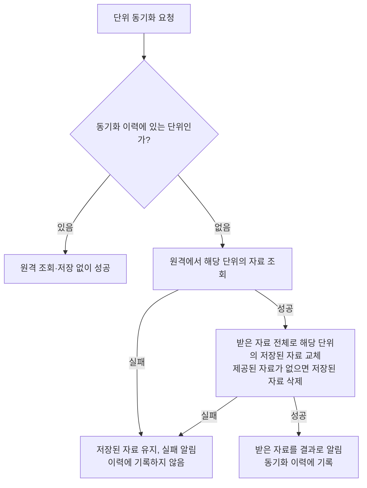

# 연도별 자료 동기화 스펙

이 문서는 연도별로 원격에서 받아 기기에 저장해 두는 자료의 동기화와 기기 보관 공통 규칙을 다룬다. 어떤 자료를 어디서 받는지, 동기화 단위, 이력을 두는 이유, 보관 규칙의 차이는 각 자료의 스펙이 정한다. 사용자에게 직접 노출되는 화면이나 사용자 행동은 없으므로 `feature` 영역은 생략한다.

## domain

### 동기화 단위

동기화 요청은 연도 하나를 대상으로 한다. 이력과 저장은 자료마다 정한 동기화 단위로 다루며, 공휴일은 국가·연도, 음력 자료는 연도가 단위다.

한 단위의 동기화가 성공하면 그 단위의 원격 자료 전체가 해당 단위의 최신 자료로 간주된다.

### 자료를 제공하지 않는 연도

원격은 요청한 단위의 자료를 제공하지 않을 수 있다. 그 단위의 자료 자체가 없어 조회 결과가 없는 경우와 자료는 받았지만 담긴 항목이 하나도 없는 경우를 구분하지 않고, 둘 다 자료를 제공하지 않는 것으로 본다.

자료를 제공하지 않는 단위의 동기화도 성공으로 끝나며, 동기화 결과에는 빈 자료가 담긴다. 따라서 동기화를 요청한 쪽은 원격에서 받아오지 못한 실패와 원격이 그 연도의 자료를 제공하지 않은 성공을 결과로 구분할 수 있다.

### 동기화 이력

앱을 실행한 동안 동기화에 성공한 단위는 더 이상 동기화가 필요하지 않은 것으로 본다.

이력에는 동기화에 성공한 단위만 기록한다. 자료를 제공하지 않는 단위도 동기화에 성공한 것이므로 함께 기록한다. 동기화에 실패한 단위는 기록하지 않으므로 다음 동기화 계기에 다시 시도한다.

동기화 이력은 앱을 실행한 동안만 유지한다. 앱을 다시 실행하면 이력이 비워지고 모든 단위를 다시 동기화할 수 있다.

한 단위의 이력은 다른 단위의 동기화 여부에 영향을 주지 않는다.

### 동기화 실패 보고

동기화 실패는 오류 보고 대상이다. 보고 방식은 [기능 실패 로깅 스펙](./usecase-failure-logging.md)의 오류 보고를 따른다.

원격 조회 실패와 기기 저장 실패 중 무엇이 실패했는지는 보고에 담긴 실패 원인으로 구분한다.

자료를 제공하지 않는 연도로 끝난 동기화는 성공이므로 오류 보고 대상이 아니다.

## data

### 동기화 처리

단위마다 동기화 요청은 이력 여부에 따라 다음과 같이 처리된다.

### 재조회 생략

단위가 이미 동기화 이력에 있으면 원격 조회와 저장 없이 성공으로 끝낸다. 사용자는 이미 저장된 그 단위의 자료를 그대로 본다.

이때 동기화 결과로는 그 단위의 기기에 저장된 자료를 알린다. 따라서 재조회를 생략해도 요청한 쪽은 그 연도의 자료가 제공되는지 결과로 판단할 수 있다.

### 진행 중인 요청

동기화를 요청하는 화면은 계기가 생길 때마다 필요한 연도를 요청한다. 다만 그 화면이 이미 요청해 진행 중인 연도를 다시 요청하지 않을지는 각 화면의 스펙이 정한다.

같은 단위의 동기화가 이미 진행 중이면 새로 원격 조회하지 않고 진행 중인 동기화가 끝나기를 함께 기다린다. 진행 중이던 동기화가 성공했으면 함께 기다린 요청은 `재조회 생략`에 따라 원격 조회 없이 끝난다. 진행 중이던 동기화가 실패했으면 그 단위는 이력에 기록되지 않았으므로, 함께 기다린 요청이 이어서 원격 조회를 다시 시도한다.

서로 다른 단위의 동기화는 서로 기다리지 않고 동시에 진행될 수 있다.

### 원격 자료 저장

동기화 이력에 없는 단위는 그 단위의 자료를 원격에서 조회한다.

원격 조회가 성공하면 받은 자료 전체로 그 단위의 저장된 자료를 교체한다. 지우기와 새로 저장하기는 한 번에 이루어진다. 원격이 해당 단위의 자료를 제공하지 않으면 그 단위의 저장된 자료를 지운다.

저장까지 성공하면 해당 단위를 동기화 이력에 기록하고, 받은 자료를 동기화 결과로 알린다.

한 단위의 동기화는 다른 단위의 저장된 자료에 영향을 주지 않는다.

### 실패 처리

원격 조회에 실패하면 그 단위의 저장된 자료를 바꾸지 않고 실패로 끝낸다.

원격 조회 후 저장에 실패하면 실패로 끝내고, 해당 단위의 기존에 저장된 자료는 유지한다.

실패한 단위는 동기화 이력에 기록하지 않으므로, 다음 동기화 요청에서 다시 원격 조회한다.

### 기기 보관

Android, iOS, 데스크톱 앱에서는 기기에 저장한 자료가 앱을 다시 실행해도 남아 있다. 웹에서는 자료를 열려 있는 페이지 안에만 두므로 페이지를 새로 열면 비워지고, 다음 동기화 계기에 다시 받아 온다.

기기에 저장한 자료는 사용자 계정과 무관하다. 로그인하거나 로그아웃하거나 다른 계정으로 바꿔도 저장된 자료는 그대로이고 서버와 동기화하지 않는다.

사용자가 저장된 자료를 직접 지우는 수단은 없다. 저장된 자료는 `원격 자료 저장`에 따라 같은 단위를 다시 받아 올 때와 앱 업데이트로 저장 형식이 바뀔 때 바뀌며, 그 밖에 바뀌는 경우가 있으면 자료의 스펙이 정한다.

앱 업데이트로 저장 형식이 바뀌면 기기에 저장된 자료를 비우고 다음 동기화 계기에 다시 받아 온다.

## 이 문서를 참조하는 문서

- [공휴일 동기화 스펙](./holiday-fetch.md): 국가·연도 단위, 적용 국가별 동기화
- [기기에 저장한 공휴일 스펙](./holiday-database.md): 기기 보관
- [음력 자료 동기화 스펙](./lunar-fetch.md): 연도 단위
- [CalendarHome 스펙](./calendar-home.md): 진행 중인 요청
- [CalendarTimetable 화면 스펙](./calendar-timetable.md): 진행 중인 요청
- [HolidayHome 화면 스펙](./holiday-home.md): 진행 중인 요청, 재조회 생략
