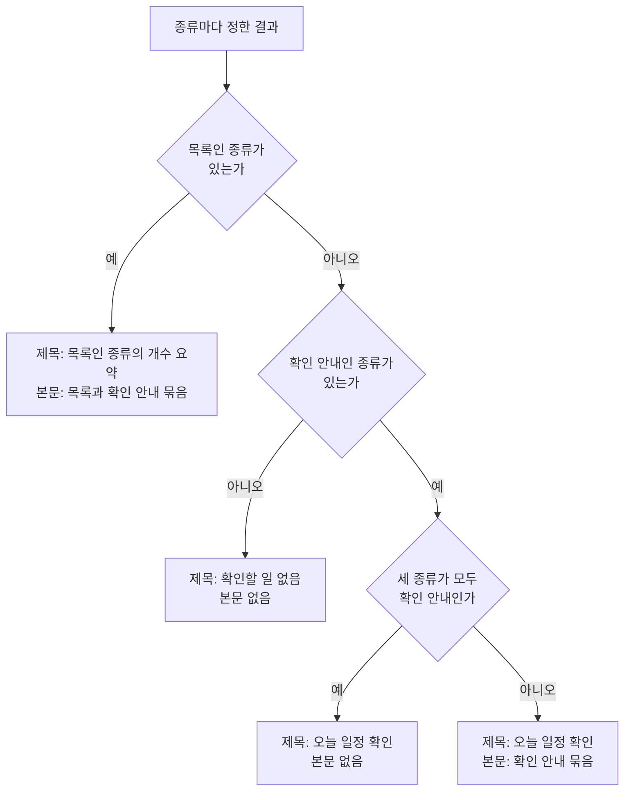

# 일일 알림 스펙

이 문서는 서버가 보내고 기기가 표시하는 일일 알림에 담기는 정보와 그 의미를 다룬다. 서버와 앱은 이 문서의 의미대로 알림을 만들고 표시한다.

무엇을 언제 누구에게 보내는지는 [일일 알림 스펙(server)](../server/daily-notification.md)이, 기기가 알림을 표시하고 사용자가 알림으로 앱을 여는 것은 [일일 알림 스펙(client)](../client/daily-notification.md)이 소유한다. 문구와 아이콘, 알림 분류의 이름은 [일일 알림 디자인](../../design/daily-notification.md)이 소유한다.

## domain

### 알림 내용

알림 내용은 오늘의 메모, 오늘의 루틴, 오늘의 디데이를 종류마다 정한 결과로 만든다. 각 종류의 기준은 [일일 알림 스펙(server)](../server/daily-notification.md)의 `오늘의 메모`, `오늘의 루틴`, `오늘의 디데이`를 따른다.

종류마다 결과는 다음 세 가지 중 하나다.

| 종류의 결과 | 뜻 |
| --- | --- |
| 목록 | 그 종류의 오늘의 항목이 1개 이상 있다 |
| 없음 | 그 종류의 오늘의 항목이 하나도 없다 |
| 확인 안내 | 서버가 그 종류의 오늘의 항목을 정하지 못했다 |

세 종류의 결과로 제목과 본문을 다음과 같이 정한다.

| 경우 | 제목 | 본문 |
| --- | --- | --- |
| 목록인 종류가 하나 이상 있다 | 목록인 종류마다 개수를 알리는 요약 | 목록인 종류와 확인 안내인 종류의 묶음 |
| 목록인 종류가 없고, 세 종류가 모두 없음이다 | 확인할 일이 없다는 문구 | 없음 |
| 목록인 종류가 없고, 확인 안내인 종류가 있으며 세 종류가 모두 확인 안내는 아니다 | 오늘 일정을 확인하라는 문구 | 확인 안내인 종류의 묶음 |
| 세 종류가 모두 확인 안내다 | 오늘 일정을 확인하라는 문구 | 없음 |

없음인 종류는 제목의 요약과 본문 어디에도 나타나지 않는다. 확인 안내인 종류는 제목의 요약에 넣지 않고 본문의 묶음으로만 알린다.

본문의 묶음은 메모, 루틴, 디데이 순으로 놓는다. 목록인 종류의 묶음에는 그 종류의 오늘의 항목을 순서대로 하나씩 담는다. 메모는 제목을, 루틴은 제목과 이번 주기의 진행을, 디데이는 제목과 그 날의 문구를 담는다. 확인 안내인 종류의 묶음에는 그 종류를 앱에서 확인하라는 안내 하나만 담는다.

제목과 본문은 서버가 기기의 등록 언어로 완성해 보낸다. 앱은 받은 제목과 본문을 고치거나 다시 만들지 않고 그대로 표시한다.

### 알림에 담기는 정보

알림에는 제목과 본문 외에 다음 정보를 함께 담는다.

| 정보 | 뜻 |
| --- | --- |
| 같은 날 알림 식별 값 | 모든 일일 알림이 같은 값을 가진다. 기기는 같은 값을 가진 알림이 새로 오면 앞서 표시한 알림을 새 알림으로 대신한다. |
| 도착 기한 | 알림이 발생한 날이 기기 시간대로 끝나는 시각. 이 시각까지 기기에 도착하지 못한 알림은 버린다. |
| 알림 분류 | Android에서 이 알림을 표시할 알림 분류. 앱이 같은 분류를 미리 만들어 두며, 사용자가 시스템 설정에서 이 분류만 끌 수 있다. |
| 알림 아이콘 | Android에서 알림에 쓸 작은 아이콘. 앱이 같은 아이콘을 가지고 있다. |
| 열 화면 | 사용자가 알림을 선택했을 때 앱이 열 화면. 일일 알림은 늘 알림이 발생한 날을 하루 형식으로 표시하는 시간표를 가리키며, 그 날짜를 함께 담는다. 알림이 발생한 날은 [일일 알림 스펙(server)](../server/daily-notification.md)의 `오늘의 메모`를 따른다. |

열 화면은 Android와 iOS에 같은 값으로 담는다. 열 화면을 알아보지 못하는 앱은 이 정보를 무시하고 특정 화면으로 이동하지 않은 채 앱만 연다. 알림을 선택했을 때 앱이 화면을 여는 방법은 [일일 알림 스펙(client)](../client/daily-notification.md)의 `알림에서 앱 열기`가 소유한다.

## 참고

- [Firebase Cloud Messaging: 메시지 유형](https://firebase.google.com/docs/cloud-messaging/concept-options)
- [Apple: apns-collapse-id](https://developer.apple.com/documentation/usernotifications/sending-notification-requests-to-apns)
