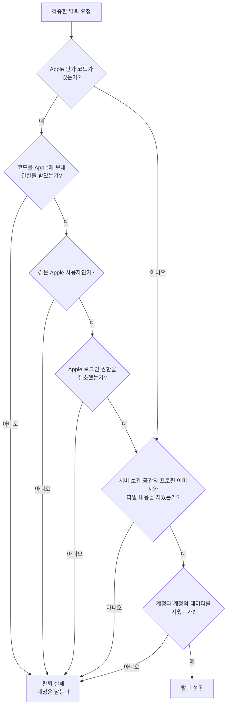

# 계정 탈퇴 스펙

이 문서는 서버가 탈퇴 요청을 검증하고, Apple 로그인 권한을 취소하고, 계정과 그 계정의 데이터를 지우는 처리를 다룬다.

앱과 서버가 주고받는 요청과 결과의 약속은 [계정 탈퇴 스펙(common)](../common/account-deletion.md)을, 앱이 탈퇴를 요청하고 결과를 반영하는 흐름은 [계정 탈퇴 스펙(client)](../client/account-deletion.md)을 따른다.

## domain

### 지우는 것

탈퇴에 성공하면 서버에서 다음이 지워진다.

- 계정과 계정 이메일, 로그인 정보와 이 계정에 연결된 로그인 수단
- 서버 보관 공간에 있는 이 계정의 프로필 이미지
- 이 계정이 올린 파일의 내용과 파일 정보
- 이 계정과 항목·연결 사이의 연결. [데이터 동기화 스펙(common)](../common/data-sync.md)의 `동기화 대상` 열여섯 종류가 모두 해당한다.
- 이 계정과의 연결을 지운 뒤 어떤 계정과도 연결되지 않은 항목과 연결. 다른 계정과도 연결된 항목과 연결은 남기고 이 계정과의 연결만 지운다.
- 이 계정에 연결된 푸시 알림 수신 등록

지운 것은 보관하지 않는다.

### Apple 로그인 권한 취소

요청에 Apple 인가 코드가 있으면 서버는 탈퇴하기 전에 그 코드로 Apple에서 이 앱의 Apple 로그인 권한을 받아 취소한다. 취소하면 사용자의 Apple 계정 설정에서 이 앱이 Apple 로그인을 쓰는 앱 목록에서 빠진다.

요청에 Apple 인가 코드가 없으면 Apple 로그인 권한을 취소하지 않고 탈퇴한다. Apple 재인증이 필요한지는 앱이 정하며 그 기준은 [계정 탈퇴 스펙(client)](../client/account-deletion.md)의 `domain > Apple 재인증 필요 여부`를 따른다.

## data

### 요청 검증

서버는 다음을 모두 만족하는 요청만 처리한다. 하나라도 어기면 아무것도 지우지 않고 요청을 거절한다.

- 인증된 로그인 세션으로 보낸 요청이다.
- Apple 인가 코드를 보냈다면 이 앱의 Apple 식별 값도 함께 보냈고, 그 값이 서버가 아는 이 앱의 값이다. 서버가 아는 값은 [로그인 스펙(server)](./login.md)의 `인증 결과 검증`에서 이 앱으로 인정하는 Apple 발급 대상과 같다.
- Apple 인가 코드를 Apple에 보내 받은 신원 증명이, 세션의 계정에 연결된 Apple 로그인과 같은 Apple 사용자의 것이다. 세션의 계정에 Apple 로그인이 연결되어 있지 않거나 다른 Apple 사용자의 코드이면 거절한다.

### 처리 순서

서버는 다음 순서로 처리한다.

어느 단계에서 실패해도 그 뒤 단계는 진행하지 않고 실패를 돌려주며, 계정은 지우지 않는다. 이미 끝난 앞 단계는 되돌리지 않는다.

- Apple 로그인 권한을 취소한 뒤 실패하면 권한은 취소된 채 남는다. 사용자가 다음에 Apple 로그인을 하면 Apple이 다시 동의를 받는다.
- 서버 보관 공간의 내용을 지운 뒤 실패하면 지운 프로필 이미지와 파일 내용은 돌아오지 않는다. 파일 정보는 남아 목록에 보이지만 내용을 내려받을 수 없다.

사용자가 다시 탈퇴를 요청하면 처음 단계부터 다시 처리한다. 이미 지운 것을 다시 지우는 것은 실패가 아니다.

계정과 계정의 데이터를 지우는 마지막 단계는 한 번에 처리되며, 일부만 지워진 채로 남지 않는다.

실패는 서버 오류 기록으로 남긴다.

### 서버 보관 공간에서 지우는 범위

서버 보관 공간에서는 이 계정의 프로필 이미지 자리와 파일 자리에 있는 것을 모두 지운다. 프로필 이미지는 마지막으로 반영된 것뿐 아니라 이전 반영에서 지우지 못하고 남은 것도 함께 지운다.
