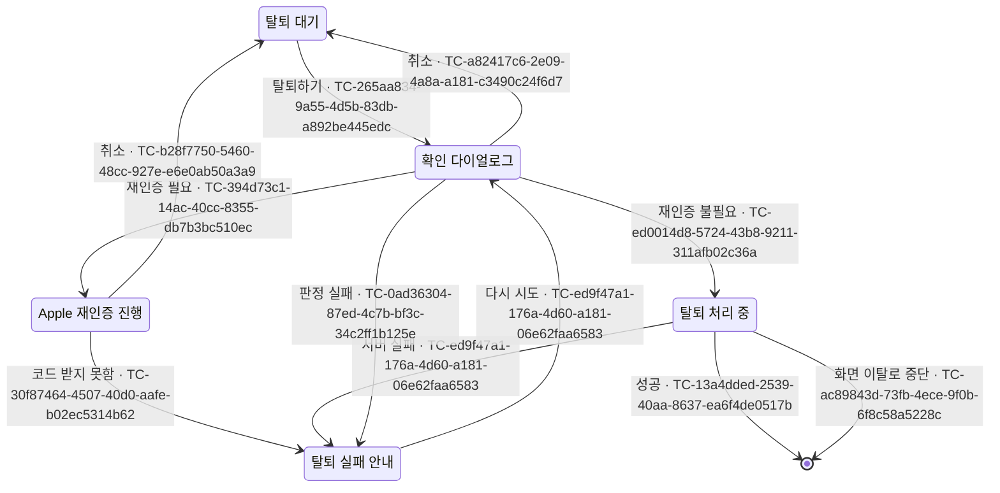

# 계정 탈퇴 테스트 케이스

기준 스펙: [계정 탈퇴(client)](../spec/client/account-deletion.md), [계정 탈퇴(common)](../spec/common/account-deletion.md), [계정 탈퇴(server)](../spec/server/account-deletion.md)

탈퇴는 Profile 화면에서 시작하므로 화면 케이스의 Given은 Profile 화면을 기준으로 한다.

## feature

### TC-265aa834-9a55-4d5b-83db-a892be445edc: 탈퇴하기를 선택하면 확인 다이얼로그가 열린다

- 근거: `feature > 탈퇴 확인`
- Given: Profile 화면이 표시되어 있다.
- When: 사용자가 `탈퇴하기`를 선택한다.
- Then: 탈퇴하면 계정과 서버의 모든 데이터가 지워져 되돌릴 수 없고 이 기기의 그 계정 데이터와 아직 반영되지 않은 변경도 지워진다는 안내가 담긴 탈퇴 확인 다이얼로그가 열리고, 탈퇴 요청은 이루어지지 않는다.

### TC-a82417c6-2e09-4a8a-a181-c3490c24f6d7: 다이얼로그에서 취소하거나 닫으면 아무것도 바뀌지 않는다

- 근거: `feature > 탈퇴 확인`
- Given: 탈퇴 확인 다이얼로그가 열려 있다.
- When: 사용자가 테스트 데이터의 방법으로 다이얼로그를 닫는다.
- Then: 다이얼로그가 닫히고 Apple 재인증과 탈퇴 요청이 이루어지지 않으며 Profile 화면이 그대로 표시된다.
- 테스트 데이터:

| 닫는 방법 |
| --- |
| 취소 선택 |
| 뒤로가기 |

### TC-ed0014d8-5724-43b8-9211-311afb02c36a: Apple 재인증이 필요하지 않으면 바로 탈퇴를 요청하고 다이얼로그에 진행 중을 표시한다

- 근거: `feature > 탈퇴 확인`, `feature > 탈퇴 처리`
- Given: 현재 로그인을 Google 로그인으로 완료했다는 기록이 있고, 탈퇴 요청의 응답이 오지 않도록 제어되어 있으며, 탈퇴 확인 다이얼로그가 열려 있다.
- When: 사용자가 탈퇴를 고른다.
- Then: 다이얼로그가 열린 채로 진행 중이 표시되고 취소를 고를 수 없으며, Apple 로그인 흐름은 시작되지 않고, Apple 인가 코드 없이 탈퇴 요청이 한 번 이루어진다.

### TC-2d841dee-ec2d-4eab-8783-63ab01d80be1: 탈퇴 진행 중에는 뒤로가기로 다이얼로그를 닫을 수 없다

- 근거: `feature > 탈퇴 확인`
- Given: 탈퇴 요청의 응답이 오지 않도록 제어되어 있고, 사용자가 확인 다이얼로그에서 탈퇴를 골라 진행 중이 표시되어 있다.
- When: 사용자가 테스트 데이터의 방법으로 다이얼로그를 닫으려 한다.
- Then: 다이얼로그와 진행 중 표시가 그대로 남고 탈퇴 요청은 한 번만 이루어진다.
- 테스트 데이터:

| 닫는 방법 |
| --- |
| 뒤로가기 |
| 다이얼로그 바깥 누름 |
| 물리 키보드의 `Esc` |

- 작성하지 않는 이유: 뒤로가기는 자동화한다. 다이얼로그 바깥 누름과 `Esc`는 현재 화면 테스트 환경에서 다이얼로그 창의 바깥 위치와 창에 전달되는 키 입력을 결정적으로 보낼 수 없어 자동화하지 않는다. 다이얼로그 창 바깥의 누름과 창의 키 입력을 보낼 수 있는 테스트 환경이 마련되면 작성한다.

### TC-394d73c1-14ac-40cc-8355-db7b3bc510ec: Apple 재인증이 필요하면 Apple 로그인 흐름을 거쳐 받은 인가 코드로 탈퇴를 요청한다

- 근거: `feature > Apple 재인증`, `data > 탈퇴 요청`
- Given: 현재 로그인을 Apple 로그인으로 완료했다는 기록이 있고, Apple 로그인 흐름이 인가 코드 `code-1`과 이 앱의 Apple 식별 값 `client-1`을 돌려주도록 제어되어 있으며, 탈퇴 확인 다이얼로그가 열려 있다.
- When: 사용자가 탈퇴를 고른다.
- Then: Apple 로그인 흐름이 한 번 시작되고, 그 뒤 `code-1`과 `client-1`을 담은 탈퇴 요청이 한 번 이루어진다.

### TC-b28f7750-5460-48cc-927e-e6e0ab50a3a9: Apple 재인증을 취소하면 탈퇴하지 않고 안내하지 않는다

- 근거: `feature > Apple 재인증`
- Given: Apple 재인증이 필요하고, Apple 로그인 흐름이 사용자 취소로 끝나도록 제어되어 있으며, 탈퇴 확인 다이얼로그가 열려 있다.
- When: 사용자가 탈퇴를 고른다.
- Then: 다이얼로그가 닫히고, 탈퇴 요청이 이루어지지 않으며, 실패 안내가 표시되지 않고, 두 동작을 다시 선택할 수 있다.

### TC-30f87464-4507-40d0-aafe-b02ec5314b62: Apple 인가 코드를 받지 못하면 탈퇴 실패를 안내한다

- 근거: `feature > Apple 재인증`
- Given: Apple 재인증이 필요하고, Apple 로그인 흐름이 인가 코드 없이 실패하도록 제어되어 있으며, 탈퇴 확인 다이얼로그가 열려 있다.
- When: 사용자가 탈퇴를 고른다.
- Then: 다이얼로그가 닫히고, 탈퇴 요청이 이루어지지 않으며, `탈퇴하지 못했습니다. 다시 시도해 주세요.`가 표시된다.

### TC-ed9f47a1-176a-4d60-a181-06e62faa6583: 서버가 탈퇴에 실패하면 실패를 안내하고 다시 시도할 수 있다

- 근거: `feature > 탈퇴 실패`
- Given: Apple 재인증이 필요하지 않고, 탈퇴 요청이 실패하도록 제어되어 있으며, 탈퇴 확인 다이얼로그가 열려 있다.
- When: 사용자가 탈퇴를 고른다.
- Then: 다이얼로그가 닫히고 `탈퇴하지 못했습니다. 다시 시도해 주세요.`가 표시되며, 기기의 계정 데이터 삭제와 로그아웃이 이루어지지 않으며, `탈퇴하기`를 다시 선택하면 확인 다이얼로그가 열린다.

### TC-4b46963d-1ea3-40d8-ae4b-66d54f4a4084: 로그인 세션이 갱신되지 않았으면 요청하지 않고 탈퇴 실패를 안내한다

- 근거: `feature > 탈퇴 실패`, `data > 탈퇴 요청`
- Given: 사용자 정보는 있지만 로그인 세션이 갱신되지 않은 상태이고, Apple 재인증이 필요하지 않으며, 탈퇴 확인 다이얼로그가 열려 있다.
- When: 사용자가 탈퇴를 고른다.
- Then: 탈퇴 요청이 이루어지지 않고 `탈퇴하지 못했습니다. 다시 시도해 주세요.`가 표시된다.

### TC-13a4dded-2539-40aa-8637-ea6f4de0517b: 탈퇴에 성공하면 안내 없이 로그아웃되어 화면이 닫힌다

- 근거: `feature > 탈퇴 성공`
- Given: Apple 재인증이 필요하지 않고, 탈퇴 요청이 성공하도록 제어되어 있으며, 탈퇴 확인 다이얼로그가 열려 있다.
- When: 사용자가 탈퇴를 고른다.
- Then: 이 기기의 계정 데이터가 지워지고 로그아웃되어 계정 상태가 게스트로 바뀌며, Profile 화면이 닫혀 이전 화면으로 돌아가고, 성공 안내는 표시되지 않는다.

### TC-ac89843d-73fb-4ece-9f0b-6f8c58a5228c: 탈퇴 진행 중 Profile 화면이 사라지면 탈퇴를 중단하고 결과를 반영하지 않는다

- 근거: `feature > 탈퇴 처리`
- Given: 탈퇴 요청이 진행 중이다.
- When: Profile 화면이 사라진 뒤 탈퇴 요청이 성공한다.
- Then: 이 기기의 계정 데이터를 지우지 않고 로그아웃하지 않으며, 실패를 안내하지 않는다.

### TC-ff12655f-9d05-45d5-941d-052f02a957c2: Apple 재인증 중 다이얼로그에서 탈퇴를 다시 고르면 새 흐름만 연다

- 근거: `feature > Apple 재인증`
- Given: Apple 재인증이 필요하고, 확인 다이얼로그에서 탈퇴를 골라 첫 Apple 로그인 흐름이 끝나지 않은 채 진행 중이다.
- When: 사용자가 다이얼로그에서 탈퇴를 다시 고르고, 그 뒤 두 흐름이 모두 인가 코드를 돌려준다.
- Then: 첫 흐름이 진행되는 동안 진행 중이 표시되지 않고 탈퇴를 고를 수 있으며, 새 흐름이 열리면 첫 흐름은 끝나고, 탈퇴 요청은 새 흐름의 인가 코드로 한 번만 이루어진다.

### TC-fdf51fd0-26c2-4877-a583-b9a9166aeecf: Apple 재인증 중 다이얼로그에서 취소하면 흐름을 끝내고 탈퇴하지 않는다

- 근거: `feature > Apple 재인증`
- Given: Apple 재인증이 필요하고, 확인 다이얼로그에서 탈퇴를 골라 Apple 로그인 흐름이 끝나지 않은 채 진행 중이다.
- When: 사용자가 테스트 데이터의 방법으로 다이얼로그를 닫고, 그 뒤 흐름이 인가 코드를 돌려준다.
- Then: 다이얼로그가 닫히고 탈퇴 요청이 이루어지지 않는다.
- 테스트 데이터:

| 닫는 방법 |
| --- |
| 취소 선택 |
| 뒤로가기 |
| 다이얼로그 바깥 누름 |
| 물리 키보드의 `Esc` |

- 작성하지 않는 이유: 취소 선택과 뒤로가기는 자동화한다. 다이얼로그 바깥 누름과 `Esc`는 현재 화면 테스트 환경에서 다이얼로그 창의 바깥 위치와 창에 전달되는 키 입력을 결정적으로 보낼 수 없어 자동화하지 않는다. 다이얼로그 창 바깥의 누름과 창의 키 입력을 보낼 수 있는 테스트 환경이 마련되면 작성한다.

### TC-1423165f-ffc3-4281-b7a0-13e4561f09ce: 로그인 수단 기록과 연결된 로그인 수단으로 Apple 재인증 필요 여부를 정한다

- 근거: `domain > Apple 재인증 필요 여부`
- Given: 현재 로그인 수단의 기록과 계정에 연결된 로그인 수단이 테스트 데이터와 같다.
- When: Apple 재인증이 필요한지 판정한다.
- Then: 테스트 데이터의 결과가 나온다.
- 테스트 데이터:

| 로그인 수단 기록 | 계정에 연결된 로그인 수단 | Apple 재인증 |
| --- | --- | --- |
| Apple 로그인 | Apple | 필요 |
| Google 로그인 | Google | 불필요 |
| Google 로그인 | Google, Apple | 불필요 |
| 없음 | Apple | 필요 |
| 없음 | Google, Apple | 필요 |
| 없음 | Google | 불필요 |

### TC-0ad36304-87ed-4c7b-bf3c-34c2ff1b125e: Apple 재인증 필요 여부를 판단하지 못하면 탈퇴를 요청하지 않고 실패를 안내한다

- 근거: `domain > Apple 재인증 필요 여부`
- Given: 로그인 수단 기록이나 저장된 사용자 정보를 읽지 못하도록 제어되어 있고, 탈퇴 확인 다이얼로그가 열려 있다.
- When: 사용자가 탈퇴를 고른다.
- Then: Apple 로그인 흐름과 탈퇴 요청이 이루어지지 않고 `탈퇴하지 못했습니다. 다시 시도해 주세요.`가 표시된다.

### TC-f002854c-6189-4577-b4fb-152dee7455c3: 탈퇴가 진행 중이면 새 탈퇴 요청을 처리하지 않는다

- 근거: `domain > 탈퇴 요청 제한`
- Given: 탈퇴 요청이 진행 중이고 응답이 오지 않도록 제어되어 있다.
- When: 같은 화면에서 탈퇴 확인이 한 번 더 전달된다.
- Then: 탈퇴 요청은 처음 한 번만 이루어진다.

### TC-364abafa-b866-4902-b128-c8a3799b563f: 탈퇴 실패 중 Apple 로그인 흐름의 오류만 오류 보고로 남긴다

- 근거: `domain > 탈퇴 실패 보고`
- Given: 탈퇴 결과가 테스트 데이터처럼 제어되어 있다.
- When: 사용자가 탈퇴를 확인한다.
- Then: 테스트 데이터대로 오류 보고가 남거나 남지 않는다.
- 테스트 데이터:

| 결과 | 오류 보고 |
| --- | --- |
| Apple 재인증의 Apple 로그인 흐름이 오류로 끝나 인가 코드를 받지 못함 | 남음 |
| Apple 재인증의 Apple 로그인 흐름이 오류 없이 인가 코드 없이 끝남 | 남지 않음 |
| Apple 재인증 사용자 취소 | 남지 않음 |
| Apple 재인증 필요 여부를 판단하지 못함 | 남지 않음 |
| 서버 처리 실패 | 남지 않음 |

### TC-c94e0258-ad3d-4541-af01-4070488bca25: 확인 다이얼로그는 화면이 재생성되어도 열린 상태를 유지하고 닫은 뒤에는 다시 열리지 않는다

- 근거: `domain > 실행 경계`
- Given: 테스트 데이터의 다이얼로그 상태다.
- When: 화면이 재생성된다.
- Then: 다이얼로그가 테스트 데이터의 상태로 표시된다.
- 테스트 데이터:

| 재생성 전 | 재생성 후 |
| --- | --- |
| 다이얼로그가 열려 있음 | 열려 있음 |
| 다이얼로그를 취소로 닫았음 | 닫혀 있음 |

### TC-fe336a0c-9832-488a-901e-eade609d22e5: Apple 재인증 중 화면이 재생성되면 흐름을 중단하고 안내 없이 탈퇴 대기로 돌아간다

- 근거: `domain > 실행 경계`
- Given: Apple 재인증 흐름이 진행 중이다.
- When: 화면이 재생성되고, 그 뒤 중단한 흐름이 인가 코드를 돌려준다.
- Then: 다이얼로그가 닫히고, 탈퇴 요청이 이루어지지 않으며, 실패 안내가 표시되지 않고, `탈퇴하기`를 다시 선택할 수 있다.

### TC-9c107475-8706-4131-a031-06dd7fd577b4: Apple 재인증 중 앱이 다시 시작되면 흐름을 중단하고 안내 없이 다이얼로그를 닫은 탈퇴 대기로 시작한다

- 근거: `domain > 실행 경계`
- Given: Apple 재인증 흐름이 진행 중이다.
- When: 앱이 다시 시작되어 Profile 화면이 다시 열린다.
- Then: 다이얼로그가 닫혀 있고, 탈퇴 요청이 이루어지지 않으며, 실패 안내가 표시되지 않고, `탈퇴하기`를 선택할 수 있다.

### TC-5b7e2c94-3d1a-4f68-9a0e-7c4d81b6e253: Apple 재인증 필요 여부를 판단하는 중 앱이 다시 시작되면 다이얼로그가 열린 채 복원되고 처리는 이어지지 않는다

- 근거: `domain > 실행 경계`
- Given: 테스트 데이터의 경로로 Apple 재인증이 필요한지 판단하는 중이고 판단 결과가 오지 않도록 제어되어 있다.
- When: 앱이 다시 시작되어 Profile 화면이 다시 열린다.
- Then: 확인 다이얼로그가 열려 있고 진행 중 표시가 없으며 탈퇴와 취소를 고를 수 있고, 탈퇴 요청은 이루어지지 않는다.
- 테스트 데이터:

| 판단에 이른 경로 |
| --- |
| 확인 다이얼로그에서 탈퇴를 처음 고름 |
| Apple 로그인 흐름이 진행되는 중 탈퇴를 다시 고름 |

### TC-c6f65655-042d-482c-8e05-bc07a3289ec6: Apple 재인증 필요 여부를 판단하는 중 화면이 재생성되면 판단을 이어 간다

- 근거: `domain > 실행 경계`
- Given: Apple 재인증이 필요한지 판단하는 중이고, 판단 결과가 테스트 데이터처럼 제어되어 있다.
- When: 화면이 재생성된 뒤 판단이 끝난다.
- Then: 판단하는 동안 탈퇴 진행 중이 계속 표시되고, 판단이 끝나면 테스트 데이터의 결과가 나온다.
- 테스트 데이터:

| 판단 결과 | 결과 |
| --- | --- |
| 재인증 필요 | Apple 로그인 흐름이 한 번 시작된다 |
| 재인증 불필요 | Apple 인가 코드 없이 탈퇴 요청이 한 번 이루어지고, 요청 중에는 진행 중이 표시되며 두 동작을 실행할 수 없다 |

### TC-01c0991e-d5bf-4e4a-9d1b-5713a21c8fe6: 탈퇴 처리 중 화면이 재생성되면 진행 중 표시가 이어진다

- 근거: `domain > 실행 경계`
- Given: 탈퇴 요청이 진행 중이고 응답이 오지 않도록 제어되어 있다.
- When: 화면이 재생성된다.
- Then: 탈퇴 진행 중이 계속 표시되고 탈퇴 요청은 다시 이루어지지 않는다.

### TC-6f5044df-99bd-4c87-ae5d-32cac969d642: 탈퇴 처리 중 앱이 다시 시작되면 다이얼로그가 열린 채 복원되고 처리는 이어지지 않는다

- 근거: `domain > 실행 경계`
- Given: 테스트 데이터의 경로로 시작한 탈퇴 요청이 진행 중이고 응답이 오지 않도록 제어되어 있다.
- When: 앱이 다시 시작되어 Profile 화면이 다시 열린다.
- Then: 확인 다이얼로그가 열려 있고 진행 중 표시가 없으며 탈퇴와 취소를 고를 수 있고, 탈퇴 요청은 다시 이루어지지 않는다.
- 테스트 데이터:

| 탈퇴 요청에 이른 경로 |
| --- |
| Apple 재인증 없이 요청 |
| Apple 재인증으로 인가 코드를 받아 요청 |

### TC-99f22181-eeaf-4512-a2be-4958af49c4d9: 화면을 떠났다 다시 들어오면 이전 실패 안내 없이 탈퇴 대기로 시작한다

- 근거: `domain > 실행 경계`
- Given: 탈퇴에 실패해 실패 안내가 표시된 적이 있다.
- When: 사용자가 Profile 화면을 떠났다가 다시 들어온다.
- Then: 실패 안내와 진행 중 표시 없이 두 동작을 선택할 수 있다.

## data

### TC-649f316c-b797-4ee8-bcde-3ef39857c274: 로그인을 완료하면 그 수단을 기록하고 로그아웃하면 지운다

- 근거: `data > 로그인 수단 기록`
- Given: 로그인 수단 기록이 없다.
- When: 테스트 데이터의 행동을 한다.
- Then: 로그인 수단 기록이 테스트 데이터와 같다.
- 테스트 데이터:

| 행동 | 기록 |
| --- | --- |
| Google 로그인 완료 | Google 로그인 |
| Apple 로그인 완료 | Apple 로그인 |
| Apple 로그인 완료 뒤 로그아웃 | 없음 |

### TC-afe16b84-85ac-4d0d-89a1-4b11cfeed28a: 앱 세션 설정에 실패한 로그인은 수단을 기록하지 않는다

- 근거: `data > 로그인 수단 기록`
- Given: 로그인 수단 기록이 Google 로그인이고, 서버가 Apple 로그인 세션을 발급한 뒤 앱 세션 설정이 실패하도록 제어되어 있다.
- When: Apple 로그인을 시도한다.
- Then: 로그인 수단 기록은 Google 로그인 그대로다.

### TC-e64cb655-d2fc-4b69-942a-20e3ad112f67: 탈퇴에 성공하면 그 계정의 기기 데이터와 마지막 동기화 시각, 로그인 수단 기록을 지운 뒤 로그아웃한다

- 근거: `data > 이 기기에서 지우는 것`
- Given: 계정 A의 항목과 연결, 동기화 상태, 필터 선택, 마지막 동기화 시각과 로그인 수단 기록이 있고, 게스트 데이터와 다른 계정 B의 데이터도 있으며, 탈퇴 요청이 성공하도록 제어되어 있다.
- When: 계정 A가 탈퇴한다.
- Then: 계정 A의 기기 데이터, 마지막 동기화 시각, 로그인 수단 기록이 지워지고 로그아웃되며, 게스트 데이터와 계정 B의 데이터는 그대로 남는다.

### TC-892a1660-772e-408f-ad0e-c99ca15aefba: 기기 데이터를 지우지 못해도 로그아웃하고 탈퇴를 성공으로 처리하며 오류 보고는 남기지 않는다

- 근거: `data > 이 기기에서 지우는 것`
- Given: 오류 보고 기록 수단이 등록되어 있고, 탈퇴 요청이 성공하며 이 기기의 계정 데이터 삭제가 실패하도록 제어되어 있다.
- When: 사용자가 탈퇴를 확인한다.
- Then: 로그아웃되어 계정 상태가 게스트로 바뀌고, 탈퇴 실패 안내는 표시되지 않으며, 오류 보고는 남지 않는다.

### TC-8f644268-bf99-49ba-9d69-db161bfe2ed8: 탈퇴 요청에는 Apple 재인증 여부에 따라 정해진 정보만 담는다

- 근거: `common > data > 탈퇴 요청`
- Given: 인증된 로그인 세션이 있다.
- When: 테스트 데이터의 조건으로 탈퇴를 요청한다.
- Then: 서버로 보내는 요청에는 테스트 데이터의 정보만 담긴다.
- 테스트 데이터:

| 조건 | 담는 정보 |
| --- | --- |
| Apple 재인증 없음 | 없음 |
| Apple 재인증으로 인가 코드 `code-1`, 식별 값 `client-1`을 받음 | `code-1`, `client-1` |

### TC-14907d46-2174-40dd-a015-c832d521d41c: Apple 웹 로그인 응답에서 인가 코드를 받는다

- 근거: `data > 탈퇴 요청`
- Given: Apple 웹 로그인으로 Apple 재인증을 시작했고, 앱으로 돌아온 응답이 테스트 데이터와 같다.
- When: 앱이 응답을 받는다.
- Then: 테스트 데이터의 결과가 나온다.
- 테스트 데이터:

| 응답 | 결과 |
| --- | --- |
| 이번 시도의 상태 값, 신원 증명, 인가 코드 | 인가 코드를 받음 |
| 이번 시도의 상태 값, 신원 증명, 인가 코드 없음 | 인가 코드를 받지 못함 |
| 다른 상태 값, 신원 증명, 인가 코드 | 인가 코드를 받지 못함 |
| 이번 시도의 상태 값, 취소 오류 | 사용자 취소 |

### TC-e411be28-d8eb-409a-946c-4ed82e93ab0c: 서버는 요청 검증을 통과하지 못한 탈퇴 요청을 거절하고 아무것도 지우지 않는다

- 근거: `server > data > 요청 검증`
- Given: 서버에 테스트 데이터의 탈퇴 요청이 도착한다.
- When: 서버가 요청을 처리한다.
- Then: 요청이 거절되고 계정과 데이터는 그대로 남는다.
- 테스트 데이터:

| 요청 |
| --- |
| 로그인 세션 없이 보낸 요청 |
| 인가 코드는 있지만 Apple 식별 값이 없는 요청 |
| 서버가 모르는 Apple 식별 값을 담은 요청 |
| 세션 계정에 연결된 Apple 사용자와 다른 Apple 사용자의 인가 코드 |
| Apple 로그인이 연결되지 않은 계정에서 보낸 인가 코드 |

- 작성하지 않는 이유: 서버 함수 실행 환경과 Apple의 응답이 있어야 판정할 수 있고, 그 환경은 저장소의 자동 검증 절차에 포함되어 있지 않다. Apple의 응답을 대신할 수 있는 서버 함수 테스트 러너가 검증 절차에 들어오면 자동화한다.

### TC-146c768a-052e-4df8-8c2c-957bb6c3fcf2: 탈퇴에 성공하면 계정과 이 계정만 쓰던 데이터가 지워지고 공유된 항목은 남는다

- 근거: `server > domain > 지우는 것`
- Given: 계정 A에 프로필 이미지, 올린 파일, 푸시 알림 수신 등록, A만 연결된 메모와 A와 B가 함께 연결된 메모가 있다.
- When: 계정 A가 탈퇴에 성공한다.
- Then: 계정 A, 프로필 이미지, 파일 내용과 정보, 수신 등록, A만 연결된 메모가 지워지고, A와 B가 함께 연결된 메모는 B와의 연결과 함께 남는다.
- 작성하지 않는 이유: 서버 데이터베이스와 보관 공간에서만 판정할 수 있고, 그 환경은 저장소의 자동 검증 절차에 포함되어 있지 않다. 서버 데이터베이스와 보관 공간을 조회하는 서버 테스트 환경이 검증 절차에 들어오면 자동화한다.

### TC-b8c72d38-e056-4569-b4ff-586a9fc51f11: 어느 단계에서 실패해도 계정을 지우지 않고 다시 요청하면 처음부터 처리한다

- 근거: `server > data > 처리 순서`
- Given: 서버의 탈퇴 처리가 테스트 데이터의 단계에서 실패하도록 제어되어 있다.
- When: 탈퇴를 요청하고, 실패한 뒤 실패 원인을 없애고 다시 요청한다.
- Then: 첫 요청은 실패로 끝나 계정이 남고, 다시 요청하면 처음 단계부터 처리되어 탈퇴에 성공한다.
- 테스트 데이터:

| 실패 단계 |
| --- |
| Apple 인가 코드로 권한을 받기 |
| Apple 로그인 권한 취소 |
| 보관 공간의 프로필 이미지와 파일 내용 지우기 |
| 계정과 계정의 데이터 지우기 |

- 작성하지 않는 이유: 서버 함수 실행 환경과 Apple, 보관 공간의 응답이 있어야 판정할 수 있고, 그 환경은 저장소의 자동 검증 절차에 포함되어 있지 않다. 각 단계의 실패를 제어할 수 있는 서버 함수 테스트 러너가 검증 절차에 들어오면 자동화한다.

### TC-f3cd9078-031a-47ba-99cb-d7514e9f6498: Apple 인가 코드가 없으면 Apple 로그인 권한을 취소하지 않고 탈퇴한다

- 근거: `server > domain > Apple 로그인 권한 취소`
- Given: Apple 로그인이 연결된 계정이 Apple 인가 코드 없이 탈퇴를 요청한다.
- When: 서버가 요청을 처리한다.
- Then: Apple에 권한 취소를 요청하지 않고 탈퇴에 성공한다.
- 작성하지 않는 이유: 서버 함수 실행 환경과 Apple의 응답이 있어야 판정할 수 있고, 그 환경은 저장소의 자동 검증 절차에 포함되어 있지 않다. Apple의 응답을 대신할 수 있는 서버 함수 테스트 러너가 검증 절차에 들어오면 자동화한다.

### TC-abd74240-12cf-4414-bc39-129ac3c5f34b: 서버 보관 공간에서는 이 계정의 프로필 이미지와 파일을 이전에 남은 것까지 모두 지운다

- 근거: `server > data > 서버 보관 공간에서 지우는 범위`
- Given: 계정 A의 프로필 이미지 자리에 마지막으로 반영된 이미지와 이전 반영에서 지우지 못하고 남은 이미지가 있고, 파일 자리에 올린 파일이 있다.
- When: 계정 A가 탈퇴에 성공한다.
- Then: 계정 A의 프로필 이미지 자리와 파일 자리에 있던 것이 모두 지워진다.
- 작성하지 않는 이유: 서버 보관 공간에서만 판정할 수 있고, 그 환경은 저장소의 자동 검증 절차에 포함되어 있지 않다. 서버 보관 공간을 조회하는 서버 테스트 환경이 검증 절차에 들어오면 자동화한다.

### TC-83700df8-7a6b-4047-8f00-255fb6bec16d: 서버는 탈퇴 실패를 서버 오류 기록으로 남긴다

- 근거: `server > data > 처리 순서`
- Given: 서버의 탈퇴 처리가 테스트 데이터의 단계에서 실패하도록 제어되어 있다.
- When: 탈퇴를 요청한다.
- Then: 요청은 실패로 끝나고 그 실패가 서버 오류 기록으로 남는다.
- 테스트 데이터:

| 실패 단계 |
| --- |
| Apple 인가 코드로 권한을 받기 |
| Apple 로그인 권한 취소 |
| 보관 공간의 프로필 이미지와 파일 내용 지우기 |
| 계정과 계정의 데이터 지우기 |

- 작성하지 않는 이유: 서버 함수 실행 환경과 서버 오류 기록, Apple과 보관 공간의 응답이 있어야 판정할 수 있고, 그 환경은 저장소의 자동 검증 절차에 포함되어 있지 않다. 각 단계의 실패와 서버 오류 기록을 확인할 수 있는 서버 함수 테스트 러너가 검증 절차에 들어오면 자동화한다.

### TC-36692e3f-65c8-439d-9df7-277f2c51f20d: 탈퇴한 계정과 같은 이메일로 다시 로그인하면 새 계정이 만들어지고 이전 데이터는 이어지지 않는다

- 근거: `common > domain > 탈퇴`
- Given: 이메일 `diary@example.com`의 계정이 탈퇴해 서버에서 지워졌다.
- When: 같은 이메일 `diary@example.com`으로 로그인하고 서버가 검증에 성공한다.
- Then: 새 계정이 만들어지고, 탈퇴한 계정의 데이터는 이어지지 않는다.
- 작성하지 않는 이유: 서버가 계정을 정하는 규칙이어서 실제 인증 제공자의 사용자 상태와 서버 데이터베이스가 있어야 판정할 수 있고, 그 환경은 저장소의 자동 검증 절차에 포함되어 있지 않다. 인증 제공자의 응답을 대신하고 서버 데이터베이스의 계정을 확인할 수 있는 서버 테스트 환경이 검증 절차에 들어오면 자동화한다.

### TC-91ecaa04-ad9f-4feb-b7db-051d50173669: 계정이 탈퇴하면 같은 계정으로 로그인한 다른 기기는 게스트가 되고 그 계정의 기기 데이터는 남는다

- 근거: `client > domain > 다른 기기`, `common > data > 탈퇴 결과`
- Given: 같은 계정으로 로그인한 두 기기가 있고, 한 기기에서 탈퇴에 성공했다.
- When: 다른 기기가 로그인 세션을 갱신하려 한다.
- Then: 로그인 세션을 갱신하지 못해 그 기기의 계정 상태가 게스트가 되고, 그 기기에 남은 그 계정의 데이터는 로그아웃했을 때처럼 남는다.
- 작성하지 않는 이유: 실제 인증 제공자의 세션 갱신 응답과 서로 다른 두 기기가 있어야 판정할 수 있고, 그 환경은 저장소의 자동 검증 절차에 포함되어 있지 않다. 탈퇴 뒤 세션 갱신 응답을 제어하고 두 기기를 함께 다룰 수 있는 테스트 환경이 갖춰지면 자동화한다.
