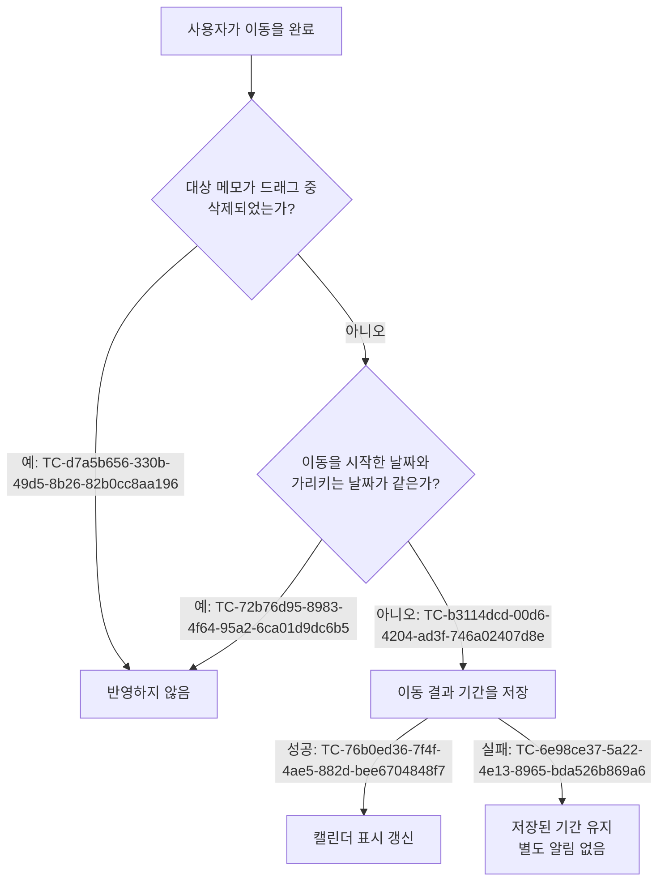

# 캘린더 메모 이동 테스트 케이스

기준 스펙: [캘린더 메모 이동 스펙](../spec/client/calendar-memo-move.md)

## feature

### TC-1f1b2cd2-aed7-4fdd-bcbf-8b158982e3cb: 메모 제목을 길게 누르면 메모 이동이 시작되고 날짜 기간 선택은 시작되지 않는다

- 근거: `feature > 이동 시작`
- Given: 캘린더 홈에 2026년 7월이 표시되어 있고, 7월 14일부터 7월 16일까지의 메모 `회의`가 표시되어 있다.
- When: 사용자가 7월 15일 위치의 `회의` 제목에서 길게 누르기를 시작한다.
- Then: `회의`의 이동이 시작되고, 선택된 날짜 기간은 생기지 않는다.

### TC-5fc067c9-d50f-40c0-9f27-bcb4895fbb0f: 아이템이 없는 날짜 칸에서 길게 누르면 기존과 같이 날짜 기간 선택이 시작된다

- 근거: `feature > 이동 시작`
- Given: 캘린더 홈에 2026년 7월이 표시되어 있고, 7월 14일부터 7월 16일까지의 메모 `회의`가 표시되어 있다.
- When: 사용자가 메모가 없는 7월 8일 날짜 칸에서 길게 누르기를 시작한다.
- Then: 7월 8일 하루가 선택되고 메모 이동은 시작되지 않는다.

### TC-9a27b012-7a38-4958-b1a1-f3ba32ce4611: 여러 주에 나뉜 조각 어느 것에서 시작해도 같은 메모의 이동이 시작된다

- 근거: `feature > 이동 시작`
- Given: 캘린더 홈에 2026년 7월이 표시되어 있고, 7월 15일부터 7월 22일까지의 메모 `여행`이 두 주에 나뉘어 표시되어 있다.
- When: 사용자가 둘째 조각인 7월 20일 위치의 `여행` 제목에서 길게 누른 뒤 7월 21일로 드래그해 완료한다.
- Then: `여행`의 기간이 7월 16일부터 7월 23일까지로 반영된다.

### TC-a1f4d97b-5997-4dea-982a-e8083ce4689b: 드래그로 가리키는 날짜를 바꾸면 옮겨질 기간이 즉시 갱신된다

- 근거: `feature > 드래그로 목적지 확인`
- Given: 캘린더 홈에 2026년 7월이 표시되어 있고, 사용자가 7월 15일 위치에서 7월 14일부터 7월 16일까지의 메모 `회의`의 이동을 시작했다.
- When: 사용자가 완료하지 않은 채 가리키는 날짜를 다음 주의 7월 22일로 바꾼다.
- Then: 옮겨질 기간이 7월 21일부터 7월 23일까지로 갱신되어 표시된다.

### TC-b3114dcd-00d6-4204-ad3f-746a02407d8e: 이동을 완료하면 날짜 차이만큼 옮겨진 기간이 반영된다

- 근거: `feature > 이동 완료`
- Given: 캘린더 홈에 2026년 7월이 표시되어 있고, 7월 14일부터 7월 16일까지의 종일 기간 메모 `회의`가 표시되어 있다.
- When: 사용자가 7월 15일 위치의 `회의` 제목에서 이동을 시작해 7월 22일로 드래그한 뒤 완료한다.
- Then: `회의`의 기간이 7월 21일부터 7월 23일까지의 종일 기간으로 반영되고, 캘린더의 `회의`가 바뀐 기간에 표시되며, 성공 안내는 표시되지 않는다.

### TC-72b76d95-8983-4f64-95a2-6ca01d9dc6b5: 이동을 시작한 날짜와 같은 날짜에서 완료하면 메모가 바뀌지 않는다

- 근거: `feature > 이동 완료`
- Given: 캘린더 홈에 2026년 7월이 표시되어 있고, 7월 14일부터 7월 16일까지의 메모 `회의`가 표시되어 있다.
- When: 사용자가 7월 15일 위치의 `회의` 제목에서 이동을 시작해 다른 날짜로 드래그하지 않은 채 완료한다.
- Then: `회의`의 기간과 수정 시각은 바뀌지 않고 캘린더 표시도 그대로 유지된다.

### TC-ac40ed6d-753d-4f36-8523-7c488476d434: 메모 이동을 시작하면 촉각 피드백을 받는다

- 근거: `feature > 이동 피드백`
- Given: 촉각 피드백을 제공하도록 설정된 기기에서 캘린더 홈에 2026년 7월이 표시되어 있고, 7월 14일부터 7월 16일까지의 메모 `회의`가 표시되어 있다.
- When: 사용자가 7월 15일 위치의 `회의` 제목에서 길게 누르기를 시작한다.
- Then: 이동 시작을 알리는 촉각 피드백이 한 번 제공된다.

### TC-898b3418-48fb-48cd-b47e-88e8ad3aafa4: 드래그로 옮겨질 기간이 달라지면 추가 촉각 피드백을 받는다

- 근거: `feature > 이동 피드백`
- Given: 촉각 피드백을 제공하도록 설정된 기기의 캘린더 홈에서 사용자가 7월 15일 위치에서 메모 `회의`의 이동을 시작해 시작 촉각 피드백을 받은 상태다.
- When: 사용자가 가리키는 날짜를 7월 16일로 바꿔 옮겨질 기간이 달라진다.
- Then: 기간 변경을 알리는 촉각 피드백이 한 번 더 제공된다.

### TC-5721518a-4dbd-4434-9d70-b38fd92db1be: 드래그해도 옮겨질 기간이 그대로이면 추가 촉각 피드백을 받지 않는다

- 근거: `feature > 이동 피드백`
- Given: 촉각 피드백을 제공하도록 설정된 기기의 캘린더 홈에서 사용자가 메모 `회의`의 이동을 시작해 시작 촉각 피드백을 받은 상태다.
- When: 사용자가 이동을 시작한 날짜 칸 안에서 드래그해 옮겨질 기간이 그대로 유지된다.
- Then: 추가 촉각 피드백이 제공되지 않는다.

### TC-ca9b5b21-578a-4898-9271-adce542ac2e8: 이동 중 오른쪽 가장자리 영역에 머무르면 다음 달로 이동하고 메모 이동이 유지된다

- 근거: `feature > 이동 중 달 이동`
- Given: 캘린더 홈에 2026년 7월이 표시되어 있고, 사용자가 7월 15일 위치에서 7월 14일부터 7월 16일까지의 메모 `회의`의 이동을 시작했다.
- When: 사용자가 현재 가리키는 위치를 오른쪽 가장자리 영역으로 옮겨 머무른다.
- Then: 캘린더가 2026년 8월로 이동하고, 메모 이동은 중단되지 않으며 이동한 달에서 가리키는 날짜를 기준으로 옮겨질 기간이 갱신된다.

### TC-0ea3f688-901f-4716-ace5-d65c30b61744: 이동 중 달 이동으로 옮겨질 기간이 달라지면 추가 촉각 피드백을 받는다

- 근거: `feature > 이동 피드백`
- Given: 촉각 피드백을 제공하도록 설정된 기기의 캘린더 홈에 2026년 7월이 표시되어 있고, 사용자가 7월 15일 위치에서 메모 `회의`의 이동을 시작해 시작 촉각 피드백을 받은 뒤 그 위치를 누르고 있다.
- When: 사용자가 메모를 누른 손가락을 그대로 둔 채 다른 손가락으로 왼쪽으로 스와이프해 2026년 8월로 이동하고, 옮겨질 기간이 이동한 달에서 가리키는 날짜 기준으로 달라진다.
- Then: 기간 변경을 알리는 촉각 피드백이 한 번 더 제공된다.

### TC-c7af792f-5fc5-48e8-954e-01ccd9f1f618: 손을 떼지 않고 이동이 끝나도 그 시점의 기간이 반영된다

- 근거: `feature > 이동 중단`
- Given: 캘린더 홈에 2026년 7월이 표시되어 있고, 7월 14일부터 7월 16일까지의 메모 `회의`가 표시되어 있다.
- When: 사용자가 7월 15일 위치의 `회의` 제목에서 이동을 시작해 7월 22일로 드래그한 뒤, 손을 떼지 않은 상태에서 화면 상태를 저장하지 않은 채 시스템이 조작을 끊는다.
- Then: `회의`의 기간이 7월 21일부터 7월 23일까지로 반영되고 이동 중이라는 표시는 남지 않는다.

### TC-576336d9-dffa-44e3-baea-39fbb5731d8b: 이동 중 다른 손가락으로 왼쪽으로 스와이프하면 다음 달로 이동하고 메모 이동이 유지된다

- 근거: `feature > 이동 중 달 이동`
- Given: 캘린더 홈에 2026년 7월이 표시되어 있고, 사용자가 7월 15일 위치에서 7월 14일부터 7월 16일까지의 메모 `회의`의 이동을 시작해 그 위치를 누르고 있다.
- When: 사용자가 메모를 누른 손가락을 그대로 둔 채 다른 손가락으로 캘린더의 다른 지점을 눌러 왼쪽으로 스와이프한다.
- Then: 캘린더가 2026년 8월로 이동하고, 메모 이동은 중단되지 않으며 이동한 달에서 가리키는 날짜를 기준으로 옮겨질 기간이 갱신된다.

### TC-b6890b14-a012-41d4-a29f-840dba2f2e0d: 스와이프한 손가락을 떼도 메모 이동이 이어지고 메모를 누른 손가락을 떼면 반영된다

- 근거: `feature > 이동 중 달 이동`
- Given: 캘린더 홈에 2026년 7월이 표시되어 있고, 사용자가 7월 15일 위치에서 7월 14일부터 7월 16일까지의 메모 `회의`의 이동을 시작해 다른 손가락의 스와이프로 2026년 8월로 이동한 상태다.
- When: 사용자가 스와이프한 손가락을 뗀 뒤 메모를 누른 손가락으로 8월 5일을 가리키고 그 손가락을 뗀다.
- Then: `회의`의 기간이 8월 4일부터 8월 6일까지로 반영된다.

### TC-f7258c37-0aa6-4e8a-93e5-57141acb0444: 공휴일 이름·생일·날씨 위에서 길게 누르면 날짜 기간 선택이 시작된다

- 근거: `feature > 이동 시작`, `domain > 이동 대상 메모`, [CalendarHome 스펙의 날짜 기간 선택으로 메모 추가 시작](../spec/client/calendar-home.md#날짜-기간-선택으로-메모-추가-시작)
- Given: 캘린더 홈에 2026년 7월이 표시되어 있고, 7월 14일부터 7월 16일까지의 메모 `회의`와 테스트 데이터의 아이템이 표시되어 있다.
- When: 사용자가 테스트 데이터의 아이템 위에서 길게 누르기를 시작한 뒤 손을 뗀다.
- Then: 길게 누르고 있는 동안 그 아이템이 놓인 날짜 하루가 선택되어 있고 메모 이동은 시작되지 않는다. 손을 떼면 그 하루의 기간으로 MemoAdd 화면 이동이 요청되고, 그 아이템을 눌렀을 때의 선택 결과는 실행되지 않는다.
- 테스트 데이터:

  | 아이템 | 놓인 날짜 | 실행되지 않는 선택 결과 |
  | --- | --- | --- |
  | 공휴일 이름 `제헌절` | 7월 17일 | 공휴일 이름 검색 결과 열기 |
  | 연락처 `홍길동`의 생일 | 7월 8일 | ContactDetail 화면 이동 |
  | 7월 21일의 날씨 | 7월 21일 | 날씨 검색 결과 열기 |

### TC-c545accb-63f2-4662-a6b1-714fcb2b5a0c: 이동 중 가장자리 영역에 머무는 동안 달 이동이 반복된다

- 근거: `feature > 이동 중 달 이동`
- Given: 캘린더 홈에 2026년 7월이 표시되어 있고, 사용자가 7월 15일 위치에서 7월 14일부터 7월 16일까지의 메모 `회의`의 이동을 시작해 오른쪽 가장자리 영역에 머물러 2026년 8월로 이동한 상태다.
- When: 사용자가 달 전환이 끝난 뒤에도 오른쪽 가장자리 영역에 계속 머무른다.
- Then: 캘린더가 2026년 9월로 한 번 더 이동하고, 메모 이동은 중단되지 않으며 9월에서 가리키는 날짜를 기준으로 옮겨질 기간이 갱신된다.

### TC-6b7c3697-cefd-48a6-945e-01bd023210fe: 같은 메모의 이동 결과를 저장하는 동안 다시 이동하면 반영하지 않는다

- 근거: `feature > 이동 완료`
- Given: 메모 하나의 이동 결과가 아직 저장 중이다.
- When: 사용자가 같은 메모를 다시 이동해 완료한다.
- Then: 두 번째 이동은 반영되지 않고 첫 번째 이동 결과만 저장된다.

## domain

`완료 시 판정`의 각 경로는 다음 케이스가 나누어 덮는다.

### TC-1f774dde-4798-4d35-a43b-77341c9e81c5: 완료된 메모도 이동할 수 있고 완료 상태는 바뀌지 않는다

- 근거: `domain > 이동 대상 메모`
- Given: 캘린더 홈에 2026년 7월이 표시되어 있고, 7월 14일부터 7월 16일까지의 완료된 메모 `회의`가 표시되어 있다.
- When: 사용자가 7월 15일 위치의 `회의` 제목에서 이동을 시작해 7월 17일로 드래그한 뒤 완료한다.
- Then: `회의`의 기간이 7월 16일부터 7월 18일까지로 반영되고 완료 상태는 그대로 유지된다.

### TC-df203968-ed19-4687-b1bc-e1ad1b912840: 시각이 있는 기간인 메모는 시각을 유지한 채 날짜만 바뀐다

- 근거: `domain > 이동 결과 기간`
- Given: 캘린더 홈에 2026년 7월이 표시되어 있고, 7월 14일 10시부터 7월 14일 11시까지의 메모 `면담`이 표시되어 있다.
- When: 사용자가 7월 14일 위치의 `면담` 제목에서 이동을 시작해 7월 16일로 드래그한 뒤 완료한다.
- Then: `면담`의 기간이 7월 16일 10시부터 7월 16일 11시까지로 반영된다.

### TC-484aef02-5606-47dc-a542-3c24a3b95f02: 드래그하는 동안 다른 경로로 기간이 바뀌어도 이동 시작 시점의 기간을 기준으로 반영한다

- 근거: `domain > 이동 결과 기간`
- Given: 캘린더 홈에 2026년 7월이 표시되어 있고, 사용자가 7월 15일 위치에서 7월 14일부터 7월 16일까지의 메모 `회의`의 이동을 시작했다.
- When: 드래그하는 동안 다른 경로로 `회의`의 기간이 7월 1일부터 7월 2일까지로 바뀌고, 사용자가 7월 22일로 드래그한 뒤 완료한다.
- Then: `회의`의 기간이 이동 시작 시점의 기간에 날짜 차이를 더한 7월 21일부터 7월 23일까지로 반영된다.

### TC-d7a5b656-330b-49d5-8b26-82b0cc8aa196: 드래그하는 동안 대상 메모가 삭제되면 완료해도 반영하지 않는다

- 근거: `domain > 완료 시 판정`
- Given: 캘린더 홈에 2026년 7월이 표시되어 있고, 사용자가 7월 15일 위치에서 7월 14일부터 7월 16일까지의 메모 `회의`의 이동을 시작했다.
- When: 드래그하는 동안 다른 경로로 `회의`가 삭제되고, 사용자가 7월 22일로 드래그한 뒤 완료한다.
- Then: `회의`의 기간 변경은 반영되지 않는다.

### TC-38cce223-e1eb-4114-bbaf-687a246129c4: 이동은 기간과 수정 시각만 바꾼다

- 근거: `domain > 이동으로 바뀌는 내용`
- Given: 캘린더 홈에 2026년 7월이 표시되어 있고, 제목·설명·컬러·태그 연결·대표 태그·장소 연결·웹 연결·연락처 연결이 저장된 7월 14일부터 7월 16일까지의 메모 `회의`가 표시되어 있다.
- When: 사용자가 7월 15일 위치의 `회의` 제목에서 이동을 시작해 7월 17일로 드래그한 뒤 완료한다.
- Then: `회의`의 기간이 7월 16일부터 7월 18일까지로 바뀌고 수정 시각이 반영 시점으로 기록되며, 제목, 설명, 컬러, 완료 여부, 삭제 여부, 생성 시각, 태그 연결과 대표 태그, 장소 연결, 웹 연결, 연락처 연결은 바뀌지 않는다.

### TC-fea6de20-9f70-4ad9-baa0-412e6fc7e41f: 이동 범위를 벗어나는 방향으로는 달이 이동하지 않고 메모 이동이 유지된다

- 근거: `domain > 이동 중 달 이동 기준`
- Given: 캘린더 홈에 이동 범위의 첫 달인 1년 1월이 표시되어 있고, 1월 안의 기간을 가진 메모 `회의`가 표시되어 있다.
- When: 사용자가 `회의` 제목에서 이동을 시작하고 이전 달 방향으로 조작한다.
- Then: 캘린더는 1년 1월을 그대로 유지하고 메모 이동도 중단되지 않는다.
- 테스트 데이터:

  | 이전 달 방향 조작 |
  | --- |
  | 현재 가리키는 위치를 왼쪽 가장자리 영역으로 옮겨 머무른다 |
  | 메모를 누른 손가락을 그대로 둔 채 다른 손가락으로 오른쪽으로 스와이프한다 |

### TC-d0132fd7-3f13-49ca-93bc-612aae47d2a6: 이웃 달에 속한 날짜 칸으로 완료하면 실제 날짜 그대로 반영된다

- 근거: `domain > 가리키는 날짜 해석`
- Given: 캘린더 홈에 2026년 6월이 표시되어 있고, 6월 23일부터 6월 24일까지의 메모 `회의`가 표시되어 있다. 2026년 6월 화면의 다섯째 주에는 7월 2일이 이웃 달 날짜로 표시된다.
- When: 사용자가 6월 23일 위치의 `회의` 제목에서 이동을 시작해 이웃 달 날짜인 7월 2일로 드래그한 뒤 완료한다.
- Then: `회의`의 기간이 7월 2일부터 7월 3일까지로 반영된다.

### TC-4d00ac00-6707-4bf3-830e-1a285d9f4e01: 화면이 재생성되면 이동 중 표시가 남지 않고 그 시점의 기간이 반영된다

- 근거: `domain > 유지 경계`, `feature > 이동 중단`
- Given: 캘린더 홈에서 사용자가 7월 15일 위치에서 7월 14일부터 7월 16일까지의 메모 `회의`의 이동을 시작해 7월 22일을 가리키고 있다.
- When: 화면이 재생성된다.
- Then: `회의`의 기간이 7월 21일부터 7월 23일까지로 반영되고 이동 중이라는 표시는 남지 않는다.

### TC-9cee0ad2-bc06-4ab7-b251-45577b45404d: 앱이 백그라운드로 이동해도 이동 중 표시가 남지 않고 그 시점의 기간이 반영된다

- 근거: `domain > 유지 경계`
- Given: 캘린더 홈에서 사용자가 7월 15일 위치에서 7월 14일부터 7월 16일까지의 메모 `회의`의 이동을 시작해 7월 22일을 가리키고 있다.
- When: 앱이 백그라운드로 이동해 화면 상태가 저장되고, 화면은 그대로 남은 채 메모를 누른 조작이 끊긴다.
- Then: 그 시점의 옮겨질 기간이 반영되고 이동 중이라는 표시는 남지 않는다.

### TC-159de65c-6255-4be1-9cb5-dca2982c36f1: 이동 중 다른 손가락으로 오른쪽으로 스와이프하면 이전 달로 이동한다

- 근거: `domain > 이동 중 달 이동 기준`
- Given: 캘린더 홈에 2026년 7월이 표시되어 있고, 사용자가 7월 15일 위치에서 메모 `회의`의 이동을 시작해 그 위치를 누르고 있다.
- When: 사용자가 메모를 누른 손가락을 그대로 둔 채 다른 손가락으로 캘린더의 다른 지점을 눌러 오른쪽으로 스와이프한다.
- Then: 캘린더가 2026년 6월로 이동하고 메모 이동은 중단되지 않는다.

### TC-06ba0904-ea09-4d4c-8977-42dd082f42e2: 한 번 누른 손가락의 스와이프로는 한 달만 이동한다

- 근거: `domain > 이동 중 달 이동 기준`
- Given: 캘린더 홈에 2026년 7월이 표시되어 있고, 사용자가 메모 `회의`의 이동을 시작한 뒤 다른 손가락으로 왼쪽으로 스와이프해 2026년 8월로 이동한 상태다.
- When: 사용자가 그 손가락을 떼지 않고 계속 왼쪽으로 움직인다.
- Then: 캘린더는 2026년 8월을 그대로 유지하고 메모 이동도 중단되지 않는다.

### TC-b716d1c6-e282-4c25-a95e-6bc00b9e51cd: 이동 중 다른 손가락으로 세로로 움직여도 달이 이동하지 않는다

- 근거: `domain > 이동 중 달 이동 기준`
- Given: 캘린더 홈에 2026년 7월이 표시되어 있고, 사용자가 메모 `회의`의 이동을 시작해 그 위치를 누르고 있다.
- When: 사용자가 메모를 누른 손가락을 그대로 둔 채 다른 손가락으로 캘린더의 다른 지점을 눌러 세로로 움직인다.
- Then: 캘린더는 2026년 7월을 그대로 유지하고 메모 이동도 중단되지 않는다.

### TC-4bcd39c8-f726-463f-85ac-fd8e11343187: 날짜 기간 선택 중에는 다른 손가락의 스와이프로 달이 이동하지 않는다

- 근거: `domain > 이동 중 달 이동 기준`
- Given: 캘린더 홈에 2026년 7월이 표시되어 있고, 사용자가 메모가 없는 7월 8일 날짜 칸에서 날짜 기간 선택을 시작해 그 위치를 누르고 있다.
- When: 사용자가 누른 손가락을 그대로 둔 채 다른 손가락으로 캘린더의 다른 지점을 눌러 왼쪽으로 스와이프한다.
- Then: 캘린더는 2026년 7월을 그대로 유지하고 7월 8일의 선택도 유지된다.

### TC-d46d5d52-57a0-44b6-9822-9c2cf7358486: 화면을 벗어나면 이동 중 표시가 남지 않고 그 시점의 기간이 반영된다

- 근거: `domain > 유지 경계`, `feature > 이동 중단`
- Given: 캘린더 홈에서 사용자가 7월 15일 위치에서 7월 14일부터 7월 16일까지의 메모 `회의`의 이동을 시작해 7월 22일을 가리키고 있다.
- When: 화면 상태를 저장하지 않은 채 캘린더 홈 화면이 사라진다.
- Then: `회의`의 기간이 7월 21일부터 7월 23일까지로 반영된다.

### TC-559372ab-af93-4be5-9843-e3d8c81baba3: 캘린더 밖으로 드래그해 완료하면 가장 가까운 날짜 칸을 기준으로 반영된다

- 근거: `domain > 가리키는 날짜 해석`
- Given: 캘린더 홈에 2026년 7월이 표시되어 있고, 7월 14일부터 7월 16일까지의 메모 `회의`가 표시되어 있다. 2026년 7월 화면의 마지막 주는 8월 2일부터 8월 8일까지다.
- When: 사용자가 7월 15일 수요일 위치의 `회의` 제목에서 이동을 시작해, 가리키는 위치를 같은 세로줄을 따라 캘린더 아래쪽 밖으로 옮긴 뒤 완료한다.
- Then: 캘린더 안에서 가장 가까운 날짜 칸인 마지막 주 수요일 8월 5일을 가리킨 것으로 보아, `회의`의 기간이 8월 4일부터 8월 6일까지로 반영된다.

### TC-b82d1ffa-84b8-40d4-a17e-001422f8ca19: 가장자리 영역 밖에서는 이동을 위한 드래그로 달이 이동하지 않는다

- 근거: `domain > 이동 중 달 이동 기준`
- Given: 캘린더 홈에 2026년 7월이 표시되어 있고, 사용자가 7월 15일 위치에서 메모 `회의`의 이동을 시작했다.
- When: 사용자가 가장자리 영역에 들어가지 않은 채 가리키는 날짜를 7월 17일로 바꾸고 기다린다.
- Then: 캘린더는 2026년 7월을 그대로 유지하고 메모 이동도 중단되지 않는다.

### TC-f708b40a-66eb-4c3a-a10d-02e536092758: 이동 중 왼쪽 가장자리 영역에 머무르면 이전 달로 이동하고 메모 이동이 유지된다

- 근거: `domain > 이동 중 달 이동 기준`
- Given: 캘린더 홈에 2026년 7월이 표시되어 있고, 사용자가 7월 15일 위치에서 7월 14일부터 7월 16일까지의 메모 `회의`의 이동을 시작했다.
- When: 사용자가 현재 가리키는 위치를 왼쪽 가장자리 영역으로 옮겨 머무른다.
- Then: 캘린더가 2026년 6월로 이동하고, 메모 이동은 중단되지 않으며 6월에서 가리키는 날짜를 기준으로 옮겨질 기간이 갱신된다.

## data

### TC-76b0ed36-7f4f-4ae5-882d-bee6704848f7: 이동을 완료하면 바뀐 기간과 수정 시각이 저장되어 기존 값을 덮어쓴다

- 근거: `data > 이동 결과의 저장`
- Given: 기기에 7월 14일부터 7월 16일까지의 기간을 가진 메모 `회의`가 저장되어 있고, 캘린더 홈에 2026년 7월이 표시되어 있다.
- When: 사용자가 7월 15일 위치의 `회의` 제목에서 이동을 시작해 7월 22일로 드래그한 뒤 완료한다.
- Then: 저장된 `회의`를 조회하면 기간이 7월 21일부터 7월 23일까지이고 수정 시각이 반영 시점으로 바뀌어 있다.

### TC-6e98ce37-5a22-4e13-8965-bda526b869a6: 저장에 실패하면 저장된 기간이 유지되고 별도로 알리지 않는다

- 근거: `data > 저장 실패`
- Given: 캘린더 홈에 2026년 7월이 표시되어 있고, 7월 14일부터 7월 16일까지의 메모 `회의`가 표시되어 있으며, 메모 저장이 실패하도록 제어되어 있다.
- When: 사용자가 7월 15일 위치의 `회의` 제목에서 이동을 시작해 7월 22일로 드래그한 뒤 완료한다.
- Then: 저장된 `회의`의 기간은 7월 14일부터 7월 16일까지로 유지되고, 캘린더도 그 기간으로 표시하며, 오류 안내는 표시되지 않는다.

### TC-2e31b168-4225-4335-9184-64ffab9ae811: 이동을 반영하면 서버와 맞추기 위한 동기화가 시작된다

- 근거: `data > 동기화`
- Given: 캘린더 홈에 2026년 7월이 표시되어 있고, 7월 14일부터 7월 16일까지의 메모 `회의`가 표시되어 있다.
- When: 사용자가 7월 15일 위치의 `회의` 제목에서 이동을 시작해 7월 22일로 드래그한 뒤 완료해 반영에 성공한다.
- Then: 변경을 서버와 맞추기 위한 동기화가 한 번 요청된다.

### TC-e477b826-b7ca-46c1-8e57-46b3ca303291: 동기화 요청이 실패해도 옮긴 기간은 유지된다

- 근거: `data > 동기화`
- Given: 기기에 7월 14일부터 7월 16일까지의 기간을 가진 메모 `회의`가 저장되어 있고, 서버와 맞추기 위한 동기화 요청이 실패하도록 제어되어 있다.
- When: 사용자가 `회의`를 7월 21일부터 7월 23일까지로 옮기는 이동을 완료한다.
- Then: 저장된 `회의`의 기간은 7월 21일부터 7월 23일까지로 바뀐 채 유지되고 이전 기간으로 되돌아가지 않는다.
